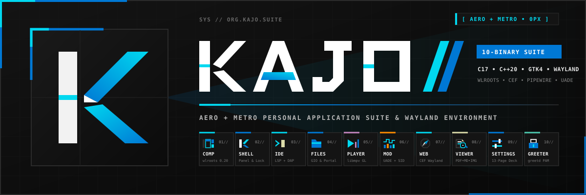

<p align="center">
  
</p>

# Kajo — Personal Native Application Suite & Wayland Environment

**Kajo** is a self-contained suite of lightweight, native C17 / GTK4 applications, a custom scrollable-tiling Wayland compositor (**`kajo-comp`**), and Wayland session components—built around a single, uncompromising visual and ergonomic vision with first-class support for both **`kajo-comp`** (`kajo.desktop`) and [Niri](https://github.com/niri-wm/niri) (`kajo-niri.desktop`).

---

## 🎯 Purpose & Philosophy

Kajo has evolved far beyond its origins as a simple Wayland panel or launcher. **Its purpose is not to be a generic, catch-all replacement for mainstream Linux desktop environments or mass-market applications.** Instead, Kajo is a **purpose-built, cohesive suite of tools engineered specifically for a personal workflow, Nordic keyboard ergonomics, and hardware setup**:

1. **A Unified "Aero + Metro" Design Language** ([`docs/design_system.md`](docs/design_system.md) • [`docs/ui-gallery.html`](docs/ui-gallery.html))
   - Rejects bloated, rounded toolkit defaults in favor of **strict `0px` sharp corner geometry**, OLED-native dark charcoal surfaces (`#111111`–`#1a1a1a`), `1px solid #2b2b2b` structural hairlines, live `@metro-accent` window framing, and high-density `Fira Code` monospace telemetry badges.
   - Every standalone application in the suite shares the exact same custom frameless window chrome, scrollable-tiling / floating compositor IPC (`🗗 FLOAT / TILE` across `kajo-comp` and Niri), and instant live CSS/accent hot-reload.
2. **Pure Native C17/C++20 Performance, Minimal Runtime Overhead**
   - Core desktop components (`kajo-comp`, `kajo`, `kajo-ide`, `kajo-files`, `kajo-player`, `kajo-mod`, `kajo-settings`, `kajo-greeter`) are built directly on `C17` (`C++20` for `libsidplayfp`), `wlroots-0.20`, `talloc`, `libinput`, `libpcre2-8`, `GTK4`, `GtkSourceView-5`, `Cairo`, `Pango`, `libpng`, `libmpv`, `libuade`, `libsidplayfp`, `libgme`, `libopenmpt`, `libxmp`, `libpulse`, `poppler-glib`, and `libarchive`—with zero Electron or JVM bloat. **`kajo-web`** embeds Chromium Embedded Framework (`CEF`, Alloy Views + Native Wayland) inside a pure C++20/Wayland host for full modern web compatibility and VA-API video playback without Chromium's stock chrome overhead.
   - Strict map- and popout-gated resource discipline keeps background CPU usage below `0.05%`.
3. **Tailored to Personal Workflows**
   - Whether driving the infinite horizontal tiling strip in **`kajo-comp`**, writing C/Go/Rust/Python/M68k in **`kajo-ide`** with Nordic modal keybindings (`ä`/`ö` diagnostic stepping, `m i/a` structural text objects, native Cairo Mermaid diagrams, and AI agent JSON-RPC diff review), inspecting archives/PDFs/videos with `Space` Quick Look in **`kajo-files`**, watching hardware-decoded media in **`kajo-player`**, listening to cycle-exact Amiga 68000 / C64 SID / tracker modules in **`kajo-mod`**, or configuring multi-monitor outputs, tiling physics, compositor effects & shaders, and 2-in-1 foldable sensors in **`kajo-settings`**, every tool is optimized to do exactly what is needed—nothing more, nothing less.

---

## 🧩 The Kajo Application Suite

The repository builds and installs **nine integrated native executables** (plus `kajo-session` and `kajo-greeter-session` wrappers):

| Executable | App ID | Role in the Suite |
| :--- | :--- | :--- |
| **`kajo-comp`** | `org.kajo.comp` | **Scrollable-Tiling Wayland Compositor** (`wlroots-0.20` + Vulkan) with an infinite horizontal strip, analytical spring physics, tabbed/stacked columns, `Mod + drag` column move/resize, Vulkan SDF shadows, Dual-Kawase frosted glass & window transitions, zoomed workspace overview (`Mod+O`), live-preview `Alt+Tab`, and in-compositor screenshots. |
| **`kajo-ide`** | `org.kajo.IDE` | **Modal Code Editor & IDE** (`GtkSourceView-5`) with selection-first Nordic keybindings, 16-language Tree-sitter highlighting, async LSP & DAP debugger, opt-in `60% \| 25% \| 15%` Call-Depth Code Strip, Cairo Mermaid diagrams, and AI Agent IPC. |
| **`kajo-files`** | `org.kajo.Files` | **URI-First File Manager & FileChooser Portal** (`GIO` / `GVFS` / `UDisks2`) with virtual `archive://` browsing, ISO/disk-image mounting, live network discovery, Wayland Drag-and-Drop, native `FileChooser` portal (`--portal`), and `Space` Quick Look preview. |
| **`kajo-player`** | `org.kajo.Player` | **Hardware-Accelerated Media Player** (`libmpv` + `GtkGLArea`) with VA-API/NVDEC decoding, subtitle/audio track selectors, chapter queue, and MPRIS2 integration. |
| **`kajo-mod`** | `org.kajo.Mod` | **Retro Amiga, C64 SID, Chiptune & Tracker Player** (`libuade`, `libsidplayfp`, `libgme`, `libopenmpt`, `libxmp`) with hardware filter controls, HVSC lookup, and 60 FPS scope/FFT. |
| **`kajo-web`** | `org.kajo.Web` | **Aero + Metro Web Browser** (`Chromium/CEF` Alloy Views + `C++20` + `sqlite3` + `KajoConfigStore`) with native Wayland GPU + VA-API decoding, autohide/compact/pinned vertical tab rail, isolated multi-profiles + startup profile picker, IO-thread ABP/cosmetic ad blocker, idle tab suspension, always-visible Downloads popout + `kajo://downloads`, and `kajo://permissions`. |
| **`kajo-settings`** | `org.kajo.Settings` | **13-Page System & Suite Control Deck** managing displays, Wi-Fi, Bluetooth, PipeWire audio, Metro themes (including opt-in revertible GTK/Qt external app theming), panel/widgets, compositor layout, IDE/Mod/Web preferences, and hardware telemetry. |
| **`kajo`** | `org.kajo.shell` | **Wayland Desktop Shell, Settings Portal & Hardware Daemon** providing the status panel (22 widgets), app launcher, OSDs, virtual touch keyboard (`ShellOSK`), notifications, `org.freedesktop.impl.portal.Settings`, screen saver, and PAM session lock. |
| **`kajo-greeter`** | `org.kajo.greeter` | **Wayland Login Greeter for `greetd`** supporting `kajo-comp --greeter-mode`, `niri`, `cage`, and desktop `--test` preview mode. |

---

## ✨ Suite Components in Detail

### ❖ Kajo Compositor (`kajo-comp`)
> 📖 **Specifications & Storyboard**: [`docs/spec_kajo_comp.md`](docs/spec_kajo_comp.md) • [`docs/spec_comp_effects.md`](docs/spec_comp_effects.md) • [`docs/spec_comp_glass_styles.md`](docs/spec_comp_glass_styles.md) • [`docs/spec_wlroots_fork.md`](docs/spec_wlroots_fork.md) • [`docs/kajo-comp-storyboard.html`](docs/kajo-comp-storyboard.html)

- **Infinite Scrolling Strip, Spring Physics & Pointer Manipulation**: Per-output dynamic workspaces with variable-width columns (`1/3`, `1/2`, `2/3`), vertical window stacking, tabbed columns (`24px` `Fira Code` tab headers), `Mod + Left/Right Button` pointer dragging to reorder or resize tiled columns and floating windows, and a closed-form 2nd-order damped spring solver. Resizes animate, and workspaces form one continuous vertical strip (both stay visible while switching).
- **3-Finger Drag & Flick**: On the touchscreen and touchpad the view follows three fingers along the strip or between workspaces and snaps on release: a slow drag switches by position, a quick flick by velocity, and a short drag springs back (a glance).
- **Vulkan Scene Graph & Shader Effects (`subprojects/wlroots` `kajo-0.20.2-fx10`)**: `0px` corner geometry with `1px` live `@metro-accent` active borders, 2-layer analytical SDF drop shadows, 7 optical glass & light-scattering backdrop materials (`frosted`, `liquid`, `halation`, `fluted`, `acrylic`, `aero`, `dichroic`, with top-edge specular hairline, cross-GPU FP32-quantized 16×16 Ulichney blue-noise dither, and `xray` background-only blur for docked/overlay panels), inactive-window dimming, window open/close/resize snapshot transitions (`[effects.transitions]`, 18 ported presets), subpass-1 output colour stage (per-pixel linear $3\times 3$ colour filters: grayscale, night-light Kelvin white point, protanopia/deuteranopia/tritanopia CVD aids; adjustable SDR reference white and ITU-R BT.2390 PQ tone mapping), lazy XWayland with immediate `DISPLAY` export, DRM atomic test-before-commit cascade, `vrr = "on-demand"`, and automatic `VK_ERROR_DEVICE_LOST` GPU reset recovery (with zero-overhead fallback to `gles2`/`pixman` or when `llvmpipe` is detected).
- **Built-In Overview, Switcher & Screenshot UI**: Zoomed-out workspace overview (`Mod+O` / `toggle-overview`) rendering all workspaces as horizontal bands with live thumbnail cards (click or keyboard navigation with `Enter`/`Esc`), live-thumbnail `Alt+Tab` MRU overlay, and interactive frozen-screen `Region` / `Screen` / `Window` screenshot capture (`Print`) to PNG + Wayland clipboard.
- **TOML Configuration & IPC**: Configured via `~/.config/kajo/{comp,outputs,binds,rules}.toml` (+ `conf.d/*.toml`) with live hot-reload, PCRE2 window/layer rules (`shadow`, `blur`, `blur_popups`, `xray`, `glass_style`, `dim_inactive`, `opacity`), `--greeter-mode` lockdown, and `$XDG_RUNTIME_DIR/kajo-comp.sock` JSON IPC.

### ⌨️ Kajo IDE (`kajo-ide`)
> 📖 **Manual & Code Strip Docs**: [`docs/kajo_ide_manual.md`](docs/kajo_ide_manual.md) • [`docs/spec_ide_code_strip.md`](docs/spec_ide_code_strip.md) • [`docs/kajo-ide-strip-mockup.html`](docs/kajo-ide-strip-mockup.html) • [`docs/kajo-ide-strip-storyboard.html`](docs/kajo-ide-strip-storyboard.html)

- **Selection-First Modal Editing & Nordic Ergonomics**: 10-state modal engine with Nordic bindings (`ä`/`ö` diagnostics, `Alt+ä`/`Alt+ö` Git hunks, `m i/a` structural text objects), per-mode TOML key remapping (`[keys.<state>]`), and a 6-column `68px` Cairo gutter (breakpoints, diagnostics, Git diff, agent bars, absolute/hybrid relative line numbers via `Space v r`, folds).
- **Tree-Sitter, LSP & DAP Debugger**: Incremental 16-language Tree-sitter highlighting, async JSON-RPC 2.0 LSP client (`clangd`, `gopls`, `rust-analyzer`, `jdtls`, `pyright`, … with references, signature help, and call hierarchy), project build/test runner (`Space r b/t/r/c`), and integrated DAP debugger (`gdb`, `lldb-dap`, `dlv`, Java via `jdtls` with conditional breakpoints, nested variable expansion, and watches).
- **Call-Depth Code Strip & Dependency Graph Lenses (`Space t s`)**: Opt-in `60% | 25% | 15%` scrollable-tiling call-depth view (`D0` leftmost live editor sharing the canonical buffer + optional top `30%` pinned reference split, `D+1` vertically scrollable peekish workspace-only target tiles with spring-animated magnetic following and manual-scroll detach/`[ ⛓ RESYNC ]`, `D+2` grandchild micro-tiles, `28px` Ancestor Spine, Cairo Bezier bridges, 4 lenses `CALLS`/`TYPES`/`IMPACT`/`DIFF` with visible `⚠ TS+RG` fallback, Zen `96% | 4%`, Bird's-Eye Overview, and vertical Trails).
- **Markdown, Vector Mermaid & Fuzzy Picker**: Side-by-side Markdown preview with interactive task checkboxes, native Cairo/Pango Mermaid diagram renderer with `.svg`/`.png` export, `ripgrep` project search (`Space f g`), and a 120-command Help Palette (`?`).
- **AI Agent IPC & Diff Review**: Exposes `$KAJO_IDE_SOCKET` so external agents can query diagnostics and apply multi-file edits with atomic snapshot review (`Space d s/a/r`).

### 📁 Kajo Files (`kajo-files`)
- **URI-First Navigation, Network Discovery & Breadcrumbs**: Non-blocking GIO/GVFS enumeration (`trash:///`, `recent:///`, live `network:///` discovery, `smb://`, `sftp://`, UDisks2 drives, inline LUKS/SMB auth) with auto-scrolling root-to-leaf breadcrumbs and right-click subfolder jump popovers.
- **Seamless Archives & Disk Images**: Browse `.zip`, `.tar.*`, `.7z`, `.rar`, and `.iso` files directly as read-only `archive://` folders, loop-mount disk images via UDisks2, or run background `libarchive` extraction and compression (`Ctrl+Shift+A`).
- **Wayland Drag-and-Drop & Native FileChooser Portal**: Full outbound/inbound `GDK_TYPE_FILE_LIST` Drag-and-Drop across Grid/List views, subfolder tiles/rows, breadcrumb segments, Places/Drives, Trash, and external Wayland apps (same-filesystem `Move`, cross-filesystem or `Ctrl` `Copy`), plus a D-Bus-activated `org.freedesktop.impl.portal.FileChooser` backend (`kajo-files --portal`, `kajo-files-portal.service`) serving native Aero + Metro `OpenFile` / `SaveFile` / `SaveFiles` dialogs to browsers and desktop apps.
- **`Space` Quick Look & Batch Operations**: Instant modal previews for images, hardware-decoded video/audio (`libmpv`), PDFs (`poppler-glib`), archives, and code, alongside rubber-band multi-selection, natural filename sorting, and Wayland clipboard transfers.

### 🎬 Kajo Player (`kajo-player`)
- **Hardware-Accelerated `libmpv` + `GtkGLArea`**: OpenGL/EGL rendering with VA-API/NVDEC decoding, live header codec/resolution badges, and a toggleable technical stats overlay (`I` / `Ctrl+J`).
- **Subtitles, Audio & Transport**: Embedded/external subtitle and audio track selectors, A/V & subtitle sync offsets, pitch-corrected speed (`0.5×`–`2.0×`), single-frame stepping, A–B loops, sibling folder queue drawer, auto-hiding fullscreen HUD, and MPRIS2 export.

### 🎹 Kajo Mod (`kajo-mod`)
> 📖 **Full Specification**: [`docs/spec_kajo_mod.md`](docs/spec_kajo_mod.md)

- **5-Tier Retro Audio Router**: Priority dispatch across **`libuade`** (cycle-exact Amiga 68000 + Paula BLEP for 150+ formats), **`libsidplayfp`/`reSIDfp`** (C64 6581/8580 SID + HVSC `Songlengths.md5` & `STIL.txt`), **`libgme`** (console chiptunes), **`libopenmpt`**, and **`libxmp`**.
- **Hardware DSP & 60 FPS Telemetry**: Live Paula `A500`/`A1200` & LED filter switches, SID chip selector, stereo crossfeed, 4-voice Mute/Solo, `$D400` SID register / sample inspector, `.lha`/`.zip` bundle extraction, and a 60 FPS stereo oscilloscope + 16-band FFT analyzer.

### 🌐 Kajo Web (`kajo-web`)
> 📖 **Specification & Prototypes**: [`docs/spec_kajo_web.md`](docs/spec_kajo_web.md)

- **Vertical Tab Rail, Omnibar & Tab Suspension**: `34px` Aero + Metro `kajo-chrome://ui/*` top chrome synced to live `theme.toml` accents, editable omnibar (`!g`, `!ddg`, `!w`, `!gh` bangs + bookmark/history/tab autocomplete), left/right vertical tab rail (`autohide` 4px edge trigger, `compact` favicon rail, `pinned` docked split), pinned favicon grid, collapsible tab groups, `Ctrl+Shift+T` undo stack, `Ctrl+K` command & tab palette, inline find bar (`Ctrl+F`), and configurable idle tab suspension (`suspend_idle_min`).
- **Native Wayland GPU & Alloy Views**: Runs Chromium/CEF Alloy Views directly on native Wayland (`--ozone-platform=wayland`, VA-API hardware video decode, `--no-hw-accel` / `hardware_acceleration = "never"` software fallback with a visible `[ ⚠ SW RENDER ]` badge), live `kajo://gpu` diagnostics, and crash recovery cards (`kajo://crashed`).
- **Isolated Multi-Profiles, Private Mode & SQLite Storage**: Isolated per-profile Chromium `CefRequestContext` containers, clickable `9`-slot Startup Profile Picker modal (`profiles.toml`), ephemeral Private windows (`--private` / `Ctrl+Shift+N`), per-profile SQLite WAL + FTS5 storage (`history.db`: history, bookmarks, downloads, permissions), and interactive `kajo://newtab`, `kajo://history`, `kajo://bookmarks`, `kajo://permissions`, and `kajo://downloads` pages.
- **IO-Thread Ad Blocker & Always-Visible Downloads Popout**: Built-in ABP network + host-file + cosmetic CSS blocker (`CefAdblockEngine`, EasyList/EasyPrivacy auto-sync, custom rules file, `~/.config/kajo/web/scripts/*.{js,css}` user scripts, `[ 🛡 ON ]`/`[ 🛡 OFF ]` site shield + `kajo://adblock`), paired with an always-visible `↓` Downloads chip (with live aggregate progress bar) opening a rich Downloads popout (`Pause`/`Resume`/`Cancel`/`Open File`/`Open Folder`, plus `kajo://downloads` history).

### ⚙️ Kajo Settings (`kajo-settings`)
- **13 Live System & Suite Pages**: Modular control deck (`displays`, `network`, `bluetooth`, `audio`, `theme`, `panel`, `widgets`, `notifications`, `ide`, `mod`, `web`, `niri`, `about`) with responsive 3-tier column reflow and zero mock data.
- **Dual-Compositor & Live Theme Sync**: Compositor-agnostic **Compositor & Effects** page synchronizing display modes/scale/VRR, layout/border geometry, glass/shadow/dim optical knobs, and window transition presets across both `kajo-comp` (`comp.toml` / `outputs.toml`) and Niri (`config.kdl`), plus live `@metro-accent`, surface/glass preset, and typography hot-reload across all running Kajo apps and compositor borders.
- **Opt-In Revertible External App Theming (`Theme` → Card 5)**: Optionally exports Kajo's active accent and dark surface palette to external GTK3, GTK4/libadwaita, and Qt 6 (`qt6ct`) apps, snapshotting pre-Kajo user configs and GSettings into `~/.config/kajo/external-theme-backup.json` for bit-exact 1-click restoration (`↺ RESTORE ORIGINAL DEFAULTS`).

### 🖥️ Kajo Desktop Shell (`kajo`) & Greeter (`kajo-greeter`)
- **Panel, Launcher, Notifications & Settings Portal**: 22 live panel widgets (including a popout-corked 30 FPS FFT media visualizer and SNI system tray), `Mod+D` multi-plugin launcher (apps, `:emoji`, `=calc`, `>shell`, `w:window`), OSDs, a `freedesktop.org` notification daemon, and the native `org.freedesktop.impl.portal.Settings` backend serving `org.freedesktop.appearance` (`color-scheme`, live `accent-color`, `contrast`, `reduced-motion`) with `SettingChanged` broadcasts.
- **Touch, Lock & Convertible Hardware**: Proportional 28-column virtual keyboard (`ShellOSK`), bezel edge swipe gestures, `ext-idle-notify-v1` OLED screen saver, `ext-session-lock-v1` PAM lock screen, and 360° foldable posture / EC backlight management.
- **`greetd` Login Greeter (`kajo-greeter`)**: Hardened login screen (`explicit_bzero`, `PR_SET_DUMPABLE=0`) running on `kajo-comp --greeter-mode`, `niri`, `cage`, or desktop `--test` preview mode.

---

## 📚 Documentation Index

| Document | Contents |
| :--- | :--- |
| **[`docs/design_system.md`](docs/design_system.md)** | Authoritative **Aero + Metro** visual design specification (color tokens, `0px` geometry, typography, component anatomy). |
| **[`docs/ui-gallery.html`](docs/ui-gallery.html)** | Interactive HTML/CSS visual reference gallery for every Kajo component and application layout. |
| **[`docs/brand-logo-gallery.html`](docs/brand-logo-gallery.html)** | Brand & application vector icon system gallery across all 9 Kajo executables. |
| **[`docs/spec_kajo_comp.md`](docs/spec_kajo_comp.md)** | Complete architecture specification for **`kajo-comp`** (scrollable-tiling strip, analytical springs, Wayland protocols, TOML schemas, IPC). |
| **[`docs/spec_comp_effects.md`](docs/spec_comp_effects.md)** | Specification for **`kajo-comp`** Vulkan visual effects (2-layer SDF drop shadows, Dual-Kawase frosted glass, `xray` panel blur, inactive dimming, output colour stage, and window open/close/resize transitions). |
| **[`docs/spec_comp_glass_styles.md`](docs/spec_comp_glass_styles.md)** | Specification for **`kajo-comp`** optical glass & light-scattering material styles (`frosted`, `liquid`, `halation`, `fluted`, `acrylic`, `aero`, `dichroic`). |
| **[`docs/spec_wlroots_fork.md`](docs/spec_wlroots_fork.md)** | Specification for Kajo's statically linked `wlroots-0.20.2` fork (`subprojects/wlroots`, `wlr_kfx_*` custom shader, pooled target & below-node pass APIs). |
| **[`docs/kajo-comp-storyboard.html`](docs/kajo-comp-storyboard.html)** | Interactive visual storyboard for **`kajo-comp`** strip mechanics, tabbed columns, `Alt+Tab` switcher, and screenshot UI. |
| **[`docs/spec_toml_config.md`](docs/spec_toml_config.md)** | Specification for the per-domain TOML 1.1 configuration store (`theme`, `shell`, `ide`, `files`, `mod`, `web`, `comp`, `outputs`, `binds`, `rules`) and `conf.d/` overlays. |
| **[`docs/kajo_ide_manual.md`](docs/kajo_ide_manual.md)** | Complete user & architecture manual for **`kajo-ide`** (modal states, Nordic chords, LSP/DAP, Mermaid, Code Strip & Lenses, AI Agent IPC). |
| **[`docs/spec_ide_code_strip.md`](docs/spec_ide_code_strip.md)** | Architecture specification for **`kajo-ide`**'s `60% \| 25% \| 15%` Call-Depth Code Strip, peekish magnetic follow, workspace-only tiles, and 4 dependency lenses. |
| **[`docs/kajo-ide-strip-mockup.html`](docs/kajo-ide-strip-mockup.html)** | Interactive HTML/CSS prototype for **`kajo-ide`** Code Strip (`60/25/15`, peekish tiles, Bezier bridges, Zen, Bird's-Eye Overview, Trails). |
| **[`docs/kajo-ide-strip-storyboard.html`](docs/kajo-ide-strip-storyboard.html)** | Interactive 7-scenario workflow storyboard for **`kajo-ide`** Code Strip navigation, magnetic resync, promotion, and lens switching. |
| **[`docs/spec_kajo_mod.md`](docs/spec_kajo_mod.md)** | Architecture specification for **`kajo-mod`** (5-tier audio priority router, DSP pipeline, column reflow). |
| **[`docs/spec_kajo_web.md`](docs/spec_kajo_web.md)** | Architecture specification for **`kajo-web`** (Chromium/CEF Alloy Views, native Wayland, vertical tab rail, profiles, IO-thread ABP ad blocker, Downloads popout, permissions & `web.toml`). |
| **[`docs/script_widgets.md`](docs/script_widgets.md)** | Guide for authoring custom panel script widgets for **`kajo`**. |
| **[`DEVELOPMENT.md`](DEVELOPMENT.md)** | Developer architecture guide, build instructions, and subsystem testing handbook. |
| **[`ROADMAP.md`](ROADMAP.md)** | Suite milestone tracking and upcoming engineering phases. |
| **[`HARDWARE_FINDINGS.md`](HARDWARE_FINDINGS.md)** | Convertible 2-in-1 sensor (`Intel ISH`), input inhibition, and Embedded Controller (`ec_sys`) register documentation. |

---

## 🛠️ Building and Installing

### 1. System Dependencies (Arch Linux / CachyOS)
```bash
sudo pacman -S --needed gtk4 gtksourceview5 gtk4-layer-shell wayland wayland-protocols \
    talloc pcre2 libinput libxkbcommon cairo pango libpng vulkan-icd-loader \
    libdrm seatd libdisplay-info libliftoff lcms2 pixman mesa vulkan-headers glslang hwdata \
    libxcb xcb-util-wm xcb-util-renderutil xcb-util-errors \
    xorg-xwayland json-glib glib2 libpulse pam poppler-glib libarchive mpv sqlite \
    libsidplayfp libgme libopenmpt libxmp gvfs gvfs-smb udisks2 blueprint-compiler meson ninja
paru -S --needed uade bencodetools
```

To build **`kajo-web`** (`CEF`), unpack the Chromium Embedded Framework Linux x86\_64 binary distribution under `/opt/cef` (or pass `-Dcef_dir=/path/to/cef` to `meson setup`); if CEF is absent, `meson setup` skips `kajo-web` and builds the remaining 8 binaries cleanly.

**Tree-sitter syntax engine** for `kajo-ide` (incremental parsing, AST-based highlighting). The runtime comes from the official repositories; the grammars are split between the official/CachyOS repositories and the AUR (use `paru` or `yay`):
```bash
# official / CachyOS repositories
sudo pacman -S --needed tree-sitter tree-sitter-c tree-sitter-bash tree-sitter-javascript \
    tree-sitter-lua tree-sitter-rust
# AUR
paru -S --needed tree-sitter-cpp tree-sitter-css tree-sitter-go tree-sitter-html \
    tree-sitter-java tree-sitter-json tree-sitter-toml tree-sitter-typescript tree-sitter-yaml \
    tree-sitter-m68k
```
Every grammar is optional at build time: `meson setup` links the ones it finds (`tree-sitter-<lang>`; `tree-sitter-typescript` provides TypeScript and TSX) and `kajo-ide` falls back to its built-in heuristic lexer for any language whose grammar is missing. Install all of them for full highlighting of C, C++, Java, Go, Rust, JavaScript/JSX, TypeScript/TSX, Bash/Zsh, Lua, Motorola 68000 (`tree-sitter-m68k`), JSON, TOML, YAML, CSS and HTML.

Optional runtime tools for **`kajo-ide`** language intelligence, search, and debugging:
```bash
sudo pacman -S --needed ripgrep clang gopls rust-analyzer pyright gdb lldb delve
```
For Motorola 68000 / Amiga assembly (`.s`, `.S`, `.asm`, `.i`): `m68k-lsp-server` (language server) and `vasmm68k_mot` from the [vasm](http://sun.hasenbraten.de/vasm/) distribution (build task and diagnostics) must be on `PATH`; both are optional.

### 2. Build, Verify & Install (`~/.local`)
By default, `meson.build` configures `prefix=~/.local`, installing all nine binaries (`kajo-comp`, `kajo`, `kajo-ide`, `kajo-files`, `kajo-player`, `kajo-mod`, `kajo-web`, `kajo-settings`, `kajo-greeter`) plus `kajo-session` and `kajo-greeter-session` to `~/.local/bin` and theme/syntax/icon/default config assets to `~/.local/share/kajo/`:

```bash
git clone --recursive https://github.com/mikolas/Kajo.git   # existing clones: git submodule update --init
meson setup builddir
meson compile -C builddir
meson test -C builddir
meson install -C builddir --skip-subprojects   # keeps the statically linked wlroots out of the install tree
```

If upgrading inside an already-running session (without logging out), reload systemd and `dbus-broker` so newly installed portal `.service` and systemd user units (`kajo-files-portal.service`) become activatable immediately:
```bash
systemctl --user daemon-reload
systemctl --user reload dbus-broker
systemctl --user restart xdg-desktop-portal
```
(Restart the `kajo` shell process as well if you updated the `org.freedesktop.impl.portal.Settings` backend inside `kajo`.)

---

## 🖥️ Compositor Sessions & Configuration (`kajo-comp` & Niri)

Kajo installs three Wayland session entries (`data/session/*.desktop`) and selects the active compositor IPC backend automatically at runtime (`$KAJO_COMP_SOCKET` first, falling back to `$NIRI_SOCKET`):
- **`kajo.desktop` ("Kajo")**: Launches `kajo-session` $\rightarrow$ `kajo-comp`, which automatically spawns the `kajo` desktop shell (`[autostart] commands` in `data/defaults/comp.toml`) and binds all Kajo suite shortcuts out of the box (`data/defaults/binds.toml`).
- **`kajo-debug.desktop` ("Kajo (Debug)")**: Launches `kajo-session --debug` with verbose compositor logging to `$XDG_STATE_HOME/kajo/kajo-comp.log`.
- **`kajo-niri.desktop` ("Kajo (on Niri)")**: Launches `niri-session` for running the Kajo suite on the [Niri](https://github.com/niri-wm/niri) compositor.

### A. Kajo Compositor Configuration (`~/.config/kajo/{comp,outputs,binds,rules}.toml`)
`kajo-comp` works with zero user configuration out of the box using the shipped defaults in `~/.local/share/kajo/defaults/{comp,outputs,binds,rules}.toml`. Override any setting in `~/.config/kajo/comp.toml` or drop-in `~/.config/kajo/conf.d/*.toml`:

```toml
[layout]
gap_px = 6
border_px = 1
active_border_color = "accent"          # tracks live @metro-accent from theme.toml
inactive_border_color = "#2b2b2b"
center_focused_column = "never"         # "never" | "on-overflow" | "always"
preset_widths = [0.33333, 0.5, 0.66667]
default_column_width = 0.5

[animations]
enabled = true

[animations.horizontal_scroll]
damping_ratio = 0.85
stiffness = 423.0
epsilon = 0.0001

[effects]
enabled = true
dither = true
color_filter = "none"                   # "none" | "grayscale" | "night-light" | "protanopia" | "deuteranopia" | "tritanopia"
color_filter_strength = 1.0
night_light_temperature = 4000
sdr_white_nits = 0.0                    # 0.0 = default (203 cd/m^2 on HDR PQ), or 80.0..1000.0
tonemap = true
tonemap_peak_nits = 0.0                 # 0.0 = container max, or target panel peak (e.g. 616.9 cd/m^2)

[effects.shadow]
enabled = true
strength = 1.0
unfocused_scale = 0.60

[effects.glass]
enabled = true
style = "frosted"                       # "frosted" | "liquid" | "halation" | "fluted" | "acrylic" | "aero" | "dichroic"
passes = 3
offset = 2.0
saturation = 1.15
brightness = 0.90
tint = "#141414"
tint_alpha = 0.35

[effects.dim]
enabled = false
opacity = 0.15

[effects.transitions]
enabled = true
open_preset = "default"
open_duration_ms = 150
close_preset = "default"
close_duration_ms = 200
resize_preset = "default"
resize_duration_ms = 180
```

### B. Niri Configuration (`~/.config/niri/config.kdl`)
When running the **`Kajo (on Niri)`** session (`kajo-niri.desktop`), add the Kajo shell startup and suite keybindings to `~/.config/niri/config.kdl`:

```kdl
// 1. Launch Kajo shell daemon at session startup
spawn-at-startup "kajo"

// 2. Kajo Suite Keybindings
binds {
    // Kajo Application Suite
    Mod+D             { spawn "kajo" "--toggle-launcher"; }
    Mod+C             { spawn "kajo-ide"; }
    Mod+E             { spawn "kajo-files"; }
    Mod+M             { spawn "kajo-player"; }
    Mod+Shift+M       { spawn "kajo-mod"; }
    Mod+S             { spawn "kajo-settings"; }
    Mod+K             { spawn "kajo" "--toggle-osk"; }

    // Session Lock & Screen Saver
    Mod+Shift+L       { spawn "kajo" "--lock"; }
    Mod+Shift+S       { spawn "kajo" "--screensaver"; }

    // Audio Volume & Mute (with Kajo OSD)
    XF86AudioRaiseVolume allow-when-locked=true { spawn "kajo" "--volume-up"; }
    XF86AudioLowerVolume allow-when-locked=true { spawn "kajo" "--volume-down"; }
    XF86AudioMute        allow-when-locked=true { spawn "kajo" "--volume-mute"; }

    // Display Backlight Brightness (with Kajo OSD)
    XF86MonBrightnessUp   allow-when-locked=true { spawn "kajo" "--brightness-up"; }
    XF86MonBrightnessDown allow-when-locked=true { spawn "kajo" "--brightness-down"; }
}
```

---

## 💻 Command-Line Interface (CLI) Summary

| Binary | Invocation | Description |
| :--- | :--- | :--- |
| **`kajo-comp`** | `kajo-comp [--config-dir <DIR>] [--renderer vulkan\|gles2\|pixman] [--mod super\|alt] [--greeter-mode] [--exit-with-command] [-- <CMD>...]` | Starts the Kajo scrollable-tiling Wayland compositor (`org.kajo.comp`) and listens on `$XDG_RUNTIME_DIR/kajo-comp.sock`. |
| **`kajo-ide`** | `kajo-ide [DIR \| FILES...]` | Opens a project workspace directory or specific source files in Kajo IDE. |
| **`kajo-files`** | `kajo-files [--portal \| --chooser-preview [DIR] \| PATH_OR_URI...]` | Opens local folders or GVFS URIs (`trash:///`, `recent:///`, `network:///`, `smb://`, `sftp://`), runs the D-Bus `FileChooser` portal backend (`--portal`), or previews the chooser window (`--chooser-preview`). |
| **`kajo-player`** | `kajo-player [FILE_OR_URI...]` | Opens video/audio media files in Kajo Player with sibling folder queue discovery. |
| **`kajo-mod`** | `kajo-mod [FILES \| ARCHIVES \| DIRS...]` | Opens Amiga, C64 SID, chiptune, or tracker modules, `.lha`/`.zip` archives, or folders in Kajo Mod. |
| **`kajo-web`** | `kajo-web [--profile <ID>] [--private] [--no-hw-accel] [--no-adblock-sync] [URL...]` | Opens the Chromium/CEF Aero + Metro browser in a specific profile, ephemeral Private window, or software-render mode. |
| **`kajo-settings`** | `kajo-settings [-p <PAGE>]` | Opens System Settings (`displays`, `network`, `bluetooth`, `audio`, `theme`, `panel`, `widgets`, `notifications`, `ide`, `mod`, `web`, `niri`, `about`). |
| **`kajo`** | `kajo [--toggle-launcher \| --lock \| --screensaver \| --toggle-osk \| --volume-up \| ...]` | Starts the Wayland shell daemon (no args) or dispatches an instant command over `$XDG_RUNTIME_DIR/kajo.sock`. |
| **`kajo-greeter`** | `kajo-greeter [--test] [--fullscreen] [--cmd <SESSION>]` | Runs the `greetd` login greeter (use `--test` to preview safely in a `1280×800` desktop window). |

---

## 📄 Configuration File Locations

| Path | Managed By | Purpose |
| :--- | :--- | :--- |
| **`~/.config/kajo/{comp,outputs,binds,rules}.toml`** | `kajo-settings` (`displays` / `niri`) / User | `kajo-comp` compositor configuration (`comp.toml` layout/springs/borders/input, `outputs.toml` monitor modes/scales/positions/VRR, `binds.toml` key & mouse bindings, `rules.toml` window & layer rules). |
| **`~/.config/kajo/{theme,shell,ide,files,mod,web}.toml`** | `kajo-settings` / User | Per-domain TOML 1.1 configuration files (`theme.toml` accent, surface/glass presets & tokens, and typography; `shell.toml` panel/gestures/OSK/lock/widgets; `ide.toml` editor, gutter, Code Strip & `[keys.<state>]` remap preferences; `files.toml` view/sort state; `mod.toml` DSP & HVSC settings; `web.toml` rail, GPU, privacy/adblock, search, appearance, downloads & profile settings). |
| **`~/.config/kajo/conf.d/*.toml`** | User / Dotfiles | Lexicographical read-only drop-in overrides (`[comp.*]`, `[output.*]`, `[binds]`, `[window_rule]`, `[theme]`, `[shell.*]`, `[ide]`, `[files]`, `[mod]`, `[web]`) merged on top of base `.toml` files. |
| **`~/.config/kajo/style.d/00-accent.css`** & **`theme-override.css`** | `kajo-settings` (`theme`) | Live `@metro-*` accent, surface, glass, border, and UI font tokens hot-reloaded across all Kajo processes. |
| **`~/.config/kajo/external-theme-backup.json`** | `kajo-settings` (`theme`) | Pre-Kajo snapshot of external GTK3/GTK4, `org.gnome.desktop.interface` GSettings, and `qt6ct` files used for bit-exact revert when opt-in external app theming is disabled or reset. |
| **`~/.config/niri/config.kdl`** | `kajo-settings` (`displays` / `niri`) | Output resolution/scale/transform/VRR blocks and layout/GLSL shader settings for Niri (`kajo-niri.desktop`). |
| **`/var/cache/kajo-greeter/state.json`** | `kajo-greeter` | Persists `last_user` and `last_session` across logins. |

---

## 📄 License & Attribution

- **Icons**: Incorporates [Fluent UI System Icons](https://github.com/microsoft/fluentui-system-icons) by Microsoft Corporation (MIT License).
- **Vendored code**:
  - [`tomlc17`](https://github.com/cktan/tomlc17) by CK Tan (MIT License) in `src/vendor/tomlc17/`; its license text is in `src/vendor/tomlc17/LICENSE`.
  - [`tinyexpr`](https://github.com/codeplea/tinyexpr) by Lewis Van Winkle (zlib License) in `src/vendor/tinyexpr/`; the notice is in the source header.
- **License**: MIT License — see [LICENSE](LICENSE); bundled third-party code and icons and their notices are listed in [THIRD_PARTY_NOTICES.md](THIRD_PARTY_NOTICES.md). Kajo is distributed as source only and links its dependencies dynamically. Some of those libraries are copyleft (for example `poppler-glib`, `libmpv`, `libsidplayfp`, `uade`); a binary that links them and is redistributed by someone else is a combined work under those libraries' terms, which is that redistributor's responsibility.

## Author

Mikolas Hämäläinen — [mikolas@mikolas.net](mailto:mikolas@mikolas.net)
