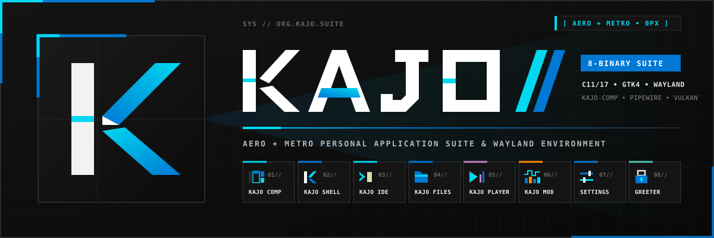

<p align="center">
  
</p>

# Kajo — Personal Native Application Suite & Wayland Environment

**Kajo** is a self-contained suite of lightweight, native C17 / GTK4 applications and Wayland session components built around a single, uncompromising visual and ergonomic vision for the [Niri](https://github.com/niri-wm/niri) Wayland compositor.

---

## 🎯 Purpose & Philosophy

Kajo has evolved far beyond its origins as a simple Wayland panel or launcher. **Its purpose is not to be a generic, catch-all replacement for mainstream Linux desktop environments or mass-market applications.** Instead, Kajo is a **purpose-built, cohesive suite of tools engineered specifically for a personal workflow, Nordic keyboard ergonomics, and hardware setup**:

1. **A Unified "Aero + Metro" Design Language** ([`docs/design_system.md`](docs/design_system.md) • [`docs/ui-gallery.html`](docs/ui-gallery.html))
   - Rejects bloated, rounded toolkit defaults in favor of **strict `0px` sharp corner geometry**, OLED-native dark charcoal surfaces (`#111111`–`#1a1a1a`), `1px solid #2b2b2b` structural hairlines, live `@metro-accent` window framing, and high-density `Fira Code` monospace telemetry badges.
   - Every standalone application in the suite shares the exact same custom frameless window chrome, Niri tiling/floating IPC (`🗗 FLOAT / TILE`), and instant live CSS/accent hot-reload.
2. **Pure Native C17 Performance, Zero Runtime Bloat**
   - Built directly on `C17`, `GTK4`, `GtkSourceView-5`, `Cairo`, `Pango`, `libmpv`, `libpulse`, `poppler-glib`, and `libarchive`—with zero Electron, CEF, or web-view wrappers.
   - Strict map- and popout-gated resource discipline keeps background CPU usage below `0.05%`.
3. **Tailored to Personal Workflows**
   - Whether writing C/Go/Rust/Python in **`kajo-ide`** with Nordic modal keybindings (`ä`/`ö` diagnostic stepping, `m i/a` structural text objects, native Cairo Mermaid diagrams, and AI agent JSON-RPC diff review), inspecting archives/PDFs/videos with `Space` Quick Look in **`kajo-files`**, watching hardware-decoded media in **`kajo-player`**, or managing Niri GLSL shaders and 2-in-1 foldable sensors in **`kajo-settings`**, every tool is optimized to do exactly what is needed—nothing more, nothing less.

---

## 🧩 The Kajo Application Suite

The repository builds and installs **six integrated native executables** (plus a `greetd` session wrapper):

| Executable | App ID | Role in the Suite |
| :--- | :--- | :--- |
| **`kajo-ide`** | `org.kajo.IDE` | **Modal Code Editor & IDE** (`GtkSourceView-5`) featuring a 10-state selection-first modal engine (`koodieditori` parity), Nordic text objects (`m i/a`), 6-column Cairo gutter, a real asynchronous LSP client (`gopls`, `jdtls`, `clangd`, `rust-analyzer`, … — diagnostics, hover, completion with auto-imports, go-to-definition/implementation, workspace-wide rename, code actions, formatting; `ripgrep`/buffer fallbacks without a server), project tasks (`Space r b/t/r/c` for Maven, Gradle, Meson, CMake, Cargo, Go, Make with clickable `javac`/`gcc`/`go` errors), debugger UI scaffold (`F5`–`F12`, breakpoints and panes; no debug adapter is connected yet), side-by-side GUI Markdown + native Cairo vector Mermaid renderer, and an AI Agent JSON-RPC 2.0 socket with atomic diff review. |
| **`kajo-files`** | `org.kajo.Files` | **URI-First File Manager** (`GIO` / `GVFS` / `UDisks2`) with natural filename collation, interactive column/popover sorting, hit-tested context menu (`Open With / Set Default`, `libarchive` `Extract Here`), inline LUKS/SMB authentication banner, and macOS-style `Space` Quick Look preview (`GtkPicture`, `libmpv` media, Poppler PDF, `libarchive`, code). |
| **`kajo-player`** | `org.kajo.Player` | **Hardware-Accelerated Media Player** (`libmpv` + `GtkGLArea`) with VA-API/NVDEC decoding, embedded/external subtitle selector (`.srt`, `.ass`, PGS), multi-audio stream switching, sync offset, playback speed & frame-stepping, chapters, sibling folder queue, auto-hiding fullscreen HUD, and MPRIS2 D-Bus integration. |
| **`kajo-settings`** | `org.kajo.Settings` | **11-Page Modular System & Suite Control Deck** managing Displays & Idle security, NetworkManager Wi-Fi, BlueZ Bluetooth, PipeWire/PulseAudio, Metro Accent Themes, Panel & Touch Gestures, Widgets, Notifications, **Kajo IDE & Code** (`config.json` `ide` schemes/fonts), Niri GLSL Shaders, and hardware telemetry. |
| **`kajo`** | `org.kajo.shell` | **Wayland Desktop Shell & Hardware Daemon** providing the status panel (22 live widgets), 16-band FFT audio visualizer, multi-plugin app launcher, OSD overlays, `ShellOSK` virtual touch keyboard, bezel touch gestures, `org.freedesktop.Notifications` daemon, `ext-idle-notify-v1` OLED screen saver, 360° foldable posture manager, and `ext-session-lock-v1` PAM lock screen. |
| **`kajo-greeter`** | `org.kajo.greeter` | **Wayland Login Greeter for `greetd`** supporting multi-monitor `niri` (`gtk4-layer-shell`), single-monitor `cage`, and desktop `--test` preview mode with PAM verification. |

---

## ✨ Suite Components in Detail

### ⌨️ Kajo IDE (`kajo-ide`)
> 📖 **Full Manual**: See [`docs/kajo_ide_manual.md`](docs/kajo_ide_manual.md) for the complete architecture, workflow & keybinding guide.

- **Selection-First Modal Editing & Nordic Ergonomics**:
  - 10-state finite state machine (`NORMAL`, `SELECT`, `INSERT`, `LEADER`, `MATCH`, `SEARCH`, `PICKER`, `TREE`, `DRAWER`, `HELP`) with color-coded status pills, bottom-right `Space` Leader chord HUD, and fast `jk` escape from `INSERT` mode.
  - First-class Nordic layout bindings: `ä` / `ö` to step through LSP diagnostics, `Alt+ä` / `Alt+ö` for Git diff hunks, and Dead-Key-free `m i/a` structural text objects (`m i f` function, `m i c` class/struct, `m i b` block, `m i a` argument, `m i q` quote, `m m` bracket jump).
- **6-Column Hardware-Accelerated Cairo Gutter (`68px`)**:
  - Renders DAP breakpoints & instruction pointer (`●`/`▶`), LSP diagnostic severity pills (`●`/`▲`/`◆`), Git diff status bars (`HEAD`), AI Agent modification bars, `Fira Code` absolute/relative line numbers, and AST fold chevrons (`z a`).
- **Code Intelligence & Debugger UI** *(partial — see [`ROADMAP.md`](ROADMAP.md))*:
  - Today: workspace-aware hover (`K`), buffer-identifier completion (`Ctrl+Space`), go-to-definition (`g d`) and project-wide rename (`Space c r`) backed by `ripgrep` plus the buffer contents; server-availability badge for `clangd`, `gopls`, `rust-analyzer`, `pyright`; build runner with clickable compiler diagnostics.
  - Debugger UI: `F9` breakpoints, `F5`/`F10`/`F11`/`F12`/`Shift+F5` transport buttons and the 3-pane bottom drawer exist, but no debug adapter (`gdb -i=dap`, `lldb-dap`, `dlv dap`) is spawned yet, so the stack and locals are placeholders.
  - Language servers: a stdio JSON-RPC 2.0 LSP client runs one server per project root (`gopls`, `jdtls`, `clangd`, `rust-analyzer`, `pyright`, `typescript-language-server`, `bash-language-server`, `vscode-json-language-server`, `yaml-language-server`, `taplo`, `lua-language-server`, `mesonlsp`) and feeds diagnostics into the gutter and status bar. `jdtls` is launched with the newest installed JDK (override with `KAJO_JDTLS_JAVA`). Planned: the DAP client.
- **Graphical Markdown & Native Cairo Vector Mermaid Diagrams**:
  - Live-synchronized 50/50 side-by-side split (`Space m p` / `📖 MD`) rendering interactive `- [ ]` task checkboxes (clicking mutates the source buffer), GitHub callout alerts (`[!NOTE]`, `[!TIP]`, `[!IMPORTANT]`, `[!WARNING]`, `[!CAUTION]`), tables, and code blocks.
  - Pure C11 Cairo/Pango layout and vector renderer for Mermaid `flowchart`, `sequenceDiagram`, `stateDiagram-v2`, `classDiagram`, `erDiagram`, and `pie` blocks—complete with interactive zoom/pan (`25%`–`400%`) and 1-click `.svg` vector export.
- **Fuzzy Finder, Live Ripgrep & 85-Command Interactive Help Palette**:
  - `Space f f` (Files), `Space b b` (Buffers), and `Space f g` (async `rg --vimgrep` project search) with a live syntax-highlighted preview pane.
  - `?` / `F1` / `Space h` opens the full-width 4-column **Help & Command Palette** with interactive category filter pills (`ALL`, `NAVIGATION`, `SELECT & EDIT`, `OBJECTS`, `LEADER`, `FILE TREE`, `LSP`, `DEBUGGER`, `MARKDOWN`, `AGENT`, `LAYOUT`, `MOUSE`).
- **AI Agent JSON-RPC 2.0 IPC & Atomic Batch Diff Review**:
  - Exposes `$XDG_RUNTIME_DIR/kajo-ide-<pid>.sock` (`$KAJO_IDE_SOCKET`) so external AI agents can query buffers/diagnostics and apply edits while recording pre-agent snapshots for instant developer review (`Space d s`), accept-all (`Space d a`), or atomic revert (`Space d r`).
- **5 Bundled Syntax Schemes & Live Font Zoom**:
  - Ships with `kajo-metro-dark`, `kajo-oled-pitch`, `kajo-nord-frost`, `kajo-amber-crt`, and `kajo-monokai-metro` (`data/ide/*.xml`), plus live `Ctrl++` / `Ctrl+-` / `Ctrl+0` font zoom and hot-reload via `kajo-settings`.

---

### 📁 Kajo Files (`kajo-files`)

- **Natural Filename Collation & Interactive Column/Popover Sorting**:
  - Precomputed `g_utf8_collate_key_for_filename()` keys sort numbered files naturally (`Episode_2.mkv` before `Episode_10.mkv`) with clickable Details List column headers (`NAME`, `SIZE`, `TYPE`, `MODIFIED`) and a **`☑ Folders First`** toggle.
- **Hit-Tested Context Menu (`Right-Click` / `Menu` / `Shift+F10` / `.`)**:
  - Item & background modes supporting `▶ Open`, `⚙ Open With... ▸` (with **`☑ Set as Default`**), `👁 Quick Look`, asynchronous `libarchive` **`📦 Extract Here`**, `>_ Open Terminal Here`, `🗔 Open in New Window`, `📋 Copy/Cut/Paste`, `🔗 Copy Path / URI` (`Ctrl+Shift+C`), `✏ Rename`, `🗑 Move to Trash`, and `⚠ Delete Permanently`.
- **URI-First GIO, GVFS & UDisks2 Integration**:
  - Non-blocking async enumeration for local paths, `trash:///` (with **Restore** & **Empty Trash** bar), `recent:///`, `network:///`, `[ + CONNECT TO SERVER ]` (`smb://`, `sftp://`, `davs://`, `mtp://`), live drive capacity bars, 1-click Eject (`⏏`), and an inline Kajo-styled `GMountOperation` auth bar for LUKS/SMB credentials.
- **macOS-Style `Space` Quick Look & Inspector (`Ctrl+I`)**:
  - Instant modal preview for high-res images (`GtkPicture`), hardware-accelerated video/audio (`KajoPlayerMpv` / `libmpv` + `GtkGLArea`), multi-page PDFs (`poppler-glib`), archives (`libarchive`), and source code (`Fira Code`).

---

### 🎬 Kajo Player (`kajo-player`)

- **Hardware-Accelerated `libmpv` + `GtkGLArea` Engine**:
  - Renders via `mpv_render_context` (OpenGL/EGL) with `hwdec=auto-safe` (VA-API / NVDEC), live header codec/resolution telemetry (`[ HEVC•vaapi | 1920×1080 | 42.1 MB ]`), and a toggleable technical stats overlay (`ℹ STATS` / `I` / `Ctrl+J`).
- **Subtitles, Multi-Language Audio & Sync Controls**:
  - **`💬 SUBS` & `🎧 AUDIO` Popovers**: Switch embedded or external subtitle tracks (`.srt`, `.ass`/`.ssa`, `.vtt`, PGS), load external subtitle files, adjust A/V & subtitle timing offset (`±100ms` / `Z` / `X`), and scale subtitle fonts (`30%–300%`).
- **Transport, Frame-Stepping, Queue & Auto-Hiding Fullscreen**:
  - Pitch-corrected playback speed (`0.5×`–`2.0×`, `[` / `]`), single-frame stepping (`,` / `.`), A–B loop (`Shift+L`), 1-key frame screenshots (`📷` / `S`), `240px` chapters/folder queue drawer (`☰ QUEUE` / `Ctrl+P`), bottom-edge auto-hiding fullscreen HUD (`F` / `F11`), and MPRIS2 D-Bus export.

---

### ⚙️ Kajo Settings (`kajo-settings`)
11 modular configuration pages (`src/settings/pages/page_*.c`) with zero mock data and live D-Bus / IPC synchronization:
1. **Displays & Idle Security (`displays`)**: Live Niri output resolution, refresh rate, fractional scale, orientation, VRR, plus Screen Saver & Session Lock timeouts.
2. **Network & Wi-Fi (`network`)**: Live NetworkManager D-Bus scanning, connection switching, real per-network security detection, and an inline passphrase banner for new WPA/WPA2/WPA3-Personal networks (saved profiles reconnect directly; WEP/802.1X networks need a profile created elsewhere).
3. **Bluetooth (`bluetooth`)**: Dynamic BlueZ adapter discovery, device scanning, pairing, and connection toggling.
4. **Audio & PipeWire (`audio`)**: Multi-channel (`2.0`–`7.1`) PulseAudio/PipeWire output sink routing, input gain, output/input mute switches, and auto-reconnect. Per-app stream sliders live in the panel volume popover.
5. **Theme & Accent (`theme`)**: Live Metro accent color palette (`@metro-accent`) hot-reloaded across all running Kajo apps.
6. **Panel & Touch (`panel`)**: Panel edge (segmented Top/Bottom), height, OLED smart autohide (toggle card), bezel touch swipe gestures and on-screen-keyboard behaviour. Convertible posture and keyboard-backlight controls live on the Displays page.
7. **Widgets (`widgets`)**: Interactive ordering (`▲`/`▼`) and display mode (`icon-only`, `text-only`, `full`) for left/center/right panel zones.
8. **Notifications (`notifications`)**: Toast timeout, click action and history size. Do-Not-Disturb and clear-history are in the panel DND widget, Control Center and notification popover.
9. **Kajo IDE & Code (`ide`)**: Syntax color scheme selector (5 bundled schemes), editor font family & size, tab width (segmented), spaces-vs-tabs, word wrap, margin guide, minimap, gutter and current-line highlight (relative line numbers are planned)—saved with an explicit SAVE & APPLY and hot-reloaded via `~/.config/kajo/config.json`.
10. **Niri & Shaders (`niri`)**: Live Niri layout settings and GLSL window animation shader presets (`open`, `close`, `resize`).
11. **About (`about`)**: System & suite telemetry overview.

---

### 🖥️ Kajo Desktop Shell, Lock Screen & Hardware Daemon (`kajo`)
- **22 Live Panel Widgets & 16-Band FFT Visualizer**: Workspaces, clock/calendar, volume mixer, control center, battery, backlight & posture, Wi-Fi, Bluetooth, media player (with 30 FPS 16-band Cooley-Tukey FFT spectrum analyzer corked automatically when hidden), CPU/RAM/disk/network telemetry, theme picker, keyboard layout, SNI system tray, notifications, power menu, privacy indicator, DND, Keep Awake idle inhibitor, `ShellOSK` toggle, window title, launcher, and custom scripts.
- **Multi-Plugin Application Launcher (`Mod+D`)**: App search, `:emoji` picker (1,914 entries), `=calculator` (TinyExpr), `>shell` runner, and `w:window` Niri switcher.
- **Virtual Touch Keyboard (`ShellOSK`) & Bezel Edge Gestures**: 28-column proportional keyboard speaking `zwp_virtual_keyboard_unstable_v1` and `zwp_input_method_unstable_v2` with dynamic XKB layout discovery, paired with configurable screen-edge swipe recognizers.
- **Wayland Session Lock (`ext-session-lock-v1`), Metro Screen Saver & Idle Manager (`ext-idle-notify-v1`)**: Multi-monitor PAM lock screen with `explicit_bzero` credential scrubbing, `systemd-logind` sleep lock hooks, and 3-mode OLED burn-in-safe screen saver (`clock`, `tiles`, `blank`).
- **360° Foldable Posture, Auto-Rotation & EC Backlight *(Experimental)***: Runtime hardware probing for Intel ISH `hinge`/`accel_3d` IIO sensors, `/sys/class/input/input*/inhibited`, and HP Embedded Controller keyboard backlight registers (`0x97` `HKBL` / `0x96` `HKBT`).

---

### 🔐 Kajo Login Greeter (`kajo-greeter`)
- Speaks the `greetd` binary IPC protocol (`$GREETD_SOCK`) with scrubbed credential memory and `prctl(PR_SET_DUMPABLE, 0)` hardening.
- Runs natively on multi-monitor `niri` (`gtk4-layer-shell`), single-monitor `cage` (`--fullscreen`), or inside an active desktop session (`kajo-greeter --test`) for instant previewing.

---

## 📚 Documentation Index

| Document | Contents |
| :--- | :--- |
| **[`docs/design_system.md`](docs/design_system.md)** | Authoritative **Aero + Metro** visual design specification (color tokens, `0px` geometry, typography, component anatomy). |
| **[`docs/ui-gallery.html`](docs/ui-gallery.html)** | Interactive HTML/CSS visual reference gallery for every Kajo component and application layout. |
| **[`docs/kajo_ide_manual.md`](docs/kajo_ide_manual.md)** | Complete user & architecture manual for **`kajo-ide`** (modal states, Nordic chords, LSP/DAP, Mermaid, AI Agent IPC). |
| **[`docs/script_widgets.md`](docs/script_widgets.md)** | Guide for authoring custom panel script widgets for **`kajo`**. |
| **[`DEVELOPMENT.md`](DEVELOPMENT.md)** | Developer architecture guide, build instructions, and subsystem testing handbook. |
| **[`ROADMAP.md`](ROADMAP.md)** | Suite milestone tracking and upcoming engineering phases. |
| **[`HARDWARE_FINDINGS.md`](HARDWARE_FINDINGS.md)** | Convertible 2-in-1 sensor (`Intel ISH`), input inhibition, and Embedded Controller (`ec_sys`) register documentation. |

---

## 🛠️ Building and Installing

### 1. System Dependencies (Arch Linux / CachyOS)
```bash
sudo pacman -S --needed gtk4 gtksourceview5 gtk4-layer-shell wayland wayland-protocols \
    libxkbcommon json-glib glib2 libpulse pam poppler-glib libarchive mpv gvfs gvfs-smb \
    udisks2 blueprint-compiler meson ninja
```

**Tree-sitter syntax engine** for `kajo-ide` (incremental parsing, AST-based highlighting). The runtime comes from the official repositories; the grammars are split between the official/CachyOS repositories and the AUR (use `paru` or `yay`):
```bash
# official / CachyOS repositories
sudo pacman -S --needed tree-sitter tree-sitter-c tree-sitter-bash tree-sitter-javascript \
    tree-sitter-lua tree-sitter-rust
# AUR
paru -S --needed tree-sitter-cpp tree-sitter-css tree-sitter-go tree-sitter-html \
    tree-sitter-java tree-sitter-json tree-sitter-toml tree-sitter-typescript tree-sitter-yaml
```
Every grammar is optional at build time: `meson setup` links the ones it finds (`tree-sitter-<lang>`; `tree-sitter-typescript` provides TypeScript and TSX) and `kajo-ide` falls back to its built-in heuristic lexer for any language whose grammar is missing. Install all of them for full highlighting of C, C++, Java, Go, Rust, JavaScript/JSX, TypeScript/TSX, Bash/Zsh, Lua, JSON, TOML, YAML, CSS and HTML.

Optional runtime tools for **`kajo-ide`** language intelligence, search, and debugging:
```bash
sudo pacman -S --needed ripgrep clang gopls rust-analyzer pyright gdb lldb delve
```

### 2. Build, Verify & Install (`~/.local`)
By default, `meson.build` configures `prefix=~/.local`, installing all six binaries to `~/.local/bin` and theme/syntax assets to `~/.local/share/kajo/`:

```bash
meson setup builddir
meson compile -C builddir
meson test -C builddir
meson install -C builddir
```

---

## 🖥️ Recommended Niri Configuration (`~/.config/niri/config.kdl`)

```kdl
// 1. Launch Kajo shell daemon at session startup
spawn-at-startup "kajo"

// 2. Kajo Suite Keybindings
binds {
    // Kajo Application Suite
    Mod+D             { spawn "kajo" "--toggle-launcher"; }
    Mod+C             { spawn "kajo-ide"; }
    Mod+E             { spawn "kajo-files"; }
    Mod+M             { spawn "kajo-player"; }
    Mod+S             { spawn "kajo-settings"; }
    Mod+K             { spawn "kajo" "--toggle-osk"; }

    // Session Lock & Screen Saver
    Mod+Shift+L       { spawn "kajo" "--lock"; }
    Mod+Shift+S       { spawn "kajo" "--screensaver"; }

    // Audio Volume & Mute (with Kajo OSD)
    XF86AudioRaiseVolume allow-when-locked=true { spawn "kajo" "--volume-up"; }
    XF86AudioLowerVolume allow-when-locked=true { spawn "kajo" "--volume-down"; }
    XF86AudioMute        allow-when-locked=true { spawn "kajo" "--volume-mute"; }

    // Display Backlight Brightness (with Kajo OSD)
    XF86MonBrightnessUp   allow-when-locked=true { spawn "kajo" "--brightness-up"; }
    XF86MonBrightnessDown allow-when-locked=true { spawn "kajo" "--brightness-down"; }
}
```

---

## 💻 Command-Line Interface (CLI) Summary

| Binary | Invocation | Description |
| :--- | :--- | :--- |
| **`kajo-ide`** | `kajo-ide [DIR \| FILES...]` | Opens a project workspace directory or specific source files in Kajo IDE. |
| **`kajo-files`** | `kajo-files [PATH_OR_URI...]` | Opens local folders or GVFS URIs (`trash:///`, `recent:///`, `smb://`, `sftp://`). |
| **`kajo-player`** | `kajo-player [FILE_OR_URI...]` | Opens video/audio media files in Kajo Player with sibling folder queue discovery. |
| **`kajo-settings`** | `kajo-settings [-p <PAGE>]` | Opens System Settings (`displays`, `network`, `bluetooth`, `audio`, `theme`, `panel`, `widgets`, `notifications`, `ide`, `niri`, `about`). |
| **`kajo`** | `kajo [--toggle-launcher \| --lock \| --screensaver \| --toggle-osk \| --volume-up \| ...]` | Starts the Wayland shell daemon (no args) or dispatches an instant command over `$XDG_RUNTIME_DIR/kajo.sock`. |
| **`kajo-greeter`** | `kajo-greeter [--test] [--fullscreen] [--cmd <SESSION>]` | Runs the `greetd` login greeter (use `--test` to preview safely in a `1280×800` desktop window). |

---

## 📄 Configuration File Locations

| Path | Managed By | Purpose |
| :--- | :--- | :--- |
| **`~/.config/kajo/config.json`** | `kajo-settings` / User | Panel layout, widget modes, notification timeouts, `idle` security settings, convertible `posture` rules, and `keyboard_backlight` preferences. |
| **`~/.config/kajo/config.json` (`ide` object)** | `kajo-settings` (`ide`) / `kajo-ide` | Editor syntax color scheme (`kajo-metro-dark`, etc.), font family & size (`Ctrl++`/`Ctrl+-` zoom), tab width, line number mode, minimap visibility, . |
| **`~/.config/kajo/theme-override.css`** | `kajo-settings` (`theme`) | Live Metro accent color definitions (`@define-color metro-accent ...`) hot-reloaded across all Kajo processes. |
| **`~/.config/niri/config.kdl`** | `kajo-settings` (`displays` / `niri`) | Output resolution/scale/transform/VRR blocks and Niri layout/GLSL shader settings. |
| **`/var/cache/kajo-greeter/state.json`** | `kajo-greeter` | Persists `last_user` and `last_session` across logins. |

---

## 📄 License & Attribution

- **Icons**: Incorporates [Fluent UI System Icons](https://github.com/microsoft/fluentui-system-icons) by Microsoft Corporation (MIT License).
- **License**: MIT License — see [LICENSE](LICENSE).

## Author

Mikolas Hämäläinen — [mikolas@mikolas.net](mailto:mikolas@mikolas.net)
