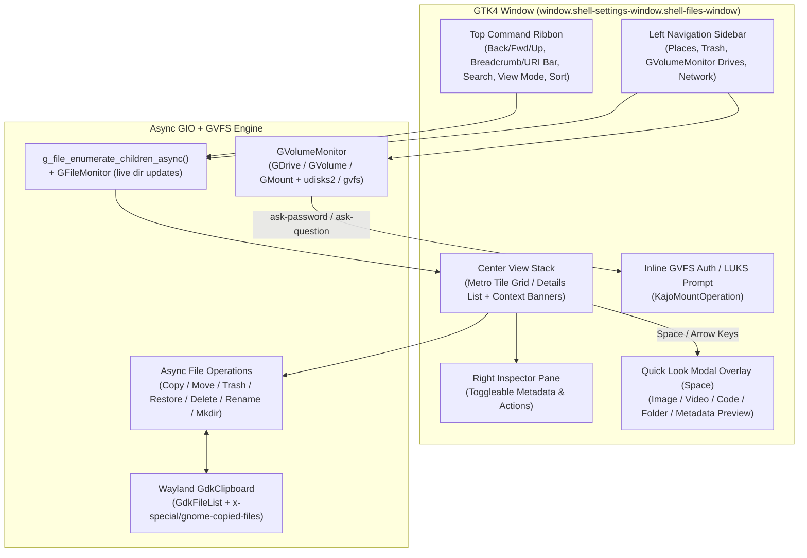

# Technical Specification: Kajo Files (`SPEC_FILE_BROWSER.md`)

**Target Module:** `src/files/`  
**Target Binary:** `kajo-files` (`org.kajo.Files`)  
**Status:** Alpha (Phase 1)  
**Desktop Entry:** `data/org.kajo.Files.desktop` (`MimeType=inode/directory;`)  
**Tech Stack:** C17, GTK4 (`gtk4`), GIO (`gio-2.0`, `gio-unix-2.0`), GVFS (`gvfs`, `gvfs-smb`, `gvfs-onedrive`, `gvfs-goa`), UDisks2 (`GVolumeMonitor`), Blueprint Markup (`blueprint-compiler`)

---

## 1. Executive Summary & Design Philosophy

**Kajo Files (`kajo-files`)** is the native file manager for the Kajo desktop environment on the Niri Wayland compositor. It strictly follows the visual and architectural language of **Kajo Settings (`kajo-settings`)**:
- **Zero-Radius Metro Dark Aesthetic:** Reuses `window.shell-settings-window` + `window.shell-files-window` styling (`#111111` / `#141414` / `#181818` surfaces, `1px solid #2b2b2b` crisp borders, `Fira Code` monospace headers/badges, and live `@metro-accent` highlights from `~/.config/kajo/style.d/00-accent.css`).
- **Single-View Per Window (No Tabs):** Each `kajo-files` instance manages a single active directory view; pressing `Ctrl+N` (or middle-clicking a folder) spawns a new window so Niri's scrollable tiling manages side-by-side workflows naturally.
- **URI-First GVFS & UDisks2 Architecture:** All navigation, enumeration, file operations, and previews operate on `GFile *` URIs (`file://`, `trash:///`, `network:///`, `smb://`, `sftp://`, `ftp://`, `davs://`, `mtp://`, `onedrive://`, `recent:///`) rather than assuming local POSIX paths.
- **macOS-Style Quick Look (`Space`):** Pressing `Space` on any selected item pops up an instant modal overlay preview (images, audio/video via `GtkVideo`, code/text, folder contents, or binary metadata) that follows arrow-key selection changes in real time.

---

## 2. System Architecture & Data Flow



---

## 3. UI Wireframes & Mockups

### 3.1 Main Window — Metro Tile Grid Mode (`>= 768px` Widescreen)

```text
┌──────────────────────────────────────────────────────────────────────────────────────────────────────────────────┐
│ [←] [→] [↑] [↻] │ [ HOME ] ▸ [ src ] ▸ [ Kajo ]                          [Ctrl+L] │ [ 🔍 Filter... ] [⊞][☰] [ⓘ] │
├──────────────────┼─────────────────────────────────────────────────────────────────┼─────────────────────────────┤
│ PLACES           │  PATH: /home/mikolas/src/Kajo              [ + NEW FOLDER ]     │ INSPECTOR                   │
│ ▌ ⌂ Home         │ ┌────────────────┐ ┌────────────────┐ ┌────────────────┐        │ ┌─────────────────────────┐ │
│   🖥 Desktop      │ │       📁       │ │       📁       │ │       📁       │        │ │                         │ │
│   📄 Documents   │ │     build      │ │      data      │ │    protocol    │        │ │     [ IMAGE / CODE      │ │
│   ⬇ Downloads    │ │   [ FOLDER ]   │ │   [ FOLDER ]   │ │   [ FOLDER ]   │        │ │       THUMBNAIL ]       │ │
│   🎵 Music       │ └────────────────┘ └────────────────┘ └────────────────┘        │ │                         │ │
│   🖼 Pictures     │ ┌────────────────┐ ┌────────────────┐ ┌────────────────┐        │ └─────────────────────────┘ │
│   🎬 Videos      │ │       📁       │ │       📄       │ │       📄       │        │ SPEC_FILE_BROWSER.md        │
│   🕒 Recent      │ │      src       │ │   AGENTS.md    │ │  meson.build   │        │ [ MARKDOWN DOCUMENT ]       │
│   🗑 Trash (3)   │ │   [ FOLDER ]   │ │    8.4 KB      │ │    12.1 KB     │        │                             │
│                  │ └────────────────┘ └────────────────┘ └────────────────┘        │ SIZE:      14.8 KB          │
│ DEVICES & DRIVES │ ┌════════════════┐ ┌────────────────┐                           │ MODIFIED:  2026-11-03 21:32 │
│   💾 NVMe Root   │ ║       📄       ║ │       🖼       │                           │ PERMS:     rw-r--r-- (0644) │
│   [████░░] 412G  │ ║ SPEC_FILE_...  ║ │   preview.png  │                           │ MIME:      text/markdown    │
│   🔌 USB Kingston│ ║    14.8 KB     ║ │    284.0 KB    │                           │                             │
│   [██░░░░] 28G ⏏ │ └════════════════┘ └────────────────┘                           │ [   👁 QUICK LOOK (SPACE) ] │
│   🔒 LUKS Vault  │                                                                 │ [   ↗ OPEN DEFAULT APP    ] │
│   [ UNMOUNTED ]  │                                                                 │ [   >_ OPEN TERMINAL HERE ] │
│                  │                                                                 │ [   🗑 MOVE TO TRASH      ] │
│ NETWORK          │                                                                 │                             │
│   🌐 Network     │                                                                 │                             │
│   [+ CONNECT...] │                                                                 │                             │
├──────────────────┴─────────────────────────────────────────────────────────────────┴─────────────────────────────┤
│ [ 8 ITEMS (4 FOLDERS, 4 FILES) | 1 SELECTED (14.8 KB) ]                     [ FREE: 412.5 GB / 1.0 TB ] [████░░] │
└──────────────────────────────────────────────────────────────────────────────────────────────────────────────────┘
```

### 3.2 Main Window — Details List Mode (`[☰]`)

```text
┌────────────────────────────────────────────────────────────────────────────────────────┐
│ NAME                                      │ SIZE       │ TYPE             │ MODIFIED   │
├───────────────────────────────────────────┼────────────┼──────────────────┼────────────┤
│ 📁 build                                  │ --         │ Folder           │ 2026-11-03 │
│ 📁 data                                   │ --         │ Folder           │ 2026-11-03 │
│ 📁 protocol                               │ --         │ Folder           │ 2026-11-03 │
│ 📁 src                                    │ --         │ Folder           │ 2026-11-03 │
│ 📄 AGENTS.md                              │ 8.4 KB     │ Markdown         │ 2026-11-02 │
│ 📄 meson.build                            │ 12.1 KB    │ Meson Build      │ 2026-11-03 │
│▌📄 SPEC_FILE_BROWSER.md                   │ 14.8 KB    │ Markdown         │ 2026-11-03 │
│ 🖼 preview.png                            │ 284.0 KB   │ PNG Image        │ 2026-11-01 │
└───────────────────────────────────────────┴────────────┴──────────────────┴────────────┘
```

### 3.3 Quick Look Modal Preview (`Space` Key Overlay)

Pressing **`Space`** on any selected item opens a centered Metro Quick Look card inside a dimmed `GtkOverlay` (`background-color: rgba(0, 0, 0, 0.72)`).
- Pressing **`Space`** or **`Escape`** closes Quick Look.
- Pressing **`↑` / `↓` / `←` / `→`** while Quick Look is open moves the selection in the underlying directory view and **immediately updates the Quick Look preview** in place.
- Pressing **`Enter`** launches the item in its default application and closes Quick Look.

```text
┌──────────────────────────────────────────────────────────────────────────────────────────────────┐
│  ░░░░░░░░░░░░░░░░░░░░░░░░░░░░░░░ DIMMED WINDOW BACKDROP (rgba(0,0,0,0.72)) ░░░░░░░░░░░░░░░░░░░░  │
│  ░░ ┌════════════════════════════════════════════════════════════════════════════════════════┐ ░░│
│  ░░ ║ QUICK LOOK // SPEC_FILE_BROWSER.md                 [ text/markdown | 14.8 KB ]  [ ✕ ] ║ ░░│
│  ░░ ╟────────────────────────────────────────────────────────────────────────────────────────╢ ░░│
│  ░░ ║   1 │ # Technical Specification: Kajo Files (`SPEC_FILE_BROWSER.md`)                  ▲║ ░░│
│  ░░ ║   2 │                                                                                 █║ ░░│
│  ░░ ║   3 │ **Target Module:** `src/files/`                                                 █║ ░░│
│  ░░ ║   4 │ **Target Binary:** `kajo-files` (`org.kajo.Files`)                              ░║ ░░│
│  ░░ ║   5 │ **Desktop Entry:** `data/org.kajo.Files.desktop`                                ░║ ░░│
│  ░░ ║   6 │                                                                                 ░║ ░░│
│  ░░ ║   7 │ ## 1. Executive Summary & Design Philosophy                                     ░║ ░░│
│  ░░ ║   8 │                                                                                 ░║ ░░│
│  ░░ ║   9 │ **Kajo Files (`kajo-files`)** is the native file manager for the Kajo...        ▼║ ░░│
│  ░░ ╟────────────────────────────────────────────────────────────────────────────────────────╢ ░░│
│  ░░ ║ [ ← PREV ] [ NEXT → ]     MODIFIED: 2026-11-03 21:32     [ ↗ OPEN IN DEFAULT APP (⏎) ] ║ ░░│
│  ░░ └════════════════════════════════════════════════════════════════════════════════════════┘ ░░│
└──────────────────────────────────────────────────────────────────────────────────────────────────┘
```

**Quick Look Content Renderers by MIME Type:**
1. **Images (`image/*`):** High-resolution aspect-fitted `GtkPicture` (`GdkTexture`) + pixel dimensions (`W × H px`).
2. **Audio & Video (`video/*`, `audio/*`):** Embedded `GtkVideo` media player (`GtkMediaFile`) with play/pause, seek bar, and volume control; automatically stops playback when Quick Look closes (`unmap`).
3. **Text, Code & Configs (`text/*`, `application/json`, `application/xml`, `application/x-shellscript`, `.c`, `.h`, `.blp`, `.md`, `.kdl`, `.toml`, `.yaml`, `.ini`):** Monospace (`Fira Code`) read-only `GtkTextView` showing the first `64 KB` loaded asynchronously via `g_input_stream_read_bytes_async()`.
4. **Directories (`inode/directory`):** Folder summary card listing child item count, subfolder/file breakdown, modification time, and a preview list of the first 25 entries.
5. **Other Binary Files / Archives:** Large file-type icon + full metadata table (MIME type, exact byte size, POSIX mode `rwxr-xr-x`, owner/group, symlink target if applicable, `trash::orig-path` if in Trash).

### 3.4 Contextual Banners: GVFS Auth / LUKS Prompt & Trash Bar

1. **Inline GVFS Mount / Authentication Banner (`GtkMountOperation`):**
   When mounting an encrypted LUKS partition (`udisks2`) or connecting to an authenticated `smb://` / `sftp://` / `davs://` share, `kajo-files` displays a Metro card banner at the top of the content area instead of an unstyled system dialog:
   ```text
   ┌═══════════════════════════════════════════════════════════════════════════════════════════┐
   ║ 🔒 AUTHENTICATION REQUIRED // smb://nas.local/media                                       ║
   ║ [ Username: mikolas      ]  [ Domain: WORKGROUP  ]  [ Password: •••••••••• ]              ║
   ║ [ MOUNT / UNLOCK ]  [ CANCEL ]                                                            ║
   └═══════════════════════════════════════════════════════════════════════════════════════════┘
   ```

2. **Trash Context Banner (`trash:///`):**
   When the active URI is `trash:///`, a dedicated bar appears above the file view:
   ```text
   ┌═══════════════════════════════════════════════════════════════════════════════════════════┐
   ║ 🗑 TRASH // 3 ITEMS                               [ ↺ RESTORE SELECTED ]  [ 🔥 EMPTY TRASH ] ║
   └═══════════════════════════════════════════════════════════════════════════════════════════┘
   ```

3. **Connect to Server Bar (`[ + CONNECT... ]`):**
   Clicking `[ + CONNECT TO SERVER ]` in the sidebar reveals an inline URI connection bar:
   ```text
   ┌═══════════════════════════════════════════════════════════════════════════════════════════┐
   ║ 🌐 CONNECT TO SERVER (smb://, sftp://, ftp://, davs://, mtp://)                           ║
   ║ [ smb://192.168.1.10/share                                      ]  [ CONNECT ] [ CANCEL ] ║
   └═══════════════════════════════════════════════════════════════════════════════════════════┘
   ```

---

## 4. Keyboard & Touch Shortcuts

| Shortcut | Action |
| :--- | :--- |
| **`Space`** | Toggle **Quick Look** modal preview on selected item |
| **`Enter` / Double-Click** | Open folder (navigate into) or launch file in default app |
| **`Backspace` / `Alt+↑`** | Navigate to parent directory (`Up`) |
| **`Alt+←` / `Alt+→`** | Navigate Back / Forward in history stack |
| **`Ctrl+L`** | Toggle Breadcrumb Bar $\leftrightarrow$ editable Path / URI entry |
| **`Ctrl+F`** | Toggle / focus live filename filter bar |
| **`Ctrl+H`** | Toggle hidden (`.` dot) files |
| **`Ctrl+1` / `Ctrl+2`** | Switch between **Metro Tile Grid** (`Ctrl+1`) and **Details List** (`Ctrl+2`) |
| **`Ctrl+I`** | Toggle Right Inspector Pane |
| **`Ctrl+N`** | Spawn a new `kajo-files` window at the current URI |
| **`Ctrl+Shift+N`** | Create New Folder in current directory |
| **`Ctrl+Shift+T`** | Open Terminal (`kitty` / `$TERMINAL`) at current directory (or GVFS FUSE path) |
| **`F2`** | Rename selected item |
| **`Ctrl+C` / `Ctrl+X` / `Ctrl+V`** | Copy / Cut / Paste files (syncs with Wayland `GdkClipboard`) |
| **`Delete`** | Move selected items to Trash (`g_file_trash_async`) |
| **`Shift+Delete`** | Permanently delete selected items (with inline confirmation prompt) |
| **`F5` / `Ctrl+R`** | Reload current directory |
| **`Escape`** | Close Quick Look, cancel inline prompt, or exit URI/search bar |

---

## 5. Modular Source Layout & Build Integration

Following `AGENTS.md` Rule #4 (no monolithic files), `kajo-files` is split into focused modules under `src/files/`:

| File | Responsibility |
| :--- | :--- |
| [`src/files/main.c`](file:///home/mikolas/src/Kajo/src/files/main.c) | `GtkApplication` (`org.kajo.Files`, `G_APPLICATION_HANDLES_OPEN \| G_APPLICATION_NON_UNIQUE`), CLI path/URI parsing, `ShellTheme` & `ShellIcons` initialization |
| [`src/files/files_window.h`](file:///home/mikolas/src/Kajo/src/files/files_window.h) / [`src/files/files_window.c`](file:///home/mikolas/src/Kajo/src/files/files_window.c) | Main window controller, navigation history stack, interactive breadcrumb/URI bar, responsive `< 768px` sidebar collapse, keyboard controller, status bar |
| [`src/files/files_model.h`](file:///home/mikolas/src/Kajo/src/files/files_model.h) / [`src/files/files_model.c`](file:///home/mikolas/src/Kajo/src/files/files_model.c) | `KajoFileItem` `GObject` (`GFile *`, name, display name, URI, MIME type, icon name, size, mtime, permissions, `is_dir`, `is_hidden`, `trash_orig_path`), async `g_file_enumerate_children_async()`, `GFileMonitor`, sorting & filtering |
| [`src/files/files_sidebar.h`](file:///home/mikolas/src/Kajo/src/files/files_sidebar.h) / [`src/files/files_sidebar.c`](file:///home/mikolas/src/Kajo/src/files/files_sidebar.c) | Places list, `trash:///`, live `GVolumeMonitor` (`GDrive`, `GVolume`, `GMount`) with free-space bars, Eject/Unmount, Connect to Server, and inline `GtkMountOperation` auth/LUKS prompt |
| [`src/files/files_ops.h`](file:///home/mikolas/src/Kajo/src/files/files_ops.h) / [`src/files/files_ops.c`](file:///home/mikolas/src/Kajo/src/files/files_ops.c) | Async Copy, Move, Trash, Restore from Trash, Empty Trash, Permanent Delete, Rename, Create Folder, and Wayland `GdkClipboard` integration |
| [`src/files/files_quicklook.h`](file:///home/mikolas/src/Kajo/src/files/files_quicklook.h) / [`src/files/files_quicklook.c`](file:///home/mikolas/src/Kajo/src/files/files_quicklook.c) | Right-hand Inspector pane and `Space`-triggered **Quick Look** modal overlay (image, video/audio `GtkVideo`, text/code async reader, directory summary, metadata) |
| [`data/ui/files_window.blp`](file:///home/mikolas/src/Kajo/data/ui/files_window.blp) | Declarative Blueprint template for `KajoFilesWindow` |
| [`data/org.kajo.Files.desktop`](file:///home/mikolas/src/Kajo/data/org.kajo.Files.desktop) | Desktop entry (`Name=Kajo Files`, `Exec=kajo-files %U`, `MimeType=inode/directory;`) |

---

## 6. Verification & Unit Test Plan

1. **Unit Tests (`tests/test_files_model.c`):**
   - Verify `KajoFileItem` creation, human-readable size formatting (`B`, `KB`, `MB`, `GB`), POSIX permission formatting (`rwxr-xr-x`), directory-first sorting (Name, Size, Modified, Type), hidden file filtering, and async local directory enumeration + `Mkdir` / `Rename` / `Delete` operations in a temporary `g_dir_make_tmp()` sandbox.
2. **Build & Style Verification:**
   - `meson compile -C builddir` $\rightarrow$ 0 errors, 0 warnings.
   - `meson test -C builddir` $\rightarrow$ all unit tests pass.
   - Launch `./builddir/kajo-files` and verify Metro styling, Quick Look (`Space` + arrow keys), sidebar places/drives, and GVFS `trash:///` / `network:///` navigation.
