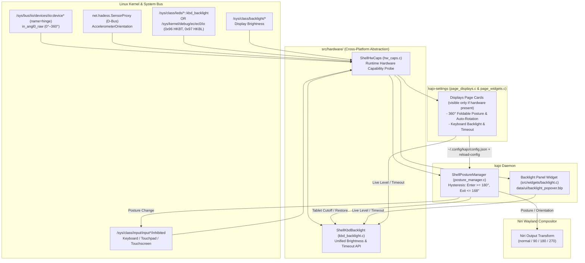

# Technical Specification: Cross-Platform 360° Posture, Auto-Rotation, Input Inhibition & Backlight Control

## 1. Overview & Goals

This specification defines the architecture for **Kajo** (`kajo`) and **Kajo Settings** (`kajo-settings`) to provide hardware-adaptive support for:
1. **360° Foldable Posture Detection & Screen Auto-Rotation** (`hinge` & `accel_3d` IIO sensors / `net.hadess.SensorProxy`).
2. **Posture-Driven Input Device Inhibition** (disabling internal keyboard/touchpad in Tablet mode and finger touchscreen in Laptop mode via `/sys/class/input/input*/inhibited`).
3. **Display & Keyboard Backlight + Timeout Control** (cross-platform abstraction supporting both standard `/sys/class/leds/*::kbd_backlight` and HP Embedded Controller `HKBL` `0x97` / `HKBT` `0x96` registers in `/sys/kernel/debug/ec/ec0/io`).
4. **Dedicated Panel Widget (`backlight`) & Hardware-Gated Settings UI**:
   - All features, timers, and UI cards are strictly gated on runtime hardware capability discovery (`ShellHwCaps`).
   - On a **Desktop PC** (where foldable sensors and laptop backlights do not exist), zero background timers run and the foldable/keyboard-backlight UI cards stay hidden.

---

## 2. System Architecture



---

## 3. Cross-Platform Hardware Capability Probing (`src/hardware/hw_caps.h` / `.c`)

Per [`AGENTS.md`](file:///home/mikolas/src/Kajo/AGENTS.md) Rules 1 & 2, no mock data or hardcoded device indices (`iio:device4`, `input2`) are used. `shell_hw_caps_probe()` dynamically inspects sysfs/DMI:

| Capability Field | Detection Mechanism | Desktop PC | HP OmniBook X Flip |
| :--- | :--- | :---: | :---: |
| `has_display_backlight` | Any entry in `/sys/class/backlight/*` with `max_brightness > 0` | `FALSE` | `TRUE` |
| `has_hinge_sensor` | `/sys/bus/iio/devices/iio:device*` where `name == "hinge"` and `in_angl0_raw` exists | `FALSE` | `TRUE` |
| `has_accel_sensor` | `/sys/bus/iio/devices/iio:device*` where `name == "accel_3d"` or `net.hadess.SensorProxy` `HasAccelerometer` | `FALSE` | `TRUE` |
| `has_internal_kbd` | `/sys/class/input/input*` where `name == "AT Translated Set 2 keyboard"` (or `phys` `isa0060/serio0*`) and `inhibited` exists | `FALSE` | `TRUE` |
| `has_touchpad` | `/sys/class/input/input*` where `name` contains `"Touchpad"` and `inhibited` exists | `FALSE` | `TRUE` |
| `has_touchscreen` | `/sys/class/input/input*` where `uevent` contains `PROP=2` (`INPUT_PROP_DIRECT`), `name` does not end with `"Stylus"`/`"Keyboard"`/`"Mouse"`/`"UNKNOWN"`, and `inhibited` exists | `FALSE` | `TRUE` |
| `kbd_bl_backend` | 1. `KBD_BL_SYSFS_LEDS`: `/sys/class/leds/*::kbd_backlight` exists<br>2. `KBD_BL_HP_EC`: `/sys/class/dmi/id/sys_vendor == "HP"` and `/sys/kernel/debug/ec/ec0/io` is accessible<br>3. `KBD_BL_NONE`: Neither exists | `KBD_BL_NONE` | `KBD_BL_HP_EC` |
| `has_kbd_timeout` | `TRUE` when `kbd_bl_backend == KBD_BL_HP_EC` | `FALSE` | `TRUE` |

---

## 4. 360° Posture, Auto-Rotation & Input Inhibition (`src/posture/posture_manager.c`)

1. **Hysteresis Posture State Machine**:
   - Active **only** when `has_hinge_sensor` is `TRUE` and at least one posture setting is enabled.
   - Polls `in_angl0_raw` at `1 Hz` (`g_timeout_add_seconds(1, ...)` — ~15 µs/sec).
   - **Enter Folded Mode (`POSTURE_FOLDED`)**: `hinge_deg >= 180.0°`.
   - **Return to Laptop Mode (`POSTURE_LAPTOP`)**: `hinge_deg <= 168.0°`.
2. **Posture-Gated Screen Auto-Rotation**:
   - **In Laptop Mode (`<= 168°`)**: Calls `net.hadess.SensorProxy.ReleaseAccelerometer()` (so the accelerometer powers down) and ensures `eDP-1` is at `transform "normal"` (`0°`).
   - **In Folded Mode (`>= 180°`)**: Calls `net.hadess.SensorProxy.ClaimAccelerometer()`, listens for `PropertiesChanged` on `AccelerometerOrientation` (with direct IIO `accel_3d` gravity vector fallback), and rotates `eDP-1` via Niri (`normal` $\rightarrow$ `normal`, `left-up` $\rightarrow$ `90`, `bottom-up` $\rightarrow$ `180`, `right-up` $\rightarrow$ `270`).
3. **Posture-Driven Input Device Inhibition**:
   - **Disable Keyboard & Touchpad in Tablet Mode**: Writes `"1"` to the discovered keyboard and touchpad `/sys/class/input/input*/inhibited` attributes in `POSTURE_FOLDED` (blocking physical keys before `keyd` or `libinput` sees them) and `"0"` in `POSTURE_LAPTOP`.
   - **Disable Touchscreen in Laptop Mode**: Writes `"1"` to the finger touchscreen `inhibited` in `POSTURE_LAPTOP` (leaving `Stylus` active) and `"0"` in `POSTURE_FOLDED`.
   - **Safety Restore**: On `kajo` exit (`SIGINT`/`SIGTERM`) or when a toggle is disabled in `kajo-settings`, unconditionally restores `"0"` to all `inhibited` nodes.

---

## 5. Keyboard Backlight & Timeout Backend (`src/hardware/kbd_backlight.h` / `.c`)

Provides a unified hardware-agnostic API:
- `gboolean shell_kbd_backlight_available(void)`
- `gboolean shell_kbd_backlight_has_timeout(void)`
- `gint shell_kbd_backlight_get_max_level(void)` (`2` for HP EC: `0=Off, 1=Low, 2=High`)
- `gint shell_kbd_backlight_get_level(void)` / `gboolean shell_kbd_backlight_set_level(gint level)`
- `gint shell_kbd_backlight_get_timeout_sec(void)` / `gboolean shell_kbd_backlight_set_timeout_sec(gint sec)`

### HP Embedded Controller (`KBD_BL_HP_EC`) Register Mapping
Uses 1-byte `pread()` / `pwrite()` on `/sys/kernel/debug/ec/ec0/io` (per [`HARDWARE_FINDINGS.md`](file:///home/mikolas/src/Kajo/HARDWARE_FINDINGS.md)):
- **Offset `0x96` (`150`, `HKBT` — Auto-Off Timeout)**:
  - `0` sec (`0x00`) = **Always On (Never Timeout)**
  - `30` sec (`0x01`) = **30 Seconds**
  - `180` sec (`0x03`) = **3 Minutes**
- **Offset `0x97` (`151`, `HKBL` — Brightness Status & Wake Register)**:
  - Readback (per `DSDT` `_Q9B`): `0x00` = **Off**, `0x02` = **Low (50%)**, `0x01` = **High (100%)**.
  - Write: Writing non-zero (`0x02`) when `HKBL == 0x00` wakes/enables the keyboard backlight (while the physical `F4` key cycles the EC's internal 50% / 100% PWM duty cycle).
- **Boot / Startup Restore**: When `kajo` starts (or reloads config), if `kbd_bl_backend != KBD_BL_NONE`, it applies the user's configured `kbd_backlight_timeout_sec` (`Always On` default) and wakes the keyboard backlight if `kbd_backlight_level > 0` and the backlight is currently disabled.

---

## 6. Panel Widget: `backlight` (`src/widgets/backlight.c` & `data/ui/backlight_popover.blp`)

A new built-in panel widget registered in [`src/widgets/registry.c`](file:///home/mikolas/src/Kajo/src/widgets/registry.c) with `.id = "backlight"` and `.name = "Backlight"`:

### Panel Button Behavior
- Displays `display-brightness-symbolic` icon and current brightness percentage label (respecting `WIDGET_MODE_ICON`, `WIDGET_MODE_LABEL`, `WIDGET_MODE_FULL`).
- **Scroll Wheel on Panel Button**: Scrolls display brightness up/down in 5% steps (and triggers the Kajo brightness OSD).
- **Auto-Hide on Desktop PCs**: If neither `has_display_backlight` nor `kbd_bl_backend` nor `has_hinge_sensor` is present on the host, the widget hides its panel button (`gtk_widget_set_visible(button, FALSE)`).

### Popover Layout (`data/ui/backlight_popover.blp`)
Populated and refreshed on GTK `map` signal (zero background polling while unmapped per [`AGENTS.md`](file:///home/mikolas/src/Kajo/AGENTS.md) Rule 10):
1. **Display Brightness Section** *(visible if `has_display_backlight`)*:
   - Horizontal `GtkScale` (`1%–100%`) + percentage badge.
2. **Keyboard Backlight Section** *(visible if `kbd_bl_backend != KBD_BL_NONE`)*:
   - **Keyboard Brightness Row**: 3 segmented toggle buttons (`[ Off ]`, `[ Low ]`, `[ High ]`).
   - **Keyboard Timeout Row** *(visible if `has_kbd_timeout`)*: 3 segmented toggle buttons (`[ Always On ]`, `[ 30s ]`, `[ 3m ]`).
   - Clicking any level or timeout button immediately writes to the hardware and saves the preference to `~/.config/kajo/config.json`.
3. **360° Posture & Auto-Rotate Quick Row** *(visible if `has_hinge_sensor || has_accel_sensor`)*:
   - Displays current hinge angle & posture (e.g., `"Laptop Mode (118°)"` or `"Tablet Mode (355°)"`) and a quick `GtkSwitch` for **Auto-Rotate**.

---

## 6.5. Battery Widget Capacity Icon Fix ([`src/widgets/battery.c`](file:///home/mikolas/src/Kajo/src/widgets/battery.c))

Currently, [`src/widgets/battery.c`](file:///home/mikolas/src/Kajo/src/widgets/battery.c#L340-L355) fails to visually show battery capacity for two reasons:
1. **GTK4 Symbolic SVG Fill Override**: [`tb-battery-symbolic.svg`](file:///home/mikolas/src/Kajo/data/icons/hicolor/scalable/apps/tb-battery-symbolic.svg) and [`tb-battery-1-symbolic.svg`](file:///home/mikolas/src/Kajo/data/icons/hicolor/scalable/apps/tb-battery-1-symbolic.svg)..[`tb-battery-4-symbolic.svg`](file:///home/mikolas/src/Kajo/data/icons/hicolor/scalable/apps/tb-battery-4-symbolic.svg) are stroke-based SVGs (`stroke="currentColor" fill="none"`). Because their filenames end in `-symbolic.svg`, GTK4's symbolic icon parser forces `fill: currentColor` onto `<path>` elements and strips strokes, filling the outer battery shell solid and making the inner capacity bars invisible.
2. **`> 75%` Mapping Bug**: In [`battery_update()`](file:///home/mikolas/src/Kajo/src/widgets/battery.c#L340-L351), `percentage > 75` fell back to `"tb-battery-symbolic"` (the 0-bar icon) instead of `"tb-battery-4-symbolic"`.

**Fix**:
- Convert the bundled `tb-battery-*-symbolic.svg` icons to proper filled-path symbolic SVGs (hollow outer shell compound path + filled inner capacity bars/fill) **and/or** render a crisp Cairo capacity bar inside the battery icon in [`src/widgets/battery.c`](file:///home/mikolas/src/Kajo/src/widgets/battery.c) that reflects exact capacity (`0%–100%`) as well as charging state and low-battery warning color.

---

## 7. Settings UI Integration ([`src/settings/pages/page_displays.c`](file:///home/mikolas/src/Kajo/src/settings/pages/page_displays.c) & [`data/ui/page_displays.blp`](file:///home/mikolas/src/Kajo/data/ui/page_displays.blp))

Two hardware-gated cards are added to the Displays page (`page_displays.blp`) and shown **only** when the corresponding hardware capability is detected:

1. **Card: `KEYBOARD BACKLIGHT & TIMEOUT`** *(visible only when `kbd_bl_backend != KBD_BL_NONE`)*:
   - **Keyboard Backlight Brightness** (`combo_kbd_level`: `Off`, `Low (50%)`, `High (100%)`)
   - **Keyboard Backlight Auto-Off Timeout** (`combo_kbd_timeout`: `Always On (Never Timeout)`, `30 Seconds`, `3 Minutes`) — *visible only when `has_kbd_timeout` is `TRUE`*.
2. **Card: `360° FOLDABLE POSTURE & SENSORS`** *(visible only when `has_hinge_sensor || has_accel_sensor`)*:
   - **Live Sensor Status Label**: e.g. `"Intel ISH Hinge Sensor Active (Current Angle: 118° — Laptop Mode)"`
   - **Auto-Rotate Display in Tablet / Tent Mode** (`sw_posture_autorotate`, visible if `has_accel_sensor`)
   - **Disable Keyboard & Touchpad in Tablet Mode** (`sw_posture_disable_kbd`, visible if `has_internal_kbd || has_touchpad`)
   - **Disable Touchscreen in Laptop Mode** (`sw_posture_disable_touch`, visible if `has_touchscreen`)
3. **Widgets Page ([`src/settings/pages/page_widgets.c`](file:///home/mikolas/src/Kajo/src/settings/pages/page_widgets.c))**:
   - Add `"backlight"` to `ALL_WIDGET_IDS` so users can add/position the `Backlight` widget on Left, Center, or Right panel sections from `kajo-settings`.

---

## 8. Configuration Schema ([`src/config.h`](file:///home/mikolas/src/Kajo/src/config.h) & [`src/config.c`](file:///home/mikolas/src/Kajo/src/config.c))

Add to `ShellConfig` in [`src/config.h`](file:///home/mikolas/src/Kajo/src/config.h) (serialized under `"posture"` and `"keyboard_backlight"` in `~/.config/kajo/config.json`):

| Field Name | JSON Key | Default | Description |
| :--- | :--- | :---: | :--- |
| `posture_auto_rotate` | `posture.auto_rotate` | `TRUE` | Auto-rotate `eDP-1` in Tablet/Tent mode (`>= 180°`); lock to `normal` in Laptop mode (`<= 168°`). |
| `posture_disable_kbd_in_tablet` | `posture.disable_kbd_in_tablet` | `TRUE` | Inhibit internal keyboard and touchpad in Tablet/Tent mode (`>= 180°`). |
| `posture_disable_touch_in_laptop` | `posture.disable_touch_in_laptop` | `FALSE` | Inhibit finger touchscreen in Laptop mode (`<= 168°`); enable in Tablet/Tent mode (`>= 180°`). |
| `kbd_backlight_level` | `keyboard_backlight.level` | `2` | Saved keyboard backlight level (`0` = Off, `1` = Low, `2` = High, or `-1` = Leave unchanged). |
| `kbd_backlight_timeout_sec` | `keyboard_backlight.timeout_sec` | `0` | Saved keyboard backlight auto-off timeout (`0` = Always On, `30` = 30s, `180` = 3m). |

---

## 9. Permissions Setup (`data/udev/`)

To allow `kajo` and `kajo-settings` to write `/sys/class/input/input*/inhibited` and `/sys/kernel/debug/ec/ec0/io` without root prompts:
1. **`data/udev/90-kajo-hardware.rules`** (`/etc/udev/rules.d/90-kajo-hardware.rules`):
   ```udev
   ACTION=="add|change", SUBSYSTEM=="input", KERNEL=="input[0-9]*", TEST=="inhibited", RUN+="/usr/bin/chgrp wheel /sys%p/inhibited", RUN+="/usr/bin/chmod 0664 /sys%p/inhibited"
   ```
2. **`data/udev/kajo-ec.conf`** (`/etc/modules-load.d/kajo-ec.conf`, `/etc/modprobe.d/kajo-ec.conf`, `/etc/tmpfiles.d/kajo-ec.conf`):
   - Auto-loads `ec_sys` with `options ec_sys write_support=1`.
   - Sets `z /sys/kernel/debug 0755 root root -` and `z /sys/kernel/debug/ec/ec0/io 0660 root wheel -`.

---

## 10. File Manifest & Verification Plan

| File | Action | Purpose |
| :--- | :--- | :--- |
| `src/hardware/hw_caps.h` / `.c` | New | Runtime hardware capability detection (`ShellHwCaps`). |
| `src/hardware/kbd_backlight.h` / `.c` | New | Unified keyboard backlight & timeout API (`sysfs` LEDs + HP EC `0x96`/`0x97`). |
| `src/posture/posture_manager.h` / `.c` | New | 360° hinge state machine, `SensorProxy` auto-rotation, and input `inhibited` control. |
| `src/widgets/backlight.c` | New | Panel widget (`.id = "backlight"`, `.name = "Backlight"`) for display + keyboard backlight & posture. |
| `data/ui/backlight_popover.blp` | New | Blueprint popover template for the `backlight` widget. |
| [`src/widgets/battery.c`](file:///home/mikolas/src/Kajo/src/widgets/battery.c) & `data/icons/.../tb-battery-*-symbolic.svg` | Modify | Fix battery widget icon to visually indicate battery capacity (fix stroke-only `-symbolic.svg` solid-fill bug in GTK4 + `>75%` mapping bug, and show capacity level when discharging/charging). |
| [`src/widgets/registry.c`](file:///home/mikolas/src/Kajo/src/widgets/registry.c) | Modify | Register `backlight_widget_class`. |
| [`src/config.h`](file:///home/mikolas/src/Kajo/src/config.h) / [`src/config.c`](file:///home/mikolas/src/Kajo/src/config.c) | Modify | Add `posture_*` and `kbd_backlight_*` config fields. |
| [`src/shell.h`](file:///home/mikolas/src/Kajo/src/shell.h) / [`src/shell.c`](file:///home/mikolas/src/Kajo/src/shell.c) | Modify | Initialize `ShellPostureManager` and apply saved keyboard backlight/timeout on startup/reload. |
| [`data/ui/page_displays.blp`](file:///home/mikolas/src/Kajo/data/ui/page_displays.blp) | Modify | Add hardware-gated Keyboard Backlight & 360° Foldable Posture cards. |
| [`src/settings/pages/page_displays.c`](file:///home/mikolas/src/Kajo/src/settings/pages/page_displays.c) | Modify | Bind hardware-gated cards, live sensor status, and save/apply handlers. |
| [`src/settings/pages/page_widgets.c`](file:///home/mikolas/src/Kajo/src/settings/pages/page_widgets.c) | Modify | Add `"backlight"` to `ALL_WIDGET_IDS`. |
| [`data/resources.gresource.xml`](file:///home/mikolas/src/Kajo/data/resources.gresource.xml) | Modify | Register `backlight_popover.ui`. |
| [`meson.build`](file:///home/mikolas/src/Kajo/meson.build) | Modify | Add new source files and `backlight_popover.blp` to `kajo`, `kajo-settings`, and `test-registry`. |
| [`tests/test_config.c`](file:///home/mikolas/src/Kajo/tests/test_config.c) & [`tests/test_registry.c`](file:///home/mikolas/src/Kajo/tests/test_registry.c) | Modify | Verify config round-trip and `"backlight"` widget registration. |

---

## 11. Future / Deferred Work: Tablet-Mode Virtual On-Screen Keyboard (OSK)

> **Status**: Postponed to a follow-up phase.
> - Niri (`26.04`) natively implements `zwp_virtual_keyboard_v1`, `zwp_input_method_v2`, and `zwp_text_input_v3`.
> - Candidate options when revisited: built-in `gtk4-layer-shell` Kajo OSK (`src/osk/`) vs external OSK (`squeekboard` / `wvkbd`).
