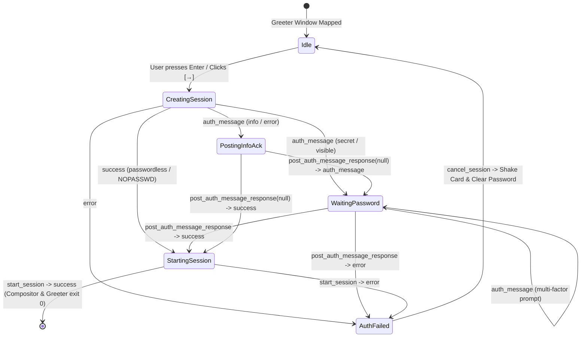

# Technical Specification: Kajo Greeter (`kajo-greeter`) for `greetd`

**Branch**: `feat/kajo-greeter` (based on `master`)  
**Target Executable**: `kajo-greeter` (Wayland Graphical Login Greeter for `greetd`)  
**Companion Scripts/Config**: `data/greetd/kajo-greeter-session`, `data/greetd/niri-greeter.kdl`  
**Target Compositor**: Niri Wayland Compositor (or any `wlr-layer-shell` compositor such as `cage` / `sway`)  

---

## 1. Executive Summary & Objectives

`kajo-greeter` is a native GTK4 + Layer-Shell graphical login greeter for the `greetd` display manager daemon, designed to match Kajo's **Rich Modern Metro Aesthetic** and share visual DNA with Kajo's native Wayland session lock screen (`src/lock/session_lock.c`).

### Core Goals
1. **Zero New Build Dependencies**: Built purely with existing Kajo dependencies (`gtk4`, `gtk4-layer-shell-0`, `gio-2.0`, `glib-2.0`, `json-glib-1.0`).
2. **Native `greetd` IPC Client**: Asynchronous, non-blocking implementation of the `greetd` UNIX socket protocol (`$GREETD_SOCK`, 4-byte native-endian length prefix + JSON payload) supporting multi-step PAM prompts (`secret`, `visible`, `info`, `error`), session launch (`start_session`), and session cancellation (`cancel_session`).
3. **Real System Discovery (Rule #1 — No Mock Data)**:
   - Dynamically enumerates human user accounts (`uid >= 1000 && uid < 60000`, valid login shell) via POSIX `getpwent()`.
   - Dynamically discovers installed Wayland and X11 desktop sessions by parsing `/usr/share/wayland-sessions/*.desktop`, `/usr/local/share/wayland-sessions/*.desktop`, and `/usr/share/xsessions/*.desktop` via `GKeyFile`.
   - Remembers the last logged-in username and selected session in `/var/cache/kajo-greeter/state.json` (falling back to `$XDG_CACHE_HOME/kajo/greeter-state.json`).
4. **Seamless Keyboard-First UX**:
   - Launches with the last-used user and session pre-selected and the password entry immediately focused—allowing a single password type + `Enter` keystroke to log in.
   - Includes the same modifier-key focus guard (`password_entry_has_focus` + `focus_password_entry_preserve_cursor`) as `session_lock.c` so pressing `Shift` for uppercase characters never selects/overwrites typed text.
5. **System Power Controls**:
   - Provides **Suspend**, **Reboot**, and **Power Off** actions via `org.freedesktop.login1.Manager` D-Bus (`Suspend`, `Reboot`, `PowerOff`).
6. **Desktop Preview / Test Mode (`kajo-greeter --test`)**:
   - Can be launched inside an active Niri desktop session without `$GREETD_SOCK` (or with `--test`) in a normal `1280x800` preview window with simulated authentication, enabling rapid UI testing without logging out.

---

## 2. System Architecture & Module Layout

```
src/greeter/
├── greetd_ipc.h / greetd_ipc.c     # greetd UNIX socket framing (uint32 LE + JSON) & async GTask client
├── greeter_users.h / greeter_users.c # Real POSIX getpwent() user enumeration & Desktop session .desktop parser
└── main.c                          # GTK4 Layer-Shell multi-monitor UI, state machine, power D-Bus actions

data/greetd/
├── niri-greeter.kdl                # Minimal locked-down Niri config for the greeter session
└── kajo-greeter-session            # Wrapper script invoked by /etc/greetd/config.toml

tests/
└── test_greetd_ipc.c               # GTest suite verifying greetd binary framing, auth roundtrips & session parsing
```

---

## 3. UI Wireframes & Visual Design

`kajo-greeter` reuses `ShellTheme` (`src/theme.c`) and the `.shell-lock-window` / `.lock-auth-card` visual language from `data/defaults/style.css`, extended with dedicated `.greeter-*` rules for the user/session selectors and bottom status/power bar.

### 3.1. Primary Monitor — Main Login Screen (`1920x1080` / HiDPI Scaled)

```
╔══════════════════════════════════════════════════════════════════════════════════════════════════════╗
║  cachyos-desktop                                                                     WAYLAND · NIRI  ║
║                                                                                                      ║
║                                               16:15                                                  ║
║                                      Saturday, October 31                                            ║
║                                                                                                      ║
║                              ┌────────────────────────────────────────┐                              ║
║                              │               ┌────────┐               │                              ║
║                              │               │   👤   │               │                              ║
║                              │               └────────┘               │                              ║
║                              │                                        │                              ║
║                              │            Mikolas Hämäläinen          │                              ║
║                              │                @mikolas                │                              ║
║                              │                                        │                              ║
║                              │  USER ACCOUNT                          │                              ║
║                              │  ┌──────────────────────────────────┐  │                              ║
║                              │  │ 👤  mikolas (Mikolas Hämäläinen) ▼│  │                              ║
║                              │  └──────────────────────────────────┘  │                              ║
║                              │                                        │                              ║
║                              │  PASSWORD                              │                              ║
║                              │  ┌───────────────────────────┐ ┌────┐  │                              ║
║                              │  │ ••••••••••••           👁 │ │ →  │  │                              ║
║                              │  └───────────────────────────┘ └────┘  │                              ║
║                              │                                        │                              ║
║                              │  SESSION                               │                              ║
║                              │  ┌──────────────────────────────────┐  │                              ║
║                              │  │ 🖥  Niri (Wayland)              ▼│  │                              ║
║                              │  └──────────────────────────────────┘  │                              ║
║                              │                                        │                              ║
║                              │      Enter password to sign in         │                              ║
║                              └────────────────────────────────────────┘                              ║
║                                                                                                      ║
║                                                                                                      ║
║  [Esc] Clear   [Tab] Switch Field                      [ 🌙 Suspend ]  [ ↻ Reboot ]  [ ⏻ Power Off ] ║
╚══════════════════════════════════════════════════════════════════════════════════════════════════════╝
```

---

### 3.2. Auth Card — Interactive States (Expanded View)

#### State A: Multi-User & Multi-Session Dropdowns Open
When the user clicks the **SESSION** dropdown (or navigates with `Tab` / `Alt+S`), all real `.desktop` sessions discovered in `/usr/share/wayland-sessions` and `/usr/share/xsessions` are listed:

```
                               ┌────────────────────────────────────────┐
                               │  SESSION                               │
                               │  ┌──────────────────────────────────┐  │
                               │  │ 🖥  Niri (Wayland)              ▲│  │
                               │  ├──────────────────────────────────┤  │
                               │  │ ▎✓ Niri (Wayland)                │  │  <-- @metro-accent (#0078d4)
                               │  │    COSMIC (Wayland)              │  │
                               │  │    GNOME (Wayland)               │  │
                               │  └──────────────────────────────────┘  │
                               └────────────────────────────────────────┘
```

#### State B: Authenticating in Progress (`greetd` IPC Roundtrip)
While waiting for `greetd` / PAM verification (`post_auth_message_response`), inputs are temporarily locked to prevent double-submission:

```
                               ┌────────────────────────────────────────┐
                               │  PASSWORD                              │
                               │  ┌───────────────────────────┐ ┌────┐  │
                               │  │ ••••••••••••              │ │ ⟳  │  │  <-- Insensitive during PAM
                               │  └───────────────────────────┘ └────┘  │
                               │                                        │
                               │  SESSION                               │
                               │  ┌──────────────────────────────────┐  │
                               │  │ 🖥  Niri (Wayland)              ▼│  │
                               │  └──────────────────────────────────┘  │
                               │                                        │
                               │          Authenticating...             │
                               └────────────────────────────────────────┘
```

#### State C: Authentication Failure (Wrong Password / PAM Error)
On `{"type": "error", "error_type": "auth_error"}` from `greetd`:
- Card border flashes `#e81123` (`.lock-auth-card.auth-error`) with horizontal shake animation (`animate_error_shake`).
- Password field clears and re-focuses automatically.
- `greetd` session is cleanly cancelled (`cancel_session`) and a fresh session is ready for the next attempt.

```
                               ╔════════════════════════════════════════╗
                               ║               ┌────────┐               ║  <-- Border: #e81123 (Danger)
                               ║               │   👤   │               ║      + 300ms Horizontal Shake
                               ║               └────────┘               ║
                               ║                                        ║
                               ║            Mikolas Hämäläinen          ║
                               ║                @mikolas                ║
                               ║                                        ║
                               ║  USER ACCOUNT                          ║
                               ║  ┌──────────────────────────────────┐  ║
                               ║  │ 👤  mikolas (Mikolas Hämäläinen) ▼│  ║
                               ║  └──────────────────────────────────┘  ║
                               ║                                        ║
                               ║  PASSWORD                              ║
                               ║  ┌───────────────────────────┐ ┌────┐  ║
                               ║  │                        👁 │ │ →  │  ║
                               ║  └───────────────────────────┘ └────┘  ║
                               ║                                        ║
                               ║  SESSION                               ║
                               ║  ┌──────────────────────────────────┐  ║
                               ║  │ 🖥  Niri (Wayland)              ▼│  ║
                               ║  └──────────────────────────────────┘  ║
                               ║                                        ║
                               ║  ⚠ Authentication failed — try again   ║  <-- #ff6b6b error label
                               ╚════════════════════════════════════════╝
```

---

### 3.3. Secondary Monitor Surface (Multi-Monitor Setup)

In multi-monitor setups, `kajo-greeter` creates a `gtk4-layer-shell` surface on every connected `GdkMonitor`:
- **Primary monitor**: Full interactive login screen (Wireframe 3.1). Clicking or moving the pointer to another monitor can optionally leave the interactive card on the primary monitor while keeping all secondary monitors covered with the synchronized Metro clock backdrop:

```
╔══════════════════════════════════════════════════════════════════════════════════════════════════════╗
║                                                                                                      ║
║                                                                                                      ║
║                                                                                                      ║
║                                               16:15                                                  ║
║                                      Saturday, October 31                                            ║
║                                                                                                      ║
║                                          cachyos-desktop                                             ║
║                                                                                                      ║
║                                                                                                      ║
║                                                                                                      ║
╚══════════════════════════════════════════════════════════════════════════════════════════════════════╝
```

---

## 4. `greetd` IPC Protocol Specification (`src/greeter/greetd_ipc.c`)

### 4.1. Wire Framing Format
Every request and response over `$GREETD_SOCK` uses the official `greetd_ipc` binary framing:
```
+-------------------------------+---------------------------------------------------+
| Length (4 bytes, uint32_t LE) | JSON Payload (UTF-8 bytes, no null terminator)    |
+-------------------------------+---------------------------------------------------+
```

### 4.2. Supported Request & Response Messages

| Direction | Message Type | JSON Structure |
| :--- | :--- | :--- |
| **Client $\rightarrow$ `greetd`** | `create_session` | `{"type": "create_session", "username": "<user>"}` |
| **Client $\rightarrow$ `greetd`** | `post_auth_message_response` | `{"type": "post_auth_message_response", "response": "<secret_or_null>"}` |
| **Client $\rightarrow$ `greetd`** | `start_session` | `{"type": "start_session", "cmd": ["<cmd>", ...], "env": ["XDG_SESSION_TYPE=wayland", ...]}` |
| **Client $\rightarrow$ `greetd`** | `cancel_session` | `{"type": "cancel_session"}` |
| **`greetd` $\rightarrow$ Client** | `success` | `{"type": "success"}` |
| **`greetd` $\rightarrow$ Client** | `error` | `{"type": "error", "error_type": "auth_error" \| "error", "description": "<msg>"}` |
| **`greetd` $\rightarrow$ Client** | `auth_message` | `{"type": "auth_message", "auth_message_type": "visible" \| "secret" \| "info" \| "error", "auth_message": "<prompt>"}` |

### 4.3. Authentication State Machine



### 4.4. Single-Step Fast Path vs Interactive Prompt Path
- **Fast Path (Standard Password Login)**:
  1. User types password into the already-visible password entry and presses `Enter`.
  2. `kajo-greeter` sends `create_session(username)` on a `GTask` worker thread.
  3. When `greetd` replies with `auth_message` (`secret`), the worker immediately sends `post_auth_message_response(password)` in the same roundtrip (zero extra UI clicks needed).
  4. Move straight to `start_session(cmd, env)` upon `success` and zero out the password buffer with `explicit_bzero()`.
- **Multi-Prompt / Custom PAM Path**:
  - If PAM requests an additional prompt (e.g., 2FA / YubiKey / OTP after the initial password), `kajo-greeter` updates the prompt label (`auth_message`), clears the entry, switches `GtkPasswordEntry` visibility according to `visible` vs `secret`, and sends the follow-up `post_auth_message_response` when the user submits.

---

## 5. User, Session & State Discovery (`src/greeter/greeter_users.c`)

### 5.1. User Account Discovery (`greeter_discover_users`)
- Iterates `setpwent()` / `getpwent()` / `endpwent()`.
- Filters accounts where:
  - `pw->pw_uid >= 1000 && pw->pw_uid < 60000` (standard human UID range).
  - `pw->pw_shell` is not `*/nologin`, `*/false`, or `/bin/sync`.
- Extracts:
  - `username` (`pw->pw_name`)
  - `real_name` (`pw->pw_gecos` up to first `,`, fallback to `pw->pw_name`)
  - `home_dir` (`pw->pw_dir`)
  - Optional user avatar path (`~/.face`, `~/.face.icon`, or `/var/lib/AccountsService/icons/<username>`).
- Sorts users alphabetically and pre-selects:
  1. CLI `--user <name>` if passed, else
  2. `last_user` from state cache, else
  3. First discovered user.

### 5.2. Desktop Session Discovery (`greeter_discover_sessions`)
- Scans directories in order:
  1. `/usr/local/share/wayland-sessions`
  2. `/usr/share/wayland-sessions`
  3. `/usr/local/share/xsessions`
  4. `/usr/share/xsessions`
- Parses each `*.desktop` file with `GKeyFile`:
  - Skips entries with `Hidden=true` or `NoDisplay=true`.
  - Reads `Name`, `Comment`, `Exec`, `DesktopNames`, and session type (`wayland` vs `x11`).
  - Splits `Exec` via `g_shell_parse_argv()` into the `cmd` array required by `greetd`'s `start_session`.
  - Populates `env` array:
    - `XDG_SESSION_TYPE=wayland` (or `x11`)
    - `XDG_SESSION_DESKTOP=<slug>`
    - `XDG_CURRENT_DESKTOP=<DesktopNames or Name>`
- If `--cmd <command>` is passed on the CLI (e.g., `kajo-greeter --cmd niri-session`), ensures that command is registered and selected as the default session.

---

## 6. Compositor Support (`niri` & `cage`) and Deployment (`data/greetd/`)

`kajo-greeter` supports both **Layer-Shell compositors** (`niri`, `sway`, `labwc`) and **XDG kiosk compositors** (`cage`) automatically:

1. **Layer-Shell Mode (Default on `niri` / `sway`)**:
   - When `gtk_layer_is_supported()` returns `TRUE` (and neither `--test` nor `--fullscreen` is passed), `kajo-greeter` creates a `gtk4-layer-shell` surface on `GTK_LAYER_SHELL_LAYER_OVERLAY` with `GTK_LAYER_SHELL_KEYBOARD_MODE_EXCLUSIVE` anchored to all 4 screen edges for every connected `GdkMonitor`.
   - Upon successful `start_session`, if `$NIRI_SOCKET` is set in the environment, `kajo-greeter` invokes `niri msg action quit --skip-confirmation` before exiting `0` so the temporary greeter compositor shuts down cleanly.
2. **XDG Kiosk / `cage` Mode (Automatic Fallback or `--fullscreen`)**:
   - When running under `cage -s -- kajo-greeter --cmd niri-session`, `gtk_layer_is_supported()` returns `FALSE` (because `cage` does not implement `zwlr_layer_shell_v1`).
   - `kajo-greeter` automatically falls back to creating a standard XDG `GtkWindow` and calling `gtk_window_fullscreen(GTK_WINDOW(win))`.
   - Upon successful `start_session`, `kajo-greeter` simply exits `0`, which causes `cage` to terminate immediately and hand control of the VT to the newly started user session.

### 6.1. `/etc/greetd/niri-greeter.kdl` (Installed to `datadir/kajo/greetd/niri-greeter.kdl`)
A minimal, locked-down Niri configuration used exclusively by the `greeter` user so no workspace switchers, terminal hotkeys, or overview bindings are exposed at the login screen:

```kdl
// Minimal Niri configuration for kajo-greeter
input {
    keyboard {
        xkb {
        }
    }
    touchpad {
        tap
        natural-scroll
    }
}

layout {
    gaps 0
    border {
        off
    }
    focus-ring {
        off
    }
}

animations {
    off
}

hotkey-overlay {
    skip-at-startup
}

spawn-at-startup "kajo-greeter"

binds {
    // Intentionally empty for login security
}
```

### 6.2. `kajo-greeter-session` Wrapper Script (Installed to `bindir/kajo-greeter-session`)
Supports launching under either `niri` (default) or `cage` (if `--compositor cage` is specified or if `niri` is unavailable):
- Exports `KAJO_GREETER_CMD` and `KAJO_GREETER_USER` from CLI flags (`--cmd`, `--user`).
- Locates `niri-greeter.kdl` in `/etc/greetd/niri-greeter.kdl`, `/usr/local/share/kajo/greetd/niri-greeter.kdl`, or `/usr/share/kajo/greetd/niri-greeter.kdl`.
- Runs `exec niri -c "$CONFIG_PATH"` (or `exec cage -s -- kajo-greeter "$@"`).

### 6.3. `/etc/greetd/config.toml` Options

**Option A — Using `niri` (Multi-Monitor + HiDPI Native, zero extra packages)**:
```toml
[terminal]
vt = 1

[default_session]
command = "kajo-greeter-session --cmd niri-session"
user = "greeter"
```

**Option B — Using `cage` (Single-Monitor Kiosk Compositor)**:
```toml
[terminal]
vt = 1

[default_session]
command = "cage -s -- kajo-greeter --cmd niri-session"
user = "greeter"
```

---

## 7. CLI Options & Test Modes

`kajo-greeter` supports the following CLI flags:
- `--cmd <command>` / `-c <command>`: Default session command (also read from `$KAJO_GREETER_CMD`).
- `--user <username>` / `-u <username>`: Pre-selected username (also read from `$KAJO_GREETER_USER`).
- `--fullscreen` / `-f`: Force standard XDG fullscreen window mode (used automatically under `cage`).
- `--test` / `-t`: Run in desktop preview mode (`1280x800` regular window on the current desktop). When `$GREETD_SOCK` is unset in `--test` mode, `kajo-greeter` authenticates against `src/lock/pam_auth.c` (`shell_pam_authenticate_async`) so real password success and failure states can be tested safely without logging out.

---

## 8. Three-Stage Testing & Installation Workflow

To avoid logging out during development, verification proceeds in three stages:

### Stage 1: Instant Window Mode on Live Desktop (`0s`, No Logout)
Run directly from the build directory:
```bash
./builddir/kajo-greeter --test --cmd niri-session
```
- Opens a `1280x800` floating/tiled GTK4 window inside your current Niri session.
- Loads real system users (`getpwent()`) and real session `.desktop` files (`/usr/share/wayland-sessions`).
- Entering a **wrong password** verifies the PAM delay, red danger border, and horizontal shake animation.
- Entering the **correct password** verifies PAM authentication success, prints `[TEST MODE] Authenticated user 'mikolas' -> starting session 'niri-session'`, and exits `0`.

### Stage 2: Nested Compositor Test on Live Desktop (`1s`, No Logout)
Run `niri` nested inside a window on the current desktop using the greeter config:
```bash
KAJO_GREETER_TEST=1 niri -c data/greetd/niri-greeter.kdl
```
- Because `$WAYLAND_DISPLAY` is set, `niri` opens as a nested windowed compositor.
- `kajo-greeter` attaches via `gtk4-layer-shell` inside the nested `niri` window.
- Signing in verifies that `kajo-greeter` cleanly terminates the nested `niri` compositor via `$NIRI_SOCKET` without affecting your host Niri session.

### Stage 3: System-Wide Installation for `greetd`
Because `greetd` runs as `user = "greeter"`, the binaries and config must reside in system paths (`/usr/local/bin` and `/etc/greetd`):
```bash
sudo install -Dm755 builddir/kajo-greeter /usr/local/bin/kajo-greeter
sudo install -Dm755 data/greetd/kajo-greeter-session /usr/local/bin/kajo-greeter-session
sudo install -Dm644 data/greetd/niri-greeter.kdl /etc/greetd/niri-greeter.kdl
sudo install -Dm755 -o greeter -g greeter -d /var/cache/kajo-greeter
```
Then enable `command = "kajo-greeter-session --cmd niri-session"` in `/etc/greetd/config.toml`.
*(Safety fallback: `Ctrl+Alt+F2` TTY login remains available at all times.)*

---

## 9. Automated Verification Plan

1. **Build Verification**:
   - `meson compile -C builddir` $\rightarrow$ **0 errors, 0 warnings**.
2. **Automated GTest Suite (`test-greetd-ipc`)**:
   - Spins up a mock `GSocketService` UNIX domain socket speaking the `greetd` binary protocol (`uint32_t LE` + JSON).
   - Verifies:
     1. Successful `create_session` $\rightarrow$ `auth_message (secret)` $\rightarrow$ `post_auth_message_response` $\rightarrow$ `start_session` flow.
     2. Failed authentication (`auth_error`) $\rightarrow$ `cancel_session` recovery flow.
     3. Real user discovery (`greeter_discover_users`) & `.desktop` session file parsing (`greeter_discover_sessions`).
