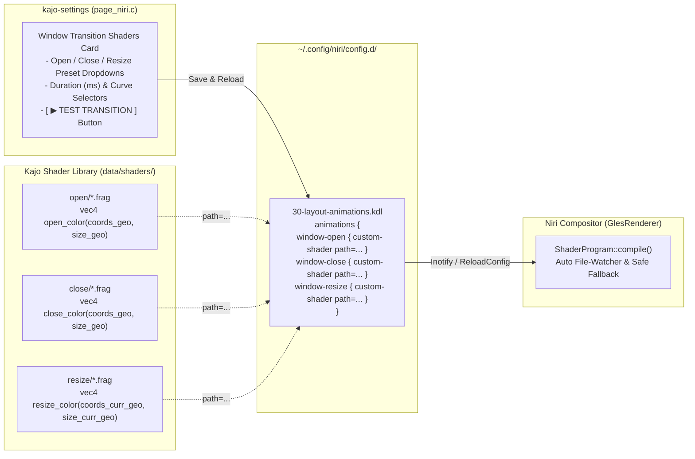

# Technical Specification: Niri Window Transition Shaders (`feat/niri-shaders`)

## 1. Overview & Goals

This specification defines the architecture for integrating a curated library of **Niri GLSL ES 1.00 custom window transition shaders** (`window-open`, `window-close`, `window-resize`) into **Kajo** and **Kajo Settings** ([`page_niri.c`](src/settings/pages/page_niri.c)).

### Key Objectives
1. **Curated Built-in Shader Library (`data/shaders/`)**:
   - Ship a collection of high-visual-impact, zero-overhead GLSL ES 1.00 fragment shaders tailored for **Window Open**, **Window Close**, and **Window Resize** transitions (including Metro 3D flips, CRT beam effects, particle/ash dissolve, vortex implode, iris wipes, pixelation, and cyberpunk glitch transitions).
2. **Interactive Selector & Timing Controls in `kajo-settings` ([`page_niri.c`](src/settings/pages/page_niri.c))**:
   - Allow independent selection of **Open**, **Close**, and **Resize** shader presets (plus `Default (Built-in)`), animation duration (`50 ms` – `800 ms`), and easing curve (`ease-out-expo`, `ease-out-cubic`, `ease-out-quad`, `linear`).
3. **Instant Live Preview (`[ ▶ TEST TRANSITION ]`)**:
   - Provide a button in `kajo-settings` that spawns a stylized transient preview window, resizes it, and closes it after a brief delay so the user can immediately see all three transitions (`window-open`, `window-resize`, `window-close`) in action.
4. **Non-Destructive KDL Persistence & Hot-Reload**:
   - Persist selections to `~/.config/niri/config.d/30-layout-animations.kdl` using `custom-shader path="..."` while preserving all existing `layout {}`, `overview {}`, and non-shader `animations {}` blocks, triggering Niri's live hot-reload.

---

## 2. Niri Custom Shader Architecture (`GLSL ES 1.00`)

In Niri (`src/render_helpers/shaders/mod.rs`), custom shaders are compiled as **OpenGL ES 2.0 (`GLSL ES 1.00`) fragment shaders** wrapped between a Niri prelude and epilogue.



### 2.1 Entry Signatures & Provided Uniforms

| Transition | Required GLSL Function Signature | Niri Prelude Uniforms Available |
| :--- | :--- | :--- |
| **`window-open`** | `vec4 open_color(vec3 coords_geo, vec3 size_geo)` | `sampler2D niri_tex`<br>`mat3 niri_geo_to_tex`<br>`float niri_progress` *(unclamped)*<br>`float niri_clamped_progress` *(`[0.0, 1.0]`)*<br>`float niri_random_seed` *(`[0.0, 1.0)`)* |
| **`window-close`** | `vec4 close_color(vec3 coords_geo, vec3 size_geo)` | Same as `window-open`.<br>*(Note: Runs over full screen area; coordinates outside `[0.0, 1.0]` must be handled cleanly.)* |
| **`window-resize`** | `vec4 resize_color(vec3 coords_curr_geo, vec3 size_curr_geo)` | `sampler2D niri_tex_prev`, `sampler2D niri_tex_next`<br>`mat3 niri_geo_to_tex_prev`, `mat3 niri_geo_to_tex_next`<br>`mat3 niri_curr_geo_to_prev_geo`, `mat3 niri_curr_geo_to_next_geo`<br>`float niri_progress`, `float niri_clamped_progress` |

### 2.2 GLSL ES 1.00 Compliance Rules
To guarantee `0` shader compilation warnings/errors across Mesa Intel (`xe`/`i915`), AMD (`radeonsi`), and NVIDIA drivers:
1. **No `#version` or duplicate `uniform` declarations**: Niri's `*_prelude.frag` already declares `precision highp float;` and all `niri_*` uniforms.
2. **Premultiplied Alpha**: All returned `vec4` colors must have premultiplied alpha (`color.rgb *= alpha; color.a *= alpha;` or `color *= alpha;`).
3. **Out-of-Bounds Clamping**: Before sampling `texture2D(niri_tex, coords_tex.st)`, check `0.0 <= coords_geo.x && coords_geo.x <= 1.0 && 0.0 <= coords_geo.y && coords_geo.y <= 1.0` (or `coords_tex.st` bounds) so edge texels do not streak across the screen during 3D rotations, slides, or falls.
4. **Float Literals**: Use explicit float literals (`0.0`, `1.0`, `2.0`) rather than integers in float expressions, as required by strict GLSL ES 1.00 compilers.

---

## 3. Curated Shader Preset Library (`data/shaders/`)

All shaders live under `data/shaders/{open,close,resize}/` in the source tree and install to `<datadir>/kajo/shaders/{open,close,resize}/` via Meson (`install_subdir`).

### 3.1 `window-open` Presets (`data/shaders/open/`)

| ID | Display Name | Recommended Curve / Duration | Visual Effect Description |
| :--- | :--- | :--- | :--- |
| `default` | `Default (Scale & Fade)` | `ease-out-expo` / `150 ms` | Niri's native built-in scale-up and opacity fade (no `custom-shader` emitted). |
| `metro-flip` | `Metro Turnstile (3D Flip)` | `ease-out-cubic` / `250 ms` | Classic Windows Phone / Metro 3D perspective Y-axis turnstile swing from `-75°` to `0°` with depth foreshortening. |
| `expanding-circle` | `Iris Circle Reveal` | `ease-out-quad` / `250 ms` | Circular iris aperture expanding from the center of the window with a soft anti-aliased edge. |
| `crt-on` | `CRT Power-On (Scanline Beam)` | `ease-out-cubic` / `300 ms` | Ignites as a bright horizontal phosphor beam in the center (`0.0–0.4`), then expands vertically to full height (`0.4–1.0`) with subtle phosphor glow. |
| `pixelate-in` | `Pixelate Materialize` | `ease-out-quad` / `250 ms` | Starts as coarse mosaic blocks (`64px` $\rightarrow$ `1px`) that sharpen into full resolution while fading in. |
| `glitch-in` | `Cyberpunk RGB Glitch` | `linear` / `250 ms` | Horizontal slice displacement with RGB chromatic aberration offset that snaps into alignment as `niri_clamped_progress` reaches `1.0`. |
| `curtain-open` | `Vertical Split Curtain` | `ease-out-expo` / `220 ms` | Left and right halves slide together and unfold from the vertical centerline. |

### 3.2 `window-close` Presets (`data/shaders/close/`)

| ID | Display Name | Recommended Curve / Duration | Visual Effect Description |
| :--- | :--- | :--- | :--- |
| `default` | `Default (Scale & Fade)` | `ease-out-quad` / `150 ms` | Niri's native built-in scale-down and fade-out (no `custom-shader` emitted). |
| `fall-and-rotate` | `Gravity Fall & Rotate` | `linear` / `250 ms` | Accelerating downward drop (`progress² * 220px`) with randomized pivot tilt around the bottom center. |
| `crt-off` | `CRT TV Turn-Off` | `ease-out-cubic` / `300 ms` | Collapses vertically into a bright horizontal scanline (`0.0–0.55`), then shrinks horizontally into a vanishing center white dot (`0.55–1.0`). |
| `ash-dissolve` | `Ash / Particle Dissolve` | `linear` / `320 ms` | Procedural 2D value-noise dissolve with upward-drifting embers and a warm glowing burn edge along the disintegration threshold. |
| `vortex-implode` | `Black Hole Vortex` | `ease-out-quad` / `300 ms` | Spirals and pinches the window texture toward its center (`angle` proportional to `(1.0 - r) * progress`) while fading out. |
| `pixelate-out` | `Pixelate Dematerialize` | `ease-out-quad` / `240 ms` | Coarsens the window into expanding mosaic blocks (`1px` $\rightarrow$ `64px`) while dissolving alpha. |
| `slice-shatter` | `Horizontal Slice Shred` | `ease-out-cubic` / `250 ms` | Splits the window into alternating horizontal bands that shear left and right in opposite directions while fading. |

### 3.3 `window-resize` Presets (`data/shaders/resize/`)

| ID | Display Name | Visual Effect Description |
| :--- | :--- | :--- |
| `default` | `Default (Crossfade & Crop)` | Niri's built-in resize shader (no `custom-shader` emitted). |
| `stretch-next` | `Elastic Stretch` | Dynamically stretches the new texture (`niri_tex_next`) across the interpolating geometry without ghosting the old size. |
| `pixelate-morph` | `Pixelate Morph` | Crossfades `niri_tex_prev` and `niri_tex_next` through a transient pixelated mosaic peak at mid-transition (`sin(progress * PI)`). |
| `glitch-morph` | `Chromatic Glitch Resize` | Crossfades `niri_tex_prev` and `niri_tex_next` with horizontal scanline jitter at the midpoint of the resize. |

---

## 4. Path Resolution & KDL Configuration Persistence

### 4.1 3-Tier Shader Path Resolution
When writing `custom-shader path="..."` into Niri's KDL configuration, `kajo-settings` resolves the shader file path using Kajo's standard 3-tier hierarchy so it works both from `./builddir/kajo-settings` and when installed:
1. `~/.local/share/kajo/shaders/<category>/<id>.frag` (`g_get_user_data_dir()`)
2. `/usr/local/share/kajo/shaders/<category>/<id>.frag` & `/usr/share/kajo/shaders/<category>/<id>.frag`
3. `<cwd>/data/shaders/<category>/<id>.frag` (Development build fallback)

### 4.2 Non-Destructive KDL Update (`~/.config/niri/config.d/30-layout-animations.kdl`)
In [`page_niri.c`](src/settings/pages/page_niri.c):
1. **Reading Current State on Page Load**:
   - Parses `~/.config/niri/config.d/30-layout-animations.kdl` (and `00-kajo.kdl` for `gaps`) using string-aware KDL brace matching to populate:
     - Active preset ID for `window-open`, `window-close`, and `window-resize` (by matching the `// kajo-shader: <id>` tag inside `custom-shader r"..."`, defaulting to `default` if absent).
     - `duration-ms` and `curve` for `window-open` and `window-close`.
2. **Saving Changes (`[ SAVE & RELOAD NIRI CONFIG ]`)**:
   - Reads the selected `.frag` file from `~/.config/kajo/shaders/`, `KAJO_SOURCE_DIR "/data/shaders"`, or `KAJO_DATADIR "/shaders"`.
   - Emits an inline `custom-shader r"\n// kajo-shader: <id>\n<glsl_source>"` block (compatible with both released `niri 26.04` and newer git builds, since `custom-shader path="..."` was added post-`26.04`).
   - Replaces only the `animations { ... }` block in `~/.config/niri/config.d/30-layout-animations.kdl` while **preserving everything above/outside `animations {}`** (`layout {}`, `overview {}`, `prefer-no-csd`, `debug {}`).
   - Inside `animations {}`, preserves all non-shader animation definitions (`workspace-switch`, `horizontal-view-movement`, `window-movement`, `config-notification-open-close`, `screenshot-ui-open`, `overview-open-close`) and writes the updated `window-open`, `window-close`, and `window-resize` blocks:
     ```kdl
     animations {
         workspace-switch {
             spring damping-ratio=0.80 stiffness=523 epsilon=0.0001
         }
         window-open {
             duration-ms 250
             curve "ease-out-cubic"
             custom-shader r"
     // kajo-shader: metro-flip
     vec4 open_color(vec3 coords_geo, vec3 size_geo) {
         ...
     }
     "
         }
         window-close {
             duration-ms 240
             curve "ease-out-quad"
             custom-shader r"
     // kajo-shader: pixelate-out
     vec4 close_color(vec3 coords_geo, vec3 size_geo) {
         ...
     }
     "
         }
         horizontal-view-movement {
             spring damping-ratio=0.85 stiffness=423 epsilon=0.0001
         }
         window-movement {
             spring damping-ratio=0.75 stiffness=323 epsilon=0.0001
         }
         window-resize {
             spring damping-ratio=0.85 stiffness=423 epsilon=0.0001
         }
         config-notification-open-close {
             spring damping-ratio=0.65 stiffness=923 epsilon=0.001
         }
         screenshot-ui-open {
             duration-ms 200
             curve "ease-out-quad"
         }
         overview-open-close {
             spring damping-ratio=0.85 stiffness=800 epsilon=0.0001
         }
     }
     ```
   - Sends `{"Action":"ReloadConfig"}` via `niri_send_action()`.

---

## 5. UI Design in `kajo-settings` ([`data/ui/page_niri.blp`](data/ui/page_niri.blp) & [`src/settings/pages/page_niri.c`](src/settings/pages/page_niri.c))

The **Niri Compositor** page (`page_niri.blp`) will be organized into two clean Metro section cards:

### Card 1: `LAYER RULES & WORKSPACE GAPS` (Existing Controls, Fixed State Loading)
- **Target Layer Namespace**: `kajo`, `kajo-launcher`, `kajo-notification`
- **Surface Layer Opacity**: `20%` – `100%`
- **Workspace Window Gaps**: `0px` – `32px` *(loads existing `gaps` value on init instead of hardcoding `12px`)*
- **Background Blur XRay Mode**: `Disabled` / `Enabled`

### Card 2: `WINDOW TRANSITION SHADERS (GLSL)` (New)
- **Window Open Effect**:
  - Preset `DropDown` (`combo_shader_open`): 7 presets (`Default`, `Metro Turnstile (3D Flip)`, `Iris Circle Reveal`, `CRT Power-On`, `Pixelate Materialize`, `Cyberpunk RGB Glitch`, `Vertical Split Curtain`).
  - Duration `Scale` (`scale_open_dur`: `50 ms` – `800 ms`, step `10 ms`) + Curve `DropDown` (`combo_open_curve`: `ease-out-expo`, `ease-out-cubic`, `ease-out-quad`, `linear`).
  - Selecting a preset automatically updates the duration & curve controls to its recommended values (which the user can still adjust).
- **Window Close Effect**:
  - Preset `DropDown` (`combo_shader_close`): 7 presets (`Default`, `Gravity Fall & Rotate`, `CRT TV Turn-Off`, `Ash / Particle Dissolve`, `Black Hole Vortex`, `Pixelate Dematerialize`, `Horizontal Slice Shred`).
  - Duration `Scale` (`scale_close_dur`: `50 ms` – `800 ms`, step `10 ms`) + Curve `DropDown` (`combo_close_curve`).
- **Window Resize Effect**:
  - Preset `DropDown` (`combo_shader_resize`): 4 presets (`Default (Crossfade & Crop)`, `Elastic Stretch`, `Pixelate Morph`, `Chromatic Glitch Resize`).
- **Action Bar**:
  - `[ SAVE & RELOAD NIRI CONFIG ]` (`btn_apply`): Saves both Layer Rules and Shader settings and reloads Niri.
  - `[ ▶ TEST TRANSITION ]` (`btn_test_shader`): Saves & reloads Niri config, then opens a stylized `420×280` Metro preview `GtkWindow` ("SHADER TRANSITION PREVIEW"), triggers a resize to `560×360` at `t = 600 ms`, and automatically closes it at `t = 1300 ms` so the user sees **Open $\rightarrow$ Resize $\rightarrow$ Close** back-to-back.

---

## 6. Implementation & Verification Plan

1. **Create Shader Library (`data/shaders/`)**:
   - Write and validate all 6 `open/*.frag`, 6 `close/*.frag`, and 3 `resize/*.frag` GLSL ES 1.00 shaders.
   - Register `install_subdir('data/shaders', install_dir: get_option('datadir') / 'kajo' / 'shaders', strip_directory: true)` in [`meson.build`](meson.build).
2. **Update Blueprint UI & Settings Page (`data/ui/page_niri.blp`, `src/settings/pages/page_niri.c`)**:
   - Add the **Window Transition Shaders** controls and `[ ▶ TEST TRANSITION ]` button to `page_niri.blp`.
   - Implement KDL parsing and non-destructive saving for `30-layout-animations.kdl` in `page_niri.c`.
   - Update sidebar search keywords for the `"niri"` row in [`src/settings/settings_window.c`](src/settings/settings_window.c) to include `"shader shaders glsl animation open close resize transition"`.
3. **Compile & Test**:
   - Verify `meson compile -C builddir` (0 errors, 0 warnings) and `meson test -C builddir` (7/7 passing).
   - Test every shader preset in Niri to confirm zero GLES compilation warnings in Niri logs.
