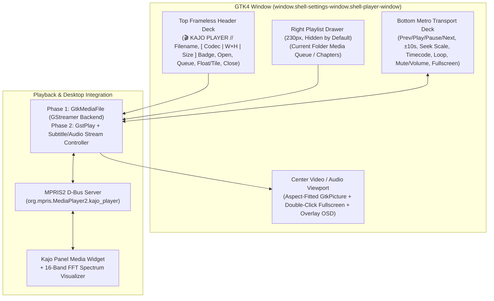

# Technical Specification: Kajo Player (`SPEC_VIDEO_PLAYER.md`)

**Target Module:** `src/player/`  
**Target Binary:** `kajo-player` (`org.kajo.Player`)  
**Status:** Phase 1 MVP Specification  
**Desktop Entry:** `data/org.kajo.Player.desktop` (`MimeType=video/*;audio/*;`)  
**Tech Stack:** C17, GTK4 (`gtk4`), GIO (`gio-2.0`), `libmpv` (`mpv/client.h`, `mpv/render_gl.h` + `GtkGLArea` / EGL / GLES2), MPRIS2 D-Bus (`org.mpris.MediaPlayer2.kajo_player`), Blueprint Markup (`blueprint-compiler`)

---

## 1. Executive Summary & Design Philosophy

**Kajo Player (`kajo-player`)** is the native video and audio player for the Kajo desktop environment on the Niri Wayland compositor. Its visual design is modeled directly on the **`kajo-files` Quick Look video preview card**—elevating that crisp, technical broadcast-deck aesthetic into a standalone application:

- **Quick Look Video Preview Aesthetic:**
  - Frameless `window.shell-settings-window.shell-player-window` surface with a `1px solid @metro-accent` perimeter and a `3px solid @metro-accent` top accent bar.
  - Pure dark `#0c0c0c` video canvas framed by `#141414` / `#161616` header and transport decks with `1px solid #2b2b2b` dividers.
  - `Fira Code` monospace titles, stream metadata badges (`[ video/x-matroska | 1920×1080 | 42.6 MB ]`), and precision timecodes (`00:14:22 / 01:48:05`).
- **Two-Stage Engineering Rollout:**
  - **Phase 1 (MVP):** Hardware-accelerated **`libmpv` (`mpv_render_context` + `GtkGLArea`)** playback with `hwdec=auto-safe` and automatic `libass` subtitle rendering (`sub-auto=fuzzy`), custom Metro transport bar, bottom-edge auto-hiding fullscreen overlay controls, auto-populated sibling folder playlist drawer (`230px`, hidden by default), and native **MPRIS2 D-Bus export** so `kajo-player` integrates immediately with Kajo's panel Media widget and 16-band FFT spectrum analyzer.
  - **Phase 2 (Full Media Controls):** UI controls exposing `libmpv`'s subtitle/audio track lists (`sid` / `aid` track selector popovers, external subtitle file picker, `sub-delay`), chapter markers, hardware decode telemetry OSD (`Ctrl+J`), frame-stepping, and playback speed control (`0.25×`–`2.0×`).

---

## 2. System Architecture



---

## 3. UI Wireframes & Mockups

### 3.1 Main Window — Standard Deck Mode (Matching Quick Look Video Card)

```text
┌══════════════════════════════════════════════════════════════════════════════════════════════════════════════┐
║ 🎬 KAJO PLAYER // Sample_Clip_1080p.mkv      [ video/x-matroska | 1920×1080 | 42.6 MB ] [📂] [☰] [🗗] [ ✕ ] ║
╟──────────────────────────────────────────────────────────────────────────────────────────────────────────────╢
║                                                                                                              ║
║                                                                                                              ║
║                                                                                                              ║
║                                                                                                              ║
║                                       ┌──────────────────────────────┐                                       ║
║                                       │                              │                                       ║
║                                       │         VIDEO CANVAS         │                                       ║
║                                       │      (#0c0c0c Backdrop)      │                                       ║
║                                       │    Aspect-Fitted Paintable   │                                       ║
║                                       │                              │                                       ║
║                                       └──────────────────────────────┘                                       ║
║                                                                                                              ║
║                                                                                                              ║
║                                                                                                              ║
║                                                                                                              ║
╟──────────────────────────────────────────────────────────────────────────────────────────────────────────────╢
║  00:01:24  [████████████████████░░░░░░░░░░░░░░░░░░░░░░░░░░░░░░░░░░░░░░░░░░░░░░░░░░░░░░░░░░░░░░░░]  00:04:12  ║
║  [ ⏮ ] [ ⏪ -10s ] [  ⏸ PAUSE  ] [ +10s ⏩ ] [ ⏭ ]    [ 🔁 LOOP ]         🔊 [██████░░] 80%    [ ⛶ FULL ]  ║
└══════════════════════════════════════════════════════════════════════════════════════════════════════════════┘
```

### 3.2 Main Window with Toggleable Right Queue Drawer (`[☰]` / `Ctrl+P`)

Like the Inspector in `kajo-files`, the Queue drawer is **hidden by default** and compact (`230px` wide) when toggled open:

```text
┌══════════════════════════════════════════════════════════════════════════════════════════════════════════════┐
║ 🎬 KAJO PLAYER // Episode_01.mkv             [ video/x-matroska | 1920×1080 | 310.4 MB ] [📂] [☰] [🗗] [ ✕ ] ║
╟───────────────────────────────────────────────────────────────────────────────────────┬──────────────────────╢
║                                                                                       │ QUEUE        [ 4 ]   ║
║                                                                                       ├──────────────────────┤
║                                                                                       │▌▶ Episode_01.mkv     ║
║                                                                                       │   310.4 MB           ║
║                                     VIDEO CANVAS                                      │ 🎬 Episode_02.mkv    ║
║                                                                                       │   298.1 MB           ║
║                                                                                       │ 🎬 Episode_03.mkv    ║
║                                                                                       │   304.8 MB           ║
║                                                                                       │ 🎬 Bonus_Clip.mp4    ║
║                                                                                       │   48.2 MB            ║
╟───────────────────────────────────────────────────────────────────────────────────────┴──────────────────────╢
║  00:12:08  [████████████████████████████░░░░░░░░░░░░░░░░░░░░░░░░░░░░░░░░░░░░░░░░░░░░░░░░░░░░░░░░]  00:24:00  ║
║  [ ⏮ ] [ ⏪ -10s ] [  ⏸ PAUSE  ] [ +10s ⏩ ] [ ⏭ ]    [ 🔁 LOOP ]         🔊 [██████░░] 80%    [ ⛶ FULL ]  ║
└══════════════════════════════════════════════════════════════════════════════════════════════════════════════┘
```

### 3.3 Fullscreen Mode (`F` / `F11` / Double-Click on Video Canvas)

- When Fullscreen is active:
  - The top Header Deck, Queue Drawer, and Bottom Transport Deck automatically hide after `2.5 seconds` of pointer inactivity so the video fills 100% of the monitor.
  - Moving the mouse or pressing any transport key reveals the Header and Bottom Transport Deck smoothly.

---

## 4. Phase 1 (MVP) vs. Phase 2 (Full Media Engine) Scope

| Feature Area | Phase 1: MVP (Initial Implementation) | Phase 2: Full Media Engine (Follow-Up) |
| :--- | :--- | :--- |
| **Window & Chrome** | Frameless Quick Look card aesthetic (`window.shell-settings-window.shell-player-window`), `3px` top accent border, `🗗 FLOAT / TILE`, Fullscreen (`F` / Double-Click) | Picture-in-Picture (PiP) aspect lock & auto-hiding overlay controls in Fullscreen |
| **Playback Backend** | `GtkMediaFile` + `GtkPicture` (GStreamer `libgstplay` backend) supporting `.mkv`, `.mp4`, `.webm`, `.mov`, `.avi`, `.mp3`, `.flac`, `.ogg`, `.opus`, `.wav` | Direct `GstPlay` + `GstPlayVideoOverlayVideoRenderer` / `gtk4paintablesink` pipeline |
| **Transport Deck** | Play/Pause (`Space`), Prev/Next (`PageUp`/`PageDown`), `±5s`/`±10s` seek (`←`/`→`), timeline `GtkScale` scrubber, monospace timecode, Loop toggle (`L`), Mute (`M`) & Volume (`↑`/`↓`) | Frame-step forward/backward (`.` / `,`), A-B loop repeat, and playback speed (`0.25×` – `2.0×`, `[` / `]`) |
| **Playlist / Queue** | Compact `230px` toggleable drawer (`Ctrl+P` / `[☰]`), automatically scanning sibling media files in the opened file's folder + CLI multi-file queue | Drag-and-drop reordering, `.m3u8` / `.pls` playlist import/export, and Chapter Markers tab |
| **Subtitles & Audio Tracks** | Default embedded audio & subtitle stream playback via GStreamer | Track selector popover for embedded/external subtitles (`.srt`, `.ass`, `.vtt`, PGS), subtitle timing offset (`Z`/`X`), and multi-language audio stream switcher (`#`) |
| **MPRIS2 Integration** | Full `org.mpris.MediaPlayer2` + `org.mpris.MediaPlayer2.Player` D-Bus service (`PlayPause`, `Next`, `Previous`, `Seek`, `Metadata`, `PlaybackStatus`, `Position`) | Album art thumbnail extraction for video frames & chapter metadata export |

---

## 5. Keyboard & Mouse Shortcuts

| Shortcut | Action |
| :--- | :--- |
| **`Space` / `K`** | Toggle Play / Pause |
| **`F` / `F11` / Double-Click** | Toggle Fullscreen mode |
| **`Escape`** | Exit Fullscreen mode (or close Queue drawer) |
| **`←` / `→`** | Seek `-5s` / `+5s` (`Shift+←` / `Shift+→` for `-30s` / `+30s`) |
| **`↑` / `↓`** | Volume `+5%` / `-5%` |
| **`M`** | Toggle Audio Mute |
| **`L`** | Toggle Loop current file |
| **`PageUp` / `P` / `<`** | Previous item in Queue |
| **`PageDown` / `N` / `>`** | Next item in Queue |
| **`Ctrl+O`** | Open Media File dialog |
| **`Ctrl+P` / `Ctrl+I`** | Toggle Right Queue Drawer |
| **`Ctrl+Q` / `Q`** | Quit `kajo-player` |

---

## 6. Modular Source Layout (`src/player/`)

Following `AGENTS.md` Section 5 (no monolithic files), `kajo-player` is organized into focused modules under `src/player/`:

| File | Responsibility |
| :--- | :--- |
| [`src/player/main.c`](file:///home/mikolas/src/Kajo/src/player/main.c) | `GtkApplication` (`org.kajo.Player`, `G_APPLICATION_HANDLES_OPEN`), CLI file/URI parsing, `ShellTheme` & `ShellIcons` initialization |
| [`src/player/player_window.h`](file:///home/mikolas/src/Kajo/src/player/player_window.h) / [`src/player/player_window.c`](file:///home/mikolas/src/Kajo/src/player/player_window.c) | Main window controller, Quick Look deck chrome, `GtkMediaFile` / `GtkPicture` binding, seek bar & timecode formatter, keyboard shortcuts, and Fullscreen auto-hide |
| [`src/player/player_queue.h`](file:///home/mikolas/src/Kajo/src/player/player_queue.h) / [`src/player/player_queue.c`](file:///home/mikolas/src/Kajo/src/player/player_queue.c) | Media queue data model (`KajoMediaTrack`), automatic sibling folder media scanner, timecode formatting (`kajo_player_format_time()`), and Queue drawer UI |
| [`src/player/player_mpris.h`](file:///home/mikolas/src/Kajo/src/player/player_mpris.h) / [`src/player/player_mpris.c`](file:///home/mikolas/src/Kajo/src/player/player_mpris.c) | Native `org.mpris.MediaPlayer2.kajo_player` D-Bus service exporting playback state, track metadata, and remote transport controls to Kajo's panel Media widget |
| [`data/ui/player_window.blp`](file:///home/mikolas/src/Kajo/data/ui/player_window.blp) | Declarative Blueprint template for `KajoPlayerWindow` |
| [`data/org.kajo.Player.desktop`](file:///home/mikolas/src/Kajo/data/org.kajo.Player.desktop) | Desktop entry (`Name=Kajo Player`, `Exec=kajo-player %U`, `MimeType=video/*;audio/*;`) |
| [`tests/test_player_queue.c`](file:///home/mikolas/src/Kajo/tests/test_player_queue.c) | Unit tests for timecode formatting (`HH:MM:SS` / `MM:SS`), media MIME/extension detection, sibling directory media discovery, and queue navigation |

---

## 7. Verification Plan

1. **Automated Unit Tests (`tests/test_player_queue.c`):**
   - Verify microsecond/second timecode formatting (`00:00`, `04:12`, `01:42:18`), supported media file filtering (`.mkv`, `.mp4`, `.webm`, `.mp3`, `.flac`), sibling folder queue discovery, and next/prev wrap-around.
2. **Build & Test Gate:**
   - `meson compile -C builddir && meson test -C builddir` $\rightarrow$ 0 errors, 0 warnings, 12/12 passing GTest suites.
3. **Live Desktop Verification:**
   - Launch `./builddir/kajo-player` on a sample video/audio file, verify the Quick Look video deck styling, seek bar, fullscreen toggle, Queue drawer, and live MPRIS2 synchronization with Kajo's top panel Media widget.
