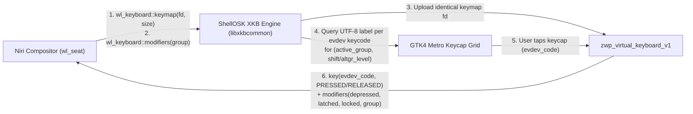

# Technical Specification: Kajo Native Wayland Virtual Keyboard (`SPEC_VIRTUAL_KEYBOARD.md`)

**Target Module:** `src/osk/` (`osk.h`, `osk.c`)  
**Target Binaries:** `kajo` & `kajo-settings`  
**Wayland Protocols:** `zwp_virtual_keyboard_v1`, `zwp_input_method_v2`, `wl_seat` (`wl_keyboard`), `wlr-layer-shell-unstable-v1` (`gtk4-layer-shell`)

---

## 1. Executive Summary & Core Requirements

When a 2-in-1 convertible or foldable laptop (such as the HP OmniBook X Flip 14) is folded into tablet/tent mode (`> 180°`), [`ShellPostureManager`](src/posture/posture_manager.c) inhibits the physical keyboard (`AT Translated Set 2 keyboard`). Without an On-Screen Keyboard (OSK), the user cannot type into browsers, terminals, password prompts, or the Kajo Launcher.

The **Kajo Virtual Keyboard (`ShellOSK`)** is a built-in, zero-dependency (beyond `libxkbcommon` and `wayland-client`), Metro-styled Wayland On-Screen Keyboard that:
1. **Never Steals Focus**: Uses `gtk4-layer-shell` on `GTK_LAYER_SHELL_LAYER_OVERLAY` (`namespace = "kajo-osk"`) with `GTK_LAYER_SHELL_KEYBOARD_MODE_NONE` so tapping keys sends keystrokes directly to the focused window without deactivating text inputs.
2. **Handles Arbitrary Keyboard Layouts Dynamically via `libxkbcommon`**: Mirrors Niri's active `wl_keyboard` XKB keymap and layout group (`fi`, `us`, `se`, `de`, `ru`, etc.) so keycap labels (`å`, `ä`, `ö`, `€`, `@`, `{`, `[`, `]`, `}`) and emitted evdev keycodes are 100% faithful to the user's configured Niri keyboard layout(s).
3. **Supports Both Automatic (`zwp_input_method_v2`) and Manual Activation**:
   - Automatically slides up when a text input field requests input (`zwp_input_method_v2::activate`) while in Tablet Mode (or Always, if configured).
   - Can be toggled manually at any time via a **Panel Widget (`osk`)**, **Control Center Quick Tile**, **Panel Edge Swipe**, or **IPC command (`kajo-msg toggle-osk`)** for apps that do not implement `text-input-v3` (e.g., terminals, XWayland apps).

---

## 2. Dynamic Multi-Layout Architecture (`wl_keyboard` + `libxkbcommon` + `zwp_virtual_keyboard_v1`)

### 2.1 Why Hardcoded Key Tables Fail on Non-US Layouts
In Wayland (`zwp_virtual_keyboard_v1`), a virtual keyboard does **not** send Unicode strings; it sends **raw Linux evdev keycodes** (`KEY_Q = 16`, `KEY_SEMICOLON = 39`, `KEY_APOSTROPHE = 40`, `KEY_LEFTBRACE = 26`, `KEY_102ND = 86`, etc.) and **modifier masks** (`Shift`, `AltGr` / `ISO_Level3_Shift`, `Ctrl`, `Alt`, `Super`). The compositor (`niri`) translates those evdev keycodes through the active XKB keymap.

If an OSK hardcodes US QWERTY labels, pressing `;` (`KEY_SEMICOLON = 39`) on a Finnish (`fi`) system actually types **`ö`**, and pressing `[` (`KEY_LEFTBRACE = 26`) types **`å`**.

### 2.2 Zero-Drift XKB Reflection Pipeline



1. **Receiving the Compositor Keymap (`wl_keyboard::keymap`)**:
   - `ShellOSK` binds `wl_seat` and attaches a `wl_keyboard` listener.
   - Whenever Niri emits `wl_keyboard::keymap(format = WL_KEYBOARD_KEYMAP_FORMAT_XKB_V1, fd, size)`:
     - `ShellOSK` `mmap`s `fd`, parses it into `struct xkb_keymap *` via `xkb_keymap_new_from_string()`, and creates a lookup `struct xkb_state *`.
     - `ShellOSK` immediately forwards the **exact same keymap** to `zwp_virtual_keyboard_v1_keymap(vkbd, format, fd, size)`.
     - **Niri Fast-Path**: In Niri's `src/handlers/virtual_keyboard.rs` (`if *self.configured_keymap() == *keymap`), uploading a keymap identical to Niri's seat keymap avoids swapping or resetting the compositor's keyboard state!
2. **Dynamic Keycap Label Resolution (`xkbcommon`)**:
   - Each physical key button in the OSK grid is bound to its hardware **Linux evdev keycode** (`uint32_t evdev_code`, where `xkb_keycode_t = evdev_code + 8`).
   - Whenever the active layout group (`group`), `Shift` state, `CapsLock` state, or `AltGr` (`ISO_Level3_Shift`, `KEY_RIGHTALT = 100`) state changes, `ShellOSK` constructs a temporary `xkb_state` with those active modifiers and queries every key's UTF-8 string via:
     ```c
     xkb_state_key_get_utf8(temp_state, evdev_code + 8, utf8_buf, sizeof(utf8_buf));
     ```
   - **Automatic ISO vs ANSI Key Adaptation**:
     - For Nordic/European ISO layouts (`fi`, `se`, `de`, `fr`, `gb`, etc.) where `KEY_LEFTBRACE (26)` (`å`), `KEY_SEMICOLON (39)` (`ö`), `KEY_APOSTROPHE (40)` (`ä`), and `KEY_102ND (86)` (`< > |`) produce letters or primary symbols, those keys are automatically shown in the main letter rows!
     - Secondary symbols on the key (`Shift` level and `AltGr` level, e.g. `@ £ $ € { [ ] } \ | ~`) are shown both as subtle top-right corner hints on the main layer and as dedicated one-tap keys on the **`?123` / `AltGr` Symbol Layer**.
3. **Multi-Layout Switching (`🌐` Globe Key)**:
   - Tapping the **`🌐 <Layout>`** key on the bottom row calls `shell_compositor_switch_keyboard_layout_idx()` (or cycles `group` if multiple layouts like `fi,us` are configured in Niri), immediately updating all keycap labels (`å ä ö` $\leftrightarrow$ `[ ; '`).

---

## 3. UI Wireframes & Layer Layouts

### 3.1 Layer 1: Primary Alpha Layout — Finnish / Nordic (`fi` / `se`) Active
When Niri's active layout is **Finnish (`fi`)**, the 11-column ISO alpha rows automatically populate `å`, `ö`, `ä` from `xkbcommon`, plus a top utility/number bar:

```text
┌─────────────────────────────────────────────────────────────────────────────────────────┐
│  [ Esc ]  [ Tab ]   [  1 !  ] [  2 " @ ] [  3 # £ ] [  4 ¤ $ ] [  5 % € ] [  6 &  ] ... │
├─────────────────────────────────────────────────────────────────────────────────────────┤
│  [  q  ] [  w  ] [  e € ] [  r  ] [  t  ] [  y  ] [  u  ] [  i  ] [  o  ] [  p  ] [ å ] │
│   [  a  ] [  s  ] [  d  ] [  f  ] [  g  ] [  h  ] [  j  ] [  k  ] [  l  ] [ ö ] [ ä ]   │
│  [ ⇧ Shift ] [ < > ] [  z  ] [  x  ] [  c  ] [  v  ] [  b  ] [  n  ] [  m  ] [  ⌫ Bksp ]│
│  [ ?123 ] [ Ctrl ] [ Alt ] [ 🌐 FI ] [        Space        ] [ AltGr ] [ ← ][ ↑↓ ][ → ] [ ⏎ ] [ ⌨↓ ] │
└─────────────────────────────────────────────────────────────────────────────────────────┘
```

### 3.2 Layer 1: Primary Alpha Layout — US English (`us`) Active
When switched to **US (`us`)**, the exact same evdev grid relabels automatically via `xkbcommon`:

```text
┌─────────────────────────────────────────────────────────────────────────────────────────┐
│  [ Esc ]  [ Tab ]   [  1 !  ] [  2 @  ] [  3 #  ] [  4 $  ] [  5 %  ] [  6 ^  ] ...     │
├─────────────────────────────────────────────────────────────────────────────────────────┤
│  [  q  ] [  w  ] [  e  ] [  r  ] [  t  ] [  y  ] [  u  ] [  i  ] [  o  ] [  p  ] [ [ { ]│
│   [  a  ] [  s  ] [  d  ] [  f  ] [  g  ] [  h  ] [  j  ] [  k  ] [  l  ] [ ; : ] [ ' " ]│
│  [ ⇧ Shift ] [ \ | ] [  z  ] [  x  ] [  c  ] [  v  ] [  b  ] [  n  ] [  m  ] [  ⌫ Bksp ]│
│  [ ?123 ] [ Ctrl ] [ Alt ] [ 🌐 US ] [        Space        ] [ . , / ] [ ← ][ ↑↓ ][ → ] [ ⏎ ] [ ⌨↓ ] │
└─────────────────────────────────────────────────────────────────────────────────────────┘
```

### 3.3 Layer 2: Symbols, Numbers & Navigation (`?123` / `AltGr` Layer)
Tapping **`[ ?123 ]`** or **`[ AltGr ]`** switches the letter rows to direct one-tap access for all `Shift` + `AltGr` symbols (discovered dynamically from levels 1 & 2 of the active XKB keymap, so `@ £ $ € { [ ] } \ ~ | < >` are always 1 tap away regardless of whether the underlying XKB layout is `fi` or `us`!), alongside function keys and navigation keys:

```text
┌─────────────────────────────────────────────────────────────────────────────────────────┐
│  [ Esc ]  [ F1 ] [ F2 ] [ F3 ] [ F4 ] [ F5 ] [ F6 ] [ F7 ] [ F8 ] [ F9 ] [ F10 ] [ Del ]│
├─────────────────────────────────────────────────────────────────────────────────────────┤
│  [  1  ] [  2  ] [  3  ] [  4  ] [  5  ] [  6  ] [  7  ] [  8  ] [  9  ] [  0  ] [ + ? ]│
│  [  @  ] [  #  ] [  €  ] [  $  ] [  %  ] [  &  ] [  {  ] [  [  ] [  ]  ] [  }  ] [ \ | ]│
│  [  ~  ] [  <  ] [  >  ] [  (  ] [  )  ] [  -  ] [  _  ] [  =  ] [  *  ] [  /  ] [  ⌫  ]│
│  [ ABC ]  [ Ctrl ] [ Super ] [ Alt ] [        Space        ] [PgUp/Dn] [ ← ][ ↑↓ ][ → ] [ ⏎ ] [ ⌨↓ ] │
└─────────────────────────────────────────────────────────────────────────────────────────┘
```
*(Wait: how does one-tap `@`, `{`, `[`, `]`, `}`, `\`, `€` work when the user taps `[ { ]` on the `?123` layer? When generating the `?123` layer from `xkbcommon`, each symbol key stores the exact `(evdev_code, required_shift_And_altgr_mask)` tuple that produces that symbol in the current XKB keymap! When tapped, `ShellOSK` temporarily sends `zwp_virtual_keyboard_v1_modifiers(mods_depressed = tuple.mask)`, sends `key(tuple.evdev_code, PRESSED/RELEASED)`, and restores the previous modifier state!)*

### 3.4 Sticky Modifier Behavior (`Shift`, `Ctrl`, `Alt`, `Super`, `AltGr`)
- **Single Tap on Modifier (`Shift`, `Ctrl`, `Alt`, `Super`, `AltGr`)**:
  - Enters **Latched (One-Shot)** state (`.osk-key-latched` CSS highlight with accent border).
  - The next non-modifier key tap sends the modifier + key and automatically unlatches the modifier (e.g. tapping `Ctrl` then `c` sends `Ctrl+C`; tapping `Shift` then `a` sends `A`).
- **Double Tap on `Shift` (or Tap while Latched)**:
  - Enters **Locked (`Caps Lock`)** state (`.osk-key-locked` solid accent fill) until tapped again.

### 3.5 Hold-to-Repeat (`Backspace`, `Delete`, Arrow Keys `← ↑ ↓ →`)
- Pressing and holding `Backspace`, `Delete`, `Space`, or any Arrow key starts an initial `400 ms` delay timer followed by a `45 ms` repeat interval (~22 Hz), stopping immediately on finger release or gesture cancel.

---

## 4. Trigger & Lifecycle Architecture

### 4.1 Automatic Trigger (`zwp_input_method_v2`)
- `ShellOSK` binds `zwp_input_method_manager_v2` and creates a `zwp_input_method_v2` object for the seat.
- When `zwp_input_method_v2_listener.activate` + `done` arrives:
  - Checks `config->osk_auto_show_mode`:
    - **`"tablet"` *(default)***: Auto-shows the OSK if `shell_posture_manager_get_state() == SHELL_POSTURE_FOLDED` (or if no hinge sensor exists and a touchscreen is present).
    - **`"always"`**: Auto-shows whenever any text input is focused.
    - **`"manual"`**: Only shows when manually toggled by the user.
- When `zwp_input_method_v2_listener.deactivate` + `done` arrives:
  - If the OSK was opened automatically by input-method activation (and not pinned open manually), smoothly hides the OSK.
- **Crucial Detail**: `ShellOSK` **never** calls `zwp_input_method_v2_grab_keyboard()`, because grabbing the keyboard would intercept physical keys and complicate XKB state. Instead, `zwp_input_method_v2` is used purely as a passive focus-detection sensor, while key injection goes through `zwp_virtual_keyboard_v1`!

### 4.2 Manual Triggers (Works for Terminals & Non-Text-Input Apps)
1. **Panel Widget (`"osk"` in `src/widgets/osk.c`) & Control Center Quick Tile**:
   - A `⌨` (`input-keyboard-symbolic`) panel button and Control Center toggle tile that calls `shell_osk_toggle(app->osk)`.
2. **Bottom-Edge Touch Swipe**:
   - Swiping upward from the bottom panel (or tapping the `⌨` button) toggles the OSK.
3. **IPC Socket Command**:
   - `kajo-msg toggle-osk` / `kajo-msg show-osk` / `kajo-msg hide-osk`.

### 4.3 Exclusive Zone & Geometry
- Anchored to `BOTTOM | LEFT | RIGHT` on `GTK_LAYER_SHELL_LAYER_OVERLAY`.
- Configurable `exclusive_zone`:
  - By default (`osk_push_windows = true`), sets `gtk_layer_set_exclusive_zone(window, osk_height)` (`~260px`) when visible so Niri automatically resizes/pushes tiled windows above the keyboard instead of covering the bottom of the terminal or browser!
  - Can also be toggled to floating overlay mode (`exclusive_zone = 0`) if the user prefers the keyboard to float over windows.

---

## 5. Settings UI Wireframe (`kajo-settings` $\rightarrow$ **Panel & Touch**)

Added to the **`TOUCHSCREEN & SWIPE GESTURES`** section in [`data/ui/page_panel.blp`](data/ui/page_panel.blp):

```text
┌──────────────────────────────────────────────────────────────────────────────┐
│  VIRTUAL KEYBOARD (ON-SCREEN KEYBOARD)                                       │
│                                                                              │
│  Auto-Show Virtual Keyboard:   [ In Tablet Mode Only (Default)           ▼ ] │
│  Window Layout Behavior:       [ Push Tiled Windows Up (Exclusive Zone)  ▼ ] │
│  Virtual Keyboard Height:      ───────────────●───────────────  260px        │
└──────────────────────────────────────────────────────────────────────────────┘
```

---

## 6. Implementation Plan

1. **Wayland Protocol XMLs (`protocol/`) & `meson.build`**:
   - Add `protocol/virtual-keyboard-unstable-v1.xml` and `protocol/input-method-unstable-v2.xml` (standard `wlr` / `wayland-protocols` XML definitions) and generate C headers/code via `wayland-scanner` in [`meson.build`](meson.build).
   - Add `dependency('xkbcommon')` to [`meson.build`](meson.build).
2. **Core OSK Engine (`src/osk/osk.h`, `src/osk/osk.c`)**:
   - Implement `wl_seat` / `wl_keyboard` XKB keymap listener, `zwp_virtual_keyboard_v1` key/modifier sender, `zwp_input_method_v2` text-focus detector, dynamic `libxkbcommon` keycap labeler & symbol-tuple resolver, sticky modifiers, and hold-to-repeat timer.
3. **Panel Widget (`src/widgets/osk.c`) & IPC (`src/ipc/socket.c`)**:
   - Register the `"osk"` panel widget (`input-keyboard-symbolic`) in [`src/widgets/registry.c`](src/widgets/registry.c) and add `toggle-osk` to [`src/ipc/socket.c`](src/ipc/socket.c).
4. **Settings & Styling (`data/defaults/style.css`, `data/ui/page_panel.blp`, `src/settings/pages/page_panel.c`)**:
   - Add Metro dark glassmorphism keycap styles (`.osk-window`, `.osk-key`, `.osk-key-special`, `.osk-key-latched`, `.osk-key-locked`) in [`data/defaults/style.css`](data/defaults/style.css).
   - Add OSK settings to `ShellConfig` and `page_panel.c`.
5. **Unit Tests (`tests/test_osk_xkb.c`)**:
   - Headless `libxkbcommon` unit test verifying that `ShellOSK`'s keymap resolver produces `å`, `ö`, `ä`, `€`, `{`, `[`, `]`, `}` on `"fi"` and `[`, `;`, `'`, `@`, `$` on `"us"`, and resolves the exact `(evdev_keycode, modifier_mask)` tuples for symbol keys.
