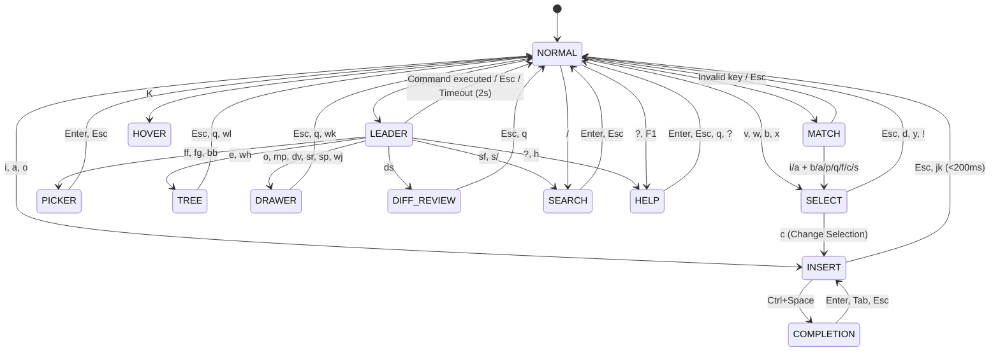

# SPEC_IDE.md — Kajo IDE (`kajo-ide`, `org.kajo.IDE`) Architecture & UI Specification

**Status:** Draft / Active Feature Specification  
**Target Binary:** `kajo-ide` (`org.kajo.IDE`)  
**Design System:** [`docs/SPEC_DESIGN_SYSTEM.md`](file:///home/mikolas/src/Kajo/docs/SPEC_DESIGN_SYSTEM.md) ("Aero + Metro" Unified UI)  
**Feature & Ergonomic Reference:** [`../koodieditori`](file:///home/mikolas/src/koodieditori/README.md) (`koodi` — Selection-First Modal Polyglot IDE)

---

## 1. Executive Summary & Core Philosophy

**`kajo-ide`** (`org.kajo.IDE`) is a native Wayland GTK4 + `GtkSourceView 5` polyglot IDE designed for the Kajo Desktop Suite. It brings **100% feature, modal FSM, and Nordic-first keybinding parity** with [`koodieditori`](file:///home/mikolas/src/koodieditori/README.md) (`koodi`) while upgrading the terminal grid to pixel-accurate GPU rendering, crisp `Fira Code` vector typography, proportional scrollbars/minimaps, native Cairo vector Mermaid diagrams, and full Kajo "Aero + Metro" visual integration.

### 1.1 The Five Pillars of `kajo-ide`
1. **Selection-First Modal Editing (`Object → Action`):**
   - Unlike traditional Vim (`Action → Object`, e.g., `dw`), movements and text objects in `kajo-ide` (`w`, `b`, `x`, `m i f`) immediately highlight the target selection in `@metro-accent` (`SELECT` mode) before an action (`d` delete, `c` change, `y` yank, `>` indent) is applied. What you see selected is guaranteed to be what you mutate.
2. **Nordic-First Laptop Ergonomics (Zero `AltGr` / Dead Keys):**
   - On Finnish/Swedish ISO keyboards, `[`, `]`, `{`, `}`, `\`, `|`, `~`, and `` ` `` require awkward `AltGr` or dead-key sequences. `kajo-ide` eliminates them from core navigation in favor of home-row mnemonic chords (`Space` leader, `m` match prefix, `j k` fast insert exit) and native Nordic keys (`ö` / `ä` to step backward/forward through diagnostics, build errors, and git diff hunks).
3. **Zero-Space-Waste Layout:**
   - No permanent bottom terminal panes, permanent symbol outlines, or cluttered toolbars. The workspace defaults to 100% code canvas with a collapsible left **File Tree (`Space e`)** and a single **Ephemeral Bottom Drawer (`Space o`)** that opens on demand for Build/Quickfix output, Search & Replace, DAP Debugging, Agent Diff Review, or Markdown/Mermaid Preview, and vanishes immediately on `Esc` or `q`.
4. **Autonomous AI Agent Coexistence:**
   - Built from day one to work alongside CLI/background coding agents (`Claude Code`, `Aider`, `Antigravity`, `koodi-cli`):
     - Non-destructive `GFileMonitor` hot-reload of clean buffers (`⚡ Reloaded`) and collision protection on dirty buffers (`⚠ Collision`).
     - Multi-file **Agent Batch Transaction Review (`Space d s`)** with unified diff hunks and atomic **Accept All (`Space d a`)** / **Revert All (`Space d r`)** rollback snapshots.
     - Wire-compatible Unix Domain Socket IPC (`$XDG_RUNTIME_DIR/koodi/koodi-default.sock` and `$XDG_RUNTIME_DIR/kajo/ide.sock`).
5. **Kajo "Aero + Metro" Native Integration:**
   - Frameless `GtkWindowHandle` chrome (`window.shell-settings-window.shell-ide-window`), `0px` corner radius across all cards/popovers/tabs, `#101010`–`#1a1a1a` OLED dark elevation layers, live `@metro-accent` borders synced from `~/.config/kajo/style.d/00-accent.css`, and `< 0.05%` idle CPU usage.

---

## 2. Visual Architecture & UI Wireframes

### 2.1 Main Editor Workspace (Full Window Chrome + Tree + Gutter + Ephemeral Drawer)

- **Window Root:** `window.shell-settings-window.shell-ide-window` (`1px solid @metro-accent`, `#141414` base surface, `0px` radius).
- **Zone 1A — Top Window Header Bar (`.settings-header-bar`):**
  - Left: `⌨ KAJO IDE` title + active workspace root badge (`[ KAJO ]`) + compact toggle buttons (`[ 🌲 TREE ]`, `[ ▤ DRAWER ]`, `[ 🗺 MAP ]`).
  - Center: Clickable file path breadcrumb (`src ▸ ide ▸ ide_window.c`) + Git branch & status badge (`[ ⎇ feat/kajo-ide • M:2 ]`).
  - Right: Build/Run quick button (`[ ▶ BUILD ]`), Niri `🗗 FLOAT / TILE` button, and `.settings-close-btn` (`✕`).
- **Zone 1B — Buffer Tab Ribbon (`.ide-tab-ribbon`):**
  - `#161616` background (`border-bottom: 1px solid #2b2b2b`).
  - Interactive tab pills (`[1] ide_window.c [+]`, `[2] ide_fsm.c`, `[3] SPEC_IDE.md`) with `Alt+1..9` indices, dirty indicator `[+]`, external modification badge `[⚡]`, and middle-click / `×` close button. Active tab has `background: #101010; border-top: 2px solid @metro-accent; color: #ffffff;`.
- **Zone 2 — Primary Split Workspace (`GtkPaned` horizontal + vertical):**
  - **Left Pane (`GtkRevealer` — `Space e`):** Project File Tree (`250px` default, resizable via mouse drag or `Space w >` / `Space w <`).
  - **Center Canvas (`#101010`):** `GtkSourceView 5` with custom 6-part gutter renderer and optional right-hand `GtkSourceMap` minimap (`110px`).
  - **Bottom Pane (`GtkRevealer` — `Space o`):** Ephemeral Bottom Drawer (`240px` default, resizable via `Space w +` / `Space w -`, maximizable via `Z`).
- **Zone 3 — Bottom Modal Status Bar (`.ide-status-bar`):**
  - Left: Color-coded FSM Mode Pill (`NORMAL` `@metro-accent`, `SELECT` `#ff8c00`, `INSERT` `#10893e`, `MATCH` `#b4009e`, `LEADER` `#00d8f0`, `TREE` / `DRAWER` / `PICKER` `#0078d4`) + File path & dirty/collision state + In-Buffer Search bar (`/query [3/14]`) when in `SEARCH` mode.
  - Center: Active chord buffer (`Space → d...` or `m → i...`) or transient notification banner (`⚡ Reloaded from disk`).
  - Right: Agent IPC status badge (`[ 🤖 AGENT: 3 Hunks ]`), LSP server status (`[ LSP: clangd ● ]`), Diagnostics (`[ ✖ 1  ⚠ 2 ]`), Encoding/Line Ending (`UTF-8 • LF`), and Cursor (`Ln 142, Col 18`).

```text
+------------------------------------------------------------------------------------------------------------------+
| ⌨ KAJO IDE  [🌲] [▤] [🗺]    src ▸ ide ▸ ide_window.c   [ ⎇ feat/kajo-ide • M:2 ]     [ ▶ BUILD ] [🗗 FLOAT] [✕] |
+------------------------------------------------------------------------------------------------------------------+
| [1] ide_window.c [+]  |  [2] ide_fsm.c  |  [3] ide_lsp.c [⚡]  |  [4] SPEC_IDE.md                         [+]    |
+-----------------------+--------------------------------------------------------------------------------+---------+
| PROJECT TREE (Space e)|GUTTER | CODE CANVAS (GtkSourceView 5 — #101010)                                | MINIMAP |
|-----------------------|-------|------------------------------------------------------------------------|---------|
| ▼ 📁 src              |  138  | static void                                                            | |||||   |
|   ▼ 📁 ide            |  139 +| ide_window_handle_action(KajoIdeWindow *self, IdeAction act)           | |||     |
|     📄 main.c         |● 140 +| {                                                                      | ||||||  |
|     📄 ide_window.c M |✖ 141 ~|   g_return_if_fail(KAJO_IS_IDE_WINDOW(self));                          | +-----[ |
|     📄 ide_fsm.c    A |▶ 142  |   ┃switch (act.type) {                                                 | | ||||| |
|     📄 ide_lsp.c    M |  143  |     case IDE_ACTION_SAVE:                                              | | |||   |
|     📄 ide_dap.c      |⚠ 144  |       ide_buffer_save_atomic(self->active_buf, NULL);                  | +-----[ |
|   ▶ 📁 files          |  145  |       break;                                                           | ||||    |
|   ▶ 📁 player         |  146 ▾|     case IDE_ACTION_TOGGLE_DRAWER: ... [14 lines folded]               | ||      |
|   ▶ 📁 settings       |  161  |   }                                                                    | |||||   |
| 📄 meson.build      M |  162  | }                                                                      | |       |
+-----------------------+-------+------------------------------------------------------------------------+---------+
| EPHEMERAL BOTTOM DRAWER: [ ⚙ BUILD & QUICKFIX (Space o) ]                        [ Z MAXIMIZE ] [ Esc / q CLOSE ]|
|------------------------------------------------------------------------------------------------------------------|
| ▶ [✖ ERROR] src/ide/ide_window.c:141:5: error: implicit declaration of function 'KAJO_IS_IDE_WINDOW' [-Werror]   |
|   [⚠ WARN ] src/ide/ide_window.c:144:7: warning: unused result of 'ide_buffer_save_atomic'                       |
|   [ℹ INFO ] ninja: build stopped: subcommand failed. (Exit code 1 — 0.42s)                                       |
+------------------------------------------------------------------------------------------------------------------+
| [ NORMAL ]  src/ide/ide_window.c [+]      Space → _       [ 🤖 AGENT: IDLE ] [ LSP: clangd ● ] [ ✖ 1 ⚠ 1 ] 142:18|
+------------------------------------------------------------------------------------------------------------------+
```

#### 6-Column Gutter Architecture (`src/ide/ide_gutter.c`)
Every line in the left gutter (`56px` width, `#121212` background, `1px solid #222222` right divider) renders 6 dedicated indicator slots in a single Cairo pass:
1. **Col 1 (`10px`) — DAP Breakpoint:** Red circle `●` (`#e81123`) when a breakpoint is set on the line.
2. **Col 2 (`12px`) — Diagnostics:** Error `✖` (`#e81123`), Warning `⚠` (`#ff8c00`), Info/Hint `ℹ` (`#00d8f0`).
3. **Col 3 (`12px`) — Execution PC:** Yellow arrow `▶` (`#ffd700`) indicating the paused DAP instruction pointer (also highlights line background in `rgba(255, 215, 0, 0.14)`).
4. **Col 4 (`28px`) — Line Number:** Right-aligned `Fira Code` (`#666666` normal, `@metro-accent` bold on active cursor line).
5. **Col 5 (`6px`) — Git & Agent Diff Bar:** `+` / `#10893e` vertical bar (Added), `~` / `#0078d4` bar (Modified), `_` / `#e81123` triangle (Deleted), or `#b4009e` bar (Pending Agent Transaction Hunk).
6. **Col 6 (`10px`) — Code Fold Chevron:** `▾` expanded / `▸` collapsed fold region indicator (`Space m f`).

---

### 2.2 Floating Modal Overlays (`GtkOverlay`)

All floating modals render inside the top-level `GtkOverlay` centered horizontally at `12%` from the top edge, framed by `1px solid @metro-accent`, `#141414` background, and `0 12px 40px rgba(0, 0, 0, 0.85)` elevation shadow.

#### A. Unified Fuzzy Picker (`Space f f` Files / `Space b b` Buffers / `Space f g` Live Ripgrep)
- Features a real-time subsequence / `ripgrep` search input at the top, a virtualized match list on the left (`45%` width), and a syntax-highlighted `GtkSourceView` **Live Code Preview** on the right (`55%` width) scrolled to the matched line.

```text
+--------------------------------------------------------------------------------------------------+
| 🔍 FUZZY FIND FILES (Space f f)                                       [ 14 / 182 files ] [ Esc ] |
+--------------------------------------------------------------------------------------------------+
| > ide_win█                                                                                       |
+---------------------------------------------+----------------------------------------------------+
| ▶ 📄 src/ide/ide_window.c          [M]      | 135 | static void                                  |
|   📄 src/ide/ide_window.h                   | 136 | ide_window_Construct(KajoIdeWindow *self)    |
|   📄 src/files/files_window.c               | 137 | {                                            |
|   📄 src/player/player_window.c             | 138 |   gtk_window_set_decorated(GTK_WINDOW(self), |
|   📄 src/settings/settings_window.c         | 139 |                            FALSE);           |
|   📄 src/osk/osk_window.c                   | 140 |   gtk_widget_add_css_class(GTK_WIDGET(self), |
|                                             | 141 |     "shell-ide-window");                     |
|                                             | 142 | }                                            |
+---------------------------------------------+----------------------------------------------------+
| [ ↑/↓ or Ctrl+P/N: Navigate ]   [ Enter: Open File ]   [ Tab: Toggle Preview ]   [ Esc: Cancel ] |
+--------------------------------------------------------------------------------------------------+
```

#### B. Interactive Help Cheatsheet & Command Palette (`?` / `F1` / `Space ?`)
- Dual-purpose modal: shows categorized Nordic/Modal keybindings AND acts as an interactive fuzzy Command Palette. Typing filters commands by description, key chord, or category; pressing `Enter` executes the selected action immediately.

```text
+--------------------------------------------------------------------------------------------------+
| ❓ COMMAND PALETTE & KEYBINDING CHEATSHEET (? / F1)                       [ 68 commands ] [ Esc ]|
+--------------------------------------------------------------------------------------------------+
| > debug step█                                                                                    |
+--------------------------------------------------------------------------------------------------+
| ▶ [DEBUG]  DAP: Step Over Current Line                            [ Space d n ]  |  [ F10 ]      |
|   [DEBUG]  DAP: Step Into Function                                [ Space d i ]  |  [ F11 ]      |
|   [DEBUG]  DAP: Step Out of Function                              [ Space d o ]  |  [ F12 ]      |
|   [NAV  ]  Nordic Quick Step Forward (Diagnostic / Error / Hunk)  [ ä ]          |  [ Space n d ]|
|   [NAV  ]  Nordic Quick Step Backward (Diagnostic / Error / Hunk) [ ö ]          |  [ Space p d ]|
+--------------------------------------------------------------------------------------------------+
| [ ↑/↓/Tab: Select Command ]          [ Enter: Execute Immediately ]          [ Esc / ?: Dismiss ]|
+--------------------------------------------------------------------------------------------------+
```

#### C. Pixel-Anchored LSP Autocomplete (`Ctrl+Space`) & Hover (`K`) Popovers
- Anchored directly to the cursor's `GdkRectangle` pixel coordinates inside `GtkSourceView`:

```text
       Line 144:   ide_buffer_save_█
                   +-------------------------------------------------------+
                   | ▶ ƒ ide_buffer_save_atomic      bool (IdeBuffer *, ..)|
                   |   ƒ ide_buffer_save_async       void (IdeBuffer *, ..)|
                   |   ƒ ide_buffer_set_modified     void (IdeBuffer *, ..)|
                   +-------------------------------------------------------+
                   | Saves buffer contents atomically via temp file +      |
                   | rename() to prevent truncation on crash.              |
                   +-------------------------------------------------------+
```

---

### 2.3 Ephemeral Bottom Drawers (`Space o` / Contextual Chords)

The Ephemeral Bottom Drawer is a single shared `GtkRevealer` container hosting a `GtkStack` with 5 specialized views:

#### Drawer Mode 1: Interactive Search & Replace with Live Diff Preview (`Space s r` Buffer / `Space s p` Project)
- Top bar provides dual `Query` and `Replace` inputs plus toggle badges for Case (`Alt+c`), Whole Word (`Alt+w`), and Regex (`Alt+r`).
- Body displays a live unified before/after diff preview (`-` red / `+` green) across the current buffer or entire project before any file is mutated.

```text
+------------------------------------------------------------------------------------------------------------------+
| 🔎 PROJECT SEARCH & REPLACE (Space s p)    [Aa Alt+C: OFF] [\b Alt+W: ON] [.* Alt+R: ON]     [12 matches / 4 files]|
+------------------------------------------------------------------------------------------------------------------+
| FIND:    [ ide_buffer_save           ]   REPLACE: [ ide_buffer_save_atomic    ]  [Alt+Y: 1] [Alt+A: ALL] [Esc]   |
+------------------------------------------------------------------------------------------------------------------+
| ▼ 📄 src/ide/ide_window.c (2 matches)                                                                            |
|   144 -       ide_buffer_save(self->active_buf, NULL);                                                           |
|   144 +       ide_buffer_save_atomic(self->active_buf, NULL);                                                    |
| ▼ 📄 src/ide/ide_agent_ipc.c (1 match)                                                                           |
|    88 -     if (!ide_buffer_save(buf, &err)) return FALSE;                                                       |
|    88 +     if (!ide_buffer_save_atomic(buf, &err)) return FALSE;                                                |
+------------------------------------------------------------------------------------------------------------------+
```

#### Drawer Mode 2: DAP Debugger Inspector (`Space d v` / Auto-opens on Breakpoint Hit)
- 3-column horizontal split inside the drawer: **Call Stack Frames**, **Lexical Scopes & Local Variables**, and **Debug Console / Watch Evaluator**, plus transport buttons in the drawer header (`▶ Continue F5`, `↷ Step Over F10`, `↓ Step Into F11`, `↑ Step Out F12`, `■ Stop Shift+F5`).

```text
+------------------------------------------------------------------------------------------------------------------+
| 🐞 DAP DEBUGGER: [ PAUSED AT BREAKPOINT ]   [▶ F5] [↷ F10] [↓ F11] [↑ F12] [■ Shift+F5]          [gdb -i=dap ●] |
+------------------------------------+---------------------------------------+-------------------------------------+
| CALL STACK                         | LOCALS & SCOPES                       | DEBUG OUTPUT & REPL                 |
|------------------------------------|---------------------------------------|-------------------------------------|
| ▶ #0 ide_window_handle_action :142 | ▼ Locals                              | [dap] Attached to PID 48219         |
|   #1 ide_fsm_dispatch_key     :310 |   self     = (KajoIdeWindow *) 0x55a8 | [dap] Thread 1 hit Breakpoint 1     |
|   #2 on_key_pressed_cb        :89  |   act.type = IDE_ACTION_SAVE (14)     | > p self->active_buf->uri           |
|   #3 gtk_main_do_event        :0   |   dirty    = (gboolean) TRUE          | $1 = "file:///home/.../ide_win.c"   |
+------------------------------------+---------------------------------------+-------------------------------------+
```

#### Drawer Mode 3: Autonomous Agent Batch Transaction Review (`Space d s`)
- Lists all files modified by external AI agents since the last review snapshot, displays side-by-side or unified diff hunks (`ö` / `ä` to jump between hunks), and provides one-keystroke atomic **Accept All (`Space d a`)** or **Revert All (`Space d r`)** rollback.

```text
+------------------------------------------------------------------------------------------------------------------+
| 🤖 AGENT TRANSACTION REVIEW (Space d s)      [ 3 files modified • +48 / -12 lines ]   [Space d a: ACCEPT ALL]    |
|                                                                                       [Space d r: REVERT ALL]    |
+------------------------------------+-----------------------------------------------------------------------------+
| MODIFIED FILES                     | UNIFIED HUNK DIFF (ö / ä: Prev/Next Hunk | Enter: Jump to Line)             |
|------------------------------------|-----------------------------------------------------------------------------|
| ▶ 📄 src/ide/ide_fsm.c    (+24/-4) | @@ -291,6 +291,10 @@ handle_normal_key(IdeFsm *fsm, const char *key)        |
|   📄 src/ide/ide_lsp.c    (+18/-6) |   case KEY_NORDIC_O_UMLAUT: /* ö */                                         |
|   📄 src/ide/ide_window.c (+6/-2)  | -   return ide_action_none();                                               |
|                                    | +   return ide_action_new(IDE_ACTION_STEP_BACKWARD);                        |
+------------------------------------+-----------------------------------------------------------------------------+
```

#### Drawer / Split Mode 4: Full Graphical Markdown & Cairo Vector Mermaid Renderer (`Space m p` / `Space m d`)
- Because `kajo-ide` runs natively on Wayland/GTK4, Markdown and Mermaid previews **never** degrade to terminal ASCII art. Instead, `src/ide/ide_markdown.c` builds a **full GUI document tree** (`GtkBox` + `GtkGrid` + `GtkPicture` + embedded `GtkSourceView` + Cairo `GtkDrawingArea`) that can dock either in the **Bottom Drawer** or as a **Side-by-Side Split Pane (`Space m d`)** with synchronized smooth pixel scrolling.
- The same graphical Markdown engine also powers **LSP Hover (`K`)** documentation cards.
- **Native Graphical Elements:**
  1. **Proportional Typography & Headings (`.ide-md-h1`..`.ide-md-h6`):** Scaled `Inter`/`Cantarell` body copy (`14px`, `1.6` line-height) paired with `Fira Code` inline code pills (`.ide-md-code-inline`, `#1e1e1e` bg, `1px solid #333333`) and crisp `1px solid #2b2b2b` bottom rules under `H1`/`H2`.
  2. **GitHub-Flavored Callout Alert Cards (`.ide-md-alert`):** `> [!NOTE]` (`#0078d4`), `> [!TIP]` (`#10893e`), `> [!IMPORTANT]` (`#b4009e`), `> [!WARNING]` (`#ff8c00`), and `> [!CAUTION]` (`#e81123`) render as Metro section cards with a `4px` semantic left border, semantic icon + uppercase badge, and `#161616` surface fill.
  3. **Interactive GUI Task Checklists (`GtkCheckButton`):** `- [ ]` and `- [x]` items render as live GTK4 checkboxes (`Space m t` or mouse click); toggling a checkbox in the preview directly updates `[ ]` ↔ `[x]` on the corresponding line in the editor buffer.
  4. **Syntax-Highlighted Code Blocks with `[ 📋 COPY ]` Header (`.ide-md-codeblock`):** Fenced code blocks embed a read-only `GtkSourceView` using `kajo-metro-dark.xml` topped by a `#181818` header strip showing the language badge (`[ C99 ]`, `[ RUST ]`) and a one-click Wayland clipboard copy button.
  5. **Native Graphical Tables (`.ide-md-table`):** Rendered via `GtkGrid` with `#181818` uppercase headers, `1px solid #2b2b2b` cell borders, and alternating `#121212` / `#151515` row fills.
  6. **High-DPI Inline Images (`GtkPicture`):** Relative and workspace `.png`, `.jpg`, `.webp`, and `.svg` images render inline with a dimension/caption footer.
  7. **Anti-Aliased Cairo / Pango Vector Mermaid Canvas (`.ide-mermaid-canvas`):**
     - Fenced ```` ```mermaid ```` blocks (`flowchart TD/LR`, `sequenceDiagram`, `stateDiagram-v2`, `classDiagram`, `erDiagram`, `xychart-beta`) render as crisp anti-aliased vector graphics via Cairo & Pango with Cubic Bézier edges, arrowheads, and Metro-styled node cards.
     - Includes an interactive diagram toolbar (`[ 🔍− ] [ 100% ] [ 🔍+ ] [ ⛶ FIT ] [ 💾 EXPORT SVG ] [ 📷 EXPORT PNG ]`) and **Node-to-Source Click Navigation** (clicking any node or transition jumps the editor cursor directly to its definition line).

```text
+------------------------------------------------------------------------------------------------------------------+
| 📖 GRAPHICAL MARKDOWN & CAIRO MERMAID PREVIEW (Space m p)   [ Layout: Split Right (Space m d) ] [ Sync Scroll ]  |
+------------------------------------------------------------------------------------------------------------------+
|  3.1 Modal FSM State Machine                                                                                     |
|  ══════════════════════════════════════════════════════════════════════════════════════════════════════════════  |
|  ┃ ℹ NOTE (GitHub Alert Card — 4px #0078d4 left accent border)                                                   |
|  ┃ Movements in NORMAL mode immediately highlight the target text object in SELECT mode before mutation.         |
|                                                                                                                  |
|  +------------------------------------------------------------------------------------------------------------+  |
|  | MERMAID VECTOR DIAGRAM (Cairo + Pango Anti-Aliased Canvas)      [🔍-] [100%] [🔍+] [⛶ FIT] [💾 SVG] [📷 PNG] |  |
|  |------------------------------------------------------------------------------------------------------------|  |
|  |     ┏━━━━━━━━━━━━━━━━━━┓         i / a / o          ┏━━━━━━━━━━━━━━━━━━┓                                   |  |
|  |     ┃      NORMAL      ┃ ─────────────────────────▶ ┃      INSERT      ┃   (Click any vector node to jump  |  |
|  |     ┃  (@metro-accent) ┃ ◀───────────────────────── ┃    (#10893e)     ┃    cursor to source line in .md)  |  |
|  |     ┗━━━━━━━━━━━━━━━━━━┛         Esc / j k          ┗━━━━━━━━━━━━━━━━━━┛                                   |  |
|  +------------------------------------------------------------------------------------------------------------+  |
|                                                                                                                  |
|  ☑ [x] Interactive GtkCheckButton synced with line 48     ☐ [ ] Click to toggle `[ ]` -> `[x]` in source buffer  |
+------------------------------------------------------------------------------------------------------------------+
```

---

## 3. Selection-First Modal FSM & Complete Keybinding Reference

### 3.1 FSM State Diagram



### 3.2 Complete Keybinding Parity Table (`koodieditori` 1:1)

#### A. Normal, Select & Insert Modes
| Mode | Key / Chord | Action (`IdeActionType`) | Description |
| :--- | :--- | :--- | :--- |
| `NORMAL` | `h` / `j` / `k` / `l` or Arrows | `MOVE_LEFT/DOWN/UP/RIGHT` | Basic cursor movement |
| `NORMAL` | `w` / `b` | `SELECT_WORD` / `SELECT_WORD_BACKWARD` | Select word forward / backward and enter `SELECT` mode |
| `NORMAL` | `x` | `SELECT_LINE` | Select entire current line and enter `SELECT` mode (repeatable) |
| `NORMAL` | `v` | *(enter `SELECT`)* | Anchor selection at cursor and enter `SELECT` mode |
| `NORMAL` | `i` / `a` / `o` | *(enter `INSERT`)* | Insert before cursor / append after cursor / open newline below |
| `INSERT` | `Esc` or `j k` (`< 200ms`) | *(enter `NORMAL`)* | Exit `INSERT` mode to `NORMAL` mode (`jk` erases transient `j`) |
| `NORMAL` / `SELECT` | `d` | `DELETE_CHAR` / `DELETE_SELECTION` | Delete char (`NORMAL`) or active selection (`SELECT` → `NORMAL`) |
| `SELECT` | `c` | `CHANGE_SELECTION` | Delete active selection and enter `INSERT` mode |
| `NORMAL` / `SELECT` | `y` | `YANK` | Copy current line (`NORMAL`) or active selection (`SELECT`) to Wayland clipboard & internal register |
| `NORMAL` | `p` / `P` | `PASTE_AFTER` / `PASTE_BEFORE` | Paste clipboard after / before cursor |
| `SELECT` | `>` / `<` | `INDENT` / `OUTDENT` | Indent / outdent selected lines while preserving selection |
| `SELECT` | `!` | `PIPE_SELECTION` | Pipe selected text through an external shell command (`sort`, `jq`, etc.) |
| `NORMAL` | `u` / `U` | `UNDO` / `REDO` | Undo / Redo (`GtkSourceBuffer` undo manager) |
| `NORMAL` | `0` / `Home`, `$` / `End` | `MOVE_LINE_START` / `MOVE_LINE_END` | Jump to start / end of line |
| `NORMAL` | `Ctrl+Home`, `G` / `Ctrl+End` | `MOVE_BUFFER_START` / `MOVE_BUFFER_END` | Jump to first / last line of buffer |
| `NORMAL` | `Ctrl+u` / `PgUp`, `Ctrl+d` / `PgDn` | `PAGE_UP` / `PAGE_DOWN` | Scroll half/full page up or down |
| `NORMAL` | `/` | `SEARCH_OPEN` | Start incremental in-buffer search (`SEARCH` mode) |
| `NORMAL` | `n` / `N` | `SEARCH_NEXT` / `SEARCH_PREV` | Jump to next / previous search match |
| `NORMAL` | `H` / `L` or `Alt+1..9` | `TAB_PREV` / `TAB_NEXT` / `TAB_SWITCH` | Switch between open buffer tabs |
| `NORMAL` | `Ctrl+o` / `Ctrl+i` | `JUMPLIST_BACK` / `JUMPLIST_FORWARD` | Navigate cross-file Jumplist history backward / forward |
| `NORMAL` | `ö` / `ä` | `STEP_BACKWARD` / `STEP_FORWARD` | **Nordic Quick Step:** Jump to prev/next LSP diagnostic, build error, or diff hunk |
| `NORMAL` | `K` | `LSP_HOVER` | Open pixel-anchored LSP Hover documentation popover |
| `INSERT` | `Ctrl+Space` | `LSP_COMPLETE` | Trigger LSP autocomplete popover at cursor |
| `NORMAL` / `INSERT` | `Ctrl+s` | `SAVE` | Save active buffer atomically |
| `NORMAL` | `Ctrl+w` | `PANE_CYCLE` | Cycle focus between File Tree, Code Buffer, and Bottom Drawer |
| `NORMAL` | `?` / `F1` | `HELP_TOGGLE` | Open Interactive Help Cheatsheet & Command Palette |
| `NORMAL` / `DRAWER` | `F5` / `Shift+F5` | `DAP_CONTINUE` / `DAP_STOP` | Start/Continue or Stop DAP debug session |
| `NORMAL` / `DRAWER` | `F9` | `DAP_TOGGLE_BREAKPOINT` | Toggle breakpoint on current line |
| `NORMAL` / `DRAWER` | `F10` / `F11` / `F12` | `DAP_STEP_OVER` / `INTO` / `OUT` | Step over, into, or out in DAP debugger |

#### B. Nordic Structural Text Objects (`m` Match Mode)
Zero `AltGr` required—all delimiter and AST structural selections use `m` + `i` (inside) or `a` (around) + mnemonic letter:

| Chord | Target Structure | Selection Behavior |
| :--- | :--- | :--- |
| `m i b` / `m a b` | **Block (`{ ... }`)** | Selects inside / around balanced curly braces |
| `m i a` / `m a a` | **Array (`[ ... ]`)** | Selects inside / around balanced square brackets |
| `m i p` / `m a p` | **Parens (`( ... )`)** | Selects inside / around balanced parentheses |
| `m i q` / `m a q` | **Quotes (`"..."` / `'...'` / `` `...` ``)** | Selects inside / around string literals |
| `m i f` / `m a f` | **Function / Method** | Selects inside body / around entire function definition |
| `m i c` / `m a c` | **Class / Struct / Type** | Selects inside fields / around entire struct or class |
| `m i s` / `m a s` | **Statement / Paragraph** | Selects inside / around current statement or block |

#### C. Complete `Space` Leader Chords (`StateLeader`)
| Category | Leader Chord | Action | Description |
| :--- | :--- | :--- | :--- |
| **Files & Buffers** | `Space f f` | `PICKER_OPEN_FILES` | Fuzzy file finder across workspace with live preview |
| | `Space f g` | `PICKER_OPEN_GREP` | Live workspace `ripgrep` search with code preview |
| | `Space f s` / `Space f a` | `SAVE` / `SAVE_ALL` | Save active buffer / Save all modified buffers |
| | `Space b b` | `PICKER_OPEN_BUFFERS` | Fuzzy open-buffer switcher |
| | `Space b d` / `Space b D` | `BUFFER_CLOSE` / `FORCE_CLOSE` | Close active buffer (warns if dirty) / Force close |
| | `Space a` | `ALTERNATE_FILE` | Toggle between implementation (`.c`/`.cpp`/`.go`) and header/test (`.h`/`.hpp`/`_test.go`) |
| **Panes & Layout** | `Space e` | `TOGGLE_FILE_TREE` | Toggle & focus collapsible left File Tree (`TREE` mode) |
| | `Space o` | `TOGGLE_DRAWER` | Toggle & focus Ephemeral Bottom Drawer (`DRAWER` mode) |
| | `Space w w` | `PANE_CYCLE` | Cycle focus across active panes |
| | `Space w h` / `l` / `j` / `k` | `PANE_FOCUS_*` | Focus Tree (`wh`), Code Buffer (`wl`/`wk`), or Drawer (`wj`) |
| | `Space w >` / `Space w <` | `RESIZE_TREE_GROW` / `SHRINK` | Grow / shrink File Tree width by `24px` |
| | `Space w +` / `Space w -` | `RESIZE_DRAWER_GROW` / `SHRINK` | Grow / shrink Bottom Drawer height by `24px` |
| **Search & Replace** | `Space s f` / `Space s /` | `SEARCH_OPEN` | Open in-buffer incremental search |
| | `Space s r` | `REPLACE_OPEN` | Open Buffer Search & Replace with live diff in Bottom Drawer |
| | `Space s p` | `PROJECT_REPLACE_OPEN` | Open Project-wide Search & Replace (`ripgrep`) in Bottom Drawer |
| | `Space n s` / `Space p s` | `SEARCH_NEXT` / `SEARCH_PREV` | Next / previous search match |
| | `Space c h` | `SEARCH_CLEAR_HIGHLIGHT` | Clear active search match highlights |
| **LSP & Navigation** | `Space g d` | `LSP_DEFINITION` | Jump to symbol definition (pushes to Jumplist) |
| | `Space g i` | `LSP_IMPLEMENTATION` | Jump to interface/trait implementation |
| | `Space g c` | `LSP_CALL_HIERARCHY` | Inspect incoming/outgoing call hierarchy in Bottom Drawer |
| | `Space c a` | `LSP_CODE_ACTION` | Open quickfix / refactoring Code Action menu (`1..9` to apply) |
| | `Space c r` | `LSP_RENAME` | Live inline symbol rename across workspace (`textDocument/rename`) |
| | `Space k` | `LSP_HOVER` | Show LSP Hover documentation popover |
| **Stepping (`ö`/`ä`)** | `Space n d` / `Space p d` | `NEXT_DIAGNOSTIC` / `PREV` | Jump to next / previous LSP diagnostic |
| | `Space n e` / `Space p e` | `NEXT_ERROR` / `PREV` | Jump to next / previous compiler build error |
| | `Space n h` / `Space p h` | `NEXT_HUNK` / `PREV` | Jump to next / previous git or agent diff hunk |
| **Debugger (DAP)** | `Space d b` | `DAP_TOGGLE_BREAKPOINT` | Toggle breakpoint on current line |
| | `Space d d` / `Space d c` | `DAP_START` / `DAP_CONTINUE` | Launch debug session / Continue execution |
| | `Space d n` / `i` / `o` | `DAP_STEP_OVER` / `INTO` / `OUT` | Step over / into / out |
| | `Space d p` / `Space d q` | `DAP_PAUSE` / `DAP_STOP` | Pause running target / Terminate debug session |
| | `Space d v` | `DAP_TOGGLE_VIEW` | Toggle DAP Inspector (Stack / Scopes / REPL) in Bottom Drawer |
| **AI Agent Review** | `Space d s` | `AGENT_REVIEW_OPEN` | Open Agent Batch Transaction Review in Bottom Drawer |
| | `Space d a` | `AGENT_ACCEPT_ALL` | Accept all pending agent modifications and clear snapshot |
| | `Space d r` | `AGENT_REVERT_ALL` | Atomically revert all files in the batch to pre-agent snapshot |
| **Markdown/Mermaid** | `Space m p` | `TOGGLE_MARKDOWN_PREVIEW` | Toggle full GUI Markdown & Cairo Vector Mermaid preview |
| | `Space m t` | `TOGGLE_CHECKLIST` | Toggle `- [ ]` / `- [x]` Markdown task item on current line |
| | `Space m d` | `TOGGLE_MERMAID_MODE` | Toggle Markdown/Mermaid preview between Side-by-Side Split and Bottom Drawer |
| | `Space m f` | `TOGGLE_MARKDOWN_FOLD` | Toggle code/heading fold at cursor |
| **Help & Palette** | `Space ?` / `Space h` | `HELP_TOGGLE` | Open Interactive Help Cheatsheet & Command Palette |

---

## 4. Technical Architecture & Subsystem Design

### 4.1 Modular C File Layout (`src/ide/`)

Following [`AGENTS.md` Section 5 (Modular Codebase Standards)](file:///home/mikolas/src/Kajo/AGENTS.md), `kajo-ide` is cleanly partitioned into focused modules under `src/ide/`:

| Source File | Responsibility |
| :--- | :--- |
| `src/ide/main.c` | `GtkApplication` (`org.kajo.IDE`), `ShellTheme` + `ShellIcons` startup init, CLI file/line argument parsing (`kajo-ide [file[:line[:col]]]`), and workspace directory detection. |
| `src/ide/ide_window.[ch]` | Top-level `KajoIdeWindow`, Aero+Metro header bar, tab ribbon, `GtkPaned` split management, status bar, `GtkOverlay` modals, and `GtkEventControllerKey` capture routing to `IdeFsm`. |
| `src/ide/ide_fsm.[ch]` | Pure, deterministic state machine (`IdeFsm`) implementing all 14 states, 2-second leader timeout, `jk` `<200ms` exit detector, Nordic `m i/a` text object parser, and TOML/JSON key remap table (`tests/test_ide_fsm.c`). |
| `src/ide/ide_buffer.[ch]` | Wrapper around `GtkSourceBuffer` + `GtkSourceView`: atomic file save (`g_file_replace_contents`), `GFileMonitor` hot-reload & collision detection, UTF-8 byte ↔ UTF-16 code-unit coordinate translation for LSP, line diff calculation against `HEAD`, and structural text object scanner (`{}`/`[]`/`()`/quotes/functions). |
| `src/ide/ide_gutter.[ch]` | Custom `GtkSourceGutterRenderer` drawing Breakpoints (`●`), Diagnostics (`✖`/`⚠`/`ℹ`), DAP PC (`▶`), Git/Agent diff bars (`+`/`~`/`_`), and fold chevrons (`▾`/`▸`). |
| `src/ide/ide_tree.[ch]` | Collapsible workspace File Tree (`Space e`) with async `GFileEnumerator`, live Git status parser (`git status --porcelain=v1 -z`), and inline create/rename/delete (`a`, `A`, `r`, `d`). |
| `src/ide/ide_picker.[ch]` | Floating Fuzzy Finder (`Space f f`, `Space b b`, `Space f g`) and Help/Command Palette (`?`) using virtualized `GtkListView` + subsequence scorer + async `ripgrep --vimgrep` runner + syntax-highlighted `GtkSourceView` preview. |
| `src/ide/ide_search.[ch]` | In-buffer incremental search (`GtkSourceSearchContext`) and Ephemeral Drawer Search & Replace (`Space s r` / `Space s p`) with live unified diff preview and atomic multi-file replacement. |
| `src/ide/ide_lsp.[ch]` | Async JSON-RPC 2.0 client over `GSubprocess` (`Content-Length` framing + `json-glib`) supporting polyglot language servers (`clangd`, `gopls`, `pyright`, `rust-analyzer`, `bash-language-server`, `vscode-json-language-server`, `yaml-language-server`, `taplo`, `mesonlsp`) and compiler error regex fallback. |
| `src/ide/ide_dap.[ch]` | Async Debug Adapter Protocol (DAP) client over `GSubprocess` / TCP (`gdb -i=dap`, `lldb-dap`, `dlv dap`) + Bottom Drawer 3-pane Inspector (Stack, Scopes/Variables, REPL). |
| `src/ide/ide_agent_ipc.[ch]` | Unix Domain Socket IPC server (`GSocketService` on `$XDG_RUNTIME_DIR/koodi/koodi-default.sock` and `$XDG_RUNTIME_DIR/kajo/ide.sock`) implementing the `koodi-cli` JSON RPC methods (`open`, `diff`, `reload`, `notify`, `status-badge`, `action`) + pre-edit file snapshot store for `Space d s` / `Space d a` / `Space d r`. |
| `src/ide/ide_markdown.[ch]` | Full GUI Markdown document renderer (headings, GitHub alert callout cards, interactive `GtkCheckButton` checklists, `GtkSourceView` code blocks with copy button, `GtkGrid` tables, `GtkPicture` images) + native Cairo/Pango vector Mermaid diagram engine (`flowchart`, `sequenceDiagram`, `stateDiagram-v2`, `classDiagram`, `erDiagram`, `xychart-beta`) with SVG/PNG export and source-line click navigation. |

---

### 4.2 Custom `GtkSourceStyleScheme` (`data/ide/kajo-metro-dark.xml`)

`GtkSourceView 5` loads a custom Kajo syntax color scheme (`kajo-metro-dark.xml`) engineered for `#101010` OLED contrast and `Fira Code`:
- **Canvas Background:** `#101010` (`--surface-0-canvas`)
- **Current Line Highlight:** `#171717`
- **Selection Fill:** `rgba(0, 120, 212, 0.32)` (synced with `@metro-accent` in CSS)
- **Syntax Tokens:**
  - Keywords & Storage: `#569cd6` (bold)
  - Control Flow (`if`, `for`, `return`, `switch`): `#c586c0`
  - Functions & Methods: `#dcdcaa`
  - Types, Structs & Classes: `#4ec9b0`
  - Strings & Characters: `#ce9178`
  - Numbers & Constants: `#b5cea8`
  - Macros & Preprocessor: `#00d8f0`
  - Comments & Docblocks: `#6a9955` (italic)
  - Diagnostics Underline: Error `#e81123` (wave), Warning `#ff8c00` (wave), Info `#00d8f0` (dashes).

---

### 4.3 `koodi-cli` Unix Socket IPC Wire Compatibility

`kajo-ide` listens on `$XDG_RUNTIME_DIR/kajo/ide.sock` and creates a compatibility symlink (or secondary listener when `koodi` is not running) at `$XDG_RUNTIME_DIR/koodi/koodi-default.sock` (`chmod 0600`). It accepts newline-delimited JSON requests identical to `koodieditori/internal/ipc`:

```json
{"method": "open", "params": {"file": "/abs/path/src/ide/ide_window.c", "line": 142, "col": 5}}
{"method": "diff", "params": {"file": "/abs/path/src/ide/ide_fsm.c"}}
{"method": "reload", "params": {"file": "/abs/path/src/ide/ide_lsp.c"}}
{"method": "notify", "params": {"message": "Agent completed 3 file edits", "level": "info"}}
{"method": "status-badge", "params": {"text": "🤖 AGENT: WORKING"}}
{"method": "action", "params": {"name": "agent_review_open"}}
```
Responses return `{"success": true, "message": "..."}` or `{"success": false, "error": "..."}`.

---

## 5. Phased Implementation Plan

### Phase 1: Core Editor, Modal FSM, Nordic Text Objects, File Tree, Fuzzy Picker & Search
1. **Build & Theme Scaffolding:**
   - Add `gtksourceview-5` dependency to `meson.build`, create `data/org.kajo.IDE.desktop`, `data/ide/kajo-metro-dark.xml`, and `.shell-ide-window` CSS rules in `data/defaults/style.css`.
2. **Selection-First Modal FSM & Unit Tests (`src/ide/ide_fsm.[ch]`, `tests/test_ide_fsm.c`):**
   - Implement all 14 states, `Space` leader chords, `m i/a` text object parser, `jk` `<200ms` insert exit, `ö`/`ä` stepping, and key remap support with 100% GTest coverage.
3. **Buffer Engine & 6-Column Gutter (`src/ide/ide_buffer.[ch]`, `src/ide/ide_gutter.[ch]`, `tests/test_ide_buffer.c`):**
   - Multi-tab buffer management, `GtkSourceView 5` integration, `GtkSourceMap` minimap toggle, atomic file saves, `GFileMonitor` hot-reload/collision handling, Git line-diff gutter bars, and structural text object selection (`m i/a b/a/p/q/f/c/s`).
4. **Workspace File Tree (`src/ide/ide_tree.[ch]`):**
   - Collapsible `Space e` sidebar with async directory enumeration, Git status badges (`M`, `A`, `U`, `D`), and keyboard CRUD (`a`, `A`, `r`, `d`).
5. **Floating Fuzzy Picker & Help/Command Palette (`src/ide/ide_picker.[ch]`):**
   - `Space f f` (Files), `Space b b` (Buffers), `Space f g` (Live `ripgrep`) with side-by-side `GtkSourceView` preview, plus `?` / `F1` interactive Command Palette.
6. **Search & Replace + Build Quickfix Drawer (`src/ide/ide_search.[ch]`):**
   - In-buffer `/` search, `Space s r` / `Space s p` Search & Replace drawer with live unified diff preview, and `Space o` Build/Compiler error output drawer with regex error jumping (`ö`/`ä`, `Space n e`/`p e`) and `Space a` C/C++/Go alternate file switching.

### Phase 2: Native Polyglot LSP Client & DAP Debugger
1. **JSON-RPC 2.0 Transport & LSP Client (`src/ide/ide_lsp.[ch]`, `tests/test_ide_lsp.c`):**
   - Async `GSubprocess` stdio transport with `Content-Length` framing and UTF-8 ↔ UTF-16 position conversion.
   - Live diagnostics (`textDocument/publishDiagnostics`), pixel-anchored Autocomplete (`Ctrl+Space`), Hover (`K`), Goto Definition/Implementation (`Space g d` / `g i`), Call Hierarchy (`Space g c`), Code Actions (`Space c a`), and Workspace Rename (`Space c r`).
2. **DAP Debugger Client & 3-Pane Inspector (`src/ide/ide_dap.[ch]`):**
   - Breakpoint toggling (`F9` / `Space d b`), session launch/attach (`F5` / `Space d d`), stepping (`F10`/`F11`/`F12`), gutter PC indicator (`▶`), and the 3-pane DAP Inspector Drawer (`Space d v`: Call Stack, Scopes/Variables, Debug REPL).

### Phase 3: Autonomous Agent Coexistence, Unix Socket IPC & Cairo Mermaid Engine
1. **Agent Transaction Review & Rollback Store (`src/ide/ide_agent_ipc.[ch]`, `tests/test_ide_ipc.c`):**
   - Automatic pre-edit file snapshots when external agent modifications are detected or announced via IPC.
   - `Space d s` multi-file unified diff review drawer, `ö`/`ä` hunk stepping, `Space d a` (Accept All), and `Space d r` (Atomic Revert All).
2. **`koodi-cli` Unix Socket Server:**
   - `GSocketService` listener supporting `open`, `diff`, `reload`, `notify`, `status-badge`, and `action`.
3. **Full Graphical Markdown & Native Cairo Vector Mermaid Engine (`src/ide/ide_markdown.[ch]`):**
   - `Space m p` live GUI Markdown preview (Bottom Drawer or `Space m d` Side-by-Side Split), GitHub callout alert cards, interactive `GtkCheckButton` task toggling (`Space m t`), embedded syntax-highlighted code blocks, `GtkGrid` tables, inline images, and anti-aliased Cairo/Pango vector Mermaid diagrams with zoom/pan, SVG/PNG export, and clickable node-to-source jumping (shared with LSP Hover `K` cards).

---

## 6. Verification & GTest Suite Requirements

Every phase must pass `meson compile -C builddir && meson test -C builddir` with **0 compiler errors and 0 compiler warnings**:
- `tests/test_ide_fsm.c`: Verifies every state transition, `Space` leader chord, `m i/a` text object action, `jk` timing threshold, `ö`/`ä` Nordic stepping, and custom key remaps.
- `tests/test_ide_buffer.c`: Verifies UTF-8 ↔ UTF-16 coordinate math, balanced delimiter & function text-object extraction, atomic save, and unified diff hunk generation.
- `tests/test_ide_ipc.c`: Verifies `Content-Length` JSON-RPC 2.0 framing and Unix socket `koodi-cli` request/response serialization.
