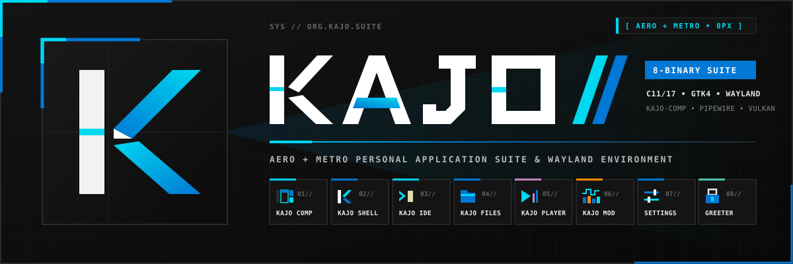

# Kajo IDE (`kajo-ide`) — User & Architecture Manual

**Binary:** `kajo-ide` (`org.kajo.IDE`)  
**Design System:** Kajo Aero + Metro (`0px` sharp geometry, high-contrast `#111111`–`#1a1a1a` dark surfaces, `Fira Code` monospace typography)  
**Settings Integration:** `kajo-settings` $\rightarrow$ **Kajo IDE & Code** (`~/.config/kajo/config.json`)

---

## 1. Overview & Philosophy

**Kajo IDE (`kajo-ide`)** is the native GTK4 / `GtkSourceView-5` modal code editor and integrated development environment for the Kajo Desktop Suite. Designed as the graphical evolution of `koodieditori`, it combines:

1. **Tree-sitter Syntax Highlighting** — C, C++, Java, Go, Rust, JavaScript/JSX, TypeScript/TSX, Bash/Zsh, Lua, Motorola 68000 (`m68k`: `.s`, `.S`, `.asm`, `.i`), JSON, TOML, YAML, CSS and HTML are parsed with Tree-sitter (incremental re-parse on every edit; only the changed region is re-tagged) and mapped onto the 11 semantic token classes of the active color scheme. Annotations, generics, records, methods vs. fields, constructors and calls are classified from the syntax tree rather than guessed. Other languages (Python, Makefile, meson.build, …) use the heuristic lexer. Grammars are optional build dependencies (see the README); a missing grammar degrades that language to the lexer.
2. **Selection-First Modal Editing** — A deterministic 10-state finite state machine (`NORMAL`, `SELECT`, `INSERT`, `LEADER`, `MATCH`, `SEARCH`, `PICKER`, `TREE`, `DRAWER`, `HELP`) where motions highlight selections first and actions (`d`, `c`, `y`, `s`) operate on the active selection.
3. **Nordic Keyboard Ergonomics** — First-class bindings for Finnish/Swedish keyboards (`ä` / `ö` diagnostic & hunk stepping, `m i/a` structural text objects that avoid Dead-Key / AltGr finger gymnastics, and `jk` fast-exit from `INSERT` mode) alongside standard desktop shortcuts (`Ctrl+S`, `Ctrl+Z`, `Ctrl+Y`, `Ctrl+C/X/V/A`, `F1`, `F5`–`F12`).
4. **Code Intelligence & Debugger UI** — a real asynchronous stdio LSP client (`gopls`, `jdtls`, `clangd`, `rust-analyzer`, …) provides diagnostics, hover, completion, definition/implementation, rename, code actions and formatting (§8); a real DAP client drives `gdb -i=dap`, `lldb-dap`, Delve and — through `jdtls` — Java (§9).
5. **Native GUI Markdown & Vector Cairo Mermaid Diagrams** — Real-time side-by-side graphical Markdown preview with interactive task checkboxes, GitHub-flavored callout alerts (`[!NOTE]`, `[!TIP]`, `[!IMPORTANT]`, `[!WARNING]`, `[!CAUTION]`), and a native C11 Cairo/Pango layout engine for Mermaid diagrams (`flowchart`, `sequenceDiagram`, `stateDiagram-v2`, `classDiagram`, `erDiagram`, `pie`) with interactive pan/zoom and `.svg` export.
6. **AI Agent JSON-RPC 2.0 Socket & Atomic Batch Diff Review** — External coding agents can query buffers, diagnostics, and apply multi-file edits over `$XDG_RUNTIME_DIR/kajo-ide-<pid>.sock`, while the developer reviews, accepts (`Space d a`), or reverts (`Space d r`) every AI-modified buffer with inline gutter diff markers.

---

## 2. Launching `kajo-ide`

```bash
# Open current working directory as workspace root
kajo-ide

# Open a specific project directory
kajo-ide ~/src/Kajo

# Open one or more files directly
kajo-ide src/ide/ide_window.c docs/kajo_ide_manual.md
```

When launched with a file path, `kajo-ide` automatically detects the enclosing Git repository root (or parent directory) to populate the **Project File Explorer** and **Git Status** badges.

---

## 3. Window Anatomy

```
┌──────────────────────────────────────────────────────────────────────────────────────────────────┐
│ ⌨ KAJO IDE  [🌲 TREE][🗺 MAP][📖 MD][🔍 FIND][❓ HELP]   src/ide/ide_window.c [⎇ main ●2]  [🗗][✕] │
├────────────────────────┬─────────────────────────────────────────────────────────────────────────┤
│ EXPLORER     [a][A][r] │ [ ● ide_window.c × ] [ ide_fsm.c × ] [ kajo_ide_manual.md × ]           │
│ ▾ 📁 src               ├────────┬───────────────────────────────────────────────────────┬────────┤
│   ▾ 📁 ide             │ ●▎ 42  │ static void update_status_bar(KajoIdeWindow *self) {  │ ▒▒▒▒▒▒ │
│     📄 ide_fsm.c     M │  │ 43  │   IdeState st = ide_fsm_get_state(self->fsm);         │ ▒▒▒▒▒▒ │
│     📄 ide_picker.c  M │ ◆│ 44  │   gtk_label_set_text(GTK_LABEL(self->mode_pill), ...  │ ███▒▒▒ │
│     📄 ide_window.c  M │  │ 45  │ }                                                     │ ▒▒▒▒▒▒ │
│   ▸ 📁 settings        │  │ 46  │                                                       │        │
├────────────────────────┴────────┴───────────────────────────────────────────────────────┴────────┤
│ [ 🐞 DEBUGGER (DAP) ] [ ⚠ DIAGNOSTICS ] [ 🔍 SEARCH & BUILD ] [ 📖 MARKDOWN ]              [✕]   │
│  ▸ Call Stack                   │ ▸ Local Scopes (Variables)  │ ▸ Debug Console / REPL          │
├──────────────────────────────────────────────────────────────────────────────────────────────────┤
│  NORMAL  src/ide/ide_window.c [+]   Space → _                    LSP: clangd ●   UTF-8  C  44:12 │
└──────────────────────────────────────────────────────────────────────────────────────────────────┘
```

### 3.1 Three-Zone Window Header Bar
- **Left Cluster:** Application title (`⌨ KAJO IDE`) and quick-toggle pills:
  - `🌲 TREE` (`Space e`) — Focus or toggle the Project File Explorer.
  - `🗺 MAP` — Toggle the right-hand `GtkSourceMap` code minimap.
  - `📖 MD` (`Space m p`) — Toggle the 50/50 side-by-side Graphical Markdown & Mermaid Preview pane.
  - `🔍 FIND` (`Space f f`) — Open the Fuzzy File Finder modal.
  - `❓ HELP` (`?` / `F1` / `Space h`) — Open the full-width Interactive Help Viewer & Command Palette.
- **Center Cluster:** Active workspace-relative file breadcrumb (`src/ide/ide_window.c`) — deep paths (Java packages) are shortened to `repo ▸ … ▸ parent ▸ dir ▸ file` and ellipsized so the right-zone **BUILD** / **FLOAT / TILE** / close controls stay on screen; the full path is on hover — plus the live Git branch & dirty counter badge (`⎇ feat/kajo-ide ●3 +1`) and the AI Agent modification indicator (`🤖 AGENT MODIFIED`).
- **Right Cluster:** `🔨 BUILD` quick-trigger (`meson compile -C builddir`), Niri `🗗 FLOAT / TILE` window toggle, and `✕` close button.

### 3.2 Six-Column Cairo Editor Gutter (`68px`)
Every open buffer renders a custom hardware-accelerated 6-column gutter (`src/ide/ide_gutter.c`) to the left of the source view:
1. **Col 1 — Breakpoint Slot (`12px`):** Click to toggle DAP breakpoints (`●` crimson `#e81123`) or view the active instruction pointer arrow (`▶` amber `#ffb900`).
2. **Col 2 — LSP Diagnostic Pill (`12px`):** Displays `●` Error (`#e81123`), `▲` Warning (`#ff8c00`), or `◆` Hint/Info (`#00d8f0`).
3. **Col 3 — Git Diff Bar (`4px`):** Vertical bar showing uncommitted line status against `HEAD` (`#10893e` Added, `#0078d4` Modified, `#e81123` Deleted).
4. **Col 4 — AI Agent Diff Bar (`4px`):** Vertical bar (`#b4009e` magenta / `#00d8f0` cyan) highlighting lines modified by an external AI agent awaiting review.
5. **Col 5 — Line Number (`28px`):** Right-aligned `Fira Code` line number (supports `absolute`, `relative`, or `none` via `kajo-settings`).
6. **Col 6 — Code Folding Chevron (`8px`):** Indicates foldable AST/brace blocks (`▾` / `▸`, toggled with `z a`).

### 3.3 Ephemeral Bottom Drawer & Switcher Strip
When diagnostics, search/replace, build output, or debugging is triggered, the bottom drawer slides open with a top `@metro-accent` border and four switcher tabs:
- **`🐞 DEBUGGER (DAP)`** — Transport toolbar (`▶ Continue`, `↷ Step Over`, `↓ Step Into`, `↑ Step Out`, `⏹ Stop`) and 3-pane split (Call Stack, Local Scopes, Interactive GDB/DAP REPL).
- **`⚠ DIAGNOSTICS`** — Workspace-wide LSP errors/warnings and symbol references list.
- **`🔍 SEARCH & BUILD`** — Live regex search & project-wide replace bar + asynchronous compiler build output log.
- **`📖 MARKDOWN`** — Bottom-docked Markdown & Mermaid preview (`Space m m`).

---

## 4. Modal State Machine & Editing Model

The bottom-left status pill color-codes the current state of the editor:

| Mode Pill | Color | Entry Key(s) | Exit Key(s) | Purpose |
| :--- | :--- | :--- | :--- | :--- |
| **`NORMAL`** | `#0078d4` (Blue) | `Esc`, `jk` (from `INSERT`) | `i`, `a`, `v`, `Space`, `:`, `/` | Default navigation, line/word selection, and structural commands |
| **`SELECT`** | `#b4009e` (Purple) | `v`, `x`, or mouse drag | `Esc`, `d`, `c`, `y` | Extend selection continuously with any motion before mutating |
| **`INSERT`** | `#10893e` (Green) | `i`, `a`, `o`, `O`, `c` | `Esc` or fast `jk` | Direct text entry, live LSP completion, and standard shortcuts |
| **`LEADER`** | `#ff8c00` (Amber) | `Space` (in `NORMAL`/`SELECT`) | `Esc` or chord completion | Prefix for two- and three-key workspace chords (`Space f f`, etc.) |
| **`MATCH`** | `#ff8c00` (Amber) | `m` (in `NORMAL`/`SELECT`) | `Esc` or object key | Nordic structural text-object selector (`m i f`, `m a c`, `m m`) |
| **`SEARCH`** | `#00b7c3` (Teal) | `/` | `Enter` (commit), `Esc` (cancel) | Incremental regex search across the active buffer |
| **`PICKER`** | `#0078d4` (Blue) | `Space f f`, `Space b b`, `Space f g` | `Esc`, `Enter` | Modal Fuzzy File Finder, Buffer Switcher, or Live Ripgrep |
| **`TREE`** | `#00b7c3` (Teal) | `Space e` | `Esc`, `Space e`, `Enter` | Keyboard navigation and file CRUD inside the Project File Explorer |
| **`DRAWER`** | `#ff8c00` (Amber) | `Space x x`, `Space s r`, `F5` | `Esc`, `q` | Keyboard navigation inside the bottom Diagnostics/Search/DAP drawer |
| **`HELP`** | `#00d8f0` (Cyan) | `?`, `F1`, `Space h` | `Esc`, `F1`, `q` (empty query) | Interactive Help Viewer & Command Palette |

> [!TIP]
> **Fast `jk` Escape from `INSERT` Mode:** Typing `j` followed immediately by `k` (within `200ms`) in `INSERT` mode exits back to `NORMAL` mode without reaching for `Escape`.

---

## 5. Complete Keybinding Reference

### 5.1 Basic Navigation & Scrolling (`NORMAL` & `SELECT`)

| Key / Chord | Command | Description |
| :--- | :--- | :--- |
| `h` / `j` / `k` / `l` | Move Left / Down / Up / Right | Character and line navigation (arrow keys also work in all modes) |
| `w` / `b` / `e` | Word Forward / Back / End | Move and select by word boundaries |
| `g h` / `Home` / `0` | Line Start | Jump to column 0 of the current line |
| `g l` / `End` / `$` | Line End | Jump to the end of the current line |
| `g s` / `^` | First Non-Blank | Jump to the first non-whitespace character on the line |
| `g g` | File Top | Jump to line 1 of the buffer |
| `G` | File Bottom | Jump to the last line of the buffer |
| `Ctrl+d` / `PgDn` | Half-Page Down | Scroll down half a viewport |
| `Ctrl+u` / `PgUp` | Half-Page Up | Scroll up half a viewport |
| `z z` | Center Cursor | Vertically center the active cursor line in the viewport |
| `z a` | Toggle Fold | Fold or unfold the current brace/AST block |
| `Ctrl+o` | Jump Back | Navigate backward in the cross-file jump history stack |
| `Ctrl+i` | Jump Forward | Navigate forward in the cross-file jump history stack |
| `n` / `N` | Next / Prev Search Match | Cycle forward or backward through `/` regex matches |

### 5.2 Nordic Quick-Step Navigation (`ä` / `ö` & Bracket Equivalents)

Designed for zero-Dead-Key navigation on Nordic layouts (with `[` / `]` brackets also supported):

| Key / Chord | Command | Description |
| :--- | :--- | :--- |
| `ä` / `]d` | Next Diagnostic | Jump to the next LSP Error/Warning in the buffer |
| `ö` / `[d` | Previous Diagnostic | Jump to the previous LSP Error/Warning in the buffer |
| `Alt+ä` / `]g` | Next Git Hunk | Jump to the next uncommitted Git diff hunk |
| `Alt+ö` / `[g` | Previous Git Hunk | Jump to the previous uncommitted Git diff hunk |

### 5.3 Selection, Editing & Clipboard (`NORMAL`, `SELECT`, `INSERT`)

| Key / Chord | Command | Description |
| :--- | :--- | :--- |
| `i` / `a` | Insert / Append | Enter `INSERT` mode before or after the cursor |
| `I` / `A` | Insert at Start / End of Line | Enter `INSERT` mode at first non-blank or end of line |
| `o` / `O` | Open Line Below / Above | Insert a new indented line below or above and enter `INSERT` mode |
| `v` | Toggle `SELECT` Mode | Toggle continuous selection extension mode |
| `x` | Select Line | Select the entire current line; press `x` repeatedly to extend downward |
| `%` | Select All | Select the entire buffer |
| `s` | Select Inside Matching | Select regex matches inside the active selection |
| `d` | Delete Selection | Delete the active selection (or current character) into the clipboard |
| `c` | Change Selection | Delete the active selection and immediately enter `INSERT` mode |
| `y` | Yank (Copy) | Copy the active selection to the system Wayland clipboard |
| `p` / `P` | Paste After / Before | Paste system clipboard contents after or before the cursor |
| `J` | Join Lines | Join the current line with the line below |
| `>` / `<` | Indent / Outdent | Shift selected lines right or left by one tab stop |
| `u` / `Ctrl+z` | Undo | Undo the last buffer modification (works in both `NORMAL` and `INSERT`) |
| `U` / `Ctrl+r` / `Ctrl+y` | Redo | Redo the last undone modification |
| `Ctrl+s` | Save File | Write the current buffer to disk |
| `Ctrl+c` / `Ctrl+x` / `Ctrl+v` | Copy / Cut / Paste | Standard desktop clipboard shortcuts (active in all modes) |
| `Ctrl+a` | Select All | Select the entire buffer |

### 5.4 Nordic Structural Text Objects (`m` Match Mode)

Pressing `m` enters `MATCH` mode (`#ff8c00` pill), allowing structural selection without awkward `AltGr` brace chords:

> **Syntax-tree objects.** For every tree-sitter language (see §1) `f`, `c`, `b` and `a` select the innermost enclosing function, class/struct/interface/enum, brace block, or argument / parameter / list element using the parsed syntax tree (`i` = body without braces or signature, or the element without its comma; `a` = whole construct, or the element with one adjacent comma). Other languages, and positions the tree cannot resolve, fall back to the text-based heuristics.


| Chord | Target Structure | Scope |
| :--- | :--- | :--- |
| `m m` | Matching Bracket `()` / `[]` / `{}` | Jump cursor to matching delimiter |
| `m i f` / `m a f` | **Function** (`func`, `fn`, `def`, C/C++ block) | Inside (`i`) or Around (`a`) function body |
| `m i c` / `m a c` | **Class / Struct / Type** | Inside (`i`) or Around (`a`) struct/class definition |
| `m i b` / `m a b` | **Block / Braces `{ ... }`** | Inside (`i`) or Around (`a`) curly brace block |
| `m i a` / `m a a` | **Argument / Parameter** | Inside (`i`) or Around (`a`) comma-separated argument |
| `m i p` / `m a p` | **Paragraph** | Inside (`i`) or Around (`a`) contiguous text paragraph |
| `m i q` / `m a q` | **Quoted String** (`"..."`, `'...'`, `` `...` ``) | Inside (`i`) or Around (`a`) string literal |
| `m i w` / `m a w` | **Word** | Inside (`i`) or Around (`a`) identifier word |

*Example:* Press `m i f` to select the body of the current C function, then press `d` to delete it or `y` to copy it.

### 5.5 `Space` Leader Chords

Pressing `Space` in `NORMAL` or `SELECT` mode opens the **Bottom-Right Chord HUD** displaying all available completions:

| Chord | Category | Action |
| :--- | :--- | :--- |
| `Space f f` / `Space Space` | Files | Open **Fuzzy File Finder** across workspace |
| `Space /` / `Space f g` | Search | Open **Live Ripgrep (`rg`)** project-wide text search |
| `/` / `Space s f` / `Space s /` | Search | Start incremental **In-Buffer Search** |
| `Space b b` / `Space ,` | Buffers | Open **Active Buffer Switcher** |
| `Space w s` / `Space f s` | Files | Save active buffer to disk (`Ctrl+S`) |
| `Space w a` | Files | Save all modified buffers to disk |
| `Space q` / `Space b d` | Buffers | Close active buffer |
| `Space Q` / `Space w q` | Buffers | Force close active buffer (discarding unsaved changes) |
| `Space e` | Explorer | Focus or toggle the **Project File Explorer** sidebar |
| `Space ?` / `?` / `F1` | Help | Open the **Interactive Help Viewer & Command Palette** |
| `Space c a` | LSP | Code actions (quick fix / refactor) at the cursor or selection (`1`–`9` or `Enter`) |
| `Space c r` | LSP | Rename symbol across the workspace via the language server |
| `Space c f` | LSP | Format current buffer via the language server |
| `Space r b` / `r t` / `r r` / `r c` | Tasks | **Build** / **Test** / **Run** / **Clean** the project that owns the active file (output and clickable errors in the bottom *SEARCH / BUILD* drawer; modified buffers are saved first) |
| `Space o` | Layout | Toggle bottom **Search / Build / DAP / Agent Drawer** |
| `Space s r` | Search | Open **Buffer Search & Replace** in bottom drawer |
| `Space s p` | Search | Open **Project-Wide Search & Replace** in bottom drawer. Files not open in a buffer are rewritten on disk (not undoable): the first apply only arms and reports the file count, a second apply confirms; editing any field disarms. UTF-8 text files up to 2 MB only; regex mode scans every non-ignored file because ripgrep's regex dialect differs from the editor's |
| `Space n h` / `Space p h` | Navigation | Jump to **Next / Previous Diff Hunk** in active buffer |
| `Space m p` | Markdown | Toggle **Side-by-Side Graphical Markdown & Mermaid Split** |
| `Space m m` / `Space m d` | Markdown | Toggle **Bottom-Docked Markdown Preview Drawer** |
| `Space m t` | Markdown | Toggle `- [ ]` / `- [x]` **Markdown Task Checkbox** on current line |
| `Space d b` | Debugger | Toggle **DAP Breakpoint** on current line (same as `F9`) |
| `Space d d` / `Space d c` | Debugger | Start or Continue **DAP Debugger Session** (same as `F5`) |
| `Space d p` | Debugger | **Pause** active DAP debuggee execution |
| `Space d s` | AI Agent | Open **Agent Diff Review** for AI-modified buffers |
| `Space d a` | AI Agent | **Accept All** pending AI agent edits in current buffer |
| `Space d r` | AI Agent | **Revert All** pending AI agent edits in current buffer to pre-agent snapshot |

---


### 5.5 Right-Click Code Menu & Mouse Navigation

Kajo is keyboard-first, but it is a native GTK4 window, not a terminal, so the mouse works too:

- **Right-click in the editor** opens a code menu merged with the usual cut/copy/paste: **Go to Definition** (`g d`), **Go to Implementation** (`Space g i`), **Show Documentation** (`K`), **Rename Symbol…** (`Space c r`), **Code Actions…** (`Space c a`), **Format Buffer** (`Space c f`) and **Toggle Breakpoint** (`F9`). The cursor is placed where you clicked first (a click inside a selection keeps it), and items that need a running language server (implementation, code actions, format) are disabled until one is ready. Every item dispatches the same action as its key, so behavior never diverges.
- **Ctrl+click** a symbol jumps straight to its definition.
- **Hover docs are explicit only:** the pointer never opens a popup by resting. Use `K` or the right-click menu; dismiss with `Esc` / `q`.


## 6. Project File Explorer & Git Status (`Space e`)

The left-hand **Project File Explorer** (`src/ide/ide_tree.c`) provides a scroll-stable tree view of your workspace with live `git status --porcelain=v1 -b` integration:

- **Visual Color Coding:**
  - Folders (`📁`) are highlighted in warm amber (`#dcb67a`), while source files use crisp slate (`#8a9ab0`).
  - Modified files tint their filename label and display a sharp 1px boxed badge:
    - `M` (`#ff8c00` Amber) — Modified in working tree or index
    - `A` (`#10893e` Green) — Added to Git index
    - `U` (`#00d8f0` Cyan) — Untracked file
    - `D` (`#e81123` Crimson) — Deleted
- **Mouse & Keyboard Navigation:**
  - **Single-Click** selects a row without scrolling or jumping the viewport.
  - **Double-Click** or `Enter` / `l` expands/collapses a directory in place (preserving exact vertical scroll position) or opens a file into the editor.
  - **In-Place File CRUD (when focused via `Space e` or header toolbar buttons):**
    - `a` — Create a new file inside the selected directory (inline entry prompt).
    - `A` — Create a new folder (`mkdir -p`) inside the selected directory.
    - `r` — Rename the selected file or directory in place.
    - `d` — Delete the selected file or directory.
    - `h` — Collapse the parent directory.
    - `Esc` / `Space e` — Return focus to the code editor.

---

## 7. Fuzzy Finder, Live Ripgrep & Interactive Help Palette

`kajo-ide` includes a multi-mode overlay modal (`src/ide/ide_picker.c`) styled with sharp `0px` Aero + Metro borders:

### 7.1 Fuzzy File Finder (`Space f f`), Buffer Switcher (`Space b b`), and Live Ripgrep (`Space f g`)
- Displays a **2-pane split**:
  - **Left Pane (`420px`):** Ranked fuzzy file matches or asynchronous `rg --vimgrep` search results.
  - **Right Pane:** Live syntax-highlighted `GtkSourceView` preview centered on the target line (`PREVIEW: <file>:<line>`).
- **Navigation:** `↑` / `↓`, `Tab` / `Shift+Tab`, `Ctrl+n` / `Ctrl+p`, or mouse click to select; `Enter` or double-click to open the file at the exact line/column.

### 7.2 Interactive Help Viewer & Command Palette (`?`, `F1`, `Space h`, or `❓ HELP`)
- Displays a **full-width (`920px`) 4-column interactive reference table** (`CHORD / KEYBINDING`, `COMMAND`, `CATEGORY`, `ACTION DESCRIPTION`) covering all **100 commands** across 12 categories.
- **Category Filter Pills:** Click any category pill (`ALL`, `NAVIGATION`, `SELECT & EDIT`, `OBJECTS`, `LEADER`, `FILE TREE`, `LSP`, `TASKS`, `DEBUGGER`, `MARKDOWN`, `AGENT`, `LAYOUT`, `MOUSE`) to filter the table by subsystem.
- **Instant Fuzzy Filter:** Type any key chord, command name, or description keyword to filter rows in real time.
- **Executable Command Palette:** Pressing `Enter` or double-clicking any row immediately executes that command in the editor.
- **Dismissing:** Press `Esc`, `F1`, click `✕ ESC`, or press `q` when the search query is empty (typing `q` when a filter query is already active appends `q` to the search string so you can search for `"quote"` or `"quickfix"`).

---

## 8. Code Intelligence (Language Server Protocol)

`kajo-ide` runs real language servers over stdio. One server process is started lazily per **(server, project root)** when a matching file is opened; the root is the nearest ancestor holding a marker file (`go.mod`/`go.work`, `pom.xml`/`build.gradle*`, `compile_commands.json`, `Cargo.toml`, `tsconfig.json`, …) and never climbs above the workspace. Everything is asynchronous — a slow server (a JVM-based `jdtls` indexing a large project) never blocks the editor. The status bar shows `LSP: <server> ●` once the server finished initialization and `LSP: <server> (not installed)` when the binary is missing; without a server the editor falls back to the `ripgrep`/buffer behaviour described below.

| Language(s) | Extensions | Server (binary) | Notes |
| :--- | :--- | :--- | :--- |
| **Go** | `.go` | `gopls` | `go.mod` root; formats with `gofmt` rules |
| **Java** | `.java` | `jdtls` | per-project data dir `~/.cache/kajo/jdtls/<hash>`; started with the **newest installed JDK** (`JAVA_HOME`, `~/.sdkman`, `/usr/lib/jvm`), override with `KAJO_JDTLS_JAVA=/path/to/bin/java` |
| **C / C++** | `.c .h .cpp .hpp .cc` | `clangd` | uses `builddir/` / `build/` `compile_commands.json` automatically; a `.h` is sent as C++ when C++ sources sit next to it |
| **Rust** | `.rs` | `rust-analyzer` | `Cargo.toml` root |
| **Python** | `.py` | `pyright-langserver` | |
| **TypeScript / JavaScript** | `.ts .tsx .js .jsx` | `typescript-language-server` | |
| **Shell / JSON / YAML / TOML / Lua / Meson** | `.sh .json .yaml .toml .lua meson.build` | `bash-language-server`, `vscode-json-language-server`, `yaml-language-server`, `taplo`, `lua-language-server`, `mesonlsp` | |

### Workflows (server running)
- **Diagnostics:** errors / warnings / hints from the server appear in the gutter pill, the status-bar counters and the hover card; `ä` / `ö` (or `]d` / `[d`) step through them. Edits are sent to the server after a short debounce (full-document sync) and saving sends `didSave`.
- **Hover (`K`, `Space k`):** signature and documentation (markdown flattened to text) plus any diagnostic on the line. `Esc` / `q` dismisses; moving the cursor, scrolling the symbol out of view, clicking elsewhere or leaving the editor also dismisses it, and the popover stays pinned to the cursor as you scroll.
- **Completion (`Ctrl+Space`, or automatically after a server trigger character such as `.`):** ranked, scrollable list with kind badges and documentation. The list follows your typing, `Up`/`Down`/`Ctrl+n`/`Ctrl+p` select, `Tab`/`Enter` insert. The server's `textEdit` and `additionalTextEdits` are honored, so auto-imports (Go, Java) are added with the completion.
- **Go to Definition (`g d` / `Space g d`) and Implementation (`Space g i`):** jumps (and records the jumplist). Definitions inside libraries (`jdt://`) are reported instead of opened.
- **Rename (`Space c r`):** prompt anchored at the cursor (type the new name, `Enter` applies, `Esc` cancels). The server's `WorkspaceEdit` is applied to open buffers (undoable) and to files that are not open (atomic write); a toast reports the edit/file count.
- **Code Actions (`Space c a`):** quick fixes and refactorings for the cursor or selection (organize imports, extract, fix) in a popover list; `Enter` runs the action (resolving it first when the server asks for that).
- **Format (`Space c f`, command palette *LSP › Format Buffer*):** `textDocument/formatting` applied as minimal edits.

### Fallbacks (no server for the file type, or server not installed)
All fallback results are visibly badged in the UI and status bar (`[RG FALLBACK — NO LSP]`, `rg fallback`, `buffer fallback`):
- Hover: asynchronous one-line declaration lookup via `ripgrep`. Completion: ranked identifiers from the buffer. Definition: asynchronous `ripgrep` declaration search. Rename: whole-word replace in the current buffer.

### Limits / not yet implemented
Call hierarchy, references list, signature help, semantic tokens (highlighting stays tree-sitter based), and incremental text sync (full-document sync is used).

---

## 8b. Project Tasks (Build / Test / Run / Clean)

`Space r b|t|r|c` (also the **▶ BUILD** header button and the command palette *TASKS* category) resolve the build system from the **active file**: the nearest ancestor directory that holds a build file, never above the workspace. Commands run asynchronously with `sh -c` in that directory and their output lands in the bottom drawer; compiler diagnostics (`gcc`/`clang`, `javac`, Maven `[ERROR] File.java:[line,col]`, Gradle, `go`, `rustc`) become clickable rows that jump to the location.

| Build system (marker) | Build | Test | Run | Clean |
| :--- | :--- | :--- | :--- | :--- |
| **Maven** (`pom.xml`, `./mvnw` if present) | `mvn -B -ntp compile` | `mvn -B -ntp test` | compile, then `java -cp target/classes <package.Class of the active file>` | `clean` |
| **Gradle** (`build.gradle[.kts]`, `./gradlew` if present) | `gradle --console=plain classes` | `test` | compile, then `java -cp build/classes/java/main <package.Class>` | `clean` |
| **Meson** (`meson.build`) | `meson setup` if needed + `meson compile -C builddir` | + `meson test --print-errorlogs` | build, then run the executable that owns the active file (from `meson-info/intro-targets.json`) | `--clean` |
| **CMake** (`CMakeLists.txt`) | configure into `build/` (`Debug`, exports `compile_commands.json` for clangd) + `cmake --build build` | + `ctest --output-on-failure` | build, then run the newest executable under `build/` (the first run only builds and says so) | `--target clean` |
| **Cargo** / **Go** / **Make** | `cargo build` / `go build ./...` / `make` | `cargo test` / `go test ./...` / `make test` | `cargo run` / `go run <package of the active file>` / `make` then `./<same-named binary>` (else `make run`) | `clean` |
| *no build file, `.java` file* | `javac -d $TMP/kajo-java-out File.java` | — | `java File.java` | — |

For Java the language server and the build see the same project root, so a Maven/Gradle project that `jdtls` imported compiles with the exact same module layout. Run tasks have no stdin; interactive programs are not supported yet.

---

## 9. Debugger (`F5`–`F12`, Debug Adapter Protocol)

`kajo-ide` is a real DAP client (`src/ide/ide_dap_client.c`). `F5` / `Space d c` starts a session for the active file: it picks an adapter, launches the debuggee, sends the breakpoints of **all open buffers** and shows the stopped frame in the editor.

| Language | Adapter | Debuggee discovery |
| :--- | :--- | :--- |
| **C / C++ / Rust** | `gdb -i=dap` (GDB 14+), else `lldb-dap` | Meson `meson-info/intro-targets.json` (the executable whose sources contain the file or its directory), Cargo `target/debug/<crate>`, `<file>` → `./<file basename>`, else the newest ELF in `builddir/`, `build/`, `bin/` |
| **Go** | `dlv dap` (Delve; `go install github.com/go-delve/delve/cmd/dlv@latest`) | the package of the active file (`_test.go` runs in test mode) |
| **Java** | Microsoft *java-debug* bundle loaded into `jdtls` (DAP over a local TCP port) | `jdtls` resolves the main class of the active file, the project classpath and the JDK; no separate build step (jdtls compiles incrementally) |

**Java setup (once):** run `scripts/install-java-debug.sh` — it downloads `com.microsoft.java.debug.plugin` from Maven Central into `~/.local/share/kajo/java-debug/` after verifying its SHA-1 (`KAJO_JAVA_DEBUG_JAR` overrides the location; a Mason `java-debug-adapter` install is picked up too) — and restart the IDE, because `jdtls` loads the bundle at startup (`initializationOptions.bundles`). The active file must contain a `main` method; breakpoints in any open `.java` file of the project are honored.

Override discovery with `<workspace>/.kajo/debug.json`:

```json
{ "adapter": "gdb", "program": "builddir/kajo-ide", "args": ["--demo"], "cwd": "." }
```

Without any breakpoint, C/C++/Rust programs stop at the start of `main` so you can step. Build first (`Space r b`); there is no automatic build step before launching.

| Key / Chord | Transport Button | Action |
| :--- | :--- | :--- |
| **`F9`** / `Space d b` | Gutter Col 1 Click | Toggle source line breakpoint (`●`) |
| **`F5`** / `Space d c` | `▶ Continue` | Launch debug session or continue execution |
| **`F10`** | `↷ Step Over` | Step over the current statement (`next`) |
| **`F11`** | `↓ Step Into` | Step into the called function (`stepIn`) |
| **`F12`** | `↑ Step Out` | Step out of the current stack frame (`stepOut`) |
| **`Shift+F5`** | `⏹ Stop` | Terminate the active debuggee session |

When paused at a breakpoint, step or signal:
1. The editor opens the active frame's file and highlights the execution line with an amber `▶` gutter indicator.
2. The **`🐞 DEBUGGER (DAP)`** bottom drawer opens automatically with three synchronized panes:
   - **Call Stack:** click a frame to jump to its source and load that frame's locals.
   - **Locals:** the adapter's locals scope (`name : type = value`).
   - **Debug Console / REPL:** adapter and program output; type an expression (for gdb: a GDB command or expression) and press `Enter` to run DAP `evaluate` in the selected frame (only while paused). Toggling a breakpoint (`F9`) during a session updates the adapter immediately.

---

## 10. Graphical Markdown, Embedded Media/Assets & Native Cairo Vector Mermaid

Unlike terminal editors that rely on ASCII approximations, `kajo-ide` includes a full-blown visual Markdown, HTML & Embedded Asset preview engine (`src/ide/ide_markdown.c`):



- **Side-by-Side Split (`Space m p` or `📖 MD` header button) & Bottom Drawer (`Space m m`):** Opens a live-synchronized graphical preview beside or below the editor. Scrolling the source buffer proportionally scrolls the rendered document.
- **Inline & Block Images (``, `[](url)`, HTML ``, and ` ```svg ` blocks):**
  - Renders vector `.svg` and raster `.png` / `.jpg` / `.webp` / `.gif` / `.bmp` / `.ico` figures directly via `GdkTexture` + `GtkPicture` with automatic aspect-ratio scaling (`FIT` mode) and interactive **`🔍 −` / `100%` / `🔍 +` / `⛶ FIT` / `↗ OPEN`** figure toolbars.
  - Resolves paths relative to the current Markdown document's directory, the IDE workspace root, `file://` URIs, or `~/.gemini/antigravity-cli/brain/` artifact directories.
  - Also renders inline `32×32` image thumbnails inside Markdown `GtkGrid` pipe tables (`|  | ... |`) and extracts inline `` figures inside paragraphs and list items.
- **Multi-Type Embedded Asset Cards:**
  - **Embedded PDF Documents (``):** Renders multi-page PDF documents inline via `poppler-glib` (`PopplerDocument` $\rightarrow$ Cairo $\rightarrow$ `GdkTexture`) with **`◀ PREV`**, **`PAGE 1 / N`**, **`NEXT ▶`**, and **`↗ OPEN PDF`** controls.
  - **Embedded Archives (`` / `.zip` / `.tar.zst`):** Inspects archive contents inline via `libarchive`, displaying total file count, uncompressed size, and a formatted manifest table.
  - **Embedded Audio / Video / Source Files (``, ``):** Displays interactive launch cards with **`▶ PLAY IN KAJO PLAYER`** or **`📂 OPEN IN IDE`** actions.
- **Interactive Slide Carousels (` ````carousel `) & Collapsible `<details>` Blocks:**
  - Fenced ` ````carousel ` blocks split on `<!-- slide -->` render as interactive multi-slide decks with **`◀ PREV` / `SLIDE 1 / N` / `NEXT ▶`** navigation, recursively rendering inner Markdown, code blocks, images, and diagrams on each slide.
  - HTML `<details><summary>Title</summary>...</details>` blocks render as collapsible `GtkExpander` cards.
- **Complete Typography, Links & Interactive Task Lists:**
  - Styled headings (`# H1` through `###### H6`), hanging-indent nested unordered (`•` / `◦` / `▪`) and numbered (`1.`) lists, and `GtkGrid` pipe tables.
  - Recursive inline Pango formatting: `***bold italic***`, `**bold**`, `*italic*`, `~~strikethrough~~`, `` `Fira Code` `` spans, `<kbd>Key</kbd>` badges, `<mark>highlights</mark>`, and clickable links (`[Label](path#L42)` jumps directly to the file and line in `kajo-ide`; `#heading` jumps to the section in the active buffer; `https://...` opens in the browser).
  - Interactive `- [ ]` / `- [x]` task list checkboxes — clicking a checkbox in the GUI preview mutates the underlying Markdown source line in real time, and updates the header **`✓ X / Y TASKS DONE`** badge.
  - GitHub-Flavored Callout Alerts (`> [!NOTE]`, `> [!TIP]`, `> [!IMPORTANT]`, `> [!WARNING]`, `> [!CAUTION]`) with semantic badges and color-coded left borders.
- **Native Cairo Vector Mermaid Diagrams (` ```mermaid `):**
  - Renders **Flowcharts (`flowchart TD/LR`, `graph TD/LR`)**, **Sequence Diagrams (`sequenceDiagram`)**, **State Diagrams (`stateDiagram-v2`)**, **Class Diagrams (`classDiagram`)**, **Entity-Relationship Diagrams (`erDiagram`)**, and **Pie Charts (`pie`)** using crisp vector primitives, Bezier edges, and Metro accent palettes.
  - Clicking any Mermaid node in the preview jumps the source editor directly to the line where that node is defined.
  - Every diagram card includes an interactive toolbar with **`🔍 −` / `100%` / `🔍 +`** zoom (`25%` to `400%`), **`💾 SVG`** (`cairo_svg_surface_create()`), and **`🖼 PNG`** export.

---

## 11. AI Agent JSON-RPC 2.0 IPC & Atomic Diff Review

External AI coding assistants can pair-program directly with a running `kajo-ide` instance over its Unix domain socket (`src/ide/ide_agent.c`):

- **Socket Path:** `$XDG_RUNTIME_DIR/kajo-ide-<pid>.sock` (also exported to child terminals as `$KAJO_IDE_SOCKET`).
- **Supported JSON-RPC 2.0 Methods:**
  - `ide.get_open_buffers` — List all open buffers, cursor positions, and dirty states.
  - `ide.get_buffer_content` — Read the live in-memory contents of a buffer.
  - `ide.get_diagnostics` — Retrieve current LSP errors and warnings across the workspace.
  - `ide.apply_edits` — Atomically apply single- or multi-file text edits while recording a pre-agent snapshot in each affected `IdeBuffer`.
  - `ide.open_file` — Open and focus a specific file/line in the IDE.
- **Developer Review Workflow:**
  1. When an external agent applies edits via `ide.apply_edits`, the header bar displays a `🤖 AGENT MODIFIED` badge and Col 4 of the editor gutter highlights the changed line ranges.
  2. Press **`Space d s`** to inspect the agent's modifications.
  3. Press **`Space d a`** to accept the changes and clear the snapshot, or **`Space d r`** to atomically revert the buffer back to its exact pre-agent state.

---

## 12. Appearance, Color Schemes, Font Zoom & Custom Keybindings

### 12.1 `kajo-settings` $\rightarrow$ **Kajo IDE & Code**
Open `kajo-settings` and select the **Kajo IDE & Code** page (`src/settings/pages/page_ide.c`) to configure:
- **Syntax Color Scheme** (with 5 bundled `GtkSourceView-5` schemes in `data/ide/*.xml`):
  1. **`kajo-metro-dark`** *(Default)* — Signature `#101010` charcoal background with `#569cd6` / `#c586c0` / `#dcdcaa` / `#4ec9b0` / `#9cdcfe` tokens.
  2. **`kajo-oled-pitch`** — True `#050505` OLED pitch-black high-contrast neon palette.
  3. **`kajo-nord-frost`** — Arctic Nord Frost dark palette (`#14171d`).
  4. **`kajo-amber-crt`** — Retro monochrome amber phosphor CRT terminal palette (`#0c0900`).
  5. **`kajo-monokai-metro`** — Monokai Pro token palette on a sharp `#121212` Metro dark surface.
- **Typography & Geometry:** Editor font family (`Fira Code`, `JetBrains Mono`, `Iosevka`, `Source Code Pro`, `Hack`, `Monospace`; a missing family falls back to `Fira Code` / `FiraCode Nerd Font` / monospace), font size (`10px`–`24px`), tab width (`2`, `4`, `8`, segmented), insert spaces instead of tabs, word wrap, margin guide at column 100, current line highlight, gutter and minimap visibility. *(Relative line numbers are planned.)*

Edits on this page update the live preview only; press **`[ ✓ SAVE & APPLY ]`** in the page footer to write them to `~/.config/kajo/config.json` (or **`[ ↺ REVERT ]`** to discard them). Saved changes are hot-reloaded across all running `kajo-ide` windows via `GFileMonitor`.

### 12.2 Live On-the-Fly Editor Font Zoom
Adjust editor font size at any time directly inside `kajo-ide`:
- **`Ctrl + +` / `Ctrl + =`** — Increase editor font size (`+1pt`) and persist to `~/.config/kajo/config.json`.
- **`Ctrl + -`** — Decrease editor font size (`-1pt`) and persist to `~/.config/kajo/config.json`.
- **`Ctrl + 0`** — Reset editor font size to the default `13pt`.

### 12.3 Configuration File & Key Remapping
IDE settings live in the `ide` object of `~/.config/kajo/config.json` and are edited from `kajo-settings` → **Kajo IDE & Code**:

```json
{
  "ide": {
    "color_scheme": "kajo-metro-dark",
    "font_family": "Fira Code",
    "font_size_px": 13,
    "tab_width": 2,
    "show_minimap": true,
    "show_line_numbers": true,
    "highlight_current_line": true
  }
}
```

Custom per-mode key remapping (`[keys.*]`) is **not implemented yet**: the finite state machine has a remap table (`ide_fsm_set_remap`), but nothing loads user bindings into it. Tracked in `ROADMAP.md`.

