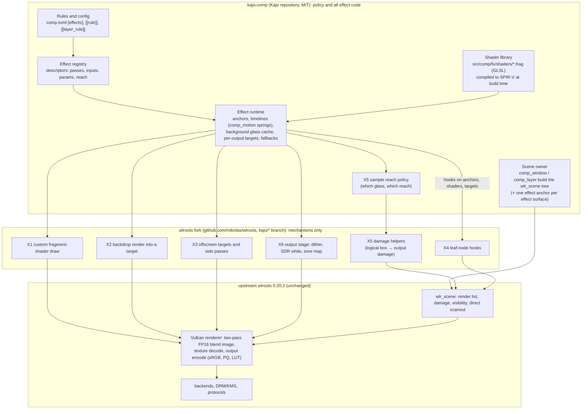
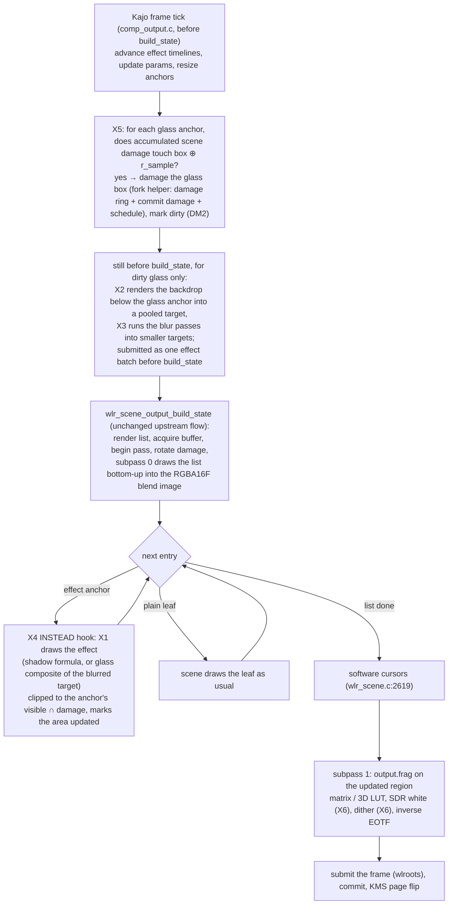
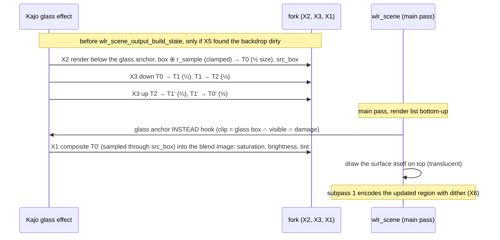

# Spec: `kajo-comp` effect pipeline (pixel / fragment shaders)

**Status:** Milestone 2 (Foundation + shadows + dim, `kajo-0.20.2-fx3`) implemented and verified (V1–V4, SH1–SH4, CB1–CB6); pre-M2/M3 spikes S1–S6, S8 verified. Kajo branch `feat/wlroots-fork`. Builds on [`docs/spec_wlroots_fork.md`](spec_wlroots_fork.md) (the fork, its compatibility rules C1–C7 and Milestone 1) and replaces the effect outline in ROADMAP §3.6 / §3.7.2.

This spec defines how `kajo-comp` runs custom fragment shaders on what it draws: which parts live in the wlroots fork, which in Kajo, how a frame flows through them, and how HDR constrains all of it. The acceptance tests are a **glassy backdrop blur** (§10) and **high-quality soft shadows** (§11).

Facts about wlroots were read from the 0.20.2 source in `subprojects/wlroots` (paths and lines cited). What is not proven yet is marked and collected in §14. §16 lists what each revision changed and why.

---

## 1. Goals and non-goals

**Goals**

- **G1 (Pixel effects):** effects are fragment shaders. A shader can read what is drawn below a surface in stacking order (the backdrop), the background layer on its own, and its own intermediate images; it never needs to re-implement how a client's buffer is drawn.
- **G2 (Extensible):** an effect is data (a short list of shader passes with declared inputs and parameters), not a hard-coded feature. Adding one means adding a shader and a descriptor in Kajo, never a change to the fork.
- **G3 (HDR-correct):** the same effect is correct on SDR and HDR outputs (§5).
- **G4 (Non-intrusive):** the fork adds generic mechanisms and stays a drop-in superset of upstream (fork spec C1–C7). With no effect active, rendering is upstream's, bit for bit and cost for cost. Where a mechanism has to change an upstream file beyond a small hook, it is a documented exception in `FORK.md` (C7).
- **G5 (Zero idle cost):** an effect costs GPU time only on frames where it is visible and something it depends on changed.

**Non-goals**

- Geometry: no custom vertex shaders, meshes, deformation, 3D or perspective. (Distortion *inside* a box, such as ripple or glitch, is still possible: the fragment shader samples at shifted coordinates.)
- Effects on the GLES2 or pixman renderers. There, effects are unavailable and everything else works as today.
- Whole-output effects that sample neighbouring pixels (whole-screen blur, bloom) in M2–M4 (§6 X6, §12).
- User-supplied shaders in the first milestones (§13, D1).
- Rounded corners (the design system is 0 px).

## 2. What a tiling compositor needs from effects

`kajo-comp` tiles windows edge to edge with a 6 px gap (`data/defaults/comp.toml` `gap_px = 6`) and an opaque 1 px border. That shapes where effects are worth their cost:

| Surface | Typical backdrop | Glass blur | Shadow |
| :--- | :--- | :--- | :--- |
| Panel (layer, exclusive zone) | only the background layer (no window is ever under it) | yes, a cached blur of the background (cheap) | optional, along its inner edge |
| Launcher, notifications, OSD, OSK (layer, overlay) | tiled windows | yes, true backdrop | yes |
| Popups and menus (`xdg_popup`, layer popups) | the window they belong to and its neighbours | yes, true backdrop | yes |
| Floating windows and dialogs | tiled windows | optional | yes (the main use) |
| Tiled windows | background in the gaps only | no | off by default (would fill the 6 px gaps; §13, D3) |
| Fullscreen windows | none | no | no (keeps direct scanout) |

Consequences used throughout this spec:

- Most of the screen is opaque tiled windows without effects, so the scene's occlusion culling and damage tracking keep working for almost everything; effects only touch their own regions.
- The panel never has a window behind it, so its glass can sample a cached background instead of the frame (§10.3).
- Shadows matter for things that float above the tiles. They are rectangles (0 px radius), which allows an exact, cheap analytic shadow that reads nothing (§11).

## 3. System overview



The fork knows how to *run* a shader at a point in the frame; it does not know what blur or a shadow is. Kajo knows every effect and decides where, when and with which parameters it runs.

## 4. The frame pipeline

### 4.1 Stacking order, anchors and hook points

`kajo-comp` builds the scene as fixed trees, bottom to top (`src/comp/comp_server.c:371–378`): `background`, `bottom`, `tiled`, `floating`, `top`, `fullscreen`, `overlay`, `lock`. Inside, a window is a tree too (`src/comp/comp_window.c`): backdrop rect, `xdg_tree` (surface and subsurfaces), four border rects, tab rects, `popup_tree`.

`wlr_scene` only puts **leaf** rect and buffer nodes into its render list, skips black opaque rects and black single-pixel buffers, and asserts on tree nodes in `scene_entry_render()` (`types/scene/wlr_scene.c:1481–1484`, `1946–1985`). It draws the list bottom-up (`:2581`). A hook on a window or layer tree would therefore never run, and a hook on the client's buffer would see only the inner surface, not the borders and tabs, and nothing before the first commit.

So Kajo gives every effect on a surface its own **effect anchor**: a leaf node Kajo owns, placed at the bottom of the surface's tree, that the scene treats like any other leaf. A surface with a shadow and glass has two anchors, a **shadow anchor** below a **glass anchor**, each with its own hook, so neither effect can spill into the other's area.

- **Anchor node:** a `wlr_scene_buffer` holding a 1×1 fully transparent buffer, scaled with `wlr_scene_buffer_set_dest_size()`, with `point_accepts_input` returning false. It has to be a buffer: `scene_node_invisible()` drops a rect with alpha 0 (`wlr_scene.c:1902`) but keeps a buffer node with a non-NULL buffer (`:1906`). A transparent buffer is not black-opaque (`:1920`, kept in the render list) and has no opaque region (`:276–284`, occludes nothing). With input disabled, `wlr_scene_node_at()` skips it, so clicks in a shadow reach the window below (`surface_at_coords()` and `comp_window_at()` in `src/comp/comp_input.c`, `comp_window.c:613` use `wlr_scene_node_at()`).
- **Anchor size:** the area the effect may paint. Shadow anchor: the window's outer box (borders and tabs included) grown by the shadow's reach. Glass anchor: exactly the surface's box.
- **What the scene then does for free:** it computes the anchor's visible region against every *opaque* node above it (`node->visible`), damages the anchor's area when it moves, resizes or appears, and, because the anchor adds an entry to the render list, does not use direct scanout while it is visible (`wlr_scene.c:2446–2449` only scans out a single entry).
- **What it does not do:** a translucent surface (opacity below 1, or a buffer without an opaque region) occludes nothing (`:276–284`). So the shadow anchor's visible region still contains the interior of a glass popup or launcher; the shadow shader therefore always discards pixels inside the surface's own box (§11.2).
- **Client opaque regions:** `wlr_scene_surface` copies a client's `wl_surface.set_opaque_region` into the buffer node on every commit. A client that declares a region opaque but draws translucent pixels there gets no glass behind it, because the scene culls the glass anchor there. That is a client bug; Kajo's own shell surfaces do not declare opaque regions over glass.
- **Hook:** each effect runs as an `INSTEAD` hook on its anchor (X4), so the transparent buffer itself is never drawn or uploaded as a texture.

```
 top of stack   lock ──────────────────────────────────────────────
                overlay   [notification]  shadow anchor, glass anchor
                fullscreen
                top       [panel]         glass anchor (cached background blur)
                          [launcher]      shadow anchor, glass anchor
                floating  [dialog]        shadow anchor
                            └ [popup]     shadow anchor, glass anchor
                tiled     [win A][win B][win C]   (no anchors by default)
                bottom
                background [wallpaper]    ◄ background glass blurs are rendered from these trees
 bottom         ────────────────────────────────────────────────────
                anchors are the lowest children of their surface's tree (shadow
                first, then glass), so their hooks run after everything below
                and before the surface itself
```

### 4.2 One frame



The order matters. `wlr_scene_output_build_state()` does all of the frame in one call: builds the render list (`wlr_scene.c:2391`), acquires the buffer (`:2490`), begins the pass (`:2520`), computes this buffer's damage (`:2535`), draws (`:2574–2611`), adds software cursors (`:2619`) and submits (`:2622`). There is no point inside it to run extra passes before the main pass without changing upstream code. So Kajo does steps B and C **before** calling it (from `src/comp/comp_output.c`, which calls `wlr_scene_output_build_state()` at line 472 today), using the scene's accumulated damage through two small fork helpers (X5): one tests whether a logical box is damaged, the other damages a logical box the way the scene itself does, so the following `build_state` repaints it and the commit carries it to the output. The effect passes of step C go to the GPU as one batch submission before `build_state`, only on frames where some glass is dirty; the frame's own pass follows on the same queue and reads the results after a barrier (§6 X3). The main pass is never interrupted (§6 X2 explains why).

### 4.3 Where the pixels are at each stage

| Stage | Owner | Format | Encoding |
| :--- | :--- | :--- | :--- |
| Client buffers | client | 8/10/16-bit, RGB or YUV | sRGB, gamma 2.2, PQ, … as declared |
| Blend image (`two_pass.blend_image`) | wlroots | `VK_FORMAT_R16G16B16A16_SFLOAT` (`render/vulkan/renderer.c:703`) | linear, 1.0 = SDR white (§5) |
| Backdrop, blur and background targets (X2, X3) | fork, on Kajo's request | RGBA16F | linear, 1.0 = SDR white |
| Output buffer | wlroots / KMS | 8-bit (SDR) or 10-bit (HDR) | encoded by `output.frag` |

## 5. Colour and HDR contract

How the 0.20.2 Vulkan renderer handles colour (verified in source):

- It picks one of three pathways per pass (`render/vulkan/pass.c:1236–1292`): **linear** (linear output), **sRGB** (only if the output buffer has an sRGB view and the inverse EOTF is sRGB), **two-pass** for everything else, including the default (no colour transform means gamma 2.2) and PQ.
- Two-pass draws into the RGBA16F blend image in subpass 0; `output.frag` reads it as a subpass input in subpass 1 and applies the colour matrix or 3D LUT and the inverse EOTF (sRGB, PQ, gamma 2.2, BT.1886). Subpass 1 only runs over the pass's updated region (`pass.c:330–339`).
- Every texture is decoded to linear in `texture.frag` and scaled by a luminance multiplier `(dst.reference / src.reference) × (src.max / dst.max)` (`types/scene/wlr_scene.c:1446–1449`) with **sRGB as the destination** (`:1534–1539`). sRGB's default luminances are reference = max = 80 (`render/color.c:408–431`), so an sRGB texture is not scaled, and a PQ texture (reference 203, max 10 000) is scaled by 10 000 / 203 ≈ 49.3 (`texture.frag:85`).
- Rects are converted from sRGB to linear without luminance scaling (`pass.c:686–699`).
- The conversion to the output's luminance (sRGB → PQ: 203 / 10 000 ≈ 0.0203) is multiplied into the output colour matrix (`wlr_scene.c:2257–2264`) and applied in subpass 1 (`output.frag:73`).

**So the blend image is linear light normalised to SDR reference white: 1.0 is SDR white on every output; HDR highlights are above 1.0** (up to ~49 for PQ content). Output luminance is applied only at the very end.

Requirements:

- **H1 (Working space):** effects read and write the blend image and their targets in that space: linear, 1.0 = SDR white, output primaries, premultiplied alpha, unclamped, RGBA16F.
- **H2 (Colours need no luminance scaling):** a colour given in config (tint, shadow colour) is converted from sRGB to linear exactly as `add_rect` does, and used as is. The same shader is correct on SDR and HDR. Effects that need to know the headroom (e.g. to keep a highlight-aware glass from clipping) get `hdr_headroom` (= output max / SDR white in blend space; 1.0 on SDR) as a parameter; none of the M2–M3 effects need it.
- **H3 (Two-pass while effects run):** while an effect is visible on an output, its pass uses the two-pass pathway (X6). The default SDR path (no colour transform → gamma 2.2) is already two-pass; only the sRGB pathway would have to be avoided (§14, S4).
- **H4 (Backdrops stay linear):** X2 renders into an RGBA16F target in the same space; nothing is ever read back from the encoded output buffer.
- **H5 (Client buffers):** M2–M4 effects do not read client buffers (shadows read nothing, glass reads its backdrop target). Client buffers as effect inputs (transitions, M5) need the decode of `texture.frag`, including YUV, whose immutable YCbCr sampler conversions cannot share X1's generic descriptor layout. M5 therefore first draws such a buffer with `wlr_render_pass_add_texture` into an RGBA16F target and feeds the target to X1.
- **H6 (Before the output colour stage):** effects run in subpass 0, before the output matrix, 3D LUT (night light, ICC) and encoding, so those apply to effect pixels too.
- **H7 (Output stage):** an adjustable SDR white and HDR tone mapping change the output matrix and encoding in subpass 1 (X6, M4), not the blend image.
- **H8 (Banding and dithering):** RGBA16F targets do not band; the final 8-bit SDR encoding can, most visibly in smooth dark gradients such as glass over a dark theme and shadow falloff. Dithering is applied in subpass 1 **after** the inverse EOTF and right before quantisation (X6), as ±0.5 LSB of blue noise in output code values. Noise added in linear light in subpass 0 would be amplified up to 12.92× in dark sRGB tones (`output.frag:27–29`) and is not used.

## 6. Extension points (X1–X6)

X1–X4 and X6 are fork code; X5 is implemented in Kajo with public API and is listed here because it belongs to the same pipeline.

Rules for all of them: Vulkan only (`wlr_kfx_*_supported()` reports false on GLES2 and pixman); public names `wlr_kfx_*`, headers in `include/wlr/kfx/`, detectable with `WLR_HAS_KFX` (fork spec C4, C5); no change to existing structs or to behaviour when unused (C2, C3). The C declarations are sketches to fix the shape, not final API.

### X1 Custom fragment-shader draw

Draw a box with a fragment shader supplied as SPIR-V, inside a normal render pass.

```c
struct wlr_kfx_shader *wlr_kfx_shader_create(struct wlr_renderer *r,
        const uint32_t *spirv, size_t len, const struct wlr_kfx_shader_layout *layout);
void wlr_kfx_shader_destroy(struct wlr_kfx_shader *shader);

struct wlr_kfx_draw_options {
    struct wlr_kfx_shader *shader;
    struct wlr_box dst_box;                          /* pass buffer pixels (output or target) */
    const pixman_region32_t *clip;                   /* anchor visible ∩ damage */
    struct wlr_kfx_target *inputs[WLR_KFX_MAX_INPUTS]; /* X3 targets only */
    const void *params; size_t params_len;           /* opaque bytes for the shader's UBO */
    enum wlr_render_blend_mode blend_mode;
};
void wlr_kfx_render_pass_add_draw(struct wlr_render_pass *pass,
        const struct wlr_kfx_draw_options *options);
```

- The vertex stage is the fork's (a box, as `common.vert`), so there is no geometry API.
- Inputs are X3 targets (RGBA16F, linear), sampled with a normal combined image sampler. Client textures are not X1 inputs (H5).
- Every draw adds its clip to the pass's updated region (`render_pass_mark_box_updated()`, `pass.c:669–682`), or subpass 1 would never encode it.
- One pipeline per (shader, render-pass variant, blend mode), cached by the fork.
- Shader layout (owned by the fork): set 0 = combined image samplers 0…N−1; set 1 = one uniform buffer holding `params` as **opaque bytes** (≤ 256); the box mapping for the fork's vertex stage is in fork-owned push constants. The fork never interprets the parameter bytes. Kajo's shaders start their parameter block with a Kajo-defined common header (`dst_size`, per input the `src_box` of valid pixels inside the target, `time`, `hdr_headroom`; §7.2), followed by the effect's own fields. `src_box` matters wherever a crop was clamped (X2 at output edges).

### X2 Backdrop render into a target

Render the scene **below a given node**, restricted to a box, into an X3 target, downscaled.

```c
/* box:         layout-logical coordinates (scene units), e.g. glass box ⊕ r_sample
 * downscale:   1, 2 or 4; the first blur level is rendered directly (no full-size copy)
 * out_src_box: target pixels; the valid area inside dst after clamping and rounding */
bool wlr_kfx_scene_output_render_below(struct wlr_scene_output *so,
        struct wlr_scene_node *node, const struct wlr_box *box,
        struct wlr_kfx_target *dst, int downscale, struct wlr_box *out_src_box);
```

- **Own list, own occlusion:** X2 walks the scene itself instead of reusing the frame's render list or `node->visible`. The scene's visible regions already have the opaque area of every node *above* subtracted (`wlr_scene.c:589–600`), and render-list building filters by them (`:1960–1966`); reusing them would leave holes wherever an opaque window sits above the glass, and the blur would smear those holes into a dark halo. X2 instead takes every leaf below `node` that intersects `box`, clips each only to `box` and to what the leaves below `node` themselves cover, and draws them bottom-up. Opaque black rects and black single-pixel buffers are **not** skipped (the frame's list skips them at `:1941–1959` only because the black clear stands in for them), so a black layer still hides a brighter one below it.
- **Layering inside the fork:** X2 is two parts. The scene part (`types/scene/kfx_render_below.c`) walks the scene and draws only through the generic `wlr_render_pass_add_texture()` / `wlr_render_pass_add_rect()`; it never includes Vulkan internals. The renderer part (X3, `render/vulkan/kfx_target.c`) provides the pass: `wlr_kfx_target_begin_pass()` returns an ordinary `struct wlr_render_pass *` targeting an internal image.
- **Drawing and sync:** X2 is therefore a real wlroots Vulkan render pass whose target is an internal image (X3), drawn with the normal texture and rect paths in linear light (the linear pathway, `pass.c:1236`). Being a real pass is what makes client buffers safe to sample: each texture it uses is tracked in the pass's texture list and gets the client's sync-file or timeline wait (`pass.c:408–416`), foreign-queue acquire and release barriers (`:370–389`), staging uploads and last-used tracking, exactly as in the frame. This matters most for windows X2 draws but the frame does not (hidden under an opaque window above the glass): the frame's pass never syncs those. Kajo calls it before `wlr_scene_output_build_state()` (§4.2, step C); scene state does not change between the two calls (single-threaded event loop).
- **Coordinates and rounding:** `box` is layout-logical and is clamped to the output in logical units first. It is converted to output buffer pixels with the output's scale and transform the way the scene converts node boxes (`logical_to_buffer_coords()` style, rounding outward), then divided by `downscale` with outward rounding. `out_src_box` is in target pixels. X1's composite uses the same conversion for its `dst_box`, so target and destination stay aligned at fractional scales (Host A: 1.75).
- **Clear colour:** areas no node covers are cleared to opaque black `(0, 0, 0, 1)`, exactly as the frame clears them (`wlr_scene.c:2574–2578`), so blurred edges match the frame.
- **Output edges:** because `box` is clamped, `out_src_box` can be smaller than `dst` and off-centre; Kajo passes it on as the input's `src_box` (X1), so the composite samples the right pixels for a panel at `y = 0` or a popup at a monitor edge.
- Why not copy from the blend image mid-frame (the revision-1 design): (1) the blend image is created without `TRANSFER_SRC` or `SAMPLED` usage (`renderer.c:711`); (2) subpass 0 and subpass 1 are one `VkRenderPass` (`renderer.c:2276–2298`), so subpass 0 cannot be suspended without running the output encode first; (3) outside the frame's damage the blend image holds whatever the buffer had last time, possibly from a frame that scanned out directly or used the sRGB pathway, so a copy can read stale or undefined pixels. Rendering the backdrop separately avoids all three and leaves the main pass untouched.
- Cost: the area under a recomputing glass surface is drawn twice (once into the target, once in the frame), but the first time at the first blur level (½ or ¼ size, 4–16× less fill) and only when that area changed (DM2).
- Fallback, only if S3 shows X2 is too expensive: split the main pass while effects are active (a single-subpass pass for the scene, a second for the encode, blend image created with `TRANSFER_SRC | SAMPLED`). That changes `pass.c` and `renderer.c` beyond a small hook and would be a documented exception (C7).

### X3 Offscreen targets and side passes

RGBA16F images usable as X2 destinations, X1 inputs and side-pass render targets.

```c
struct wlr_kfx_target *wlr_kfx_target_acquire(struct wlr_renderer *r, int width, int height);
void wlr_kfx_target_release(struct wlr_kfx_target *target);   /* back to the pool */
/* An ordinary wlr_render_pass targeting the image, with the full texture sync of a
 * normal pass; used by X2 (scene side) and for X3 blur steps (X1 draws). */
struct wlr_render_pass *wlr_kfx_target_begin_pass(struct wlr_renderer *r,
        struct wlr_kfx_target *target, struct wlr_kfx_batch *batch);
```

- **Plain Vulkan images:** targets are images the renderer allocates internally (`COLOR_ATTACHMENT | SAMPLED`), not dmabuf-backed `wlr_buffer`s. Rendering into a `wlr_buffer` goes through dmabuf sync-file import / export on every pass (`pass.c:156`), which internal images do not need.
- **Effect batch:** per frame, the X2 passes and the X3 blur steps of all dirty glass surfaces form one batch, submitted **before** `wlr_scene_output_build_state()`, only when some glass is dirty. X3 blur steps sample only internal targets, so they need no client sync and are recorded into the same command buffer right after the X2 pass that feeds them. The frame's pass is submitted later on the same queue; X1's composite reads the targets after a pipeline barrier, whose first scope covers all earlier submissions on that queue, so no extra semaphore is needed. If `build_state` then fails or returns early, nothing is left pending; the targets were simply computed. Effect work is **not** recorded into wlroots' staging command buffer: that submit carries no client-fence waits (`pass.c:562–567`; the waits go only to the frame's render submit, `:620–621`), and anything recorded there would stay pending if `build_state` returned early (`wlr_scene.c:2478–2529`). First implementation (M3): one wlroots render pass per step, i.e. a few submissions on dirty frames; merging them into one command buffer is a measured optimisation (S8).
- **Pooled, never destroyed mid-animation:** destroying a render buffer calls `vkQueueWaitIdle()` (`renderer.c:623`), stalling the GPU queue. Targets are handed out from a pool by size bucket (rounded up, e.g. to 64 px), reused while a surface resizes or animates, and only freed after they have been unused for a few seconds, on output change, or on renderer loss.

### X4 Leaf-node hooks

```c
enum wlr_kfx_hook_stage { WLR_KFX_BEFORE, WLR_KFX_INSTEAD, WLR_KFX_AFTER };
struct wlr_kfx_node_hook_impl {
    void (*render)(struct wlr_kfx_node_hook *hook, enum wlr_kfx_hook_stage stage,
                   const struct wlr_kfx_render_ctx *ctx);  /* pass, dst box, clip, output */
};
bool wlr_kfx_node_hook_init(struct wlr_kfx_node_hook *hook, struct wlr_scene_node *leaf,
        enum wlr_kfx_hook_stage stage, const struct wlr_kfx_node_hook_impl *impl);
void wlr_kfx_node_hook_finish(struct wlr_kfx_node_hook *hook);
```

- Only rect and buffer leaves can be hooked (init fails on a tree); Kajo uses its anchors (§4.1).
- The hook is a `wlr_addon` on the node (`include/wlr/types/wlr_scene.h:77`), so no public struct changes (a per-node flag would add a field to `wlr_scene_node` and break C2). The lookup is `wlr_addon_find()` with the fork's addon interface. Most buffer nodes already carry one addon (`wlr_scene_surface`, `types/scene/surface.c:457`), so an empty-list test alone does not skip them; the find walks a list of one or two entries (S5).
- Call site: one added check at the top of `scene_entry_render()`, before the rect / buffer branches, so an `INSTEAD` hook runs before `scene_buffer_get_texture()` and the anchor's 1×1 buffer is never uploaded as a texture.
- `clip` is the scene's render region for the leaf: its visible region ∩ frame damage, in buffer coordinates.

### X5 Sample reach (Kajo policy, two fork helpers)

A glass surface depends on what is below `box ⊕ r_sample`. Kajo decides which glass and which reach; the fork provides two helpers that take **layout-logical** boxes:

```c
bool wlr_kfx_scene_output_damage_intersects(struct wlr_scene_output *so, const struct wlr_box *box);
void wlr_kfx_scene_output_damage_box(struct wlr_scene_output *so, const struct wlr_box *box);
```

- Why helpers and not the public damage ring: (1) the scene damages two regions, the damage ring and the private `pending_commit_damage`, and schedules a frame (`scene_output_damage()`, `wlr_scene.c:369–386`); the commit sends `pending_commit_damage` to the output (`:2439`) and `wlr_scene_output_needs_frame()` checks it (`:2183–2187`). Damaging only the ring would repaint the glass into the buffer but leave it out of the damage given to the output, so backends that update only damaged areas (DRM damage clips, nested Wayland) could show stale pixels. (2) The damage ring is in output buffer coordinates (`include/wlr/types/wlr_damage_ring.h:45–57`), scaled and rotated; scene boxes are logical. The helpers convert with the output's scale and transform, as the scene does, and `damage_box` calls `scene_output_damage()`.
- Per frame, before `build_state`: if `damage_intersects(box ⊕ r_sample)`, Kajo calls `damage_box(glass box)` and marks the glass dirty, so step C re-renders its backdrop and the frame repaints and commits the glass box.
- Only the glass box is added to damage. Frame damage is **not** grown to `box ⊕ r_sample`: X2 renders the backdrop into its own target, so the blend image around the glass does not need repainting (a revision-1 leftover, removed).
- `current` also includes damage from nodes *above* the glass; that triggers a needless recompute in rare cases (e.g. a tooltip over a popup) and is accepted. Paint reach (shadows) needs nothing either: the shadow anchor's size is the paint area (§4.1).


### X6 Output stage

Changes to subpass 1, each off by default so the output is upstream's when unused:

- **Pathway:** guarantee the two-pass pathway on outputs with a visible effect (H3).
- **Dither (M3):** an optional ±0.5 LSB blue-noise dither after the inverse EOTF in `output.frag`, selected by a new specialization constant (H8). This touches an upstream shader; with the constant off the generated code is identical.
- **SDR white (M4):** override the SDR reference luminance used for the output matrix (`wlr_scene.c:2257–2264`).
- **Tone mapping (M4, with HDR output):** an alternative encode with a tone-mapping curve for content above the output's peak.

**Scope rule:** X6 contains only output colour-pipeline primitives (pathway choice, dithering, SDR reference luminance, a tone-mapping curve, and a hook to read `hdr_headroom`). It never contains visual effects or compositor-specific filters.

Whole-output effects that sample neighbouring pixels cannot run in subpass 1 (`output.frag:3` reads a `subpassInput`, one pixel per invocation); they are out of scope until the pass-split fallback of X2 exists. Per-pixel colour filters (grayscale, colour-blindness aids, night-light-style tints) are **Kajo data, not fork code**: Kajo computes a colour matrix or 3D LUT and passes it through wlroots' existing `wlr_scene_output_state_options.color_transform` (`include/wlr/types/wlr_scene.h:598–610`). That option cannot be combined with an output image description (HDR), so on HDR outputs the filter's matrix is folded into X6's output matrix instead.

### What the fork does not contain

No effect shaders, no blur, no shadow, no colour filters, no effect list, no configuration, no animation, and no knowledge of Kajo's parameter layout. The fork's only shader code is X1's vertex stage and X6's colour-pipeline additions in `output.frag` (dither, tone-mapping curve).

## 7. Kajo side

### 7.1 Effect descriptor

```c
typedef enum {                      /* where a pass input comes from */
    FX_IN_BACKDROP,                 /* X2 render of what is below, box ⊕ reach */
    FX_IN_BACKGROUND,               /* cached background layer */
    FX_IN_PASS,                     /* output of an earlier pass of this effect */
    FX_IN_TEXTURE,                  /* M5: a client buffer pre-drawn into a target (H5) */
} FxInputKind;

typedef struct {
    const char   *shader;           /* name in the shader library */
    FxInputKind   inputs[4];
    int           scale_div;        /* target size = box size / scale_div (1, 2, 4, …) */
    bool          to_frame;         /* last pass: drawn by the anchor hook into the blend image */
} FxPass;

typedef struct {
    const char   *name;             /* "glass", "shadow", "dim", … */
    const FxPass *passes; size_t npasses;
    void        (*reach)(const void *params, int *paint, int *sample);
    size_t        params_size;      /* validated against the shader layout */
} FxEffect;
```

- Code in `src/comp/fx/` (new): `comp_fx.h` (the facade, §15), `fx_registry.c` (descriptors), `fx_runtime.c` (anchors, scheduling, damage, targets), one file per effect (`fx_glass.c`, `fx_shadow.c`, `fx_dim.c`), and `fx_stub.c` (no-op facade for builds without the extensions). The pure parts (descriptor validation, reach and anchor-box maths, parameter packing including the common header, sRGB → linear colour conversion) live in `src/comp/core/` with unit tests like the rest of the core.
- Each effect on a surface gets its own anchor (§4.1), stacked in a fixed order: shadow, then glass, then any others. Several passes of one effect (e.g. the blur) run within that effect; effects never share an anchor, so each keeps its own paint area.

### 7.2 Shader library

- Sources: `src/comp/fx/shaders/*.frag`, GLSL 450, written against the X1 layout. `src/comp/fx/shaders/fx_common.glsl` defines Kajo's common parameter header (§6 X1), mirrored by a C struct in `src/comp/core/` that packs it; a unit test checks both layouts match (offsets and size). Compiled to SPIR-V at build time with `glslang` (already a build dependency of the fork) and embedded as arrays, as wlroots does for its own shaders.
- Ownership: every effect shader is Kajo's.
- The existing `data/shaders/{open,close,resize}/*.frag` (written for the settings page's transition presets) are ported to this convention for M5; they are not used as is.

### 7.3 Attachment and configuration

- **Rules:** `[[layer_rule]]` already reserves `blur`, `xray` and `blur_popups` and rejects them with a diagnostic (`src/comp/core/comp_rules.c:203`); they become accepted, plus `shadow`. `[[rule]]` (windows) gains `shadow` and `blur`. Defaults per §2.
- **Popups:** `blur_popups` and inherited shadows must reach popups that live outside the surface's tree: xdg popups in each window's `popup_tree`, and layer popups in `CompLayerSurface.popups` (`src/comp/comp_layer.c`), separate from `scene_layer->tree`. Each popup gets its own anchor when created.
- **Config:** `comp.toml` `[effects]` with `enabled`, and per-effect tables `[effects.glass]`, `[effects.shadow]` (§10.3, §11.3). Keys go into `src/comp/core/comp_schema_keys.h` and the config schema; `kajo-settings` gets controls only once each works end to end.
- **Shell side:** glass only shows if the surface is translucent. The shell's CSS lowers the panel and popover background alpha (`@metro-panel-bg`, `popover > contents`) while text and 1 px accent borders stay opaque; documented in `docs/design_system.md` and the gallery when it lands.

### 7.4 Runtime and lifecycle

- **Per frame:** runs in `kajo-comp`'s frame handler right before it calls `wlr_scene_output_build_state()` (`src/comp/comp_output.c`): advance timelines (focus dim, shadow strength; `comp_motion` springs), update parameters, resize anchors, then X5 and the backdrop / blur passes for dirty glass (§4.2, steps A–C). A finished animation stops scheduling frames.
- **Background glass cache:** a surface whose glass samples only the background (`xray = true`, the panel) caches its **final blurred result**, not a full-size copy of the background: X2 with the first node of `tiled` as the boundary, straight into the first blur level, then the blur passes, kept in a pooled target. It does **not** use X5's damage test: the panel's box ⊕ r_sample reaches across the gap into the top of the tiled windows, and their damage (cursor blink, scrolling, video) would re-blur the panel every frame. Instead Kajo keeps a per-output **background serial**, bumped when a surface in the `background` or `bottom` tree commits, maps, unmaps or moves, and when the output's mode, scale or transform changes. The cache is rebuilt only when the serial differs from the one it was built with; Kajo then damages the glass box with the X5 helper.
- **Targets per output:** every target is keyed by (effect surface, output) and sized in that output's buffer pixels, so a popup spanning two outputs with different scales, or an HDR and an SDR output, gets correct targets on each. Targets come from the fork's pool (X3) and go back to it on unmap, output change or when the effect is switched off; the pool frees them later, never in the middle of an animation.
- **Fallbacks:** no Vulkan → no anchors, no effects, nothing else changes. A shader that fails to compile or validate disables that effect (one diagnostic). The renderer-lost path (`src/comp/comp_server.c`, `handle_renderer_lost`) drops all fork objects and recreates them.
- **Input:** anchors never accept input (§4.1); effects never change hit-testing.

### 7.5 Building without the fork's extensions

- The build picks the implementation: `meson.build` reads `have_kfx` from the wlroots dependency (`get_variable('have_kfx', default_value: 'false')`); with it, `fx_runtime.c` and the effect files are compiled, without it (plain upstream, system package) `fx_stub.c`, whose `comp_fx_*` functions do nothing. The rest of `src/comp/` calls the facade unconditionally.
- Inside `src/comp/fx/`, any remaining extension-only code is guarded with `#if defined(WLR_HAS_KFX) && WLR_HAS_KFX` (fork spec K7); no other directory uses the macro (CB2). wlroots emits its feature macros with `set10` (`include/wlr/meson.build:11`), so a disabled feature is `#define WLR_HAS_… 0` and a plain `#ifdef` would be wrong; on plain upstream the macro is absent, which a plain `#if` would turn into a `-Wundef` error. `-Wundef` is added to `comp_strict_args` (`meson.build:831–835`).
- A meson option `-Dwlroots=fork|system` (default `fork`) builds against the system package or a plain upstream tag for comparison (fork spec P3); the system package is never picked without it.

## 8. Damage and performance

- **DM1 (No change, no work):** an anchor hook draws only inside its clip (visible ∩ damage); empty clip → return. Without damage nothing is recomputed or drawn.
- **DM2 (Backdrop recompute):** a glass surface re-renders its backdrop and blur only when the scene's accumulated damage touches `box ⊕ r_sample` (X5), or when the surface moves or resizes. A video in a tiled window under an open popup therefore costs one backdrop render and blur per video frame, only while the popup is open.
- **DM3 (Background glass):** the panel's glass recomputes only when the background serial changes (wallpaper, bottom-layer surfaces, output mode / scale / transform), never because of tiled windows; otherwise it is one composite draw of a cached image.
- **DM4 (Budget, to be measured):** glass on the panel and one popup, shadows on two floating windows, 2880×1800 @ 120 Hz on Host A: target ≤ 1.0 ms GPU per changed frame, measured with `wlr_render_timer` (`include/wlr/render/pass.h`, `wlr_buffer_pass_options.timer`). Idle with effects visible but nothing changing: no extra GPU work.
- **DM5 (Memory):** targets are sized to the surface's box ⊕ reach and live at the blur levels only (½ to ⅛); there is no full-size copy of anything. A full-width ½-size RGBA16F target at 2880 px wide and 64 px tall (the panel) is about 0.7 MB; a 1000×700 logical popup at scale 1.75 needs about 3.5 MB at ½ plus about 1.2 MB for the smaller levels. Pool buckets round up, so actual use is somewhat higher.
- **DM6 (Throttle, optional):** `[effects.glass] max_recompute_hz` (default off) caps how often a glass surface over constantly changing content (video) recomputes its blur; between recomputes it composites the last result. A power knob, not a correctness feature.
- **DM7 (Submission and allocation):** frames without dirty glass add no queue submissions; frames with dirty glass add one effect batch (a few submissions in the first M3 implementation, S8). No target allocation or destruction happens per frame or during an animation (pool).

## 9. Ownership matrix

| Concern | Upstream wlroots | Fork (`wlr_kfx_*`) | Kajo |
| :--- | :--- | :--- | :--- |
| Decode client buffers to linear | ✔ `texture.frag` | reused by X2 | |
| Blend image, main pass, output encode | ✔ | two-pass guarantee, dither, SDR white, tone map (X6) | values and tone-mapping choice |
| Run a custom fragment shader | | ✔ X1 | SPIR-V and parameters |
| Render the backdrop below a node | | ✔ X2 (own list and occlusion, clamped, black clear, `src_box`, direct downscale) | which node, which box, when |
| Offscreen images, side passes | | ✔ X3 (internal images, pool, effect batch before the frame) | sizes, per output |
| Call into effects at a leaf | | ✔ X4 | anchors and callbacks |
| Visibility, paint damage, scanout opt-out | ✔ scene (via anchors) | | anchor size and placement |
| Damage test and damage of a logical box | | ✔ X5 helpers | |
| Recompute glass when its backdrop changed | | | ✔ X5 policy (damage test for true backdrop, background serial for `xray`) |
| Effect shaders | | | ✔ `src/comp/fx/shaders/` |
| Effect list, chains, parameters, rules, config | | | ✔ |
| Animation, background glass cache, fallbacks | | | ✔ |

## 10. Acceptance test 1: glassy backdrop blur

### 10.1 Look

Frosted glass behind translucent shell surfaces: the backdrop is blurred, slightly saturated and brightened (or darkened, for the dark theme), with a tint toward the surface colour. The surface's own content (text, icons, borders) is drawn on top, unblurred. Banding in dark gradients is removed by the output dither (H8).

### 10.2 Passes

Dual-filter blur (repeated 2× downsample, then 2× upsample with a tent filter), which approximates a large Gaussian at a fraction of the cost:



- Background glass (panel, `xray = true`) composites its cached blur result (§7.4) and skips X2 and the blur passes.
- `r_sample` (X5) is the blur's footprint, about `2^passes × offset` pixels at full size, so the edges of the box blur correctly.

### 10.3 Parameters (`[effects.glass]`, defaults to be tuned)

| Key | Meaning | Default |
| :--- | :--- | :--- |
| `passes` | down/up iterations (blur size) | 3 |
| `offset` | sample offset per pass, px | 2.0 |
| `saturation` | 1.0 = unchanged | 1.15 |
| `brightness` | multiplier in linear light | 0.9 |
| `tint` / `tint_alpha` | colour mixed over the blur (sRGB, converted per H2) | `#141414` / 0.35 |
| `max_recompute_hz` | cap on blur recomputes over changing content (DM6); 0 = off | 0 |

Per surface, `[[layer_rule]]` `blur = true`, `xray = true|false` (source: cached blur of the background, or the true backdrop), `blur_popups = true`. Dithering is an output setting (`[effects] dither = true`), not a glass parameter.

### 10.4 Done when

- **GB1:** panel, launcher, notifications and popups (window and layer popups) show glass over tiled windows and wallpaper on Host A; text stays sharp; moving a window under an open popup updates the glass without lag or seams at the box edges; glass never extends outside the surface's box (including surfaces that also have a shadow), and edge-hugging surfaces (panel at the output edge, popup at a monitor border) show no dark or stretched edge.
- **GB2:** a headless Vulkan pixel test renders a known pattern under a glass surface and checks the result against a reference (tolerance), and that pixels outside the box are untouched.
- **GB3:** with glass visible and nothing changing, GPU time per frame equals the no-effects case (DM1); idle CPU unchanged; no target allocations while a glass popup is resized (DM7).
- **GB4:** DM4 budget met, measured.
- **GB5:** headless with a PQ output: glass over a bright HDR highlight stays above SDR white in the blend image (no clipping), and the tint gives the same result relative to SDR white as on SDR (H1, H2). On Host A once HDR output lands.
- **GB6:** with dithering on, an 8-bit capture of dark glass shows no bands (histogram of a smooth region has no gaps); with it off, `output.frag`'s output is bit-identical to upstream.
- **GB7:** on GLES2 or pixman, surfaces are drawn as today without glass, with one diagnostic.
- **GB8:** with an opaque window overlapping a glass surface's sampled area, the glass shows no dark halo along that window's edge (X2 occlusion); on a backend with damage clips (nested Wayland), recomputed glass appears without stale pixels (X5 commit damage).
- **GB9:** with the panel's glass visible, a tiled window updating every frame right below the panel (cursor blink, video) causes no panel blur recompute (DM3); changing the wallpaper does.
- **GB10:** a glass popup over a window whose client renders with the GPU (explicit or implicit sync) never shows that window's previous frame or a torn frame in the blur (X2 sync), also when that window is hidden behind an opaque window in the main frame.

## 11. Acceptance test 2: high-quality soft shadows

### 11.1 Look

Layered shadows as on macOS: a tight, darker "key" shadow plus a wide, faint "ambient" one, offset slightly downward; stronger on the focused floating window than on unfocused ones; never visible inside the window.

### 11.2 Method: exact analytic shadow, drawn on the anchor

Windows are rectangles (0 px radius), so the shadow of a box blurred by a Gaussian has a closed form, evaluated per pixel:

```
coverage(x, y) = ¼ · [erf((x − x0)/(σ√2)) − erf((x − x1)/(σ√2))]
                   · [erf((y − y0)/(σ√2)) − erf((y − y1)/(σ√2))]
```

with `(x0, y0, x1, y1)` the window's outer box shifted by the layer's offset. All layers are evaluated in one shader, so a shadow is one X1 draw, with no inputs and no targets; exact at any size. The shader **discards every pixel inside the window's outer box** (passed as a parameter), so a translucent or glass surface never shows its own shadow through itself.

```
     shadow anchor = outer box ⊕ paint reach (max over layers of |offset| + 3σ ≈ 80 px)
   ┌───────────────────────────────────────┐
   │ ambient: σ = 24, opacity 0.18, (0, 8)  │
   │      key: σ = 6, opacity 0.30, (0, 2)  │
   │        ┌──────────────────────┐        │   drawn where: shadow anchor->visible (the scene
   │        │ window outer box     │        │   removes every opaque node above, the window
   │        │ (borders, tabs)      │        │   too if it is opaque) ∩ damage, and the shader
   │        └──────────────────────┘        │   discards inside the outer box itself
   └───────────────────────────────────────┘
```

- The scene clips the hook to `anchor->visible ∩ damage`, which excludes anything opaque covering the shadow (an opaque window above, the window itself if opaque); a window hidden under another one still shows the part of its shadow that sticks out. Translucent surfaces occlude nothing in the scene, which is why the shader's own discard inside the outer box is required, not an optimisation.
- The shadow colour is converted sRGB → linear like a rect (H2), so it looks the same on SDR and HDR.
- Moving or resizing the window resizes the anchor, and the scene damages the old and new anchor areas.

### 11.3 Parameters (`[effects.shadow]`, defaults to be tuned)

| Key | Meaning | Default |
| :--- | :--- | :--- |
| `layers` | list of `{ sigma, offset_x, offset_y, opacity }` | key + ambient as above |
| `color` | shadow colour (sRGB) | `#000000` |
| `unfocused_scale` | opacity factor for unfocused windows | 0.6 |

Per window/layer: `[[rule]]` / `[[layer_rule]]` `shadow = true|false`.

### 11.4 Done when

- **SH1:** floating windows, dialogs, popups and the launcher show layered shadows on Host A; moving a floating window repaints only the old and new anchor areas (damage check); clicks in the shadow reach the window below.
- **SH2:** a headless pixel test compares the shadow profile across a window edge with the formula (tolerance), checks that the window's box is untouched for both an opaque and a translucent window, and that a shadow partly covered by an opaque window is drawn only outside it.
- **SH3:** focus changes animate the shadow strength smoothly and then stop scheduling frames.
- **SH4:** tiled windows have no shadow by default, and fullscreen windows keep direct scanout.

## 12. Milestones

| Milestone | Fork (`kajo/0.20.2`) | Kajo | Proves |
| :--- | :--- | :--- | :--- |
| **M2 Foundation + shadows** | X1, X4, X6 pathway guarantee; `WLR_HAS_KFX` / `have_kfx`; compatibility checks V1–V4 for the first time | anchors, `src/comp/fx/` runtime and registry, shader build step, `shadow` and `dim`, rules and `[effects]` config, `-Wundef`, `-Dwlroots=`, headless Vulkan pixel test harness that fails hard (below) | custom shaders inside the scene; acceptance test 2 (§11) |
| **M3 Glass** | X2 (real render pass, client sync), X3 (pool, effect batch), X5 helpers, X6 dither | `glass`, X5 policy, background glass cache with background serial, popups propagation, per-output targets, shell CSS translucency | acceptance test 1 (§10) |
| **M4 Output stage** | X6 SDR white and tone map | adjustable SDR white; tone mapping when HDR output lands (ROADMAP §3.7.1); per-pixel colour filters | H7 |
| **M5 Transitions** | (none expected) | open / close / resize on Kajo's own snapshot nodes, client buffers pre-drawn into targets (H5), ported `data/shaders/` | animated effects without new fork code |

**Test harness rule:** pixel tests run on the Vulkan renderer (headless backend). When `KAJO_REQUIRE_VULKAN=1` (set by the effect test suites), failing to start Vulkan is a test failure, not a skip. Today `tests/comp/comp_headless_smoke.sh:316–426` silently skips its Vulkan block when Vulkan does not start; the effect tests must not inherit that.

Each milestone ends with a new `kajo-0.20.2-fxN` tag, a Kajo pin bump (fork spec F5), the full Kajo gate, ASan, and the fork compatibility checks.

## 13. Open decisions

- **D1 (User shaders):** later, `.frag` files from `~/.config/kajo/shaders/` would need runtime SPIR-V compilation, validation against the layout, a GPU-time guard and a fallback. Not in M2–M4.
- **D2 (Glass on floating windows):** a rule option, off by default?
- **D3 (Tiled shadows):** off by default (§2). If wanted, a subtle variant whose anchor is clipped to the gaps.
- **D4 (Defaults):** §10.3 and §11.3 values are starting points to tune on Host A.

## 14. Verification spikes (before M2 / M3)

Spikes S1–S6 and S8 were run on `Intel(R) Graphics (LNL)` (Mesa `26.2.6-arch3.1`, headless Vulkan + GBM DMA-BUF targets) against the pinned `libwlroots-0.20.a` (`kajo-0.20.2-fx2`) with `VK_LAYER_KHRONOS_validation`; GPU/CPU timings were measured with validation off.

- **S1 — Verified (blend-image scale & PQ encode):** `wlr_scene` scales incoming textures by `1.0` (`sRGB`, `EXT_LINEAR`) and `10000/203 = 49.261` (`ST2084_PQ`). Readback from `R16G16B16A16_SFLOAT` `blend_image` (via `wlr_texture_from_buffer` + `wlr_texture_read_pixels`, `0` validation errors): `sRGB white = 1.000000`, `PQ 203 cd/m² = 0.998535` (under scene multiplier), `PQ 1000 cd/m² = 4.906250`; PQ encode into `XBGR2101010` outputs `202.9 cd/m²` and `998.9 cd/m²`.
  - *Test-harness finding:* `vulkan_import_dmabuf(..., for_render=true)` and `two_pass.blend_image` lack `VK_IMAGE_USAGE_TRANSFER_SRC_BIT`, so calling `vulkan_read_pixels` directly on a render target triggers `VUID-01212` / `VUID-00219`. Pixel tests must wrap the output `wlr_buffer` via `wlr_texture_from_buffer()` + `wlr_texture_read_pixels()` (as `comp_screenshot.c` does). `HEADLESS-1` modifier-less swapchains also reject `ABGR16161616F` and `XBGR2101010`.
- **S2 — Verified (X1 inside `VkRenderPass`):** A separate `VkGraphicsPipeline` targeting `setup->render_pass` (`subpass 0`, reusing `vert_module`) bound and drew cleanly between `wlr_render_pass_add_rect()` calls on both `two_pass` and `one_pass_SRGB` with `0` validation errors, leaving `setup->pipelines` untouched (`3 -> 3`).
  - *Required invariants:* clear `pass->bound_pipeline = VK_NULL_HANDLE` after custom draws; call `render_pass_mark_box_updated(pass, &box)` per clip rect (or `two_pass` subpass 1 skips encoding); route any externally sampled client DMA-BUF through `foreign_textures` / `pass->textures` sync.
- **S3 — Measured (X2 vs pass-split on LNL, `VkQueryPool` `52.083 ns/tick`):** Popup (`1750×1225`, ½-size `875×613`, `R16F`, 6 overdraw quads): `X2 = 0.153 ms`, `X3 (2d+2u) = 0.084 ms`, main `2880×1800` = `1.883 ms` (`2.120 ms` total). Panel (`2880×112`, ½-size `1440×56`, 4 quads): `X2 = 0.138 ms`, `X3 = 0.028 ms`. Pass-split fallback (`STORE` + `vkCmdBlitImage` `2880×1800 -> 875×613` + X3 + `LOAD_OP_LOAD` resume): `0.165 ms` blit alone + `LOAD/STORE` (`2.116 ms` heavy-main total), plus requires `blend_image` usage changes and breaks stacked glass. Keeps X2+X3 design.
- **S4 — Verified (output pathway & cost):** `src/comp/comp_output.c` passes `NULL` options to `wlr_scene_output_build_state()`, so Kajo outputs already use `two_pass` (`GAMMA22`, `blend_image != NULL`). At `2880×1800` (8 overlapping `1440×900` quads): `two_pass_GAMMA22 = 1.210 ms` sync (`0.998 ms` pipelined) vs `one_pass_SRGB = 0.826 ms` sync (`0.537 ms` pipelined). Note: `wlr_render_timer_create()` returns `NULL` on Vulkan.
- **S5 — Verified (`wlr_addon_find()` cost):** Over 1,000 `wlr_scene_buffer` nodes (5,000 iterations): `2.34 ns/call` (`2.338 µs/frame`) with 2 unrelated addons/node; `1.59 ns/call` (`1.587 µs/frame`) with 0 addons.
- **S6 — Verified (anchor runtime semantics):** `1×1 RGBA(0,0,0,0)` buffer + `set_dest_size(400, 300)` at `(100, 100)` with a `150×150` opaque occluder above produced an empty `opaque_region`, left the underlying background `visible` unpunched (`n_rects=4`), computed exact occluded `node.visible` (`n_rects=4`, `(100,100)-(500,400)`), and skipped cleanly in `wlr_scene_node_at()` (`point_accepts_input` false). Stock `wlr_scene` uploaded a 1×1 texture as expected without the fork's `INSTEAD` hook.
- **S8 — Measured (effect batching, 2 glass surfaces = 10 offscreen + 1 main = 11 passes):** `11` separate DMA-BUF `wlr_render_pass` submissions took `0.264 ms` CPU record+submit and `3.430 ms` sync total (vs `0.057 ms` / `2.562 ms` for main pass alone). In single/grouped Vulkan CBs on internal `VkImage`s: `11` submits = `0.022 ms` CPU / `2.641 ms` GPU span / `2.963 ms` wall; `3` submits (panel batch, popup batch, main) = `0.008 ms` CPU / `2.451 ms` GPU span / `2.803 ms` wall; `1` submit = `0.004 ms` CPU / `2.374 ms` GPU span / `2.774 ms` wall. Merging X3 steps onto pooled internal `VkImage`s in X2's CB saves `~0.63–0.66 ms` per dirty two-glass frame and eliminates per-blur DMA-BUF sync.
- **S7 — Blocked:** `libdisplay-info 0.3.0-1.1` installed on Host A (`0.4` not yet packaged). HDR physical scanout checks remain headless until `0.4` lands.

## 15. Code boundaries (rules for the M2–M4 code)

The split of §9 only stays clean if the code keeps to it. These rules are checked in review and, where possible, by build or test.

- **CB1 (Facade):** `src/comp/fx/comp_fx.h` is the only effects header the rest of `src/comp/` includes:
  - per surface: `comp_fx_surface_create(parent_tree, kind)`, `comp_fx_surface_sync(fx, outer_box, surface_box, rules, mapped)`, `comp_fx_surface_destroy(fx)`;
  - per output: `comp_fx_output_prepare(output)` right before `wlr_scene_output_build_state()` (X5 tests, background serial, effect batch), and `comp_fx_background_changed(output)` from layer commit / map / unmap / move in the `background` and `bottom` trees;
  - global: `comp_fx_config_apply(server, cfg)`, `comp_fx_renderer_lost(server)`.

  `comp_window.c`, `comp_layer.c` (including layer popups), the xdg popup code and `comp_output.c` hold a `CompFxSurface *` and call these on geometry, rule, map or output changes. They never create, order, size or hook anchors and never call `wlr_kfx_*`. Check: `rg 'wlr_kfx_|WLR_HAS_KFX' src/comp --glob '!src/comp/fx/**'` returns nothing (added to `scripts/audit.sh comp`).
- **CB2 (Guards in one place):** the stub-or-runtime choice is made by meson (§7.5). `WLR_HAS_KFX` appears only under `src/comp/fx/`. Both variants are built in CI-equivalent runs (`-Dwlroots=fork` and `-Dwlroots=system`).
- **CB3 (Opaque parameters):** the fork treats X1 parameters as bytes; the common header and every effect's fields are defined in Kajo (§7.2). Changing a parameter never touches the fork.
- **CB4 (X6 is colour pipeline only):** dither, SDR reference luminance, tone-mapping curve, headroom query. Visual effects and colour filters live in Kajo (filters as matrices / LUTs, §6 X6).
- **CB5 (Scene does not reach into Vulkan):** in the fork, `types/scene/kfx_*` uses only the generic render-pass API; `render/vulkan/kfx_*` provides targets and passes. No `types/scene/` file includes a `render/vulkan/` header (checked by a grep in the fork's compatibility checks).
- **CB6 (Pure maths in core):** validation, reach and anchor maths, parameter packing and colour conversion live in `src/comp/core/` (no wlroots, Vulkan or GLib, existing rule `scripts/audit.sh comp`) and are unit-tested in every build variant.

## 16. Changes

### Revision 2

From a review of revision 1 against the 0.20.2 source:

- **Colour scale corrected (§5):** revision 1 claimed the blend image is normalised to the output's peak (SDR white ≈ 0.02 on PQ) and scaled effect colours by a `ref_white`. Wrong: textures are decoded with sRGB as the destination, so 1.0 = SDR white, and output luminance is applied in the output matrix. Scaling by `ref_white` would have made effects ~50× too dark on HDR. `ref_white` is removed.
- **Dither moved to the output stage (H8, X6):** linear-light grain in the effect shader is amplified in dark sRGB tones.
- **Backdrop capture redesigned (X2):** copying from the blend image mid-frame does not work (usage flags, coupled subpasses, stale pixels outside damage); revision 1 also wrongly said the render passes clear instead of load. X2 now renders the backdrop into a target before the main pass.
- **Updated region (X1):** effect draws must mark the region updated, or subpass 1 does not encode them.
- **Hooks on leaves with anchors (§4.1, X4, X5):** tree nodes are not in the render list. Kajo's anchors give hooks a leaf, and let the scene compute shadow visibility, paint damage and the scanout opt-out itself; X5 shrinks to sample reach.
- **Per-output targets, popups propagation, client-buffer inputs only via targets, no neighbour sampling in subpass 1, software cursors after effects, `-Wundef`, `-Dwlroots=`, hard-failing Vulkan tests:** added.

### Revision 3

From a second review against the 0.20.2 source:

- **Shadow through translucent surfaces (§4.1, §11.2):** translucent buffers have no opaque region, so the scene does not remove a glass surface's interior from the shadow anchor. The shadow shader discards inside the outer box again (as in revision 1).
- **One anchor per effect (§4.1, §7.1):** a shared shadow + glass anchor would let glass spill into the shadow halo. Shadow and glass now have separate anchors.
- **Client opaque regions (§4.1):** documented as a client responsibility.
- **Pipeline order (§4.2, X2, X5):** `wlr_scene_output_build_state()` does the whole frame in one call, so nothing can run "between build_state and the main pass". Backdrop and blur passes now run before `build_state`, driven by the public `damage_ring.current`; X2 builds its own render list for the box. No change to `build_state` is needed.
- **X5 moved to Kajo:** sample-reach dirtiness and the glass box damage use the public damage ring; the stale rule that grew frame damage to `box ⊕ r_sample` is removed.
- **X2 edge cases:** black opaque clear like the frame, output-edge clamping with `src_box` for the composite.
- **X4:** the per-node flag (a struct change, against C2) is replaced by `wlr_addon_find()`; the hook check comes before `scene_buffer_get_texture()` so the anchor is never uploaded.
- **K7:** back to `#if defined(WLR_HAS_KFX) && WLR_HAS_KFX`; revision 2's `#ifdef` was wrong because wlroots emits feature macros with `set10`.

### Revision 4

From a third review and a performance pass:

- **X5 back to two small fork helpers:** damaging only the public damage ring left the glass out of the damage sent to the output (`pending_commit_damage`, private) and used the wrong coordinate space (the ring is in buffer pixels). The helpers take logical boxes and damage the way the scene does. Revision 3's "no fork code" claim for X5 was wrong.
- **X2 occlusion:** X2 no longer reuses the scene's visible regions, which already subtract nodes above the glass and would leave black holes; it draws everything below the glass clipped only to the box, without the black-node skip.
- **Coordinates:** X2 `box` is layout-logical, `out_src_box` and X1 `dst_box` are pixels, with one rounding rule shared by both.
- **Performance:** effect passes recorded into the frame's single submission; internal images instead of dmabuf buffers; pooled targets (destroying one waits for the GPU queue); the panel caches its final blur instead of a full-size background copy (about 40 MB saved per output); X2 renders straight into the first blur level; shadow layers in one draw; optional blur recompute cap. New DM6, DM7, GB8, S8.

### Revision 5

From a fourth review:

- **No effect work in wlroots' staging command buffer (X2, X3):** that submit has no client-fence waits, windows hidden in the main frame would never be synced, and work would stay pending if `build_state` returned early. X2 is now a real render pass with the frame's texture sync and ownership barriers; the effect batch is submitted before `build_state`; DM7 and S8 updated. Revision 4's single-submission claim is withdrawn.
- **Background glass invalidation (§7.4, DM3):** the damage test made tiled-window activity below the panel re-blur it every frame. Background-only glass now uses a background serial instead. New tests GB9, GB10.

### Revision 6

From a review of the separation of concerns:

- **Code boundaries (new §15, CB1–CB6):** a single `comp_fx_*` facade for the rest of `src/comp/`, the stub-or-runtime choice made by meson with `have_kfx` (no `WLR_HAS_KFX` outside `src/comp/fx/`), opaque X1 parameters with Kajo's common header moved into Kajo, X6 limited to colour-pipeline primitives, the fork's scene code kept off Vulkan internals, pure maths in core.
- **X1:** parameters are opaque bytes; the fork's vertex data is in its own push constants.
- **X2 / X3:** X2's scene part draws only through the generic render-pass API; X3 provides `wlr_kfx_target_begin_pass()`.
- **Colour filters (M4):** Kajo-computed matrices / LUTs through wlroots' existing `color_transform`, folded into X6's output matrix on HDR; no filter code in the fork.
