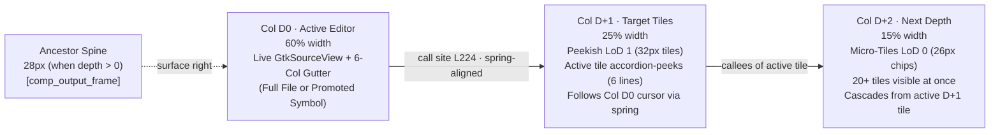

# Kajo IDE — Scrollable-Tiling Code Strip & Dependency Graph Lenses (`spec_ide_code_strip.md`)

**Status:** ✅ Implemented (M0–M5; opt-in via `Space t s` / `[ ▥ STRIP ]` / `ide.toml` `start_in_strip_mode`)  
**Target Binary:** `kajo-ide` (`org.kajo.IDE`)  
**Interactive Companions:**
- High-Fidelity Interactive UI Mockup: [`docs/kajo-ide-strip-mockup.html`](kajo-ide-strip-mockup.html)
- Interactive Step-by-Step Workflow Storyboard: [`docs/kajo-ide-strip-storyboard.html`](kajo-ide-strip-storyboard.html)

---

## 1. Paradigm: Call-Depth Columns & Peekish Target Tiles

Traditional IDEs force developers to browse software through **flat file tabs** and **rigid manual splits**. Jumping `g d` four hops deep (`comp_output_frame → fx_glass_render → blur_down_pass → kfx_dispatch_shader`) overwrites the screen four times and destroys structural context.

**Kajo Code Strip** replaces flat tab juggling with a **Call-Depth Miller Column Strip** powered by live **Tree-sitter**, **LSP 3.17**, and `kajo-comp`'s analytical damped-spring physics (`comp_spring.c`):

### The Two Primitives & One Core Invariant
1. **Columns = Structural / Call Depth (`D0 | D+1 | D+2 | ...`)**
2. **Target Tiles = Every workspace symbol (function, struct, method, class) is a tile**

**Core Invariant ("Active Tile Leftmost, Downstream Structure to the Right"):**
- Whatever tile is currently **full-column editable** sits **leftmost** in the viewport (**`60%`** width).
- Immediately to its right sit the downstream call-depth columns:
  - **Column `D+1` (`25%` width):** Every workspace target symbol referenced by the leftmost column, ordered top-to-bottom in **source call order**, rendered as **Peekish Tiles** (compact `32px` tiles by default; the active/aligned tile smoothly **accordion-expands** into a 4–6 line syntax-highlighted peek).
  - **Column `D+2` (`15%` width):** Workspace targets of the currently active `D+1` tile, rendered as crisp **`26px` Micro-Tiles** (fits 20–25+ tiles on screen at once).
- **Magnetic Code Following:** As you scroll or move your cursor through the leftmost `60%` source column (even across a file with 30–1,000 workspace calls), `D+1` smoothly springs its scroll position to **vertically align the active call's target tile opposite your cursor**, accordion-expanding its peek, while `D+2` smoothly updates to show the next depth level of that tile.
- **Promoting a Tile ("Sliding the World Left"):** Promoting any tile in `D+1` (`Enter` / double-click / `g d` / `→` button) slides the entire strip **left by 1 depth level** via `comp_spring`:
  - The promoted `D+1` tile expands from **`25%` → `60%`** to become the new leftmost live editor.
  - `D+2` expands from **`15%` → `25%`** (becoming the new `D+1` Peek column).
  - A fresh `D+3` column slides in from the right at **`15%`** (new `D+2` Micro-Tiles).
  - The former leftmost caller slides off the left edge into a slim **`28px` Ancestor Spine** so you can click or press `Backspace` / `Alt+Left` / Mouse Back to surface back cleanly at any time.

### Strict Guardrails (`AGENTS.md` §8 & Kajo Platform Constraints)
- **Workspace-only tiles:** Only symbols whose resolved definition path resides inside `workspace_root` become tiles (`WS ONLY`). External/stdlib calls (`GLib`, `GTK`, `/usr/include`, JDK/Maven jars, `GOROOT`/`GOMODCACHE`, Cargo registry) are **suppressed** from tile columns so `D+1`/`D+2` stay 100% pure project architecture. (Explicit `K` Hover and `g d` still work on external symbols.)
- **Zero 2- or 3-finger swipes:** `kajo-comp` owns multi-finger gestures. All Code Strip scrolling and depth transitions use per-column vertical wheel / 1-finger touch drag, keyboard chords, click/double-click, Ancestor Spine pills, Mouse Back/Forward buttons, or `Shift+Wheel`.
- **Opt-in, zero forced migration:** Classic File Tabs remain untouched and default. **`Space t s`** (or `[ ▥ STRIP ]`) switches seamlessly between Classic Tabs and Code Strip over the exact same live `IdeBuffer` pool.
- **Manual scroll never gets fought:** If the user scrolls `D+1` manually with the mouse wheel or `j`/`k`, magnetic follow pauses cleanly (`[ ⛓ UNLINKED · RESYNC ]`) until the user moves the cursor in `Col 0` again or clicks resync.

---

## 2. Screen-Space Geometry (`60% | 25% | 15%`) & 3-Tier Tile Level-of-Detail

### 2.1 Column Proportions
For any viewport width `W` (minus `28px` Ancestor Spine when `depth > 0` and two `12px` Cairo Dependency Bridge Gutters):
- **`Col D0` (Leftmost Active Editor):** **`60%`** — at `1280px` wide this gives `~735px` (~90 monospace columns with the 6-column Cairo gutter); at `1920px` it gives `~1120px`.
- **`Col D+1` (Direct Targets — Peekish):** **`25%`** — `~305px` at `1280px` (`~465px` at `1920px`), comfortably showing symbol name, file:line badge, and an accordion syntax-highlighted peek of the active tile.
- **`Col D+2` (Grandchildren — Horizon):** **`15%`** — `~185px` at `1280px` (`~280px` at `1920px`), displaying dense `26px` micro-tiles (`[ƒ] name` + `→N` child count) so the entire next depth level is scannable at a glance.
- **Zen / Focus Mode (`Space t z`):** Temporarily expands `D0` to `96%` and collapses `D+1`/`D+2` into a `4%` right edge count strip (`D+1: 18 · D+2: 7`) clickable to restore.
- **Vertical Pin Split Inside `D0` (`Space t p`):** When you need to edit or reference a second symbol (e.g., a `struct` definition) alongside the active function without stealing width from `D+1`/`D+2`, pinning docks it vertically at the top of `D0` (`30%` pinned / `70%` active).

### 2.2 Three-Tier Tile Level-of-Detail (LoD) & 1,000-Tile Performance
Rendering 1,000 `GtkSourceView` widgets would destroy memory and frame rate. Instead, `kajo-ide` keeps **at most 1–2 live `GtkSourceView` widgets** (in `D0`, plus optional pinned split) while `D+1` and `D+2` use lightweight `GtkListBox` rows bounded to a capped visible slice (`STRIP_D1_MAX_ROWS` / `STRIP_D2_MAX_ROWS`, with an inline `/` filter and `"+N more"` overflow cue when a file exposes hundreds of targets):

| Tier | Column | Height | Visual Content | Widget Weight |
| :--- | :--- | :---: | :--- | :--- |
| **LoD 2 — Live Editor** | `D0` (`60%`) | `100%` column height | Real `GtkSourceView` attached directly to canonical `IdeBuffer`'s `GtkSourceBuffer` + 6-col Cairo gutter + optional out-of-scope dimming veil (`[ ⤢ FULL FILE ]`). | 1 live `GtkSourceView` |
| **LoD 1 — Peekish Tile** | `D+1` (`25%`) | `32px` collapsed; accordion-expanded (active tile only) | Header: `[kind]` `symbol_name`, `file:L`, occurrence badge (`×3`), `📌` pin & `→` promote buttons. Active/selected tile expands to show a 5-line syntax preview label. | Bounded `GtkListBoxRow` |
| **LoD 0 — Micro-Tile** | `D+2` (`15%`) | `26px` | Compact Metro chip: `[kind]` `symbol_name` + right-aligned `→N` downstream count. | Bounded `GtkListBoxRow` |

Because the model (`ide_strip_layout.c` / `ide_strip_graph.c`) indexes 1,000+ targets in pure C while the view caps live GTK rows and removes its frame-clock spring tick as soon as springs settle, idle CPU stays `< 0.05%`.

---

## 3. Magnetic Code-Following & Arrangement Mechanics

When `D0` is a large source file or complex dispatcher containing tens or hundreds of workspace calls, `D+1` and `D+2` must feel **effortlessly alive and predictable**:

1. **Source-Order Alignment (Anti-Tangle Rule):**
   - Tiles in `D+1` are sorted by **first call-site line number in `D0`** (`L42`, `L58`, `L71`, …). Because both `D0` and `D+1` flow in the exact same top-to-bottom order, the Cairo bridge connectors form clean parallel/fanning lanes instead of a tangled spiderweb.
   - Repeated calls to the same workspace function within `D0` are deduplicated into **one tile** (at its first occurrence in the active scope, or dynamically re-anchored to the occurrence nearest the cursor) with a `×N` call-count chip.
2. **Viewport Band Highlighting:**
   - Every `D+1` tile whose call site(s) fall inside `D0`'s currently visible line range `[vis_top..vis_bottom]` displays a crisp `2px` left rail in `@metro-accent` (`#0078d4`). Tiles above/below the visible band dim softly (`opacity: 0.52`), giving instant visual feedback of which targets belong to the code on screen right now.
3. **Cursor / Scroll Magnetic Spring Alignment:**
   - Moving the cursor onto (or scrolling past) a line containing a workspace call smoothly selects that call's target tile in `D+1`, **accordion-expands** its 5-line code peek, and uses `comp_spring` to scroll `D+1` vertically so the tile's header aligns horizontally with the calling line in `D0` (clamped cleanly to `D+1`'s scroll bounds).
   - A `1.5px` horizontal/Bezier Cairo connector locks the calling line's right gutter edge in `D0` directly to the left edge of the expanded `D+1` tile, and `0.8px` muted connectors link the other visible-band call sites.
   - Debounced at `60 ms` during rapid `j`/`k` cursor motion so fast scrolling stays silky and never stutters.
4. **Cascading `D+2` Horizon:**
   - Whenever `D+1`'s active tile changes (via `D0` magnetic follow OR via explicit `D+1` selection), `D+2` updates asynchronously (using cached call-graph entries first, falling back to `ide_ts` + LSP `outgoingCalls`) with a subtle `90 ms` vertical slide-in, and draws thin connectors from the active `D+1` tile to its `D+2` micro-tiles.
5. **Manual Scroll Override (Zero Tug-of-War):**
   - Scrolling `D+1` with the mouse wheel, 1-finger touch drag, or `j`/`k` immediately detaches magnetic follow and displays a small clickable **`[ ⛓ RESYNC ]`** chip in `D+1`'s header.
   - Magnetic follow re-engages automatically when the user next moves the cursor onto a new call site in `D0` or clicks `[ ⛓ RESYNC ]`.

---

## 4. Interaction, Scrolling & Keyboard Model (Zero 2-/3-Finger Swipes)

### 4.1 Vertical Scrolling Inside Dense Columns (10–1,000 Tiles)
- **Pointer / Mouse:** Hover any column (`D0`, `D+1`, or `D+2`) and use the standard **mouse wheel** (each column is an independent `GtkScrolledWindow` with a slim `4px` Metro scrollbar).
- **Touchscreen:** Standard **1-finger vertical drag** inside any column scrolls that column directly.
- **Keyboard (inside `D+1` or `D+2`):**
  - `j` / `k` / `↑` / `↓`: step tile-by-tile (accordion-peeking each tile and updating `D+2`).
  - `Ctrl+d` / `Ctrl+u` / `PgDn` / `PgUp`: half/full page jump; `g g` / `G`: top/bottom.
  - **`/` (Inline Column Filter):** filters a 50+ tile column live as you type (`Esc` clears).

### 4.2 Horizontal Depth Navigation (Dive In ← / Surface Out →)
| Action | Keyboard | Mouse / Touchscreen |
| :--- | :--- | :--- |
| **Select / Peek tile in `D+1`** | `Space t j` / `Space t k` (or magnetic cursor follow in `D0`) | Single-click tile in `D+1` |
| **Promote tile to Leftmost `D0` (Dive +1 depth)** | `Space t e` | **Double-click** tile in `D+1`, or click its `→` promote button |
| **Jump directly 2 depths (`D+2 → D0`)** | Focus `D+2` + `Enter` | **Double-click** micro-tile in `D+2` (promotes intermediate `D+1` into Ancestor Spine and lands target in `D0`) |
| **Surface Back (-1 depth)** | `Space t u` or `Alt+Left` | Click any pill in far-left **Ancestor Spine** |
| **Move Focus Between `D0 ↔ D+1 ↔ D+2`** | `Space t h` / `Space t l` | Click anywhere in target column |
| **Branch / Switch Vertical Trails** | `Space t b` / `Space t [` / `Space t ]` | Click Trail pills or `[ + BRANCH ]` in top strip toolbar |
| **Filter `D+1` Workspace Tiles** | `Space t /` | Click inline `Filter workspace tiles (/)` entry |
| **Resync Magnetic Follow** | `Space t r` | Click `[ ⛓ RESYNC ]` in `D+1` header |
| **Toggle `D0` Symbol Veil ↔ Full File** | `Space t f` | Click `[ ⤢ FULL FILE ]` / `[ ⤡ SYMBOL FOCUS ]` in `D0` header |
| **Pin / Unpin Reference Tile at Top of `D0`** | `Space t p` | Click `📌` on any `D+1` tile |
| **Toggle Bird's-Eye Overview / Zen Mode** | `Space t o` / `Space t z` | Click `[ ⬡ MAP ]` / `[ ⤢ ZEN ]` |
| **Toggle Classic File Tabs ↔ Code Strip** | `Space t s` | Click `[ ▥ STRIP ]` in IDE header or `[ ✕ TABS ]` in strip bar |

---

## 5. Dependency Lenses (`Space t 1..4`)

Switching Lenses changes *what relationship populates `D+1` and `D+2`* while keeping the exact same `60% | 25% | 15%` layout and magnetic follow behavior:

| Key | Lens | Connector Color | What Populates `D+1` & `D+2` (Workspace-Only) |
| :--- | :--- | :---: | :--- |
| **`Space t 1`** | **`CALLS`** *(Default)* | `@metro-accent` (`#0078d4`) | Downstream workspace function/method calls (`D+1` = callees of `D0` in call order; `D+2` = callees of active `D+1` tile). |
| **`Space t 2`** | **`TYPES`** | `@metro-telemetry` (`#00d8f0`) | Workspace `struct`, `enum`, `typedef`, `class`, and `interface` definitions referenced in `D0` (`D+2` = nested member types / targets of active type). |
| **`Space t 3`** | **`IMPACT`** | `@metro-warning` (`#ffb900`) | Incoming callers / references of `D0` (`D+1` = direct callers in workspace; `D+2` = callers-of-callers — blast radius while refactoring). |
| **`Space t 4`** | **`DIFF`** | `#b4009e` | Git-modified workspace symbols ordered in workspace flow (pair with `Space d s/a/r` for AI agent diff review). |

### Honest Fallback Without LSP
When no language server is running for a file, `ide_strip_graph` extracts calls and types using bundled **tree-sitter grammars (`ide_ts`, 16 languages)** + workspace-scoped **`ripgrep`** / text search, displaying a visible **`⚠ TS+RG`** chip in the strip bar (`⚡ LSP` when live LSP answers).

---

## 6. Shared Canonical Buffer & Editing Integrity

- `D0` attaches its `GtkSourceView` directly to the canonical `IdeBuffer`'s `GtkSourceBuffer` (zero secondary buffer copy, zero undo-stack split).
- When `D0` is focused on a promoted symbol (e.g., `fx_glass_render` at `L210–L268`), out-of-scope lines outside its `GtkTextMark`-tracked bounds are gently dimmed by a `#0a0a0a` veil while remaining scrollable for quick surrounding-context peeking; pressing `Space t f` (`[ ⤢ FULL FILE ]`) lifts the veil immediately.
- Editing in `D0` updates diagnostics, breakpoints (including conditional breakpoints), DAP PC arrows, tree-sitter highlights, and LSP `didChange` identically to Classic Tab mode.

---

## 7. Data Model & Module Split

| Module | Responsibility | GTK-Free? |
| :--- | :--- | :---: |
| `src/ide/ide_strip_layout.{h,c}` | Pure depth-stack state (`IdeStripTrail`, `IdeStripTile`, `IdeStripAncestor`), `60/25/15` & Zen `96/4` geometry, magnetic scroll target calculation, manual-override state, and `comp_spring` camera/scroll springs. | **Yes** (`tests/test_ide_strip.c`) |
| `src/ide/ide_strip_graph.{h,c}` | Workspace-only symbol filter (`is_inside_workspace`), source-order call extractor (`ide_ts`), async LSP `callHierarchy` / `references` / `definition` resolver (`ide_lsp_manager_request_raw`) + `⚠ TS+RG` fallback, and per-buffer call-graph cache invalidated on edit/save. | **Yes** (`tests/test_ide_strip_graph.c` + `tests/test_ide_ipc.c`) |
| `src/ide/ide_strip_view.{h,c}` | GTK4 widget tree: `28px` Ancestor Spine, `60%` live `GtkSourceView` (`D0`) with optional pin split & scope veil, `25%` bounded `GtkListBox` (`D+1` Peekish accordion rows + `/` filter), `15%` bounded `GtkListBox` (`D+2` Micro-Tiles), Cairo Bezier bridge overlay, and Bird's-Eye Overview canvas. | GTK4 UI |

---

## 8. Phased Implementation Milestones (M0–M5)

| Milestone | Status | Scope | Verification Gate |
| :--- | :---: | :--- | :--- |
| **M0 — Spec, Mockup & Storyboard** | ✅ Done | `spec_ide_code_strip.md` v2, `kajo-ide-strip-mockup.html`, `kajo-ide-strip-storyboard.html` | User visual review & sign-off |
| **M1 — Pure Depth Model & Spring Engine** | ✅ Done | `ide_strip_layout.{h,c}` sharing `comp_spring.c`, `60/25/15` math, Ancestor Spine push/pop, magnetic align + manual-override state machine, `tests/test_ide_strip.c` | 100% unit tests + ASan/UBSan |
| **M2 — Workspace Call-Graph Indexer & Cache** | ✅ Done | `ide_strip_graph.{h,c}`, strict `workspace_root` filter, `ide_ts` source-order call extraction, LSP + `⚠ TS+RG` fallback, 1,000-call benchmark test | `test_ide_strip_graph` + mock LSP |
| **M3 — Live `60/25/15` Strip View & Peekish Accordion** | ✅ Done | `ide_strip_view.{h,c}`, `D0` shared `GtkSourceView` + scope veil + pin split, `D+1` Peekish + `D+2` Micro-Tiles, magnetic follow, Cairo connectors, 20 `Space t *` FSM bindings | Headless `cage`+`grim` ASan capture + `test_ide_fsm` |
| **M4 — Lenses (`TYPES`, `IMPACT`, `DIFF`) & Bird's-Eye Overview** | ✅ Done | All 4 lenses + `Space t o` overview canvas + `/` inline column filter + vertical Trails (`Space t b` / `[` / `]`) | Mock LSP + unit tests |
| **M5 — Settings, Gallery & Docs** | ✅ Done | `ide.toml` options, `kajo-settings`, 120-command Help Palette, `ui-gallery.html`, `design_system.md`, `kajo_ide_manual.md`, `ROADMAP.md`, `README.md`, `DEVELOPMENT.md` | 35/35 Meson suites + headless UI shot |
