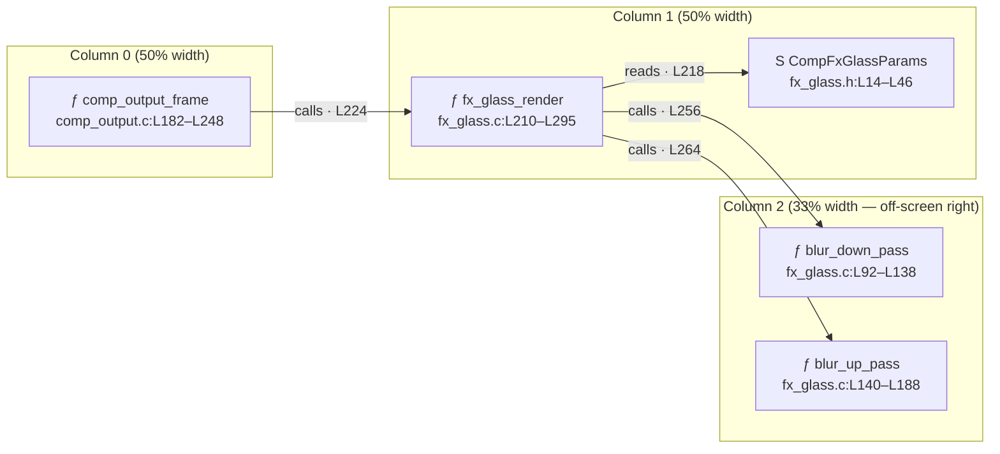

# Kajo IDE — Scrollable-Tiling Code Strip & Dependency Graph Lenses (`spec_ide_code_strip.md`)

**Status:** 📋 Specification Draft (for review — not implemented yet)  
**Target Binary:** `kajo-ide` (`org.kajo.IDE`)  
**Interactive Companions:**
- High-Fidelity Interactive UI Mockup: [`docs/kajo-ide-strip-mockup.html`](kajo-ide-strip-mockup.html)
- Interactive Step-by-Step Workflow Storyboard: [`docs/kajo-ide-strip-storyboard.html`](kajo-ide-strip-storyboard.html)

---

## 1. Motivation & Paradigm ("Scrollable Tiling for Code")

Traditional IDEs organize code around **flat file tabs** and **rigid split grids**. That model breaks down the moment a developer traces a non-trivial execution path:

1. **Tab amnesia:** Jumping `g d` four hops deep (`main → dispatch → render → shader`) overwrites the viewport four times. By hop 4, the caller's invariants are no longer visible.
2. **Rigid splits don't scale:** Splitting vertically once gives 2 cramped panes; splitting twice yields unusable 40-column slivers and forces manual pane micromanagement.
3. **File boundaries are arbitrary:** A 1,600-line C file mixes unrelated helpers with the 35-line function you actually care about, while the `struct` it mutates lives in a header two directories away.

Kajo already solved the window-management equivalent of this problem in **`kajo-comp`** (inspired by Niri): an **infinite horizontal scrollable strip of resizable columns** with analytical spring camera motion (`comp_spring.c`), vertical stacking inside columns, and vertical workspaces for separate tasks.

**Kajo Code Strip** brings that exact spatial model inside `kajo-ide`, fused with live **LSP 3.17** and **Tree-sitter** structural intelligence:

- **Horizontal axis = Execution / Dependency Trail:** Navigating from a call site or type reference in Column `i` opens the target symbol in **Column `i + 1`** right beside its caller and smoothly springs the camera so both stay in view, linked by a subtle Cairo dependency connector.
- **Vertical axis inside a column = Related Context Stack:** Consume/expel cards into or out of a column (e.g., stack a `struct` definition directly above the function that mutates it, or stack two sibling callees in Column `i + 1`).
- **Vertical axis across workspaces = Named Trails:** Each vertical **Trail** preserves an entire multi-column investigation (e.g. `01 · fx_glass pipeline`, `02 · LSP call hierarchy`, `03 · XWayland DISPLAY`) independently.
- **Unit of editing = Live Symbol Card (or Full File):** Every card edits the **exact same canonical `GtkSourceBuffer`** as classic file-tab mode — shared undo/redo, breakpoints, diagnostics, tree-sitter highlights, and LSP `didChange`.

### Non-Goals & Strict Guardrails (`AGENTS.md` §8)
- **Opt-in, zero forced migration:** Classic File Tab mode remains untouched and default. Pressing **`Space t s`** (or clicking **`[ ▥ STRIP ]`** in the header bar) switches seamlessly between Classic Tabs and Code Strip using the same open `IdeBuffer` set.
- **No ambient auto-spawning:** Moving the cursor over a symbol never automatically opens cards or shifts the camera. Every card spawn, lens switch, and overview zoom happens only on an explicit user action.
- **No free-form infinite 2D node-graph canvas:** Free-floating draggable boxes require constant mouse tidying and clash with modal keyboard editing. Strict **columnar scrollable tiling** keeps every card keyboard-addressable (`h/j/k/l`), crisp, and predictable.
- **Honest fallback without LSP:** When no language server is running for a file, structural lenses degrade visibly (`[TS+RG FALLBACK]`) using `ide_ts` (16 bundled grammars) and asynchronous `ripgrep`.

---

## 2. Architecture & Reuse of Existing Kajo Subsystems

Kajo already has almost every primitive needed to build Code Strip without adding external dependencies:

| Existing Kajo Module | Role in Kajo Code Strip |
| :--- | :--- |
| [`src/comp/core/comp_spring.{h,c}`](../src/comp/core/comp_spring.h) | Pure C (zero wlroots/GLib deps) analytical damped-spring oscillator (`comp_spring_init`, `comp_spring_retarget`, `comp_spring_value`). Drives smooth horizontal camera scrolling and vertical trail transitions with seamless retargeting on rapid `Space t l` / `Space t h` taps. |
| [`src/ide/ide_ts.{h,c}`](../src/ide/ide_ts.h) | Tree-sitter AST across 16 languages (`ide_ts_doc_find_object` for `'f'` function & `'c'` struct/class/enum). Extracts enclosing symbol spans `[start_line..end_line]` and local call/type sites without blocking on LSP. |
| [`src/ide/ide_lsp.{h,c}`](../src/ide/ide_lsp.h) | Real async LSP client already supporting `textDocument/definition`, `textDocument/implementation`, `textDocument/references`, `textDocument/prepareCallHierarchy`, `callHierarchy/incomingCalls`, and `callHierarchy/outgoingCalls` (plus `textDocument/documentSymbol` to be added in M1). |
| [`src/ide/ide_buffer.{h,c}`](../src/ide/ide_buffer.h) | Single canonical `IdeBuffer` + `GtkSourceBuffer` per open file, owning disk baseline, atomic save, `GFileMonitor`, breakpoints (with conditions), diagnostics, DAP PC line, and git/agent diffs. |
| [`src/ide/ide_gutter.{h,c}`](../src/ide/ide_gutter.h) | 6-column Cairo gutter reused per card (breakpoints, diagnostics, DAP PC, absolute/relative line numbers, git/agent diff bars, fold indicators). |
| [`src/ide/ide_fsm.{h,c}`](../src/ide/ide_fsm.h) | Modal FSM extended with explicit `Space t *` (Trail/Strip) chords and an `IDE_STATE_STRIP_OVERVIEW` state for bird's-eye overview navigation. |

---

## 3. Spatial Model & Geometry

### 3.1 Horizontal Column Strip
- Each **Trail** (`IdeStripTrail`) owns an ordered array of columns `C[0..N-1]`.
- Each **Column** (`IdeStripColumn`) has a normalized width preset relative to the viewport width `W`:
  - `STRIP_WIDTH_THIRD` (`0.333 * W`, min `360px`)
  - `STRIP_WIDTH_HALF` (`0.500 * W`, default — fits caller + callee cleanly side-by-side at `1280px+`)
  - `STRIP_WIDTH_TWOTHIRDS` (`0.667 * W`)
  - `STRIP_WIDTH_FULL` (`1.000 * W` — distraction-free focus on one column)
- Columns are separated by a **`14px` Dependency Bridge Gutter** where the strip's Cairo overlay draws crisp orthogonal/Bezier connectors linking source lines in Column `i` to target cards in Column `i + 1`.
- **Camera Positioning Policy (matching `kajo-comp` `center_focused_column = "never"`):**
  - If the newly focused column already fits completely inside `[camera_x, camera_x + W]`, the camera does **not** move (zero disorienting jitter when toggling between two visible neighbors).
  - If the newly focused column extends past the right edge (`col_right > camera_x + W`), `camera_target = col_right - W` (so the previous caller column stays visible on the left!).
  - If it extends past the left edge (`col_left < camera_x`), `camera_target = col_left`.
  - Explicit **`Space t c`** centers the focused column (`camera_target = col_left - (W - col_width) / 2`).
  - Horizontal mouse-wheel / 2-finger trackpad scroll pans `camera_x` directly and settles smoothly via `comp_spring_launch()`.

### 3.2 Vertical Card Stacking Inside a Column
- A column holds `1..4` stacked **Cards** (`IdeStripCard`), sharing the column's vertical height `H` (equal weights by default; draggable `4px` splitter handle between stacked cards, plus collapse-to-header `Space t z` which folds a card to its `26px` title bar while keeping it pinned in the column!).
- **Consume Left / Expel Right (exact Niri / `kajo-comp` muscle memory):**
  - **`Space t ,`** (*Consume into column*): pulls the top card from Column `i + 1` into the bottom of Column `i`.
  - **`Space t .`** (*Expel out of column*): ejects the focused card out of Column `i` into its own new Column `i + 1`.
  - **`Space t H` / `Space t L`**: swaps the focused column left/right in the strip.
  - **`Space t J` / `Space t K`**: reorders the focused card down/up within its column.

### 3.3 Vertical Trails (Task Workspaces)
- Just as `kajo-comp` has a vertical stack of workspaces (`WS1, WS2, ...`), `kajo-ide` maintains a vertical list of named **Trails** (`IdeStripTrail`):
  - Example: `01 · fx_glass pipeline`, `02 · LSP call hierarchy`, `03 · xwayland DISPLAY`.
  - Switching trails (**`Space t ]` / `Space t [`** or clicking the trail pills in the slim top strip rail) swaps the active strip instantaneously (or with a crisp vertical spring slide) while preserving every trail's columns, camera position, active lens, and collapsed cards.
  - **`Space t n`**: create a new blank trail (opens fuzzy symbol/file picker).
  - **`Space t b`**: **Branch Trail** — forks a new trail rooted at the currently focused card so you can explore a side tangent without cluttering your main trail.
  - **`Space t x`**: close active trail (never closes unsaved `IdeBuffer`s — buffers live in the IDE's canonical buffer pool!).

---

## 4. Card Types & Shared-Buffer Editing Mechanics

### 4.1 Card Kinds
| Kind | Header Badge | Purpose | Editable? |
| :--- | :---: | :--- | :---: |
| **`IDE_STRIP_CARD_SYMBOL`** | `ƒ` / `S` / `T` / `M` | Focused slice of one function, struct, class, method, or macro (`start_line..end_line` from tree-sitter / LSP). | **Yes** (live shared `GtkSourceBuffer`) |
| **`IDE_STRIP_CARD_FILE`** | `📄` | Full-file column (headers, configs, `meson.build`, Markdown docs). | **Yes** (live shared `GtkSourceBuffer`) |
| **`IDE_STRIP_CARD_LENS`** | `⬡` | Live structural card (Call Graph, Type Dependencies, References/Impact list, or Git/Agent Diff queue). | Interactive (click / `Enter` spawns or focuses target card in Column `i+1`) |

### 4.2 Card Chrome (Aero + Metro, `0px` Radius)
Every card has a `26px` header strip (`.ide-strip-card-header`):
- Left: `[kind badge]` + bold `symbol_name` + muted `relpath:L210–L295` + state chips (`●` dirty, `✖ N` error, `◆` conditional BP, `🤖` agent modified).
- Right: compact action buttons (`focusable = FALSE`):
  - `[ ⤢ ]` — Toggle between `SYMBOL` scope and `FILE` full view (`Space t f`).
  - `[ ▁ ]` — Collapse card to its `26px` header strip (`Space t z`).
  - `[ × ]` — Remove card from trail (`Space t q`, does **not** close the underlying buffer if dirty or open elsewhere).
- Active card gets a `1px solid @metro-accent` outer frame and `2px solid @metro-accent` top bar; inactive cards use `1px solid #2b2b2b` (`@metro-border`).

### 4.3 Critical Technical Decision: How `CARD_SYMBOL` Shares `GtkSourceBuffer` in GTK4

In GTK4, multiple `GtkSourceView` widgets can natively attach to the **exact same `GtkSourceBuffer`** (`gtk_text_view_set_buffer()`). However, `GtkTextTag` properties (including `invisible = TRUE`) belong to the `GtkTextBuffer`, **not** the individual `GtkSourceView`! Therefore, hiding out-of-scope lines via an `invisible` tag would break whenever two cards show different functions from the same file (e.g., `blur_down_pass` and `blur_up_pass` in `fx_glass.c`).

Two honest engineering options exist:

| Aspect | Option A: Synced Sub-Buffer Slice (`IdeBufferSlice`) | Option B: Shared Canonical Buffer + Viewport Scope Veil *(Recommended)* |
| :--- | :--- | :--- |
| **Mechanism** | Allocate a secondary `GtkSourceBuffer` containing only lines `[start..end]`; mirror edits bidirectionally to canonical `IdeBuffer` with line-offset translation. | Attach the card's `GtkSourceView` directly to the canonical `IdeBuffer`'s `GtkSourceBuffer`. Scroll viewport to `start_line`, draw a subtle `#0a0a0a` dimmed veil (65% alpha) + `2px` scope boundary ticks over lines outside `[start_line..end_line]`, and auto-track `[start_line..end_line]` via `GtkTextMark`s (left/right gravity) + tree-sitter re-query on edit. |
| **Undo / Redo** | Must manually coordinate undo stacks across slice and canonical buffer (fragile). | **100% native shared GTK undo stack** across all cards and Classic Tab mode. |
| **LSP / Diagnostics / DAP / Tree-sitter** | Must translate every line offset back and forth on every edit. | **Zero translation:** diagnostics, breakpoints, DAP PC arrow, git diff bars, and tree-sitter highlights appear identically in real time. |
| **Peek Surrounding Context** | Impossible without expanding slice bounds and reloading text. | Effortless: user can scroll slightly above/below the dimmed boundary to peek at comments/includes, or press `Space t f` to lift the veil completely. |
| **Compactness in Stacked Columns** | Strictly shows only the N lines of the function. | Shows the function framed cleanly from `start_line` down; dimmed lines below/above stay visually quiet and non-distracting. |

**Recommendation:** **Option B (Shared Canonical Buffer + Viewport Scope Veil + `GtkTextMark` Bounds)** for M1–M5. It eliminates an entire class of dual-buffer desynchronization bugs while giving instant live editing across multiple cards of the same file. *(Highlighted in §10 Open Questions for user sign-off.)*

---

## 5. Dependency Graph Lenses (`Space t 1..4`)

Lenses transform how the strip populates and connects columns. Lenses are **explicitly invoked** — switching lenses updates the active Lens indicator pill in the strip toolbar and lets the user materialize cards with one keystroke:

### 5.1 Lens 1 — `CALLS` (Execution Call Trail, Default)
- **Data source:** LSP `textDocument/prepareCallHierarchy` → `callHierarchy/incomingCalls` (left) & `callHierarchy/outgoingCalls` (right).
- **Fallback (no LSP):** `ide_ts` walks `call_expression` / `IDE_TS_TOKEN_FUNCTION` nodes inside the focused symbol's AST range + async `ripgrep` for definitions (`[TS+RG FALLBACK]` badge).
- **Behavior:**
  - Inside any `SYMBOL` or `FILE` card, **`g d`** / **`Ctrl+Click`** opens the target symbol in **Column `i + 1`** (if already present in the trail, smoothly focuses it instead of duplicating — unless **`g D`** is pressed to stack/duplicate explicitly).
  - **`Space t i`** opens/updates an **Incoming Callers** lens card in Column `i - 1` (showing who calls the focused function).
  - **`Space t e`** (*Expand Callees*) fans out the focused function's direct outgoing callees into a stacked column at `i + 1` (up to 4 cards, or a `LENS` card if > 4).
- **Connector color:** `@metro-accent` (`#0078d4`).

### 5.2 Lens 2 — `TYPES` (Type & Data-Flow Lens)
- **Data source:** `ide_ts` extracts `IDE_TS_TOKEN_TYPE` tokens from the focused symbol's signature and body, resolved via LSP `textDocument/definition` (or `rg` `struct|enum|typedef|class|interface` fallback).
- **Behavior:** Shows referenced structs, enums, and interfaces in a compact `LENS` card (or pulls the selected type definition into the focused column's vertical stack via `Enter` / `Space t ,`). Ideal for inspecting data layouts right above the logic operating on them.
- **Connector color:** `@metro-telemetry` (`#00d8f0`).

### 5.3 Lens 3 — `IMPACT` (References & Blast-Radius Lens)
- **Data source:** LSP `textDocument/references` (`includeDeclaration: false`).
- **Behavior:** When refactoring a function signature or struct field in Column `i`, activating `IMPACT` (`Space t 3`) places a `References` lens card in Column `i + 1` grouped by caller symbol, with **`[ ▤ MATERIALIZE TOP CALLERS ]`** to open the live editable caller cards stacked vertically in Column `i + 1` — edit the callee on the left and update every caller on the right without losing context.
- **Connector color:** `@metro-warning` (`#ffb900`).

### 5.4 Lens 4 — `DIFF` (Git & AI-Agent Flow Review Lens)
- **Data source:** `git diff` hunks + `IdeBuffer` agent snapshots (`ide_buffer_has_agent_changes`), mapped to enclosing tree-sitter symbols (`ide_ts_doc_find_object`), topologically ordered by call edges where available.
- **Behavior:** Instead of reviewing AI agent edits or a PR in alphabetical file order, `DIFF` lays out every modified symbol left-to-right in call order, with `[ ✓ ACCEPT ]` / `[ ✕ REVERT ]` actions directly in each card's header.
- **Connector color:** `#b4009e` (Agent magenta) / `@metro-success` (`#10893e` git diff).

---

## 6. Dependency Connectors & Bird's-Eye Overview (`Space t o`)

### 6.1 Strip Bridge Connectors (Always Lightweight, Damage-Gated)
- Between Column `i` and Column `i + 1`, a `14px` bridge gutter is rendered by a single lightweight `GtkDrawingArea` overlay (`can-target = FALSE`, zero input interception).
- For every directed edge `(card_a, src_line) -> card_b` where both endpoints are currently visible on screen:
  - Compute `y_src` from `gtk_text_view_get_line_yrange()` mapped into strip coordinates (clamped to card bounds if scrolled out of card viewport, drawing a small `▲`/`▼` off-viewport indicator tick).
  - Compute `y_dst` at the vertical midpoint of `card_b`'s header bar.
  - Draw a crisp stepped/cubic Bezier connector (`1.5px` stroke for edges attached to the focused card; `1px` at 30% alpha for background edges; small `4px` filled anchor dot on `y_src` and crisp arrowhead on `y_dst`).
- **Idle CPU discipline:** Redraws ONLY on camera spring tick, card scroll, or layout change. Zero background timers when idle (`< 0.05%` CPU).

### 6.2 Bird's-Eye Strip Overview (`Space t o`)
- Pressing **`Space t o`** transitions the FSM to `IDE_STATE_STRIP_OVERVIEW` and switches the main viewport to an interactive **Cairo Vector Strip Map** (reusing the exact visual clarity of `ide_mermaid.c` and `kajo-comp-storyboard.html`'s minimap):
  - Displays every column `C0..CN` and stacked card as crisp Aero+Metro rectangles showing symbol name, file badge, line count, diagnostic/dirty/BP indicators, and all directed dependency curves across the entire trail.
  - Highlights the current viewport frame in `2px solid @metro-telemetry` (`#00d8f0`).
  - **Keyboard navigation:** `h/j/k/l` moves selection across cards; typing filters/highlights matching symbols; `Enter` exits overview and springs the camera directly to the chosen card; `Esc` cancels back to prior focus.
  - **Mouse interaction:** Click any card to jump; drag a card onto another column to reorder or stack.

---

## 7. Modal FSM & Keybinding Specification

All strip commands live under the **`Space t`** (*Trail / Tiling Strip*) leader namespace — zero collisions with existing `kajo-ide` bindings (`Space f/b/c/d/g/m/n/p/r/s/v/w`):

| Key / Chord | Scope | Action |
| :--- | :--- | :--- |
| **`Space t s`** | Normal / Strip | Toggle between **Classic File Tabs** and **Code Strip** mode |
| **`Space t h` / `Space t l`** | Strip | Focus previous / next column (spring camera scroll) |
| **`Alt+H` / `Alt+L`** | Strip | Fast column focus left / right (mirrors `kajo-comp` `Mod+H/L`) |
| **`Space t j` / `Space t k`** | Strip | Focus card below / above inside current column |
| **`Space t r`** | Strip | Cycle focused column width (`33%` → `50%` → `66%` → `100%`) |
| **`Space t c`** | Strip | Center focused column in viewport |
| **`Space t ,`** | Strip | Consume card from right column into bottom of current column |
| **`Space t .`** | Strip | Expel focused card out of column into its own column to the right |
| **`Space t H` / `Space t L`** | Strip | Move focused column left / right in strip |
| **`Space t f`** | Strip | Toggle focused card between `SYMBOL` scope and `FILE` full view |
| **`Space t z`** | Strip | Collapse / expand focused card to `26px` header bar |
| **`Space t o`** | Strip | Toggle **Bird's-Eye Strip Overview** (`IDE_STATE_STRIP_OVERVIEW`) |
| **`Space t 1` / `2` / `3` / `4`** | Strip | Activate Lens: `1=CALLS`, `2=TYPES`, `3=IMPACT`, `4=DIFF` |
| **`Space t i` / `Space t e`** | Strip | Open Incoming Callers (left) / Expand Outgoing Callees (right) |
| **`Space t n` / `Space t b`** | Strip | New empty Trail / Branch new Trail from focused card |
| **`Space t [` / `Space t ]`** | Strip | Switch to previous / next vertical Trail |
| **`Space t q`** | Strip | Remove focused card from current Trail (keeps underlying buffer) |
| **`g d` / `Ctrl+Click`** | Strip (`NORMAL`) | Jump to definition → opens/focuses card in **Column `i + 1`** |
| **`g D`** | Strip (`NORMAL`) | Open definition stacked into **Column `i + 1`** (even if already open) |

All actions will be registered in `ide_action_type_from_name()` (so users can remap them in `ide.toml` `[keys.normal]`), `kValidLeaderChords`, Which-Key HUD (`Space t`), and the Help Palette (`?`).

---

## 8. Data Model & Module Decomposition

To honor `AGENTS.md` §5 ("no monolithic files", keep pure logic GTK-free and unit-tested):

| New Module | Responsibility | GTK-Free? |
| :--- | :--- | :---: |
| `src/ide/ide_strip_layout.{h,c}` | Pure data model (`IdeStripWorkspace`, `IdeStripTrail`, `IdeStripColumn`, `IdeStripCard`, `IdeStripEdge`), column geometry calculation, camera follow/center policy, consume/expel, reorder, and `comp_spring` camera state. | **Yes** (100% pure C + GLib, unit-tested headlessly in `tests/test_ide_strip.c`) |
| `src/ide/ide_strip_graph.{h,c}` | Dependency edge builder & Lens query coordinator (extracts symbol spans via `ide_ts_doc_find_object`, dispatches LSP `prepareCallHierarchy`/`references`/`definition` or `ts+rg` fallback, computes topological order for `DIFF` lens). | **Yes** (tested against `mock_lsp_server.py`) |
| `src/ide/ide_strip_view.{h,c}` | GTK4 widget layer: horizontal scrolled viewport hosting live `GtkSourceView` cards, `.ide-strip-card-header`, out-of-scope dimming veil, `GtkDrawingArea` Cairo connector overlay, Trail switcher rail, and Bird's-Eye Cairo overview canvas. | GTK4 UI |

### Virtualization & Resource Discipline
- **Max live `GtkSourceView` cap (default `12`):** If a long trail grows beyond 12 cards, cards far outside `[camera_x - W, camera_x + 2*W]` release their `GtkSourceView` widget while preserving their `IdeStripCard` metadata (path, symbol range, cursor `GtkTextMark`/line, scroll offset) and re-materialize seamlessly when scrolled back within range.
- **Session persistence (optional, M5):** Trails can be serialized to `<workspace>/.kajo/strip-trails.json` (only when the user saves/enables workspace session state; never writes surprise files without config).

---

## 9. Phased Implementation Roadmap (M0–M5)

Each milestone lands cleanly behind `meson compile && meson test` + ASan/UBSan + `scripts/ui-shot.sh`:

| Milestone | Scope | Verification Gate |
| :--- | :--- | :--- |
| **M0 — Spec, Mockup & Storyboard** | [`docs/spec_ide_code_strip.md`](spec_ide_code_strip.md), [`docs/kajo-ide-strip-mockup.html`](kajo-ide-strip-mockup.html), [`docs/kajo-ide-strip-storyboard.html`](kajo-ide-strip-storyboard.html) | User review & sign-off on §10 open questions |
| **M1 — Pure Strip Core & Spring Camera** | `ide_strip_layout.{h,c}` sharing `comp_spring.c`, column width presets, consume/expel, vertical trails, camera policy, `tests/test_ide_strip.c` | 100% unit tests + ASan/UBSan clean |
| **M2 — Live Strip View & Shared-Buffer Symbol Cards** | `ide_strip_view.{h,c}`, `Space t s` toggle, `SYMBOL` + `FILE` cards sharing canonical `GtkSourceBuffer` with scope dimming veil, `g d` opening target in `Column i+1`, Cairo bridge connectors | `ui-shot.sh` visual verify + shared-buffer edit/undo test + `test_ide_fsm` chords |
| **M3 — Dependency Graph Lenses (`CALLS`, `TYPES`, `IMPACT`, `DIFF`)** | `ide_strip_graph.{h,c}`, `LENS` cards, LSP `documentSymbol`/call-hierarchy/references integration + `[TS+RG FALLBACK]` | Mock LSP end-to-end tests in `test_ide_ipc.c` + real `clangd` check |
| **M4 — Bird's-Eye Cairo Overview & Off-Screen Virtualization** | `Space t o` interactive Cairo overview canvas with fuzzy filter, click-to-jump, drag-to-reorder, and live widget cap (`<= 12`) | Headless Cairo export test + ASan/UBSan stress test (30-card trail) |
| **M5 — Polish, `kajo-settings`, Docs & UI Gallery** | Strip preferences in `ide.toml` (`default_strip_mode`, `strip_default_col_width`), `kajo-settings` controls, Help Palette entries, `docs/ui-gallery.html`, `docs/design_system.md`, `docs/kajo_ide_manual.md`, `ROADMAP.md` | Full 33+ test gate + `ui-shot.sh` + live testing |

---

## 10. Open Design Decisions for User Review

Before writing any C implementation code, please weigh in on these 5 choices:

1. **Symbol Card Buffer Strategy (§4.3):**
   - **Recommended (Option B):** Attach each `SYMBOL` card directly to the canonical `GtkSourceBuffer`, scrolling to the symbol and softly dimming lines outside `[start_line..end_line]` (zero sync risk, shared undo, can scroll slightly past bounds to peek context).
   - **Alternative (Option A):** Strictly clipped sub-buffer showing *only* the symbol's lines (cleaner compact height when stacking 3 functions in one column, but requires bidirectional slice-to-buffer sync).
2. **Re-opening an Already-Open Symbol on `g d`:**
   - **Recommended:** Focus and spring-scroll to the existing card if it's already in the current trail (prevents duplicate clutter), while `g D` forces opening/stacking a new card in Column `i + 1`.
   - **Alternative:** Always open or move the target into Column `i + 1` right beside the caller so the active hop is always immediately adjacent.
3. **Default Column Width Preset:**
   - **Recommended:** `50%` (`0.50 * W`) so caller (left) + callee (right) always sit side-by-side at `1280px+`, cycling `33% → 50% → 66% → 100%` via `Space t r`.
4. **Workspace Mode Default:**
   - **Recommended:** Classic File Tabs remains the default; `Space t s` (or `[ ▥ STRIP ]` header toggle) switches into Code Strip, with an opt-in `start_in_strip_mode = false` toggle in `kajo-settings` (`ide.toml`).
5. **Trail Persistence Across Restarts:**
   - **Recommended (opt-in):** Keep trails in-memory during M1–M4, and add explicit `[ 💾 SAVE TRAIL ]` / optional `.kajo/strip-trails.json` restoration in M5 so the IDE never litters repos with untracked state files by default.
