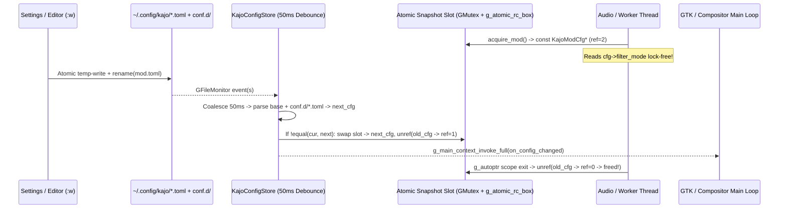

# Specification: Domain-Split TOML Configuration & `KajoConfigStore` (`docs/spec_toml_config.md`)

**Status:** Implemented  
**Target Modules:** `src/vendor/tomlc17/`, `src/config/`, `kajo_core` (`meson.build`), all 7 Kajo binaries (`kajo`, `kajo-settings`, `kajo-ide`, `kajo-files`, `kajo-player`, `kajo-mod`, `kajo-greeter`) + future `kajo-comp`  
**Dependencies:** Vendored upstream `cktan/tomlc17` (MIT, pure C17, zero external deps), `glib-2.0`, `gio-2.0`, `json-glib-1.0` *(strictly isolated inside one-time legacy importer `kajo_config_migrate.c`)*

---

## 1. Objectives & Motivation

Kajo's current configuration layer (`src/config.h` + `src/config.c`, 1,210 lines) stores every setting for the panel, widgets, OSK, notifications, idle/lock, foldable sensors, `kajo-ide`, `kajo-files`, and `kajo-mod` inside a single monolithic `~/.config/kajo/config.json` file. Auditing the current implementation reveals five structural flaws that must be resolved before introducing `kajo-comp`:

1. **Cross-Process Write Clobbering:** Eleven separate write sites across `kajo-settings`, `kajo` panel popovers (`theme.c`, `backlight.c`), `kajo-files`, and `kajo-ide` rewrite the entire JSON blob via `shell_config_save()`, risking lost updates when two processes save concurrently.
2. **Duplicated Raw String Literals & Stringly-Typed Modes:** Key names appear in 3+ places (JSON reader, JSON writer, tests), and 13 closed-set mode fields (`files_view_mode`, `screensaver_mode`, `mod_filter_mode`, `toast_click_action`, `osk_auto_show_mode`, …) are stored as heap-allocated `gchar *` strings compared via `g_strcmp0()` across dozens of files—where a single typo compiles cleanly and silently malfunctions at runtime.
3. **Ad-Hoc File Watching & Multi-Thread Workarounds:** `ide_window.c` and `mod_window.c` each hand-roll single-file `GFileMonitor` instances on `config.json` without event debouncing, while `mod_engine.h` had to invent custom mutex-locked global copies (`kajo_mod_set_runtime_prefs()`) so background UADE/SID audio threads could read preferences safely.
4. **Silent Default Drift:** Shipped `data/defaults/config.json` (`position = "bottom"`, `height = 39`, `autohide.enabled = true`, plus an unparsed `"hide_duration": 200` key) has already drifted apart from `shell_config_get_default()` in `src/config.c` (`PANEL_POSITION_TOP`, `height = 32`, `autohide_enabled = FALSE`).
5. **Hostility to Human Hacking:** JSON forbids comments, rejects trailing commas, and requires double-escaped regexes—making it unsuitable for human-maintained files and future `kajo-comp` keybindings/window rules.

### Core Design Goals
- **Domain-Split Plain-Text TOML (`~/.config/kajo/*.toml` + `conf.d/*.toml`):** Small, domain-owned files (`theme.toml`, `shell.toml`, `ide.toml`, `files.toml`, `mod.toml`, and future `comp.toml` / `binds.toml` / `rules.toml`) with `#` comments and atomic per-domain saves.
- **Lock-Free Multi-Threaded Reads via Immutable Refcounted Snapshots:** RCU-style `g_atomic_rc_box` snapshots (`const Kajo<Domain>Cfg *`) safe to acquire from GTK UI threads, PipeWire/UADE/SID DSP threads, `GTask` workers, and future 240Hz compositor render loops with zero torn reads and zero lock contention after pointer acquisition.
- **Zero Raw String Literals in Application Code:** Strongly typed C `enum`s for all mode/choice fields (`-Wswitch-enum` checked) + single-header `#define` key/section/file constants (`kajo_config_keys.h`).
- **Single-Source-of-Truth Table-Driven Schema Engine:** One declarative `offsetof()` field table per domain drives defaults, TOML parsing, type validation, `[min, max]` clamping, `conf.d/` overlay merging, TOML serialization, structural diffing, and memory cleanup—backed by a mandatory unit test asserting 1:1 parity between C defaults and `data/defaults/*.toml`.

---

## 2. Architecture & Module Layout

All files adhere strictly to `< 400` lines per module (`AGENTS.md` §5.1) and compile once into the shared `kajo_core` static library (`meson.build`):

| File | Responsibility |
| :--- | :--- |
| `src/vendor/tomlc17/tomlc17.h` / `tomlc17.c` | Unmodified upstream MIT C17 TOML 1.0/1.1 parser (`cktan/tomlc17`, `toml_parse()`, `toml_free()`). |
| `src/config/kajo_config_keys.h` | Canonical `#define` constants for all directory env vars, `.toml` filenames, `[section]` names, and key names. Zero magic string literals outside this header. |
| `src/config/kajo_config_types.h` | Strongly typed C `enum`s, `ShellWidgetConfig`, and immutable `const`-consumed domain structs (`KajoThemeCfg`, `KajoShellCfg`, `KajoIdeCfg`, `KajoFilesCfg`, `KajoModCfg`) + `G_DEFINE_AUTOPTR_CLEANUP_FUNC` declarations. |
| `src/config/kajo_config_schema.h` / `.c` | Generic table-driven `offsetof()` engine: default initialization, TOML table extraction + type validation + `[min, max]` clamping, `conf.d/*.toml` partial overlay application, surgical comment/unknown-key-preserving TOML patcher (`kajo_cfg_domain_patch_toml()`) + full serializer, deep equality diffing (`kajo_cfg_domain_equal()`), and field destructor cleanup. |
| `src/config/kajo_config_store.h` / `.c` | Process-wide (or sandboxed test-dir) thread-safe store managing atomic refcounted snapshots, `write_lock` + advisory `flock()`-serialized `conf.d/`-safe transactional `update_<domain>()` writes, a 50ms-debounced `GFileMonitor` directory watcher, and `GMainContext`-dispatched pub/sub notifications. |
| `src/config/kajo_config_migrate.h` / `.c` | Quarantined, `flock()`-locked, retry-safe one-time `~/.config/kajo/config.json` $\rightarrow$ `{theme,ide,files,mod,shell}.toml` importer (renaming `config.json` $\rightarrow$ `config.json.bak` once all 5 files exist). **Only** file in `src/config/` linking `json-glib`. |
| `src/config/schemas/schema_theme.c` | Declarative `KajoDomainSchema` for `theme.toml`. |
| `src/config/schemas/schema_shell.c` | Declarative `KajoDomainSchema` + widget layout array (`left`/`center`/`right`) parser/serializer for `shell.toml`. |
| `src/config/schemas/schema_ide.c` | Declarative `KajoDomainSchema` for `ide.toml`. |
| `src/config/schemas/schema_files.c` | Declarative `KajoDomainSchema` for `files.toml`. |
| `src/config/schemas/schema_mod.c` | Declarative `KajoDomainSchema` for `mod.toml`. |
| `tests/test_config.c` | GTest suite: C-default vs `data/defaults/*.toml` parity gate, per-domain round-trip, `conf.d/` overlay & base-save isolation, multi-threaded reader + hot-reload stress test, corrupt-input recovery, and legacy `config.json` migration. |
| `tests/fuzz/fuzz_toml_config.c` | `clang -fsanitize=fuzzer,address,undefined` target fuzzing all domain schemas and widget array parsers. |

---

## 3. Core C17 Abstractions & Thread-Safety Design

### 3.1 Zero Raw String Literals: Typed `enum`s & `kajo_config_keys.h`

Every closed string option in the legacy `ShellConfig` is converted to a strongly typed C `enum` backed by a single `KajoCfgEnumEntry` mapping table:

| Legacy `gchar *` Field | New C `enum` Type | Canonical TOML Values (`KajoCfgEnumEntry`) |
| :--- | :--- | :--- |
| `panel_position` *(existing)* | `KajoPanelPosition` | `"top"`, `"bottom"` |
| `panel_layer` | `KajoPanelLayer` | `"background"`, `"bottom"`, `"top"`, `"overlay"` |
| `default_widget_mode` *(existing)* | `KajoWidgetMode` | `"icon"`, `"label"`, `"full"` |
| `touch_swipe_center` | `KajoSwipeCenterAction` | `"launcher"`, `"overview"`, `"osk"`, `"none"` |
| `touch_swipe_right` | `KajoSwipeRightAction` | `"control-center"`, `"notifications"`, `"osk"`, `"none"` |
| `touch_swipe_horizontal` | `KajoSwipeHorizAction` | `"column"`, `"workspace"`, `"none"` |
| `osk_auto_show_mode` | `KajoOskAutoMode` | `"tablet"`, `"always"`, `"manual"` |
| `toast_click_action` | `KajoToastClickAction` | `"focus"`, `"dismiss"` |
| `screensaver_mode` | `KajoScreensaverMode` | `"overlay"`, `"dpms"`, `"disabled"` |
| `files_view_mode` | `KajoFilesViewMode` | `"grid"`, `"list"` |
| `files_sort_field` | `KajoFilesSortField` | `"name"`, `"size"`, `"modified"`, `"type"` |
| `mod_filter_mode` | `KajoModFilterMode` | `"a500"`, `"a1200"`, `"near"`, `"linear"`, `"sinc"` |
| `mod_led_mode` | `KajoModLedMode` | `"auto"`, `"on"`, `"off"` |
| `mod_sid_model` | `KajoModSidModel` | `"auto"`, `"6581"`, `"8580"` |
| `mod_end_action` | `KajoModEndAction` | `"next-sub"`, `"loop"`, `"next-mod"` |

Open-ended user strings (`accent_color`, `ide_color_scheme`, `ide_font_family`, `mod_hvsc_path`, `css_path`, and custom-script `exec_cmd` / `click_*_cmd`) remain `gchar *` owned by the immutable snapshot and freed automatically when the snapshot's atomic reference count reaches zero.

All file names, section headers, and key identifiers live exclusively in `src/config/kajo_config_keys.h`:
```c
#define KAJO_ENV_CONFIG_DIR                  "KAJO_CONFIG_DIR"

#define KAJO_CFG_FILE_THEME                  "theme.toml"
#define KAJO_CFG_FILE_SHELL                  "shell.toml"
#define KAJO_CFG_FILE_IDE                    "ide.toml"
#define KAJO_CFG_FILE_FILES                  "files.toml"
#define KAJO_CFG_FILE_MOD                    "mod.toml"
#define KAJO_CFG_DIR_CONFD                   "conf.d"
#define KAJO_CFG_FILE_LEGACY_JSON            "config.json"

/* Example section & key constants (used only in schema_*.c and tests) */
#define KAJO_CFG_SEC_PANEL                   "panel"
#define KAJO_CFG_SEC_AUTOHIDE                "autohide"
#define KAJO_CFG_SEC_NOTIFICATIONS           "notifications"
#define KAJO_CFG_SEC_TOUCH                   "touch"
#define KAJO_CFG_SEC_OSK                     "osk"
#define KAJO_CFG_SEC_LOCK                    "lock"
#define KAJO_CFG_SEC_HARDWARE                "hardware"
#define KAJO_CFG_SEC_LAYOUT                  "layout"
```

---

### 3.2 Table-Driven `offsetof()` Schema Engine (`kajo_config_schema.h`)

```c
typedef enum {
    KAJO_CFG_DOMAIN_THEME = 1u << 0,
    KAJO_CFG_DOMAIN_SHELL = 1u << 1,
    KAJO_CFG_DOMAIN_IDE   = 1u << 2,
    KAJO_CFG_DOMAIN_FILES = 1u << 3,
    KAJO_CFG_DOMAIN_MOD   = 1u << 4,
    /* Reserved for Phase 2 compositor: KAJO_CFG_DOMAIN_COMP = 1u << 5 */
    KAJO_CFG_DOMAIN_ALL   = 0x1Fu,
} KajoCfgDomainFlags;

typedef enum {
    KAJO_CFG_FIELD_BOOL = 0,
    KAJO_CFG_FIELD_INT,
    KAJO_CFG_FIELD_DOUBLE,
    KAJO_CFG_FIELD_STRING,
    KAJO_CFG_FIELD_ENUM,
} KajoCfgFieldKind;

typedef struct {
    gint        value;
    const char *toml_str;
} KajoCfgEnumEntry;

typedef struct {
    const char             *section;      /* NULL for top-level key, or KAJO_CFG_SEC_* */
    const char             *key;          /* KAJO_CFG_KEY_* */
    KajoCfgFieldKind        kind;
    gsize                   offset;       /* offsetof(StructType, field) */
    gboolean                def_bool;
    gint                    def_int;
    gint                    min_int;
    gint                    max_int;
    gdouble                 def_dbl;
    gdouble                 min_dbl;
    gdouble                 max_dbl;
    const char             *def_str;      /* NULL = optional string (omitted on save when NULL) */
    const KajoCfgEnumEntry *enum_table;   /* NULL-terminated array when kind == KAJO_CFG_FIELD_ENUM */
} KajoCfgFieldSpec;

typedef struct {
    KajoCfgDomainFlags      domain;
    const char             *filename;     /* KAJO_CFG_FILE_* */
    const char             *header_comment;
    gsize                   struct_size;
    const KajoCfgFieldSpec *fields;
    gsize                   n_fields;

    /* Optional domain hooks for complex nested arrays (used by shell.toml widget lists) */
    void     (*init_extra)(gpointer instance);
    void     (*copy_extra)(gpointer dst, gconstpointer src);
    void     (*clear_extra)(gpointer instance);
    gboolean (*equal_extra)(gconstpointer a, gconstpointer b);
    void     (*parse_extra)(gpointer instance, toml_datum_t root_table, const char *src_label);
    void     (*write_extra)(gconstpointer instance, GString *out);
} KajoDomainSchema;
```

**Validation & Resilience Guarantees:**
- Out-of-range integers/doubles are clamped via `CLAMP(val, spec->min_int, spec->max_int)` with a structured `g_warning("%s: [%s].%s=%lld clamped to [%d..%d]", ...)`.
- Wrong TOML value types (e.g. `show_hidden = "yes"` instead of boolean) or unknown enum strings log an exact diagnostic warning and preserve the prior/default field value—**never** crashing or aborting.
- Unknown user keys in TOML files are harmlessly ignored without fatal errors.

---

### 3.3 Thread-Safe `KajoConfigStore` & Hot-Reload Lifecycle (`kajo_config_store.h`)

```c
typedef struct _KajoConfigStore KajoConfigStore;

typedef void (*KajoConfigChangedFn)(KajoConfigStore   *store,
                                    KajoCfgDomainFlags changed_domains,
                                    gpointer           user_data);

/* Singleton default store (respects $KAJO_CONFIG_DIR, else ~/.config/kajo) */
KajoConfigStore *kajo_config_store_get_default(void);

/* Explicit store constructor for unit tests or isolated --config-dir sandboxes */
KajoConfigStore *kajo_config_store_new(const gchar       *custom_config_dir,
                                       KajoCfgDomainFlags watched_domains);
void             kajo_config_store_unref(KajoConfigStore *store);

/* Thread-safe O(1) snapshot acquisition (returns const refcounted pointer; free via g_autoptr / *_unref) */
const KajoThemeCfg *kajo_config_store_acquire_theme(KajoConfigStore *store);
const KajoShellCfg *kajo_config_store_acquire_shell(KajoConfigStore *store);
const KajoIdeCfg   *kajo_config_store_acquire_ide  (KajoConfigStore *store);
const KajoFilesCfg *kajo_config_store_acquire_files(KajoConfigStore *store);
const KajoModCfg   *kajo_config_store_acquire_mod  (KajoConfigStore *store);

void kajo_theme_cfg_unref(const KajoThemeCfg *cfg);
void kajo_shell_cfg_unref(const KajoShellCfg *cfg);
void kajo_ide_cfg_unref  (const KajoIdeCfg   *cfg);
void kajo_files_cfg_unref(const KajoFilesCfg *cfg);
void kajo_mod_cfg_unref  (const KajoModCfg   *cfg);

/* Base-only snapshot loader (excludes conf.d/*.toml) for Settings UI inspection if needed */
KajoShellCfg *kajo_config_store_dup_base_shell(KajoConfigStore *store);

/* Transactional base-file mutators:
 * 1. Lock store->write_lock + advisory flock() on .<domain>.toml.lock
 * 2. Parse ONLY base <domain>.toml into mutable draft (refusing to clobber if on-disk file has syntax errors)
 * 3. Invoke mutate_fn(&draft, user_data)
 * 4. Surgically patch <domain>.toml (preserving # comments, unknown keys, and avoiding freezing untouched defaults)
 * 5. Re-evaluate base + conf.d/*.toml, swap active snapshot under snapshot_lock, notify subscribers */
typedef void (*KajoThemeMutateFn)(KajoThemeCfg *draft, gpointer user_data);
typedef void (*KajoShellMutateFn)(KajoShellCfg *draft, gpointer user_data);
typedef void (*KajoIdeMutateFn)  (KajoIdeCfg   *draft, gpointer user_data);
typedef void (*KajoFilesMutateFn)(KajoFilesCfg *draft, gpointer user_data);
typedef void (*KajoModMutateFn)  (KajoModCfg   *draft, gpointer user_data);

gboolean kajo_config_store_update_theme(KajoConfigStore *store, KajoThemeMutateFn fn, gpointer user_data, GError **error);
gboolean kajo_config_store_update_shell(KajoConfigStore *store, KajoShellMutateFn fn, gpointer user_data, GError **error);
gboolean kajo_config_store_update_ide  (KajoConfigStore *store, KajoIdeMutateFn   fn, gpointer user_data, GError **error);
gboolean kajo_config_store_update_files(KajoConfigStore *store, KajoFilesMutateFn fn, gpointer user_data, GError **error);
gboolean kajo_config_store_update_mod  (KajoConfigStore *store, KajoModMutateFn   fn, gpointer user_data, GError **error);

/* Force synchronous reload of specified domains from disk */
gboolean kajo_config_store_reload(KajoConfigStore *store, KajoCfgDomainFlags domains);

/* Subscribe to live hot-reload events delivered on the subscriber's thread-default GMainContext */
guint  kajo_config_store_subscribe(KajoConfigStore     *store,
                                   KajoCfgDomainFlags   domains_mask,
                                   KajoConfigChangedCb  cb,
                                   gpointer             user_data,
                                   GDestroyNotify       destroy_notify);
void   kajo_config_store_unsubscribe(KajoConfigStore *store, guint sub_id);
```



---

## 4. Domain Schemas, Reconciled Defaults & `conf.d/` Precedence

### 4.1 Resolution Order (Lowest $\rightarrow$ Highest Priority)
For each domain `<name>.toml`:
1. **Compiled C Schema Defaults** (`KajoCfgFieldSpec.def_*`)
2. **Shipped System Defaults** (`$KAJO_DEFAULTS_DIR/<name>.toml` $\rightarrow$ `~/.local/share/kajo/defaults/<name>.toml` $\rightarrow$ `/usr/local/share/kajo/defaults/<name>.toml` $\rightarrow$ `/usr/share/kajo/defaults/<name>.toml` $\rightarrow$ `KAJO_SOURCE_DIR/data/defaults/<name>.toml` in dev builds)
3. **User Base Domain File** (`$XDG_CONFIG_HOME/kajo/<name>.toml`)
4. **Drop-In Overrides (`$XDG_CONFIG_HOME/kajo/conf.d/*.toml`):** Sorted lexicographically (`g_strcmp0` on `*.toml` basenames). Drop-in files in `conf.d/` use top-level domain tables (`[theme]`, `[shell.panel]`, `[ide]`, `[files]`, `[mod]`) so a single `conf.d/90-laptop-experiment.toml` can cleanly override keys across one or more domains without ambiguity.

> **Mandatory Default Parity Rule:** Shipped `data/defaults/{theme,shell,ide,files,mod}.toml` are the authoritative default configurations (preserving all shipped values from `data/defaults/config.json`: `panel.position = "bottom"`, `panel.height = 39`, `autohide.enabled = true`, `reveal_delay = 200`, `hide_delay = 1000`, `reveal_duration = 150`, `hide_duration = 200` wired into `src/autohide.c`, and the full default widget layout), and compiled C `KajoCfgFieldSpec` fallback defaults MUST match `data/defaults/*.toml` 100%. `tests/test_config.c` enforces `kajo_cfg_domain_equal(parsed_default_toml, compiled_c_default)` on every `meson test` run so they can never drift apart again.

---

### 4.2 Exact Domain Schemas & Shipped Default Files

#### 1. `data/defaults/theme.toml` (`KajoThemeCfg`)
```toml
# Kajo Aero + Metro Theme & Typography Tokens
accent_color = "#0078d4"
ui_font_size_px = 14            # clamp: [10..24]
font_heading_size_px = 13       # clamp: [10..28]
font_subtitle_size_px = 12      # clamp: [9..24]
font_badge_size_px = 11         # clamp: [8..20]
# css_path = ""                 # optional custom style.css path override
```

#### 2. `data/defaults/shell.toml` (`KajoShellCfg`)
```toml
# Kajo Shell, Panel, Overlays, Idle Lock & Hardware Posture Configuration

[panel]
position = "bottom"             # "top" | "bottom"
height = 39                     # clamp: [24..96]
layer = "top"                   # "background" | "bottom" | "top" | "overlay"
widget_mode = "icon"            # "icon" | "label" | "full"
icon_size = 24                  # clamp: [12..64]

[autohide]
enabled = true
reveal_delay = 200              # ms, clamp: [0..5000]
hide_delay = 1000               # ms, clamp: [0..10000]
reveal_duration = 150           # ms, clamp: [0..2000]
hide_duration = 200             # ms, clamp: [0..2000] (wired into autohide.c AUTOHIDE_HIDING)
edge_strip_px = 2               # px, clamp: [1..16]

[touch]
enabled = true
dwell_ms = 4000                 # ms, clamp: [500..15000]
swipe_center = "launcher"       # "launcher" | "overview" | "osk" | "none"
swipe_right = "control-center"  # "control-center" | "notifications" | "osk" | "none"
swipe_horizontal = "column"     # "column" | "workspace" | "none"

[osk]
auto_show_mode = "tablet"       # "tablet" | "always" | "manual"
push_windows = true
height_px = 260                 # px, clamp: [160..600]

[notifications]
toast_timeout_ms = 8000         # ms, clamp: [1000..60000]
max_history = 50                # items, clamp: [5..500]
toast_click_action = "focus"    # "focus" | "dismiss"
dnd_enabled = false

[lock]
screensaver_mode = "overlay"    # "overlay" | "dpms" | "disabled"
screensaver_timeout_sec = 300   # 0 = disabled, clamp: [0..86400]
dpms_timeout_sec = 600          # 0 = disabled, clamp: [0..86400]
lock_timeout_sec = 900          # 0 = disabled, clamp: [0..86400]
lock_on_suspend = true

[hardware]
posture_auto_rotate = true
posture_disable_kbd_in_tablet = true
posture_disable_touch_in_laptop = false
kbd_backlight_level = 2         # clamp: [0..2] (0=Off, 1=Low, 2=High)
kbd_backlight_timeout_sec = 0   # clamp: [0..3600] (0=Always On, 30=30s, 180=3m)
osd_timeout_ms = 1500           # ms, clamp: [300..10000]
osd_width = 200                 # px, clamp: [80..800]
osd_height = 120                # px, clamp: [60..600]
launcher_width = 640            # px, clamp: [320..1920]
launcher_max_height = 320       # px, clamp: [160..1200]
settings_width = 814            # px, clamp: [480..3840]
settings_height = 680           # px, clamp: [360..2160]
settings_transition_ms = 150    # ms, clamp: [0..2000]

[layout]
# Items accept either bare widget ID strings (uses [panel].widget_mode) or inline tables:
# { id = "custom-script", mode = "label", interval_sec = 10, exec_cmd = "...", click_left_cmd = "...", click_right_cmd = "..." }
left = [
    "launcher",
    "workspaces",
    { id = "window", mode = "full" },
]
center = [
    { id = "clock", mode = "label" },
]
right = [
    "tray",
    { id = "notifications", mode = "icon" },
    { id = "media", mode = "icon" },
    { id = "network", mode = "icon" },
    { id = "bluetooth", mode = "icon" },
    { id = "cpu-mem", mode = "icon" },
    { id = "keyboard-layout", mode = "label" },
    { id = "osk", mode = "icon" },
    { id = "volume", mode = "icon" },
    { id = "battery", mode = "icon" },
    { id = "privacy", mode = "icon" },
    { id = "theme", mode = "icon" },
    { id = "custom-script", mode = "icon" },
    { id = "control-center", mode = "icon" },
    { id = "power", mode = "icon" },
]
```

#### 3. `data/defaults/ide.toml` (`KajoIdeCfg`)
```toml
# Kajo IDE (org.kajo.IDE) Editor Preferences
color_scheme = "kajo-metro-dark"
font_family = "Fira Code"
font_size_px = 13               # clamp: [9..28]
tab_width = 2                   # clamp: [1..8]
insert_spaces = true
show_minimap = true
show_line_numbers = true
highlight_current_line = true
word_wrap = false
show_margin_guide = false
```

#### 4. `data/defaults/files.toml` (`KajoFilesCfg`)
```toml
# Kajo Files (org.kajo.Files) Browser Preferences
view_mode = "grid"              # "grid" | "list"
sort_field = "name"             # "name" | "size" | "modified" | "type"
sort_ascending = true
sort_folders_first = true
show_hidden = false
show_inspector = false
```

#### 5. `data/defaults/mod.toml` (`KajoModCfg`)
```toml
# Kajo Mod (org.kajo.Mod) Retro Audio & Emulation Defaults
filter_mode = "a500"            # "a500" | "a1200" | "near" | "linear" | "sinc"
led_mode = "auto"               # "auto" | "on" | "off"
sid_model = "auto"              # "auto" | "6581" | "8580"
stereo_sep_pct = 70             # clamp: [0..100]
end_action = "next-sub"         # "next-sub" | "loop" | "next-mod"
hvsc_path = ""
uade_timeout_sec = 180          # 0 = infinite, else clamp: [0..600]
auto_extract_archives = true
```

---

## 5. One-Time Legacy Migration, CSS Decoupling & Dead-Code Cleanup

1. **Automatic One-Time `config.json` $\rightarrow$ `*.toml` Migration (`kajo_config_migrate.c`):**
   - Triggered automatically inside `KajoConfigStore` initialization under an exclusive advisory `flock()` on `<config_dir>/.migrate.lock` when `<config_dir>/config.json` exists and any of the 5 domain `.toml` files is missing.
   - Parses `config.json` (supporting both structured objects and legacy flat keys), writes missing `theme.toml`, `ide.toml`, `files.toml`, `mod.toml`, and finally `shell.toml` atomically, and renames `config.json` $\rightarrow$ `config.json.bak` only after all 5 domain `.toml` files exist on disk (making partial migration retry-safe).
2. **Decouple `00-accent.css` from `ide.toml` (`src/theme.c`):**
   - Previously `shell_theme_write_override_css()` (`src/theme.c:383`) had to load `ShellConfig` just to append `.ide-source-view` font rules into `~/.config/kajo/style.d/00-accent.css`.
   - **Refactor:** `00-accent.css` emits **only** `KajoThemeCfg` rules (`@metro-accent`, `@metro-accent-hover`, UI/heading/subtitle/badge font sizes). `kajo-ide` applies its own scoped `GtkCssProvider` (`.ide-source-view` `font-family` and `font-size`) directly inside `ide_window_apply_config()` from `KajoIdeCfg`, eliminating cross-domain file writes when zooming font size in `kajo-ide`.
3. **Remove Dead `icon_map_path` Relic:**
   - `shell_icons_init(const gchar *icon_map_path G_GNUC_UNUSED)` (`src/icons.c:9`) already ignores its argument. Remove `icon_map_path` from config structs and change signature to `shell_icons_init(void)`.
4. **Non-Config JSON Files Left Untouched:**
   - Launcher frequency cache (`stats.json` in `src/launcher/launcher_surface.c`), Niri IPC (`src/compositor/niri.c`), and per-project IDE `.kajo/{tasks,debug}.json` files are machine/workspace formats and remain JSON.

---

## 6. Complete Codebase Callsite Refactor Map

| Target Binary / Component | Files Modified | Migration Action |
| :--- | :--- | :--- |
| **Shared Core (`kajo_core`)** | `meson.build`, `src/app_init.c`, `src/theme.{c,h}`, `src/icons.{c,h}`, delete `src/config.{c,h}` | Compile `tomlc17.c` + `src/config/*.c` + `src/config/schemas/*.c` into `kajo_core`. `kajo_app_init_theme()` acquires `KajoThemeCfg` from `kajo_config_store_get_default()`. |
| **`kajo` (Shell & 22 Widgets)** | `src/shell.{c,h}`, `src/panel.c`, `src/autohide.c`, `src/osk/osk.c`, `src/osd/osd.c`, `src/notifications/daemon.c`, `src/launcher/launcher_surface.c`, `src/lock/{idle_manager,screensaver,session_lock}.c`, `src/hardware/touch_gestures.c`, `src/posture/posture_manager.c`, `src/widgets/{backlight,theme,control-center,dnd,notifications,widget.h}.c` | Replace `ShellApp.config` mutable pointer with `KajoConfigStore` + `acquire_shell()` / `acquire_theme()` snapshots and enum switches. `widgets/theme.c` calls `kajo_config_store_update_theme()`; `widgets/backlight.c` calls `kajo_config_store_update_shell()`. Subscribe `ShellApp` to `KAJO_CFG_DOMAIN_SHELL | KAJO_CFG_DOMAIN_THEME` so editing `shell.toml` or `theme.toml` in an editor live-reloads the panel automatically! |
| **`kajo-settings`** | `src/settings/settings_window.c`, `src/settings/pages/page_{theme,panel,widgets,notifications,displays,ide,mod,niri,about}.c` | Each page acquires only its domain snapshot (`acquire_theme`, `acquire_shell`, `acquire_ide`, `acquire_mod`) and saves via `kajo_config_store_update_<domain>()`. Update footer telemetry strings to show the active `.toml` file (`~/.config/kajo/shell.toml`, `theme.toml`, `ide.toml`, `mod.toml`). |
| **`kajo-ide`** | `src/ide/main.c`, `src/ide/ide_window.c` | Remove manual `GFileMonitor` on `config.json`; subscribe to `KAJO_CFG_DOMAIN_IDE` via `kajo_config_store_subscribe()` (with `GWeakRef`-safe teardown in `dispose()`). `Ctrl+Plus/Minus/0` zoom updates `ide.toml` via `kajo_config_store_update_ide()`. |
| **`kajo-files`** | `src/files/main.c`, `src/files/files_window.c` | Acquire `KajoFilesCfg` via `acquire_files()` and persist view/sort/hidden/inspector toggles exclusively to `files.toml` via `kajo_config_store_update_files()`. |
| **`kajo-mod`** | `src/mod/mod_window.c`, `src/mod/mod_engine.{c,h}`, `src/mod/mod_vis.c` | Remove manual `GFileMonitor` on `config.json` and remove duplicated mutex globals `kajo_mod_set_runtime_prefs()`; UI subscribes to `KAJO_CFG_DOMAIN_MOD`, and background UADE/SID probe/render threads call `kajo_config_store_acquire_mod()` directly. |
| **`kajo-player` & `kajo-greeter`** | `src/player/main.c`, `src/greeter/main.c`, `data/greetd/install-greeter.sh` | Use `kajo_app_init_theme()` / `acquire_theme()`. Update `install-greeter.sh` and `meson.build` to install `data/defaults/{theme,shell,ide,files,mod}.toml` instead of `data/defaults/config.json`. |

---

## 7. Hardened Verification, Parity Gates & Fuzzing Plan

1. **Default-File Parity Gate (`tests/test_config.c`):**
   - Parse each file in `data/defaults/{theme,shell,ide,files,mod}.toml` and assert `kajo_cfg_domain_equal(parsed_file, compiled_default) == TRUE`. Any future edit to `schema_*.c` that forgets `data/defaults/*.toml` (or vice-versa) fails `meson test` immediately.
2. **Round-Trip & Clamping Tests (`tests/test_config.c`):**
   - Every field of every domain mutated to non-default values $\rightarrow$ `update_<domain>()` $\rightarrow$ fresh `KajoConfigStore` $\rightarrow$ exact field-for-field match.
   - Out-of-bounds ints, wrong types, unknown keys, and syntax errors in `.toml` emit expected warnings without crashing and preserve valid settings.
3. **`conf.d/` Precedence & Base-Save Isolation Test (`tests/test_config.c`):**
   - Place `height = 32` in `shell.toml` and `[shell.panel]\nheight = 56` in `conf.d/10-override.toml`.
   - Assert `acquire_shell()->panel_height == 56`.
   - Call `update_shell()` modifying `dnd_enabled = true`.
   - Assert `shell.toml` on disk **still has `height = 32`** (override was NOT leaked into base file!) while `acquire_shell()` returns `panel_height == 56 && dnd_enabled == true`.
4. **Multi-Threaded Concurrency & Hot-Reload Stress Test (`tests/test_config.c`):**
   - Spawn 4 reader threads tight-looping `acquire_mod()` / `acquire_shell()` + reading all string/enum/array fields while 2 writer threads run 200 `update_*()` and `reload()` cycles. Must pass with `0` errors under `scripts/asan-test.sh` (`ASan + UBSan + LSan`).
5. **Legacy `config.json` Auto-Migration Test (`tests/test_config.c`):**
   - Populate a temp config dir with a full `config.json` (including custom-script widgets, IDE, Files, and Mod keys), initialize `KajoConfigStore`, verify all 5 `.toml` files were generated with exact values, verify `config.json.bak` exists, and verify subsequent reloads ignore `config.json.bak`.
6. **LibFuzzer Target (`tests/fuzz/fuzz_toml_config.c`):**
   - Optional Meson fuzz target (`-Dfuzzing=true`, `clang -fsanitize=fuzzer,address,undefined`) feeding arbitrary byte streams through `tomlc17` + all 5 `KajoDomainSchema` parsers + widget array parser with zero leaks or crashes.
